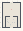

# LSystems_Grammar_Lab

Authored dimensions: {"width": 19, "depth": 26, "max_height": 5}

Source plan only: columns=x, rows=z. Red dots are manuscript/role primary anchors; blue dots are other placed objects; green crosses are utilities. Numbers refer to A rows below. Dark blue is source 0, cream lower structure, grey source wall-height threshold, ochre platforms. Museum overrides can change the built interpretation. Dots show anchors, not footprints or a proven route.

Map: [commons/maps/LSystems_Grammar_Lab/map_data.json](https://github.com/palletorsson/AdaResearch/blob/palm-scanner-door-entry/commons/maps/LSystems_Grammar_Lab/map_data.json)

Text: [commons/maps/LSystems_Grammar_Lab/final.md](https://github.com/palletorsson/AdaResearch/blob/palm-scanner-door-entry/commons/maps/LSystems_Grammar_Lab/final.md)

| Instance | x,z | Raw token | Recorded role | Registry / scene |
|---|---|---|---|---|
| A1 | 9,7 | `lsystem_editor:180#lesson:true#grammar:koch#depth:1` | primary | [commons/artifacts/registry/commons_artifacts.json](https://github.com/palletorsson/AdaResearch/blob/palm-scanner-door-entry/commons/artifacts/registry/commons_artifacts.json) → [commons/artifacts/lsystem_editor/lsystem_editor.tscn](https://github.com/palletorsson/AdaResearch/blob/palm-scanner-door-entry/commons/artifacts/lsystem_editor/lsystem_editor.tscn) |
| A2 | 5,17 | `mesh_grammar_lsystem_tree` | secondary | [commons/artifacts/registry/mesh_grammar.json](https://github.com/palletorsson/AdaResearch/blob/palm-scanner-door-entry/commons/artifacts/registry/mesh_grammar.json) → [commons/mesh_grammar/mesh_grammar_node.tscn](https://github.com/palletorsson/AdaResearch/blob/palm-scanner-door-entry/commons/mesh_grammar/mesh_grammar_node.tscn) |
| A3 | 11,17 | `science_screen:180:1.5:0.4#mode:trace` | secondary | [commons/artifacts/registry/shaders.json](https://github.com/palletorsson/AdaResearch/blob/palm-scanner-door-entry/commons/artifacts/registry/shaders.json) → [commons/artifacts/science_screen/science_screen.tscn](https://github.com/palletorsson/AdaResearch/blob/palm-scanner-door-entry/commons/artifacts/science_screen/science_screen.tscn) |
| A4 | 5,19 | `grammar_provenance` | secondary | [commons/artifacts/registry/lsystems.json](https://github.com/palletorsson/AdaResearch/blob/palm-scanner-door-entry/commons/artifacts/registry/lsystems.json) → [commons/artifacts/grammar_provenance/grammar_provenance.tscn](https://github.com/palletorsson/AdaResearch/blob/palm-scanner-door-entry/commons/artifacts/grammar_provenance/grammar_provenance.tscn) |
| A5 | 6,20 | `lsystem_tree` | secondary | [commons/artifacts/registry/lsystems.json](https://github.com/palletorsson/AdaResearch/blob/palm-scanner-door-entry/commons/artifacts/registry/lsystems.json) → [commons/artifacts/lsystem_tree/lsystem_tree.tscn](https://github.com/palletorsson/AdaResearch/blob/palm-scanner-door-entry/commons/artifacts/lsystem_tree/lsystem_tree.tscn) |
| A6 | 10,20 | `fractal_lsystem_string` | secondary | [commons/artifacts/registry/lsystems.json](https://github.com/palletorsson/AdaResearch/blob/palm-scanner-door-entry/commons/artifacts/registry/lsystems.json) → [commons/artifacts/fractal_lsystem_string/fractal_lsystem_string.tscn](https://github.com/palletorsson/AdaResearch/blob/palm-scanner-door-entry/commons/artifacts/fractal_lsystem_string/fractal_lsystem_string.tscn) |
| A7 | 12,20 | `city_bench` | secondary | [commons/artifacts/registry/lsystems.json](https://github.com/palletorsson/AdaResearch/blob/palm-scanner-door-entry/commons/artifacts/registry/lsystems.json) → [commons/artifacts/city_bench/city_bench.tscn](https://github.com/palletorsson/AdaResearch/blob/palm-scanner-door-entry/commons/artifacts/city_bench/city_bench.tscn) |
| A8 | 8,22 | `dark_sphere` | decoration | [commons/artifacts/registry/lsystems.json](https://github.com/palletorsson/AdaResearch/blob/palm-scanner-door-entry/commons/artifacts/registry/lsystems.json) → [commons/artifacts/dark_sphere/dark_sphere.tscn](https://github.com/palletorsson/AdaResearch/blob/palm-scanner-door-entry/commons/artifacts/dark_sphere/dark_sphere.tscn) |

Utilities are listed with exact coordinates and raw tokens in space.json. Read map_info.museum and utility_definitions before inferring pits, entrances, movement or collision.
