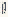

# ML_Sequence_Memory

Authored dimensions: {"width": 4, "depth": 12, "max_height": 3}

Source plan only: columns=x, rows=z. Red dots are manuscript/role primary anchors; blue dots are other placed objects; green crosses are utilities. Numbers refer to A rows below. Dark blue is source 0, cream lower structure, grey source wall-height threshold, ochre platforms. Museum overrides can change the built interpretation. Dots show anchors, not footprints or a proven route.

Map: [commons/maps/ML_Sequence_Memory/map_data.json](https://github.com/palletorsson/AdaResearch/blob/palm-scanner-door-entry/commons/maps/ML_Sequence_Memory/map_data.json)

Text: [commons/maps/ML_Sequence_Memory/final.md](https://github.com/palletorsson/AdaResearch/blob/palm-scanner-door-entry/commons/maps/ML_Sequence_Memory/final.md)

| Instance | x,z | Raw token | Recorded role | Registry / scene |
|---|---|---|---|---|
| A1 | 1,5 | `transformers_vr:0:0:0.6` | secondary | [commons/artifacts/registry/machinelearning.json](https://github.com/palletorsson/AdaResearch/blob/palm-scanner-door-entry/commons/artifacts/registry/machinelearning.json) → [algorithms/machinelearning/transformers/Transformers_VR.tscn](https://github.com/palletorsson/AdaResearch/blob/palm-scanner-door-entry/algorithms/machinelearning/transformers/Transformers_VR.tscn) |
| A2 | 0,8 | `lstms_vr:0:0:0.6` | primary | [commons/artifacts/registry/machinelearning.json](https://github.com/palletorsson/AdaResearch/blob/palm-scanner-door-entry/commons/artifacts/registry/machinelearning.json) → [algorithms/machinelearning/LSTMs/LSTMs_VR.tscn](https://github.com/palletorsson/AdaResearch/blob/palm-scanner-door-entry/algorithms/machinelearning/LSTMs/LSTMs_VR.tscn) |

Utilities are listed with exact coordinates and raw tokens in space.json. Read map_info.museum and utility_definitions before inferring pits, entrances, movement or collision.
