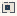

# Noise_One

Authored dimensions: {"width": 13, "depth": 11, "max_height": 5}

Source plan only: columns=x, rows=z. Red dots are manuscript/role primary anchors; blue dots are other placed objects; green crosses are utilities. Numbers refer to A rows below. Dark blue is source 0, cream lower structure, grey source wall-height threshold, ochre platforms. Museum overrides can change the built interpretation. Dots show anchors, not footprints or a proven route.

Map: [commons/maps/Noise_One/map_data.json](https://github.com/palletorsson/AdaResearch/blob/palm-scanner-door-entry/commons/maps/Noise_One/map_data.json)

Text: [commons/maps/Noise_One/final.md](https://github.com/palletorsson/AdaResearch/blob/palm-scanner-door-entry/commons/maps/Noise_One/final.md)

| Instance | x,z | Raw token | Recorded role | Registry / scene |
|---|---|---|---|---|
| A1 | 5,2 | `noisetorus:180#stand:pair` | primary | [commons/artifacts/registry/randomness.json](https://github.com/palletorsson/AdaResearch/blob/palm-scanner-door-entry/commons/artifacts/registry/randomness.json) → [algorithms/randomness/noisetorus/noisetorus.tscn](https://github.com/palletorsson/AdaResearch/blob/palm-scanner-door-entry/algorithms/randomness/noisetorus/noisetorus.tscn) |
| A2 | 5,5 | `noiselayers:0:0.8#stand:basin` | primary | [commons/artifacts/registry/randomness.json](https://github.com/palletorsson/AdaResearch/blob/palm-scanner-door-entry/commons/artifacts/registry/randomness.json) → [algorithms/randomness/noiselayers/noiselayers.tscn](https://github.com/palletorsson/AdaResearch/blob/palm-scanner-door-entry/algorithms/randomness/noiselayers/noiselayers.tscn) |
| A3 | 8,8 | `dark_sphere` | primary | [commons/artifacts/registry/lsystems.json](https://github.com/palletorsson/AdaResearch/blob/palm-scanner-door-entry/commons/artifacts/registry/lsystems.json) → [commons/artifacts/dark_sphere/dark_sphere.tscn](https://github.com/palletorsson/AdaResearch/blob/palm-scanner-door-entry/commons/artifacts/dark_sphere/dark_sphere.tscn) |

Utilities are listed with exact coordinates and raw tokens in space.json. Read map_info.museum and utility_definitions before inferring pits, entrances, movement or collision.
