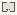

# Random_Noise_Types

Authored dimensions: {"width": 13, "depth": 10, "max_height": 6}

Source plan only: columns=x, rows=z. Red dots are manuscript/role primary anchors; blue dots are other placed objects; green crosses are utilities. Numbers refer to A rows below. Dark blue is source 0, cream lower structure, grey source wall-height threshold, ochre platforms. Museum overrides can change the built interpretation. Dots show anchors, not footprints or a proven route.

Map: [commons/maps/Random_Noise_Types/map_data.json](https://github.com/palletorsson/AdaResearch/blob/palm-scanner-door-entry/commons/maps/Random_Noise_Types/map_data.json)

Text: [commons/maps/Random_Noise_Types/final.md](https://github.com/palletorsson/AdaResearch/blob/palm-scanner-door-entry/commons/maps/Random_Noise_Types/final.md)

| Instance | x,z | Raw token | Recorded role | Registry / scene |
|---|---|---|---|---|
| A1 | 3,2 | `randompoint:90:1.25:1#stand:bounds#size:0.6` | primary | [commons/artifacts/registry/randomness.json](https://github.com/palletorsson/AdaResearch/blob/palm-scanner-door-entry/commons/artifacts/registry/randomness.json) → [algorithms/randomness/randompoint/randompoint.tscn](https://github.com/palletorsson/AdaResearch/blob/palm-scanner-door-entry/algorithms/randomness/randompoint/randompoint.tscn) |
| A2 | 10,3 | `randompoints:180#stand:compare#count:24#size:0.9` | primary | [commons/artifacts/registry/randomness.json](https://github.com/palletorsson/AdaResearch/blob/palm-scanner-door-entry/commons/artifacts/registry/randomness.json) → [algorithms/randomness/randompoints/randompoints.tscn](https://github.com/palletorsson/AdaResearch/blob/palm-scanner-door-entry/algorithms/randomness/randompoints/randompoints.tscn) |
| A3 | 4,4 | `WhiteNoiseGallery:180:-0.500:0.050#stand:gallery#seed:31415` | primary | [commons/artifacts/registry/randomness.json](https://github.com/palletorsson/AdaResearch/blob/palm-scanner-door-entry/commons/artifacts/registry/randomness.json) → [algorithms/randomness/whitenoise/WhiteNoiseGallery.tscn](https://github.com/palletorsson/AdaResearch/blob/palm-scanner-door-entry/algorithms/randomness/whitenoise/WhiteNoiseGallery.tscn) |
| A4 | 6,4 | `NoiseColors3D:180:-0.500:0.100#stand:gallery#seed:31415` | primary | [commons/artifacts/registry/randomness.json](https://github.com/palletorsson/AdaResearch/blob/palm-scanner-door-entry/commons/artifacts/registry/randomness.json) → [algorithms/randomness/whitenoise/NoiseColors3D.tscn](https://github.com/palletorsson/AdaResearch/blob/palm-scanner-door-entry/algorithms/randomness/whitenoise/NoiseColors3D.tscn) |

Utilities are listed with exact coordinates and raw tokens in space.json. Read map_info.museum and utility_definitions before inferring pits, entrances, movement or collision.
