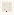

# SpeculativeComputation_Situated_Computation

Authored dimensions: {"width": 10, "depth": 10, "max_height": 3}

Source plan only: columns=x, rows=z. Red dots are manuscript/role primary anchors; blue dots are other placed objects; green crosses are utilities. Numbers refer to A rows below. Dark blue is source 0, cream lower structure, grey source wall-height threshold, ochre platforms. Museum overrides can change the built interpretation. Dots show anchors, not footprints or a proven route.

Map: [commons/maps/SpeculativeComputation_Situated_Computation/map_data.json](https://github.com/palletorsson/AdaResearch/blob/palm-scanner-door-entry/commons/maps/SpeculativeComputation_Situated_Computation/map_data.json)

Text: [commons/maps/SpeculativeComputation_Situated_Computation/final.md](https://github.com/palletorsson/AdaResearch/blob/palm-scanner-door-entry/commons/maps/SpeculativeComputation_Situated_Computation/final.md)

| Instance | x,z | Raw token | Recorded role | Registry / scene |
|---|---|---|---|---|
| A1 | 2,2 | `situated_readout:0:0.3#verdict:NW` | primary | [commons/artifacts/registry/algorithms_misc.json](https://github.com/palletorsson/AdaResearch/blob/palm-scanner-door-entry/commons/artifacts/registry/algorithms_misc.json) → [commons/artifacts/situated_readout/situated_readout.tscn](https://github.com/palletorsson/AdaResearch/blob/palm-scanner-door-entry/commons/artifacts/situated_readout/situated_readout.tscn) |
| A2 | 7,2 | `situated_readout:0:0.3#verdict:NE` | primary | [commons/artifacts/registry/algorithms_misc.json](https://github.com/palletorsson/AdaResearch/blob/palm-scanner-door-entry/commons/artifacts/registry/algorithms_misc.json) → [commons/artifacts/situated_readout/situated_readout.tscn](https://github.com/palletorsson/AdaResearch/blob/palm-scanner-door-entry/commons/artifacts/situated_readout/situated_readout.tscn) |
| A3 | 7,5 | `head_crab:180#detection:14` | secondary | [commons/artifacts/registry/hazards.json](https://github.com/palletorsson/AdaResearch/blob/palm-scanner-door-entry/commons/artifacts/registry/hazards.json) → [commons/hazards/head_crab/head_crab.tscn](https://github.com/palletorsson/AdaResearch/blob/palm-scanner-door-entry/commons/hazards/head_crab/head_crab.tscn) |
| A4 | 2,7 | `situated_readout:0:0.3#verdict:SW` | primary | [commons/artifacts/registry/algorithms_misc.json](https://github.com/palletorsson/AdaResearch/blob/palm-scanner-door-entry/commons/artifacts/registry/algorithms_misc.json) → [commons/artifacts/situated_readout/situated_readout.tscn](https://github.com/palletorsson/AdaResearch/blob/palm-scanner-door-entry/commons/artifacts/situated_readout/situated_readout.tscn) |
| A5 | 7,7 | `situated_readout:0:0.3#verdict:SE` | primary | [commons/artifacts/registry/algorithms_misc.json](https://github.com/palletorsson/AdaResearch/blob/palm-scanner-door-entry/commons/artifacts/registry/algorithms_misc.json) → [commons/artifacts/situated_readout/situated_readout.tscn](https://github.com/palletorsson/AdaResearch/blob/palm-scanner-door-entry/commons/artifacts/situated_readout/situated_readout.tscn) |

Utilities are listed with exact coordinates and raw tokens in space.json. Read map_info.museum and utility_definitions before inferring pits, entrances, movement or collision.
