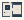

# Point_Line_Grid

Authored dimensions: {"depth": 15.0, "max_height": 5.0, "width": 20.0}

Source plan only: columns=x, rows=z. Red dots are manuscript/role primary anchors; blue dots are other placed objects; green crosses are utilities. Numbers refer to A rows below. Dark blue is source 0, cream lower structure, grey source wall-height threshold, ochre platforms. Museum overrides can change the built interpretation. Dots show anchors, not footprints or a proven route.

Map: [commons/maps/Point_Line_Grid/map_data.json](https://github.com/palletorsson/AdaResearch/blob/palm-scanner-door-entry/commons/maps/Point_Line_Grid/map_data.json)

Text: [commons/maps/Point_Line_Grid/final.md](https://github.com/palletorsson/AdaResearch/blob/palm-scanner-door-entry/commons/maps/Point_Line_Grid/final.md)

| Instance | x,z | Raw token | Recorded role | Registry / scene |
|---|---|---|---|---|
| A1 | 9,1 | `player_trace:0:0.5#seam_grid:1.0#show_discarded:1` | {'role': 'primary', 'group': 'kept-and-discarded-position'} | [commons/artifacts/registry/primitives.json](https://github.com/palletorsson/AdaResearch/blob/palm-scanner-door-entry/commons/artifacts/registry/primitives.json) → [commons/primitives/point/player_trace.tscn](https://github.com/palletorsson/AdaResearch/blob/palm-scanner-door-entry/commons/primitives/point/player_trace.tscn) |
| A2 | 5,5 | `grid_lines:0:0#plinth:0#rotation_speed:0#panel:1` | primary | [commons/artifacts/registry/primitives.json](https://github.com/palletorsson/AdaResearch/blob/palm-scanner-door-entry/commons/artifacts/registry/primitives.json) → [commons/primitives/line/grid_lines.tscn](https://github.com/palletorsson/AdaResearch/blob/palm-scanner-door-entry/commons/primitives/line/grid_lines.tscn) |
| A3 | 15,7 | `plan_vitrine:0:0` | primary | [commons/artifacts/registry/plan_vitrine.json](https://github.com/palletorsson/AdaResearch/blob/palm-scanner-door-entry/commons/artifacts/registry/plan_vitrine.json) → [commons/artifacts/plan_vitrine/plan_vitrine.tscn](https://github.com/palletorsson/AdaResearch/blob/palm-scanner-door-entry/commons/artifacts/plan_vitrine/plan_vitrine.tscn) |
| A4 | 3,10 | `grab_sphere_point_snap:0:0#offset:0.00,0.70,0.00` | {'role': 'primary', 'group': 'kept-and-discarded-position'} | [commons/artifacts/registry/primitives.json](https://github.com/palletorsson/AdaResearch/blob/palm-scanner-door-entry/commons/artifacts/registry/primitives.json) → [commons/primitives/point/grab_sphere_point_snap.tscn](https://github.com/palletorsson/AdaResearch/blob/palm-scanner-door-entry/commons/primitives/point/grab_sphere_point_snap.tscn) |
| A5 | 5,10 | `floating_sphere_field:0:0#bounds:5,3,8` | secondary | [commons/artifacts/registry/primitives.json](https://github.com/palletorsson/AdaResearch/blob/palm-scanner-door-entry/commons/artifacts/registry/primitives.json) → [commons/primitives/sphere_field/floating_sphere_field.tscn](https://github.com/palletorsson/AdaResearch/blob/palm-scanner-door-entry/commons/primitives/sphere_field/floating_sphere_field.tscn) |
| A6 | 2,13 | `modulor_man_demo#measure:scale` | secondary | [commons/artifacts/registry/wavefunctions.json](https://github.com/palletorsson/AdaResearch/blob/palm-scanner-door-entry/commons/artifacts/registry/wavefunctions.json) → [algorithms/wavefunctions/line_builder_3d/modulor_man_demo.tscn](https://github.com/palletorsson/AdaResearch/blob/palm-scanner-door-entry/algorithms/wavefunctions/line_builder_3d/modulor_man_demo.tscn) |
| A7 | 7,13 | `room_grammar:0:0#offset:0.00,0.30,0.00` | secondary | [commons/artifacts/registry/procgen_extra.json](https://github.com/palletorsson/AdaResearch/blob/palm-scanner-door-entry/commons/artifacts/registry/procgen_extra.json) → [commons/artifacts/room_grammar/room_grammar.tscn](https://github.com/palletorsson/AdaResearch/blob/palm-scanner-door-entry/commons/artifacts/room_grammar/room_grammar.tscn) |

Utilities are listed with exact coordinates and raw tokens in space.json. Read map_info.museum and utility_definitions before inferring pits, entrances, movement or collision.
