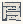

# Point_Lines

Authored dimensions: {"depth": 19.0, "max_height": 5.0, "width": 19.0}

Source plan only: columns=x, rows=z. Red dots are manuscript/role primary anchors; blue dots are other placed objects; green crosses are utilities. Numbers refer to A rows below. Dark blue is source 0, cream lower structure, grey source wall-height threshold, ochre platforms. Museum overrides can change the built interpretation. Dots show anchors, not footprints or a proven route.

Map: [commons/maps/Point_Lines/map_data.json](https://github.com/palletorsson/AdaResearch/blob/palm-scanner-door-entry/commons/maps/Point_Lines/map_data.json)

Text: [commons/maps/Point_Lines/final.md](https://github.com/palletorsson/AdaResearch/blob/palm-scanner-door-entry/commons/maps/Point_Lines/final.md)

| Instance | x,z | Raw token | Recorded role | Registry / scene |
|---|---|---|---|---|
| A1 | 2,0 | `player_trace:0:0#plinth:0#pin:1` | {'role': 'primary', 'group': 'body-and-record'} | [commons/artifacts/registry/primitives.json](https://github.com/palletorsson/AdaResearch/blob/palm-scanner-door-entry/commons/artifacts/registry/primitives.json) → [commons/primitives/point/player_trace.tscn](https://github.com/palletorsson/AdaResearch/blob/palm-scanner-door-entry/commons/primitives/point/player_trace.tscn) |
| A2 | 11,1 | `line_proof_pair:0:0#plinth:0#pin:1` | secondary | [commons/artifacts/registry/line_proof_pair.json](https://github.com/palletorsson/AdaResearch/blob/palm-scanner-door-entry/commons/artifacts/registry/line_proof_pair.json) → [commons/artifacts/line_proof_pair/line_proof_pair.tscn](https://github.com/palletorsson/AdaResearch/blob/palm-scanner-door-entry/commons/artifacts/line_proof_pair/line_proof_pair.tscn) |
| A3 | 5,2 | `line_demo:90:0#plinth:0` | {'role': 'primary', 'group': 'relation-and-instruction'} | [commons/artifacts/registry/primitives.json](https://github.com/palletorsson/AdaResearch/blob/palm-scanner-door-entry/commons/artifacts/registry/primitives.json) → [commons/primitives/snappoint/demos/line_demo.tscn](https://github.com/palletorsson/AdaResearch/blob/palm-scanner-door-entry/commons/primitives/snappoint/demos/line_demo.tscn) |
| A4 | 7,2 | `do_not_cross_barrier:75:0` | {'role': 'primary', 'group': 'relation-and-instruction'} | [commons/artifacts/registry/do_not_cross_barrier.json](https://github.com/palletorsson/AdaResearch/blob/palm-scanner-door-entry/commons/artifacts/registry/do_not_cross_barrier.json) → [commons/artifacts/do_not_cross_barrier/do_not_cross_barrier.tscn](https://github.com/palletorsson/AdaResearch/blob/palm-scanner-door-entry/commons/artifacts/do_not_cross_barrier/do_not_cross_barrier.tscn) |
| A5 | 16,2 | `line:90:1.5#plinth:1.12,micropod` | {'role': 'primary', 'group': 'relation-and-instruction'} | [commons/artifacts/registry/primitives.json](https://github.com/palletorsson/AdaResearch/blob/palm-scanner-door-entry/commons/artifacts/registry/primitives.json) → [commons/primitives/line/line.tscn](https://github.com/palletorsson/AdaResearch/blob/palm-scanner-door-entry/commons/primitives/line/line.tscn) |
| A6 | 17,2 | `scale_lines:90:1#rungs:body` | secondary | [commons/artifacts/registry/primitives.json](https://github.com/palletorsson/AdaResearch/blob/palm-scanner-door-entry/commons/artifacts/registry/primitives.json) → [commons/primitives/line/scale_lines.tscn](https://github.com/palletorsson/AdaResearch/blob/palm-scanner-door-entry/commons/primitives/line/scale_lines.tscn) |
| A7 | 8,4 | `laser_measure:280:1.2#burns:1` | secondary | [commons/artifacts/registry/primitives.json](https://github.com/palletorsson/AdaResearch/blob/palm-scanner-door-entry/commons/artifacts/registry/primitives.json) → [commons/primitives/laser_measure/grab_laser_measure.tscn](https://github.com/palletorsson/AdaResearch/blob/palm-scanner-door-entry/commons/primitives/laser_measure/grab_laser_measure.tscn) |
| A8 | 15,4 | `redline:0:0:1.4` | secondary | [commons/artifacts/registry/primitives.json](https://github.com/palletorsson/AdaResearch/blob/palm-scanner-door-entry/commons/artifacts/registry/primitives.json) → [commons/primitives/redline/redline.tscn](https://github.com/palletorsson/AdaResearch/blob/palm-scanner-door-entry/commons/primitives/redline/redline.tscn) |
| A9 | 1,5 | `lightrod` | secondary | [commons/artifacts/registry/primitives.json](https://github.com/palletorsson/AdaResearch/blob/palm-scanner-door-entry/commons/artifacts/registry/primitives.json) → [commons/primitives/line/light_rod.tscn](https://github.com/palletorsson/AdaResearch/blob/palm-scanner-door-entry/commons/primitives/line/light_rod.tscn) |
| A10 | 2,5 | `lightrod` | secondary | [commons/artifacts/registry/primitives.json](https://github.com/palletorsson/AdaResearch/blob/palm-scanner-door-entry/commons/artifacts/registry/primitives.json) → [commons/primitives/line/light_rod.tscn](https://github.com/palletorsson/AdaResearch/blob/palm-scanner-door-entry/commons/primitives/line/light_rod.tscn) |
| A11 | 5,5 | `modulor_man_demo:0:0#plinth:1.0#offset:0,-0.5,0` | secondary | [commons/artifacts/registry/wavefunctions.json](https://github.com/palletorsson/AdaResearch/blob/palm-scanner-door-entry/commons/artifacts/registry/wavefunctions.json) → [algorithms/wavefunctions/line_builder_3d/modulor_man_demo.tscn](https://github.com/palletorsson/AdaResearch/blob/palm-scanner-door-entry/algorithms/wavefunctions/line_builder_3d/modulor_man_demo.tscn) |
| A12 | 11,5 | `line_sledgehammer:0:3` | secondary | [commons/artifacts/registry/primitives.json](https://github.com/palletorsson/AdaResearch/blob/palm-scanner-door-entry/commons/artifacts/registry/primitives.json) → [commons/artifacts/line_sledgehammer/line_sledgehammer.tscn](https://github.com/palletorsson/AdaResearch/blob/palm-scanner-door-entry/commons/artifacts/line_sledgehammer/line_sledgehammer.tscn) |
| A13 | 12,5 | `parallel_line_puzzle:180:1.2#plinth:0.66#offset:0.00,0.60,0.00` | secondary | [commons/artifacts/registry/primitives.json](https://github.com/palletorsson/AdaResearch/blob/palm-scanner-door-entry/commons/artifacts/registry/primitives.json) → [commons/primitives/line/puzzles/parallel_line_puzzle.tscn](https://github.com/palletorsson/AdaResearch/blob/palm-scanner-door-entry/commons/primitives/line/puzzles/parallel_line_puzzle.tscn) |
| A14 | 16,5 | `sketch_monitor:270:1.0` | secondary | [commons/artifacts/registry/primitives.json](https://github.com/palletorsson/AdaResearch/blob/palm-scanner-door-entry/commons/artifacts/registry/primitives.json) → [commons/artifacts/sketch_monitor/sketch_monitor.tscn](https://github.com/palletorsson/AdaResearch/blob/palm-scanner-door-entry/commons/artifacts/sketch_monitor/sketch_monitor.tscn) |
| A15 | 1,6 | `lightrod` | secondary | [commons/artifacts/registry/primitives.json](https://github.com/palletorsson/AdaResearch/blob/palm-scanner-door-entry/commons/artifacts/registry/primitives.json) → [commons/primitives/line/light_rod.tscn](https://github.com/palletorsson/AdaResearch/blob/palm-scanner-door-entry/commons/primitives/line/light_rod.tscn) |
| A16 | 8,6 | `laser_measure:135:1#burns:1` | secondary | [commons/artifacts/registry/primitives.json](https://github.com/palletorsson/AdaResearch/blob/palm-scanner-door-entry/commons/artifacts/registry/primitives.json) → [commons/primitives/laser_measure/grab_laser_measure.tscn](https://github.com/palletorsson/AdaResearch/blob/palm-scanner-door-entry/commons/primitives/laser_measure/grab_laser_measure.tscn) |
| A17 | 15,6 | `grabbable_line:0:1#plinth:1.13,micropod#offset:0.00,0.05,0.00` | secondary | [commons/artifacts/registry/primitives.json](https://github.com/palletorsson/AdaResearch/blob/palm-scanner-door-entry/commons/artifacts/registry/primitives.json) → [commons/primitives/line/grabbable_line.tscn](https://github.com/palletorsson/AdaResearch/blob/palm-scanner-door-entry/commons/primitives/line/grabbable_line.tscn) |
| A18 | 16,6 | `street_talker:180:0` | secondary | [commons/artifacts/registry/primitives.json](https://github.com/palletorsson/AdaResearch/blob/palm-scanner-door-entry/commons/artifacts/registry/primitives.json) → [commons/artifacts/street_talker/street_talker.tscn](https://github.com/palletorsson/AdaResearch/blob/palm-scanner-door-entry/commons/artifacts/street_talker/street_talker.tscn) |
| A19 | 17,6 | `parallel_lines` | secondary | [commons/artifacts/registry/primitives.json](https://github.com/palletorsson/AdaResearch/blob/palm-scanner-door-entry/commons/artifacts/registry/primitives.json) → [commons/primitives/line/parallel_lines.tscn](https://github.com/palletorsson/AdaResearch/blob/palm-scanner-door-entry/commons/primitives/line/parallel_lines.tscn) |
| A20 | 1,7 | `lightrod` | secondary | [commons/artifacts/registry/primitives.json](https://github.com/palletorsson/AdaResearch/blob/palm-scanner-door-entry/commons/artifacts/registry/primitives.json) → [commons/primitives/line/light_rod.tscn](https://github.com/palletorsson/AdaResearch/blob/palm-scanner-door-entry/commons/primitives/line/light_rod.tscn) |
| A21 | 9,7 | `walk_this_line_marking:0:1.1:2#plinth:0#pin:1#paint_color:000000` | {'role': 'primary', 'group': 'body-and-record'} | [commons/artifacts/registry/walk_this_line_marking.json](https://github.com/palletorsson/AdaResearch/blob/palm-scanner-door-entry/commons/artifacts/registry/walk_this_line_marking.json) → [commons/artifacts/walk_this_line_marking/walk_this_line_marking.tscn](https://github.com/palletorsson/AdaResearch/blob/palm-scanner-door-entry/commons/artifacts/walk_this_line_marking/walk_this_line_marking.tscn) |
| A22 | 15,7 | `laser_exploding_sphere:0:2#plinth:1.05,micropod#offset:0.00,0.05,0.00` | secondary | [commons/artifacts/registry/furniture.json](https://github.com/palletorsson/AdaResearch/blob/palm-scanner-door-entry/commons/artifacts/registry/furniture.json) → [commons/primitives/spheres/laser_exploding_sphere.tscn](https://github.com/palletorsson/AdaResearch/blob/palm-scanner-door-entry/commons/primitives/spheres/laser_exploding_sphere.tscn) |
| A23 | 16,7 | `line_collection` | secondary | [commons/artifacts/registry/primitives.json](https://github.com/palletorsson/AdaResearch/blob/palm-scanner-door-entry/commons/artifacts/registry/primitives.json) → [commons/primitives/line/line_collection.tscn](https://github.com/palletorsson/AdaResearch/blob/palm-scanner-door-entry/commons/primitives/line/line_collection.tscn) |
| A24 | 17,7 | `axis_line` | secondary | [commons/artifacts/registry/primitives.json](https://github.com/palletorsson/AdaResearch/blob/palm-scanner-door-entry/commons/artifacts/registry/primitives.json) → [commons/artifacts/axis_line/axis_line.tscn](https://github.com/palletorsson/AdaResearch/blob/palm-scanner-door-entry/commons/artifacts/axis_line/axis_line.tscn) |
| A25 | 1,8 | `lightrod` | secondary | [commons/artifacts/registry/primitives.json](https://github.com/palletorsson/AdaResearch/blob/palm-scanner-door-entry/commons/artifacts/registry/primitives.json) → [commons/primitives/line/light_rod.tscn](https://github.com/palletorsson/AdaResearch/blob/palm-scanner-door-entry/commons/primitives/line/light_rod.tscn) |
| A26 | 15,8 | `line_collection` | secondary | [commons/artifacts/registry/primitives.json](https://github.com/palletorsson/AdaResearch/blob/palm-scanner-door-entry/commons/artifacts/registry/primitives.json) → [commons/primitives/line/line_collection.tscn](https://github.com/palletorsson/AdaResearch/blob/palm-scanner-door-entry/commons/primitives/line/line_collection.tscn) |
| A27 | 16,8 | `laser_measure:0:1#burns:1` | secondary | [commons/artifacts/registry/primitives.json](https://github.com/palletorsson/AdaResearch/blob/palm-scanner-door-entry/commons/artifacts/registry/primitives.json) → [commons/primitives/laser_measure/grab_laser_measure.tscn](https://github.com/palletorsson/AdaResearch/blob/palm-scanner-door-entry/commons/primitives/laser_measure/grab_laser_measure.tscn) |
| A28 | 17,8 | `laser_exploding_sphere:0:2#plinth:1.05,micropod#offset:0.00,0.10,0.00` | secondary | [commons/artifacts/registry/furniture.json](https://github.com/palletorsson/AdaResearch/blob/palm-scanner-door-entry/commons/artifacts/registry/furniture.json) → [commons/primitives/spheres/laser_exploding_sphere.tscn](https://github.com/palletorsson/AdaResearch/blob/palm-scanner-door-entry/commons/primitives/spheres/laser_exploding_sphere.tscn) |
| A29 | 1,9 | `lightrod` | secondary | [commons/artifacts/registry/primitives.json](https://github.com/palletorsson/AdaResearch/blob/palm-scanner-door-entry/commons/artifacts/registry/primitives.json) → [commons/primitives/line/light_rod.tscn](https://github.com/palletorsson/AdaResearch/blob/palm-scanner-door-entry/commons/primitives/line/light_rod.tscn) |
| A30 | 1,10 | `lightrod:90:0` | secondary | [commons/artifacts/registry/primitives.json](https://github.com/palletorsson/AdaResearch/blob/palm-scanner-door-entry/commons/artifacts/registry/primitives.json) → [commons/primitives/line/light_rod.tscn](https://github.com/palletorsson/AdaResearch/blob/palm-scanner-door-entry/commons/primitives/line/light_rod.tscn) |
| A31 | 17,10 | `wall_health_station:270` | secondary | [commons/artifacts/registry/primitives.json](https://github.com/palletorsson/AdaResearch/blob/palm-scanner-door-entry/commons/artifacts/registry/primitives.json) → [commons/artifacts/wall_health_station/wall_health_station.tscn](https://github.com/palletorsson/AdaResearch/blob/palm-scanner-door-entry/commons/artifacts/wall_health_station/wall_health_station.tscn) |
| A32 | 1,11 | `line:0:1#plinth:1.12,micropod#offset:0.00,0.05,0.00` | {'role': 'primary', 'group': 'relation-and-instruction'} | [commons/artifacts/registry/primitives.json](https://github.com/palletorsson/AdaResearch/blob/palm-scanner-door-entry/commons/artifacts/registry/primitives.json) → [commons/primitives/line/line.tscn](https://github.com/palletorsson/AdaResearch/blob/palm-scanner-door-entry/commons/primitives/line/line.tscn) |
| A33 | 6,11 | `axis_line:0:0:2#orientation:vertical` | secondary | [commons/artifacts/registry/primitives.json](https://github.com/palletorsson/AdaResearch/blob/palm-scanner-door-entry/commons/artifacts/registry/primitives.json) → [commons/artifacts/axis_line/axis_line.tscn](https://github.com/palletorsson/AdaResearch/blob/palm-scanner-door-entry/commons/artifacts/axis_line/axis_line.tscn) |
| A34 | 7,11 | `wall_abstract:0:1.6#work:cube_wire` | secondary | [commons/artifacts/registry/primitives.json](https://github.com/palletorsson/AdaResearch/blob/palm-scanner-door-entry/commons/artifacts/registry/primitives.json) → [commons/artifacts/wall_abstract/wall_abstract.tscn](https://github.com/palletorsson/AdaResearch/blob/palm-scanner-door-entry/commons/artifacts/wall_abstract/wall_abstract.tscn) |
| A35 | 8,11 | `axis_line:90:0:2#orientation:horizontal` | secondary | [commons/artifacts/registry/primitives.json](https://github.com/palletorsson/AdaResearch/blob/palm-scanner-door-entry/commons/artifacts/registry/primitives.json) → [commons/artifacts/axis_line/axis_line.tscn](https://github.com/palletorsson/AdaResearch/blob/palm-scanner-door-entry/commons/artifacts/axis_line/axis_line.tscn) |
| A36 | 9,11 | `wall_abstract:0:1.6#work:divide_diagonal` | secondary | [commons/artifacts/registry/primitives.json](https://github.com/palletorsson/AdaResearch/blob/palm-scanner-door-entry/commons/artifacts/registry/primitives.json) → [commons/artifacts/wall_abstract/wall_abstract.tscn](https://github.com/palletorsson/AdaResearch/blob/palm-scanner-door-entry/commons/artifacts/wall_abstract/wall_abstract.tscn) |
| A37 | 13,11 | `two_point_ruler:0:0#plinth:0#pin:1#block_base_y:0.75` | secondary | [commons/artifacts/registry/primitives.json](https://github.com/palletorsson/AdaResearch/blob/palm-scanner-door-entry/commons/artifacts/registry/primitives.json) → [commons/artifacts/two_point_ruler/two_point_ruler.tscn](https://github.com/palletorsson/AdaResearch/blob/palm-scanner-door-entry/commons/artifacts/two_point_ruler/two_point_ruler.tscn) |
| A38 | 1,12 | `lightrod:90:0` | secondary | [commons/artifacts/registry/primitives.json](https://github.com/palletorsson/AdaResearch/blob/palm-scanner-door-entry/commons/artifacts/registry/primitives.json) → [commons/primitives/line/light_rod.tscn](https://github.com/palletorsson/AdaResearch/blob/palm-scanner-door-entry/commons/primitives/line/light_rod.tscn) |
| A39 | 16,12 | `health_cross` | secondary | [commons/artifacts/registry/primitives.json](https://github.com/palletorsson/AdaResearch/blob/palm-scanner-door-entry/commons/artifacts/registry/primitives.json) → [commons/artifacts/health_cross/health_cross.tscn](https://github.com/palletorsson/AdaResearch/blob/palm-scanner-door-entry/commons/artifacts/health_cross/health_cross.tscn) |
| A40 | 1,13 | `lightrod` | secondary | [commons/artifacts/registry/primitives.json](https://github.com/palletorsson/AdaResearch/blob/palm-scanner-door-entry/commons/artifacts/registry/primitives.json) → [commons/primitives/line/light_rod.tscn](https://github.com/palletorsson/AdaResearch/blob/palm-scanner-door-entry/commons/primitives/line/light_rod.tscn) |
| A41 | 1,14 | `lightrod` | secondary | [commons/artifacts/registry/primitives.json](https://github.com/palletorsson/AdaResearch/blob/palm-scanner-door-entry/commons/artifacts/registry/primitives.json) → [commons/primitives/line/light_rod.tscn](https://github.com/palletorsson/AdaResearch/blob/palm-scanner-door-entry/commons/primitives/line/light_rod.tscn) |
| A42 | 5,14 | `perspective_lines` | secondary | [commons/artifacts/registry/primitives.json](https://github.com/palletorsson/AdaResearch/blob/palm-scanner-door-entry/commons/artifacts/registry/primitives.json) → [commons/primitives/line/perspective_lines.tscn](https://github.com/palletorsson/AdaResearch/blob/palm-scanner-door-entry/commons/primitives/line/perspective_lines.tscn) |
| A43 | 1,15 | `lightrod` | secondary | [commons/artifacts/registry/primitives.json](https://github.com/palletorsson/AdaResearch/blob/palm-scanner-door-entry/commons/artifacts/registry/primitives.json) → [commons/primitives/line/light_rod.tscn](https://github.com/palletorsson/AdaResearch/blob/palm-scanner-door-entry/commons/primitives/line/light_rod.tscn) |
| A44 | 5,15 | `perspective_lines#plinth:0.66` | secondary | [commons/artifacts/registry/primitives.json](https://github.com/palletorsson/AdaResearch/blob/palm-scanner-door-entry/commons/artifacts/registry/primitives.json) → [commons/primitives/line/perspective_lines.tscn](https://github.com/palletorsson/AdaResearch/blob/palm-scanner-door-entry/commons/primitives/line/perspective_lines.tscn) |
| A45 | 7,15 | `anamorphic_cross:90:0` | secondary | [commons/artifacts/registry/primitives.json](https://github.com/palletorsson/AdaResearch/blob/palm-scanner-door-entry/commons/artifacts/registry/primitives.json) → [commons/artifacts/anamorphic_cross/anamorphic_cross.tscn](https://github.com/palletorsson/AdaResearch/blob/palm-scanner-door-entry/commons/artifacts/anamorphic_cross/anamorphic_cross.tscn) |
| A46 | 10,15 | `axis_line:90:-1:4#orientation:diagonal_2` | secondary | [commons/artifacts/registry/primitives.json](https://github.com/palletorsson/AdaResearch/blob/palm-scanner-door-entry/commons/artifacts/registry/primitives.json) → [commons/artifacts/axis_line/axis_line.tscn](https://github.com/palletorsson/AdaResearch/blob/palm-scanner-door-entry/commons/artifacts/axis_line/axis_line.tscn) |
| A47 | 11,15 | `axis_line:90:0#orientation:diagonal` | secondary | [commons/artifacts/registry/primitives.json](https://github.com/palletorsson/AdaResearch/blob/palm-scanner-door-entry/commons/artifacts/registry/primitives.json) → [commons/artifacts/axis_line/axis_line.tscn](https://github.com/palletorsson/AdaResearch/blob/palm-scanner-door-entry/commons/artifacts/axis_line/axis_line.tscn) |
| A48 | 1,16 | `lightrod` | secondary | [commons/artifacts/registry/primitives.json](https://github.com/palletorsson/AdaResearch/blob/palm-scanner-door-entry/commons/artifacts/registry/primitives.json) → [commons/primitives/line/light_rod.tscn](https://github.com/palletorsson/AdaResearch/blob/palm-scanner-door-entry/commons/primitives/line/light_rod.tscn) |
| A49 | 5,16 | `perspective_lines#vanishing_points:one` | secondary | [commons/artifacts/registry/primitives.json](https://github.com/palletorsson/AdaResearch/blob/palm-scanner-door-entry/commons/artifacts/registry/primitives.json) → [commons/primitives/line/perspective_lines.tscn](https://github.com/palletorsson/AdaResearch/blob/palm-scanner-door-entry/commons/primitives/line/perspective_lines.tscn) |
| A50 | 16,16 | `line_space_workshop:180:0#plinth:0#pin:1` | secondary | [commons/artifacts/registry/primitives.json](https://github.com/palletorsson/AdaResearch/blob/palm-scanner-door-entry/commons/artifacts/registry/primitives.json) → [commons/artifacts/line_space_workshop/line_space_workshop.tscn](https://github.com/palletorsson/AdaResearch/blob/palm-scanner-door-entry/commons/artifacts/line_space_workshop/line_space_workshop.tscn) |
| A51 | 15,17 | `two_points_line` | secondary | [commons/artifacts/registry/primitives.json](https://github.com/palletorsson/AdaResearch/blob/palm-scanner-door-entry/commons/artifacts/registry/primitives.json) → [commons/primitives/two_points_line/two_points_line.tscn](https://github.com/palletorsson/AdaResearch/blob/palm-scanner-door-entry/commons/primitives/two_points_line/two_points_line.tscn) |
| A52 | 16,17 | `science_screen` | secondary | [commons/artifacts/registry/shaders.json](https://github.com/palletorsson/AdaResearch/blob/palm-scanner-door-entry/commons/artifacts/registry/shaders.json) → [commons/artifacts/science_screen/science_screen.tscn](https://github.com/palletorsson/AdaResearch/blob/palm-scanner-door-entry/commons/artifacts/science_screen/science_screen.tscn) |

Utilities are listed with exact coordinates and raw tokens in space.json. Read map_info.museum and utility_definitions before inferring pits, entrances, movement or collision.
