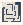

# Point_One

Authored dimensions: {"width": 19, "depth": 20, "max_height": 5}

Source plan only: columns=x, rows=z. Red dots are manuscript/role primary anchors; blue dots are other placed objects; green crosses are utilities. Numbers refer to A rows below. Dark blue is source 0, cream lower structure, grey source wall-height threshold, ochre platforms. Museum overrides can change the built interpretation. Dots show anchors, not footprints or a proven route.

Map: [commons/maps/Point_One/map_data.json](https://github.com/palletorsson/AdaResearch/blob/palm-scanner-door-entry/commons/maps/Point_One/map_data.json)

Text: [commons/maps/Point_One/final.md](https://github.com/palletorsson/AdaResearch/blob/palm-scanner-door-entry/commons/maps/Point_One/final.md)

| Instance | x,z | Raw token | Recorded role | Registry / scene |
|---|---|---|---|---|
| A1 | 0,0 | `origin:0:0#plinth:0#pin:1#offset:-0.50,2.00,-0.50` | primary | [commons/artifacts/registry/primitives.json](https://github.com/palletorsson/AdaResearch/blob/palm-scanner-door-entry/commons/artifacts/registry/primitives.json) → [commons/primitives/origin/origin.tscn](https://github.com/palletorsson/AdaResearch/blob/palm-scanner-door-entry/commons/primitives/origin/origin.tscn) |
| A2 | 10,0 | `the_invisible_point` | primary | [commons/artifacts/registry/primitives.json](https://github.com/palletorsson/AdaResearch/blob/palm-scanner-door-entry/commons/artifacts/registry/primitives.json) → [commons/artifacts/the_invisible_point/the_invisible_point.tscn](https://github.com/palletorsson/AdaResearch/blob/palm-scanner-door-entry/commons/artifacts/the_invisible_point/the_invisible_point.tscn) |
| A3 | 3,1 | `you_are_here:270:-0.5#offset:0.20,0.20,0.00` | secondary | [commons/artifacts/registry/primitives.json](https://github.com/palletorsson/AdaResearch/blob/palm-scanner-door-entry/commons/artifacts/registry/primitives.json) → [commons/primitives/you_are_here/you_are_here.tscn](https://github.com/palletorsson/AdaResearch/blob/palm-scanner-door-entry/commons/primitives/you_are_here/you_are_here.tscn) |
| A4 | 7,1 | `frame_counter_display:180:2:3` | primary | [commons/artifacts/registry/commons_artifacts.json](https://github.com/palletorsson/AdaResearch/blob/palm-scanner-door-entry/commons/artifacts/registry/commons_artifacts.json) → [commons/visualaid/frame_counter/frame_counter_display.tscn](https://github.com/palletorsson/AdaResearch/blob/palm-scanner-door-entry/commons/visualaid/frame_counter/frame_counter_display.tscn) |
| A5 | 12,1 | `code_evolution_screen:90:1.4:2#evolution_path:res://commons/maps/Point_One/evolution.json` | primary | [commons/artifacts/registry/primitives.json](https://github.com/palletorsson/AdaResearch/blob/palm-scanner-door-entry/commons/artifacts/registry/primitives.json) → [commons/artifacts/code_evolution_screen/code_evolution_screen.tscn](https://github.com/palletorsson/AdaResearch/blob/palm-scanner-door-entry/commons/artifacts/code_evolution_screen/code_evolution_screen.tscn) |
| A6 | 0,5 | `street_talker:0:0` | secondary | [commons/artifacts/registry/primitives.json](https://github.com/palletorsson/AdaResearch/blob/palm-scanner-door-entry/commons/artifacts/registry/primitives.json) → [commons/artifacts/street_talker/street_talker.tscn](https://github.com/palletorsson/AdaResearch/blob/palm-scanner-door-entry/commons/artifacts/street_talker/street_talker.tscn) |
| A7 | 8,5 | `interactive_point_origin_force:0:0#plinth:0.90#coordinate_id:point_one_main` | primary | [commons/artifacts/registry/primitives.json](https://github.com/palletorsson/AdaResearch/blob/palm-scanner-door-entry/commons/artifacts/registry/primitives.json) → [commons/primitives/point/interactive_point_origin_force.tscn](https://github.com/palletorsson/AdaResearch/blob/palm-scanner-door-entry/commons/primitives/point/interactive_point_origin_force.tscn) |
| A8 | 9,5 | `3t:90:0#text:POINT_ONE` | secondary | [commons/artifacts/registry/commons_artifacts.json](https://github.com/palletorsson/AdaResearch/blob/palm-scanner-door-entry/commons/artifacts/registry/commons_artifacts.json) → [commons/scenes/mapobjects/word_is.tscn](https://github.com/palletorsson/AdaResearch/blob/palm-scanner-door-entry/commons/scenes/mapobjects/word_is.tscn) |
| A9 | 14,5 | `comment_box` | decoration | [commons/artifacts/registry/comment_box.json](https://github.com/palletorsson/AdaResearch/blob/palm-scanner-door-entry/commons/artifacts/registry/comment_box.json) → [commons/artifacts/comment_box/comment_box.tscn](https://github.com/palletorsson/AdaResearch/blob/palm-scanner-door-entry/commons/artifacts/comment_box/comment_box.tscn) |
| A10 | 2,9 | `coordinate_readout:90:1.4:2#readout_channel:point_one_main#space:world` | {'role': 'primary', 'group': 'the-3d-coordinate-system'} | [commons/artifacts/registry/primitives.json](https://github.com/palletorsson/AdaResearch/blob/palm-scanner-door-entry/commons/artifacts/registry/primitives.json) → [commons/primitives/point/coordinate_readout.tscn](https://github.com/palletorsson/AdaResearch/blob/palm-scanner-door-entry/commons/primitives/point/coordinate_readout.tscn) |
| A11 | 6,10 | `drag_point_target#text:drag point here` | primary | [commons/artifacts/registry/primitives.json](https://github.com/palletorsson/AdaResearch/blob/palm-scanner-door-entry/commons/artifacts/registry/primitives.json) → [commons/artifacts/drag_point_target/drag_point_target.tscn](https://github.com/palletorsson/AdaResearch/blob/palm-scanner-door-entry/commons/artifacts/drag_point_target/drag_point_target.tscn) |
| A12 | 12,11 | `fontana_puncture:270:0#plinth:1.00#embed_artifact:interactive_point_origin_force#embed_mode:transformation#offset:0.00,0.20,0.00` | secondary | [commons/artifacts/registry/primitives.json](https://github.com/palletorsson/AdaResearch/blob/palm-scanner-door-entry/commons/artifacts/registry/primitives.json) → [commons/primitives/fontana_puncture/fontana_puncture.tscn](https://github.com/palletorsson/AdaResearch/blob/palm-scanner-door-entry/commons/primitives/fontana_puncture/fontana_puncture.tscn) |
| A13 | 4,12 | `CoordinateSystem3M:0:0#tick_step:0#labels:0#panel:0#floating_point:0#adopt_external_point:1#external_point_id:point_one_main#readout_channel:point_one_main#point_finish:zero#offset:0.00, 1.90, 0.00` | {'role': 'primary', 'group': 'the-3d-coordinate-system'} | [commons/artifacts/registry/vectors.json](https://github.com/palletorsson/AdaResearch/blob/palm-scanner-door-entry/commons/artifacts/registry/vectors.json) → [algorithms/vectors/00_coordinates/CoordinateSystem3M.tscn](https://github.com/palletorsson/AdaResearch/blob/palm-scanner-door-entry/algorithms/vectors/00_coordinates/CoordinateSystem3M.tscn) |
| A14 | 9,14 | `floating_sphere_field#sphere_count:18#bounds:2.5,1.2,2.5#volume_offset:0,2.4,0` | secondary | [commons/artifacts/registry/primitives.json](https://github.com/palletorsson/AdaResearch/blob/palm-scanner-door-entry/commons/artifacts/registry/primitives.json) → [commons/primitives/sphere_field/floating_sphere_field.tscn](https://github.com/palletorsson/AdaResearch/blob/palm-scanner-door-entry/commons/primitives/sphere_field/floating_sphere_field.tscn) |
| A15 | 7,15 | `grab_sphere_point_snap:0:0` | secondary | [commons/artifacts/registry/primitives.json](https://github.com/palletorsson/AdaResearch/blob/palm-scanner-door-entry/commons/artifacts/registry/primitives.json) → [commons/primitives/point/grab_sphere_point_snap.tscn](https://github.com/palletorsson/AdaResearch/blob/palm-scanner-door-entry/commons/primitives/point/grab_sphere_point_snap.tscn) |

Utilities are listed with exact coordinates and raw tokens in space.json. Read map_info.museum and utility_definitions before inferring pits, entrances, movement or collision.
