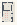

# Primitives_Ignorance

Authored dimensions: {"width": 13, "depth": 20, "max_height": 3}

Source plan only: columns=x, rows=z. Red dots are manuscript/role primary anchors; blue dots are other placed objects; green crosses are utilities. Numbers refer to A rows below. Dark blue is source 0, cream lower structure, grey source wall-height threshold, ochre platforms. Museum overrides can change the built interpretation. Dots show anchors, not footprints or a proven route.

Map: [commons/maps/Primitives_Ignorance/map_data.json](https://github.com/palletorsson/AdaResearch/blob/palm-scanner-door-entry/commons/maps/Primitives_Ignorance/map_data.json)

Text: [commons/maps/Primitives_Ignorance/final.md](https://github.com/palletorsson/AdaResearch/blob/palm-scanner-door-entry/commons/maps/Primitives_Ignorance/final.md)

| Instance | x,z | Raw token | Recorded role | Registry / scene |
|---|---|---|---|---|
| A1 | 1,1 | `dark_sphere:0:-0.5` | decoration | [commons/artifacts/registry/lsystems.json](https://github.com/palletorsson/AdaResearch/blob/palm-scanner-door-entry/commons/artifacts/registry/lsystems.json) → [commons/artifacts/dark_sphere/dark_sphere.tscn](https://github.com/palletorsson/AdaResearch/blob/palm-scanner-door-entry/commons/artifacts/dark_sphere/dark_sphere.tscn) |
| A2 | 2,1 | `cube_scene:0:-0.5#offset:0.00,0.45,0.00#plinth:0.10` | secondary | [commons/artifacts/registry/primitives.json](https://github.com/palletorsson/AdaResearch/blob/palm-scanner-door-entry/commons/artifacts/registry/primitives.json) → [commons/primitives/cubes/cube_scene.tscn](https://github.com/palletorsson/AdaResearch/blob/palm-scanner-door-entry/commons/primitives/cubes/cube_scene.tscn) |
| A3 | 3,1 | `sphere:0:-0.5` | {'role': 'primary', 'group': 'spheres'} | [commons/artifacts/registry/primitives.json](https://github.com/palletorsson/AdaResearch/blob/palm-scanner-door-entry/commons/artifacts/registry/primitives.json) → [commons/primitives/sphere/sphere.tscn](https://github.com/palletorsson/AdaResearch/blob/palm-scanner-door-entry/commons/primitives/sphere/sphere.tscn) |
| A4 | 11,3 | `dark_sphere#body:cairn` | decoration | [commons/artifacts/registry/lsystems.json](https://github.com/palletorsson/AdaResearch/blob/palm-scanner-door-entry/commons/artifacts/registry/lsystems.json) → [commons/artifacts/dark_sphere/dark_sphere.tscn](https://github.com/palletorsson/AdaResearch/blob/palm-scanner-door-entry/commons/artifacts/dark_sphere/dark_sphere.tscn) |
| A5 | 6,4 | `platonic_grabbables:0:0` | secondary | [commons/artifacts/registry/primitives.json](https://github.com/palletorsson/AdaResearch/blob/palm-scanner-door-entry/commons/artifacts/registry/primitives.json) → [commons/primitives/platonic_grabbables.tscn](https://github.com/palletorsson/AdaResearch/blob/palm-scanner-door-entry/commons/primitives/platonic_grabbables.tscn) |
| A6 | 5,9 | `budget_of_smoothness:180:0#discovery:1#plinth:0` | {'role': 'primary', 'group': 'spheres'} | [commons/artifacts/registry/primitives.json](https://github.com/palletorsson/AdaResearch/blob/palm-scanner-door-entry/commons/artifacts/registry/primitives.json) → [commons/artifacts/budget_of_smoothness/budget_of_smoothness.tscn](https://github.com/palletorsson/AdaResearch/blob/palm-scanner-door-entry/commons/artifacts/budget_of_smoothness/budget_of_smoothness.tscn) |
| A7 | 10,9 | `primitive_pillar` | secondary | [commons/artifacts/registry/primitives.json](https://github.com/palletorsson/AdaResearch/blob/palm-scanner-door-entry/commons/artifacts/registry/primitives.json) → [commons/artifacts/primitive_pillar/primitive_pillar.tscn](https://github.com/palletorsson/AdaResearch/blob/palm-scanner-door-entry/commons/artifacts/primitive_pillar/primitive_pillar.tscn) |
| A8 | 10,10 | `science_screen#surface:tiles` | secondary | [commons/artifacts/registry/shaders.json](https://github.com/palletorsson/AdaResearch/blob/palm-scanner-door-entry/commons/artifacts/registry/shaders.json) → [commons/artifacts/science_screen/science_screen.tscn](https://github.com/palletorsson/AdaResearch/blob/palm-scanner-door-entry/commons/artifacts/science_screen/science_screen.tscn) |
| A9 | 3,11 | `sphere_high:0:0#plinth:0.10#offset:0.00,0.60,0.00#inspection:1#inspection_edges:1` | {'role': 'primary', 'group': 'spheres'} | [commons/artifacts/registry/primitives.json](https://github.com/palletorsson/AdaResearch/blob/palm-scanner-door-entry/commons/artifacts/registry/primitives.json) → [commons/primitives/godotmeshes/sphere_high.tscn](https://github.com/palletorsson/AdaResearch/blob/palm-scanner-door-entry/commons/primitives/godotmeshes/sphere_high.tscn) |
| A10 | 5,11 | `sphere_high:0:0#plinth:0.10#offset:0.00,0.60,0.00#inspection:1#inspection_edges:0` | {'role': 'primary', 'group': 'spheres'} | [commons/artifacts/registry/primitives.json](https://github.com/palletorsson/AdaResearch/blob/palm-scanner-door-entry/commons/artifacts/registry/primitives.json) → [commons/primitives/godotmeshes/sphere_high.tscn](https://github.com/palletorsson/AdaResearch/blob/palm-scanner-door-entry/commons/primitives/godotmeshes/sphere_high.tscn) |
| A11 | 1,12 | `star_primitive:90:0#plinth:0.90` | secondary | [commons/artifacts/registry/primitives.json](https://github.com/palletorsson/AdaResearch/blob/palm-scanner-door-entry/commons/artifacts/registry/primitives.json) → [commons/primitives/star/star.tscn](https://github.com/palletorsson/AdaResearch/blob/palm-scanner-door-entry/commons/primitives/star/star.tscn) |
| A12 | 10,12 | `cube_scene#grain:quartered` | secondary | [commons/artifacts/registry/primitives.json](https://github.com/palletorsson/AdaResearch/blob/palm-scanner-door-entry/commons/artifacts/registry/primitives.json) → [commons/primitives/cubes/cube_scene.tscn](https://github.com/palletorsson/AdaResearch/blob/palm-scanner-door-entry/commons/primitives/cubes/cube_scene.tscn) |
| A13 | 3,13 | `sphere_mid:0:0#plinth:0.10#offset:0.00,0.60,0.00#inspection:1#inspection_edges:1` | {'role': 'primary', 'group': 'spheres'} | [commons/artifacts/registry/primitives.json](https://github.com/palletorsson/AdaResearch/blob/palm-scanner-door-entry/commons/artifacts/registry/primitives.json) → [commons/primitives/godotmeshes/sphere_mid.tscn](https://github.com/palletorsson/AdaResearch/blob/palm-scanner-door-entry/commons/primitives/godotmeshes/sphere_mid.tscn) |
| A14 | 5,13 | `sphere_mid:0:0#plinth:0.10#offset:0.00,0.60,0.00#inspection:1#inspection_edges:0` | {'role': 'primary', 'group': 'spheres'} | [commons/artifacts/registry/primitives.json](https://github.com/palletorsson/AdaResearch/blob/palm-scanner-door-entry/commons/artifacts/registry/primitives.json) → [commons/primitives/godotmeshes/sphere_mid.tscn](https://github.com/palletorsson/AdaResearch/blob/palm-scanner-door-entry/commons/primitives/godotmeshes/sphere_mid.tscn) |
| A15 | 8,13 | `hole_with_cones:0:-0.5` | secondary | [commons/artifacts/registry/primitives.json](https://github.com/palletorsson/AdaResearch/blob/palm-scanner-door-entry/commons/artifacts/registry/primitives.json) → [commons/primitives/combines/hole_with_cones.tscn](https://github.com/palletorsson/AdaResearch/blob/palm-scanner-door-entry/commons/primitives/combines/hole_with_cones.tscn) |
| A16 | 10,13 | `seven_words_choir` | secondary | [commons/artifacts/registry/primitives.json](https://github.com/palletorsson/AdaResearch/blob/palm-scanner-door-entry/commons/artifacts/registry/primitives.json) → [commons/artifacts/seven_words_choir/seven_words_choir.tscn](https://github.com/palletorsson/AdaResearch/blob/palm-scanner-door-entry/commons/artifacts/seven_words_choir/seven_words_choir.tscn) |
| A17 | 0,14 | `truncatedtetrahedron:0:0#plinth:0.90` | secondary | [commons/artifacts/registry/primitives.json](https://github.com/palletorsson/AdaResearch/blob/palm-scanner-door-entry/commons/artifacts/registry/primitives.json) → [commons/primitives/truncatedtetrahedron/truncatedtetrahedron.tscn](https://github.com/palletorsson/AdaResearch/blob/palm-scanner-door-entry/commons/primitives/truncatedtetrahedron/truncatedtetrahedron.tscn) |
| A18 | 10,14 | `cylinder_radials_rings` | secondary | [commons/artifacts/registry/primitives.json](https://github.com/palletorsson/AdaResearch/blob/palm-scanner-door-entry/commons/artifacts/registry/primitives.json) → [commons/primitives/cylinder/cylinder_radials_rings.tscn](https://github.com/palletorsson/AdaResearch/blob/palm-scanner-door-entry/commons/primitives/cylinder/cylinder_radials_rings.tscn) |
| A19 | 3,15 | `sphere_low:0:0#plinth:0.10#offset:0.00,0.60,0.00#inspection:1#inspection_edges:1` | {'role': 'primary', 'group': 'spheres'} | [commons/artifacts/registry/primitives.json](https://github.com/palletorsson/AdaResearch/blob/palm-scanner-door-entry/commons/artifacts/registry/primitives.json) → [commons/primitives/godotmeshes/sphere_low.tscn](https://github.com/palletorsson/AdaResearch/blob/palm-scanner-door-entry/commons/primitives/godotmeshes/sphere_low.tscn) |
| A20 | 5,15 | `sphere_low:0:0#plinth:0.10#offset:0.00,0.60,0.00#inspection:1#inspection_edges:0` | {'role': 'primary', 'group': 'spheres'} | [commons/artifacts/registry/primitives.json](https://github.com/palletorsson/AdaResearch/blob/palm-scanner-door-entry/commons/artifacts/registry/primitives.json) → [commons/primitives/godotmeshes/sphere_low.tscn](https://github.com/palletorsson/AdaResearch/blob/palm-scanner-door-entry/commons/primitives/godotmeshes/sphere_low.tscn) |
| A21 | 0,16 | `capsule:0:0#plinth:0.90` | primary | [commons/artifacts/registry/primitives.json](https://github.com/palletorsson/AdaResearch/blob/palm-scanner-door-entry/commons/artifacts/registry/primitives.json) → [commons/primitives/capsule/capsule.tscn](https://github.com/palletorsson/AdaResearch/blob/palm-scanner-door-entry/commons/primitives/capsule/capsule.tscn) |
| A22 | 3,17 | `grab_octahedron:0:0#plinth:0.90` | secondary | [commons/artifacts/registry/primitives.json](https://github.com/palletorsson/AdaResearch/blob/palm-scanner-door-entry/commons/artifacts/registry/primitives.json) → [commons/primitives/octahedron/grab_octahedron.tscn](https://github.com/palletorsson/AdaResearch/blob/palm-scanner-door-entry/commons/primitives/octahedron/grab_octahedron.tscn) |
| A23 | 5,17 | `snap_octahedron_puzzle:0:0.5#fillhole:remove` | secondary | [commons/artifacts/registry/primitives.json](https://github.com/palletorsson/AdaResearch/blob/palm-scanner-door-entry/commons/artifacts/registry/primitives.json) → [commons/primitives/snappoint/puzzles/snap_octahedron_puzzle.tscn](https://github.com/palletorsson/AdaResearch/blob/palm-scanner-door-entry/commons/primitives/snappoint/puzzles/snap_octahedron_puzzle.tscn) |
| A24 | 7,18 | `diamonds` | secondary | [commons/artifacts/registry/primitives.json](https://github.com/palletorsson/AdaResearch/blob/palm-scanner-door-entry/commons/artifacts/registry/primitives.json) → [commons/primitives/combines/diamonds.tscn](https://github.com/palletorsson/AdaResearch/blob/palm-scanner-door-entry/commons/primitives/combines/diamonds.tscn) |
| A25 | 3,19 | `roughrock:0:0#plinth:0.90` | secondary | [commons/artifacts/registry/primitives.json](https://github.com/palletorsson/AdaResearch/blob/palm-scanner-door-entry/commons/artifacts/registry/primitives.json) → [commons/primitives/roughrock/roughrock.tscn](https://github.com/palletorsson/AdaResearch/blob/palm-scanner-door-entry/commons/primitives/roughrock/roughrock.tscn) |
| A26 | 4,19 | `righttriangle:0:0#plinth:0.90` | secondary | [commons/artifacts/registry/primitives.json](https://github.com/palletorsson/AdaResearch/blob/palm-scanner-door-entry/commons/artifacts/registry/primitives.json) → [commons/primitives/righttriangle/righttriangle.tscn](https://github.com/palletorsson/AdaResearch/blob/palm-scanner-door-entry/commons/primitives/righttriangle/righttriangle.tscn) |

Utilities are listed with exact coordinates and raw tokens in space.json. Read map_info.museum and utility_definitions before inferring pits, entrances, movement or collision.
