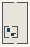

# PG_Branching_Growth

Authored dimensions: {"width": 26, "depth": 42, "max_height": 10}

Source plan only: columns=x, rows=z. Red dots are manuscript/role primary anchors; blue dots are other placed objects; green crosses are utilities. Numbers refer to A rows below. Dark blue is source 0, cream lower structure, grey source wall-height threshold, ochre platforms. Museum overrides can change the built interpretation. Dots show anchors, not footprints or a proven route.

Map: [commons/maps/PG_Branching_Growth/map_data.json](https://github.com/palletorsson/AdaResearch/blob/palm-scanner-door-entry/commons/maps/PG_Branching_Growth/map_data.json)

Text: [commons/maps/PG_Branching_Growth/final.md](https://github.com/palletorsson/AdaResearch/blob/palm-scanner-door-entry/commons/maps/PG_Branching_Growth/final.md)

| Instance | x,z | Raw token | Recorded role | Registry / scene |
|---|---|---|---|---|
| A1 | 13,3 | `pg_workshop_console:180#chapter:branching` | decoration | [commons/artifacts/registry/procgen_extra.json](https://github.com/palletorsson/AdaResearch/blob/palm-scanner-door-entry/commons/artifacts/registry/procgen_extra.json) → [commons/artifacts/timing_machines/pg_workshop.tscn](https://github.com/palletorsson/AdaResearch/blob/palm-scanner-door-entry/commons/artifacts/timing_machines/pg_workshop.tscn) |
| A2 | 8,10 | `branching_growth_algorithm:0:0.1#lesson:true` | primary | [commons/artifacts/registry/procgen_extra.json](https://github.com/palletorsson/AdaResearch/blob/palm-scanner-door-entry/commons/artifacts/registry/procgen_extra.json) → [algorithms/proceduralgeneration/growth_systems/branchinggrowthalgorithm/BranchingGrowthAlgorithm.tscn](https://github.com/palletorsson/AdaResearch/blob/palm-scanner-door-entry/algorithms/proceduralgeneration/growth_systems/branchinggrowthalgorithm/BranchingGrowthAlgorithm.tscn) |
| A3 | 18,15 | `organic_space:0:0:0.5` | secondary | [commons/artifacts/registry/alternative_geometries.json](https://github.com/palletorsson/AdaResearch/blob/palm-scanner-door-entry/commons/artifacts/registry/alternative_geometries.json) → [algorithms/alternativegeometries/organicspace/organic_space.tscn](https://github.com/palletorsson/AdaResearch/blob/palm-scanner-door-entry/algorithms/alternativegeometries/organicspace/organic_space.tscn) |

Utilities are listed with exact coordinates and raw tokens in space.json. Read map_info.museum and utility_definitions before inferring pits, entrances, movement or collision.
