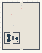

# PG_Caves_Mazes

Authored dimensions: {"width": 38, "depth": 48, "max_height": 10}

Source plan only: columns=x, rows=z. Red dots are manuscript/role primary anchors; blue dots are other placed objects; green crosses are utilities. Numbers refer to A rows below. Dark blue is source 0, cream lower structure, grey source wall-height threshold, ochre platforms. Museum overrides can change the built interpretation. Dots show anchors, not footprints or a proven route.

Map: [commons/maps/PG_Caves_Mazes/map_data.json](https://github.com/palletorsson/AdaResearch/blob/palm-scanner-door-entry/commons/maps/PG_Caves_Mazes/map_data.json)

Text: [commons/maps/PG_Caves_Mazes/final.md](https://github.com/palletorsson/AdaResearch/blob/palm-scanner-door-entry/commons/maps/PG_Caves_Mazes/final.md)

| Instance | x,z | Raw token | Recorded role | Registry / scene |
|---|---|---|---|---|
| A1 | 19,3 | `pg_workshop_console:180#chapter:caves` | decoration | [commons/artifacts/registry/procgen_extra.json](https://github.com/palletorsson/AdaResearch/blob/palm-scanner-door-entry/commons/artifacts/registry/procgen_extra.json) → [commons/artifacts/timing_machines/pg_workshop.tscn](https://github.com/palletorsson/AdaResearch/blob/palm-scanner-door-entry/commons/artifacts/timing_machines/pg_workshop.tscn) |
| A2 | 19,6 | `maze_generation#lesson:true` | primary | [commons/artifacts/registry/procgen_extra.json](https://github.com/palletorsson/AdaResearch/blob/palm-scanner-door-entry/commons/artifacts/registry/procgen_extra.json) → [algorithms/proceduralgeneration/procedural_logic/mazegeneration/maze_generator_vr.tscn](https://github.com/palletorsson/AdaResearch/blob/palm-scanner-door-entry/algorithms/proceduralgeneration/procedural_logic/mazegeneration/maze_generator_vr.tscn) |
| A3 | 9,12 | `caverandomwalk:0:0.5#lesson:true` | primary | [commons/artifacts/registry/procgen_extra.json](https://github.com/palletorsson/AdaResearch/blob/palm-scanner-door-entry/commons/artifacts/registry/procgen_extra.json) → [algorithms/proceduralgeneration/growth_systems/caverandomwalk/caverandomwalk.tscn](https://github.com/palletorsson/AdaResearch/blob/palm-scanner-door-entry/algorithms/proceduralgeneration/growth_systems/caverandomwalk/caverandomwalk.tscn) |
| A4 | 11,23 | `binary_space_partitioning:0:0:0.3` | secondary | [commons/artifacts/registry/procgen_extra.json](https://github.com/palletorsson/AdaResearch/blob/palm-scanner-door-entry/commons/artifacts/registry/procgen_extra.json) → [algorithms/proceduralgeneration/spatial_partitioning/binary_space_partitioning/BinarySpacePartitioning.tscn](https://github.com/palletorsson/AdaResearch/blob/palm-scanner-door-entry/algorithms/proceduralgeneration/spatial_partitioning/binary_space_partitioning/BinarySpacePartitioning.tscn) |

Utilities are listed with exact coordinates and raw tokens in space.json. Read map_info.museum and utility_definitions before inferring pits, entrances, movement or collision.
