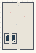

# PG_Mirrored_Patterns

Authored dimensions: {"width": 32, "depth": 48, "max_height": 10}

Source plan only: columns=x, rows=z. Red dots are manuscript/role primary anchors; blue dots are other placed objects; green crosses are utilities. Numbers refer to A rows below. Dark blue is source 0, cream lower structure, grey source wall-height threshold, ochre platforms. Museum overrides can change the built interpretation. Dots show anchors, not footprints or a proven route.

Map: [commons/maps/PG_Mirrored_Patterns/map_data.json](https://github.com/palletorsson/AdaResearch/blob/palm-scanner-door-entry/commons/maps/PG_Mirrored_Patterns/map_data.json)

Text: [commons/maps/PG_Mirrored_Patterns/final.md](https://github.com/palletorsson/AdaResearch/blob/palm-scanner-door-entry/commons/maps/PG_Mirrored_Patterns/final.md)

| Instance | x,z | Raw token | Recorded role | Registry / scene |
|---|---|---|---|---|
| A1 | 16,3 | `pg_workshop_console:180#chapter:mirrored` | decoration | [commons/artifacts/registry/procgen_extra.json](https://github.com/palletorsson/AdaResearch/blob/palm-scanner-door-entry/commons/artifacts/registry/procgen_extra.json) → [commons/artifacts/timing_machines/pg_workshop.tscn](https://github.com/palletorsson/AdaResearch/blob/palm-scanner-door-entry/commons/artifacts/timing_machines/pg_workshop.tscn) |
| A2 | 8,10 | `mirror_cellular_texture_for_3d:0:0.12` | primary | [commons/artifacts/registry/procgen_extra.json](https://github.com/palletorsson/AdaResearch/blob/palm-scanner-door-entry/commons/artifacts/registry/procgen_extra.json) → [algorithms/proceduralgeneration/growth_systems/mirroredcellularautomata/mirror_cellular_texture_for_3d.tscn](https://github.com/palletorsson/AdaResearch/blob/palm-scanner-door-entry/algorithms/proceduralgeneration/growth_systems/mirroredcellularautomata/mirror_cellular_texture_for_3d.tscn) |
| A3 | 22,14 | `rhizomatic_maze_space:0:4:0.7#lesson:true` | primary | [commons/artifacts/registry/alternative_geometries.json](https://github.com/palletorsson/AdaResearch/blob/palm-scanner-door-entry/commons/artifacts/registry/alternative_geometries.json) → [algorithms/alternativegeometries/rhizomaticmazespace/RhizomaticMazeSpace.tscn](https://github.com/palletorsson/AdaResearch/blob/palm-scanner-door-entry/algorithms/alternativegeometries/rhizomaticmazespace/RhizomaticMazeSpace.tscn) |
| A4 | 14,22 | `pattern_tunnel_machine:0` | secondary | [commons/artifacts/registry/procgen_extra.json](https://github.com/palletorsson/AdaResearch/blob/palm-scanner-door-entry/commons/artifacts/registry/procgen_extra.json) → [commons/artifacts/pattern_tunnel/pattern_tunnel_machine.tscn](https://github.com/palletorsson/AdaResearch/blob/palm-scanner-door-entry/commons/artifacts/pattern_tunnel/pattern_tunnel_machine.tscn) |

Utilities are listed with exact coordinates and raw tokens in space.json. Read map_info.museum and utility_definitions before inferring pits, entrances, movement or collision.
