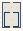

# Random_Walk

Authored dimensions: {"width": 19, "depth": 26, "max_height": 6}

Source plan only: columns=x, rows=z. Red dots are manuscript/role primary anchors; blue dots are other placed objects; green crosses are utilities. Numbers refer to A rows below. Dark blue is source 0, cream lower structure, grey source wall-height threshold, ochre platforms. Museum overrides can change the built interpretation. Dots show anchors, not footprints or a proven route.

Map: [commons/maps/Random_Walk/map_data.json](https://github.com/palletorsson/AdaResearch/blob/palm-scanner-door-entry/commons/maps/Random_Walk/map_data.json)

Text: [commons/maps/Random_Walk/final.md](https://github.com/palletorsson/AdaResearch/blob/palm-scanner-door-entry/commons/maps/Random_Walk/final.md)

| Instance | x,z | Raw token | Recorded role | Registry / scene |
|---|---|---|---|---|
| A1 | 3,5 | `random_walk_collection:180#plinth:0.75#bench_bare_rack:1` | secondary | [commons/artifacts/registry/randomness.json](https://github.com/palletorsson/AdaResearch/blob/palm-scanner-door-entry/commons/artifacts/registry/randomness.json) → [algorithms/randomness/randomwalk/scenes/random_walk_collection.tscn](https://github.com/palletorsson/AdaResearch/blob/palm-scanner-door-entry/algorithms/randomness/randomwalk/scenes/random_walk_collection.tscn) |
| A2 | 9,5 | `random_walk_terrarium:180#stand:logbook#controls:compact#control_front:1.25` | primary | [commons/artifacts/registry/commons_artifacts.json](https://github.com/palletorsson/AdaResearch/blob/palm-scanner-door-entry/commons/artifacts/registry/commons_artifacts.json) → [commons/artifacts/random_walk_terrarium/random_walk_terrarium.tscn](https://github.com/palletorsson/AdaResearch/blob/palm-scanner-door-entry/commons/artifacts/random_walk_terrarium/random_walk_terrarium.tscn) |
| A3 | 15,5 | `random_walk_leash:180` | secondary | [commons/artifacts/registry/randomness.json](https://github.com/palletorsson/AdaResearch/blob/palm-scanner-door-entry/commons/artifacts/registry/randomness.json) → [algorithms/randomness/random_walk_leash/random_walk_leash.tscn](https://github.com/palletorsson/AdaResearch/blob/palm-scanner-door-entry/algorithms/randomness/random_walk_leash/random_walk_leash.tscn) |
| A4 | 6,8 | `random_draw_dot:0` | primary | [commons/artifacts/registry/randomness.json](https://github.com/palletorsson/AdaResearch/blob/palm-scanner-door-entry/commons/artifacts/registry/randomness.json) → [commons/artifacts/randomness_space/random_draw_dot.tscn](https://github.com/palletorsson/AdaResearch/blob/palm-scanner-door-entry/commons/artifacts/randomness_space/random_draw_dot.tscn) |
| A5 | 3,9 | `pixel_cloud:180:0.1:0.18#walk_seed:101` | secondary | [commons/artifacts/registry/randomness.json](https://github.com/palletorsson/AdaResearch/blob/palm-scanner-door-entry/commons/artifacts/registry/randomness.json) → [algorithms/randomness/pixelcloud/pixel_cloud.tscn](https://github.com/palletorsson/AdaResearch/blob/palm-scanner-door-entry/algorithms/randomness/pixelcloud/pixel_cloud.tscn) |
| A6 | 9,17 | `random_walk_128:180#glass_width:12#glass_depth:12#glass_height:5#glass_title:WALK / RETAIN#glass_moat:true` | primary | [commons/artifacts/registry/randomness.json](https://github.com/palletorsson/AdaResearch/blob/palm-scanner-door-entry/commons/artifacts/registry/randomness.json) → [algorithms/randomness/random_walk_128.tscn](https://github.com/palletorsson/AdaResearch/blob/palm-scanner-door-entry/algorithms/randomness/random_walk_128.tscn) |

Utilities are listed with exact coordinates and raw tokens in space.json. Read map_info.museum and utility_definitions before inferring pits, entrances, movement or collision.
