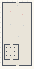

# ProceduralGeneration_Reaction_Diffusion_Systems

Authored dimensions: {"width": 30, "depth": 64, "max_height": 10}

Source plan only: columns=x, rows=z. Red dots are manuscript/role primary anchors; blue dots are other placed objects; green crosses are utilities. Numbers refer to A rows below. Dark blue is source 0, cream lower structure, grey source wall-height threshold, ochre platforms. Museum overrides can change the built interpretation. Dots show anchors, not footprints or a proven route.

Map: [commons/maps/ProceduralGeneration_Reaction_Diffusion_Systems/map_data.json](https://github.com/palletorsson/AdaResearch/blob/palm-scanner-door-entry/commons/maps/ProceduralGeneration_Reaction_Diffusion_Systems/map_data.json)

Text: [commons/maps/ProceduralGeneration_Reaction_Diffusion_Systems/final.md](https://github.com/palletorsson/AdaResearch/blob/palm-scanner-door-entry/commons/maps/ProceduralGeneration_Reaction_Diffusion_Systems/final.md)

| Instance | x,z | Raw token | Recorded role | Registry / scene |
|---|---|---|---|---|
| A1 | 15,3 | `soft_workshop_console:180#chapter:reaction` | decoration | [commons/artifacts/registry/soft_bodies.json](https://github.com/palletorsson/AdaResearch/blob/palm-scanner-door-entry/commons/artifacts/registry/soft_bodies.json) → [commons/artifacts/timing_machines/soft_workshop.tscn](https://github.com/palletorsson/AdaResearch/blob/palm-scanner-door-entry/commons/artifacts/timing_machines/soft_workshop.tscn) |
| A2 | 8,9 | `turing_pattern_generator:180:1#pattern_seed:1337#seeding:centre#resolution:32` | primary | [commons/artifacts/registry/commons_artifacts.json](https://github.com/palletorsson/AdaResearch/blob/palm-scanner-door-entry/commons/artifacts/registry/commons_artifacts.json) → [commons/artifacts/turing_pattern_generator/turing_pattern_generator.tscn](https://github.com/palletorsson/AdaResearch/blob/palm-scanner-door-entry/commons/artifacts/turing_pattern_generator/turing_pattern_generator.tscn) |
| A3 | 20,12 | `reaction_diffusion:0:0:0.5` | primary | [commons/artifacts/registry/procgen_extra.json](https://github.com/palletorsson/AdaResearch/blob/palm-scanner-door-entry/commons/artifacts/registry/procgen_extra.json) → [algorithms/proceduralgeneration/growth_systems/reactiondiffusion/2d_in_3d_turing_pattern_reaction_diffusion.tscn](https://github.com/palletorsson/AdaResearch/blob/palm-scanner-door-entry/algorithms/proceduralgeneration/growth_systems/reactiondiffusion/2d_in_3d_turing_pattern_reaction_diffusion.tscn) |
| A4 | 8,22 | `mesh_grammar_detailed_bulge` | secondary | [commons/artifacts/registry/mesh_grammar.json](https://github.com/palletorsson/AdaResearch/blob/palm-scanner-door-entry/commons/artifacts/registry/mesh_grammar.json) → [commons/mesh_grammar/mesh_grammar_node.tscn](https://github.com/palletorsson/AdaResearch/blob/palm-scanner-door-entry/commons/mesh_grammar/mesh_grammar_node.tscn) |
| A5 | 21,23 | `softstopscene` | secondary | [commons/artifacts/registry/physics_simulation.json](https://github.com/palletorsson/AdaResearch/blob/palm-scanner-door-entry/commons/artifacts/registry/physics_simulation.json) → [algorithms/physicssimulation/softbodies/softbodystop/fourstopsoftbody.tscn](https://github.com/palletorsson/AdaResearch/blob/palm-scanner-door-entry/algorithms/physicssimulation/softbodies/softbodystop/fourstopsoftbody.tscn) |
| A6 | 16,34 | `the_confessing_body:0:0:0.5` | secondary | [commons/artifacts/registry/softbodies.json](https://github.com/palletorsson/AdaResearch/blob/palm-scanner-door-entry/commons/artifacts/registry/softbodies.json) → [commons/artifacts/the_confessing_body/the_confessing_body.tscn](https://github.com/palletorsson/AdaResearch/blob/palm-scanner-door-entry/commons/artifacts/the_confessing_body/the_confessing_body.tscn) |

Utilities are listed with exact coordinates and raw tokens in space.json. Read map_info.museum and utility_definitions before inferring pits, entrances, movement or collision.
