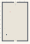

# SoftBodies_Affect_Theory_Visualization

Authored dimensions: {"width": 30, "depth": 45, "max_height": 10}

Source plan only: columns=x, rows=z. Red dots are manuscript/role primary anchors; blue dots are other placed objects; green crosses are utilities. Numbers refer to A rows below. Dark blue is source 0, cream lower structure, grey source wall-height threshold, ochre platforms. Museum overrides can change the built interpretation. Dots show anchors, not footprints or a proven route.

Map: [commons/maps/SoftBodies_Affect_Theory_Visualization/map_data.json](https://github.com/palletorsson/AdaResearch/blob/palm-scanner-door-entry/commons/maps/SoftBodies_Affect_Theory_Visualization/map_data.json)

Text: [commons/maps/SoftBodies_Affect_Theory_Visualization/final.md](https://github.com/palletorsson/AdaResearch/blob/palm-scanner-door-entry/commons/maps/SoftBodies_Affect_Theory_Visualization/final.md)

| Instance | x,z | Raw token | Recorded role | Registry / scene |
|---|---|---|---|---|
| A1 | 15,3 | `soft_workshop_console:180#chapter:affect` | decoration | [commons/artifacts/registry/soft_bodies.json](https://github.com/palletorsson/AdaResearch/blob/palm-scanner-door-entry/commons/artifacts/registry/soft_bodies.json) → [commons/artifacts/timing_machines/soft_workshop.tscn](https://github.com/palletorsson/AdaResearch/blob/palm-scanner-door-entry/commons/artifacts/timing_machines/soft_workshop.tscn) |
| A2 | 9,11 | `radiolaria` | primary | [commons/artifacts/registry/computational_biology.json](https://github.com/palletorsson/AdaResearch/blob/palm-scanner-door-entry/commons/artifacts/registry/computational_biology.json) → [algorithms/computationalbiology/radiolaria2/radiolaria.tscn](https://github.com/palletorsson/AdaResearch/blob/palm-scanner-door-entry/algorithms/computationalbiology/radiolaria2/radiolaria.tscn) |

Utilities are listed with exact coordinates and raw tokens in space.json. Read map_info.museum and utility_definitions before inferring pits, entrances, movement or collision.
