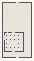

# SoftBodies_Carusell

Authored dimensions: {"width": 30, "depth": 56, "max_height": 10}

Source plan only: columns=x, rows=z. Red dots are manuscript/role primary anchors; blue dots are other placed objects; green crosses are utilities. Numbers refer to A rows below. Dark blue is source 0, cream lower structure, grey source wall-height threshold, ochre platforms. Museum overrides can change the built interpretation. Dots show anchors, not footprints or a proven route.

Map: [commons/maps/SoftBodies_Carusell/map_data.json](https://github.com/palletorsson/AdaResearch/blob/palm-scanner-door-entry/commons/maps/SoftBodies_Carusell/map_data.json)

Text: [commons/maps/SoftBodies_Carusell/final.md](https://github.com/palletorsson/AdaResearch/blob/palm-scanner-door-entry/commons/maps/SoftBodies_Carusell/final.md)

| Instance | x,z | Raw token | Recorded role | Registry / scene |
|---|---|---|---|---|
| A1 | 15,3 | `soft_workshop_console:180#chapter:carousel` | decoration | [commons/artifacts/registry/soft_bodies.json](https://github.com/palletorsson/AdaResearch/blob/palm-scanner-door-entry/commons/artifacts/registry/soft_bodies.json) → [commons/artifacts/timing_machines/soft_workshop.tscn](https://github.com/palletorsson/AdaResearch/blob/palm-scanner-door-entry/commons/artifacts/timing_machines/soft_workshop.tscn) |
| A2 | 24,6 | `flex_cloth_pad:180:1` | secondary | [commons/artifacts/registry/softbodies.json](https://github.com/palletorsson/AdaResearch/blob/palm-scanner-door-entry/commons/artifacts/registry/softbodies.json) → [algorithms/softbodies/affordance_demos/flex_cloth_pad.tscn](https://github.com/palletorsson/AdaResearch/blob/palm-scanner-door-entry/algorithms/softbodies/affordance_demos/flex_cloth_pad.tscn) |
| A3 | 5,7 | `synthesis_stand#subject:pick_up_cube#mode:hero` | secondary | [commons/artifacts/registry/synthesis.json](https://github.com/palletorsson/AdaResearch/blob/palm-scanner-door-entry/commons/artifacts/registry/synthesis.json) → [commons/artifacts/synthesis/synthesis_stand.tscn](https://github.com/palletorsson/AdaResearch/blob/palm-scanner-door-entry/commons/artifacts/synthesis/synthesis_stand.tscn) |
| A4 | 5,9 | `pick_up_cube` | secondary | [commons/artifacts/registry/commons_artifacts.json](https://github.com/palletorsson/AdaResearch/blob/palm-scanner-door-entry/commons/artifacts/registry/commons_artifacts.json) → [commons/scenes/mapobjects/pick_up_cube.tscn](https://github.com/palletorsson/AdaResearch/blob/palm-scanner-door-entry/commons/scenes/mapobjects/pick_up_cube.tscn) |
| A5 | 25,9 | `grab_long_stick:180` | secondary | [commons/artifacts/registry/primitives.json](https://github.com/palletorsson/AdaResearch/blob/palm-scanner-door-entry/commons/artifacts/registry/primitives.json) → [commons/primitives/cubes/grab_long_stick.tscn](https://github.com/palletorsson/AdaResearch/blob/palm-scanner-door-entry/commons/primitives/cubes/grab_long_stick.tscn) |
| A6 | 6,11 | `grab_long_stick` | secondary | [commons/artifacts/registry/primitives.json](https://github.com/palletorsson/AdaResearch/blob/palm-scanner-door-entry/commons/artifacts/registry/primitives.json) → [commons/primitives/cubes/grab_long_stick.tscn](https://github.com/palletorsson/AdaResearch/blob/palm-scanner-door-entry/commons/primitives/cubes/grab_long_stick.tscn) |
| A7 | 15,14 | `revolving_joy_ride` | primary | [commons/artifacts/registry/soft_bodies.json](https://github.com/palletorsson/AdaResearch/blob/palm-scanner-door-entry/commons/artifacts/registry/soft_bodies.json) → [algorithms/softbodies/joyride/revolving_joy_ride.tscn](https://github.com/palletorsson/AdaResearch/blob/palm-scanner-door-entry/algorithms/softbodies/joyride/revolving_joy_ride.tscn) |
| A8 | 7,23 | `cloth_straps` | primary | [commons/artifacts/registry/soft_bodies.json](https://github.com/palletorsson/AdaResearch/blob/palm-scanner-door-entry/commons/artifacts/registry/soft_bodies.json) → [algorithms/softbodies/cloth_straps/cloth_straps.tscn](https://github.com/palletorsson/AdaResearch/blob/palm-scanner-door-entry/algorithms/softbodies/cloth_straps/cloth_straps.tscn) |
| A9 | 23,24 | `soft_mushroom:0:0:0.6` | secondary | [commons/artifacts/registry/soft_bodies.json](https://github.com/palletorsson/AdaResearch/blob/palm-scanner-door-entry/commons/artifacts/registry/soft_bodies.json) → [algorithms/softbodies/mushrooms/soft_mushrooms.tscn](https://github.com/palletorsson/AdaResearch/blob/palm-scanner-door-entry/algorithms/softbodies/mushrooms/soft_mushrooms.tscn) |
| A10 | 2,33 | `pick_up_cube` | secondary | [commons/artifacts/registry/commons_artifacts.json](https://github.com/palletorsson/AdaResearch/blob/palm-scanner-door-entry/commons/artifacts/registry/commons_artifacts.json) → [commons/scenes/mapobjects/pick_up_cube.tscn](https://github.com/palletorsson/AdaResearch/blob/palm-scanner-door-entry/commons/scenes/mapobjects/pick_up_cube.tscn) |
| A11 | 2,35 | `pick_up_cube` | secondary | [commons/artifacts/registry/commons_artifacts.json](https://github.com/palletorsson/AdaResearch/blob/palm-scanner-door-entry/commons/artifacts/registry/commons_artifacts.json) → [commons/scenes/mapobjects/pick_up_cube.tscn](https://github.com/palletorsson/AdaResearch/blob/palm-scanner-door-entry/commons/scenes/mapobjects/pick_up_cube.tscn) |
| A12 | 7,39 | `cloth_straps:0:-0.5` | primary | [commons/artifacts/registry/soft_bodies.json](https://github.com/palletorsson/AdaResearch/blob/palm-scanner-door-entry/commons/artifacts/registry/soft_bodies.json) → [algorithms/softbodies/cloth_straps/cloth_straps.tscn](https://github.com/palletorsson/AdaResearch/blob/palm-scanner-door-entry/algorithms/softbodies/cloth_straps/cloth_straps.tscn) |

Utilities are listed with exact coordinates and raw tokens in space.json. Read map_info.museum and utility_definitions before inferring pits, entrances, movement or collision.
