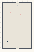

# SoftBodies_Cloth_Physics

Authored dimensions: {"width": 30, "depth": 47, "max_height": 10}

Source plan only: columns=x, rows=z. Red dots are manuscript/role primary anchors; blue dots are other placed objects; green crosses are utilities. Numbers refer to A rows below. Dark blue is source 0, cream lower structure, grey source wall-height threshold, ochre platforms. Museum overrides can change the built interpretation. Dots show anchors, not footprints or a proven route.

Map: [commons/maps/SoftBodies_Cloth_Physics/map_data.json](https://github.com/palletorsson/AdaResearch/blob/palm-scanner-door-entry/commons/maps/SoftBodies_Cloth_Physics/map_data.json)

Text: [commons/maps/SoftBodies_Cloth_Physics/final.md](https://github.com/palletorsson/AdaResearch/blob/palm-scanner-door-entry/commons/maps/SoftBodies_Cloth_Physics/final.md)

| Instance | x,z | Raw token | Recorded role | Registry / scene |
|---|---|---|---|---|
| A1 | 15,3 | `soft_workshop_console:180#chapter:cloth` | decoration | [commons/artifacts/registry/soft_bodies.json](https://github.com/palletorsson/AdaResearch/blob/palm-scanner-door-entry/commons/artifacts/registry/soft_bodies.json) → [commons/artifacts/timing_machines/soft_workshop.tscn](https://github.com/palletorsson/AdaResearch/blob/palm-scanner-door-entry/commons/artifacts/timing_machines/soft_workshop.tscn) |
| A2 | 8,10 | `cloth_straps#lesson:true` | primary | [commons/artifacts/registry/soft_bodies.json](https://github.com/palletorsson/AdaResearch/blob/palm-scanner-door-entry/commons/artifacts/registry/soft_bodies.json) → [algorithms/softbodies/cloth_straps/cloth_straps.tscn](https://github.com/palletorsson/AdaResearch/blob/palm-scanner-door-entry/algorithms/softbodies/cloth_straps/cloth_straps.tscn) |
| A3 | 18,12 | `softstopscene#landing:rail` | primary | [commons/artifacts/registry/physics_simulation.json](https://github.com/palletorsson/AdaResearch/blob/palm-scanner-door-entry/commons/artifacts/registry/physics_simulation.json) → [algorithms/physicssimulation/softbodies/softbodystop/fourstopsoftbody.tscn](https://github.com/palletorsson/AdaResearch/blob/palm-scanner-door-entry/algorithms/physicssimulation/softbodies/softbodystop/fourstopsoftbody.tscn) |

Utilities are listed with exact coordinates and raw tokens in space.json. Read map_info.museum and utility_definitions before inferring pits, entrances, movement or collision.
