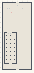

# SoftBodies_Obsticals_Part2

Authored dimensions: {"width": 30, "depth": 68, "max_height": 10}

Source plan only: columns=x, rows=z. Red dots are manuscript/role primary anchors; blue dots are other placed objects; green crosses are utilities. Numbers refer to A rows below. Dark blue is source 0, cream lower structure, grey source wall-height threshold, ochre platforms. Museum overrides can change the built interpretation. Dots show anchors, not footprints or a proven route.

Map: [commons/maps/SoftBodies_Obsticals_Part2/map_data.json](https://github.com/palletorsson/AdaResearch/blob/palm-scanner-door-entry/commons/maps/SoftBodies_Obsticals_Part2/map_data.json)

Text: [commons/maps/SoftBodies_Obsticals_Part2/final.md](https://github.com/palletorsson/AdaResearch/blob/palm-scanner-door-entry/commons/maps/SoftBodies_Obsticals_Part2/final.md)

| Instance | x,z | Raw token | Recorded role | Registry / scene |
|---|---|---|---|---|
| A1 | 15,3 | `soft_workshop_console:180#chapter:contact` | decoration | [commons/artifacts/registry/soft_bodies.json](https://github.com/palletorsson/AdaResearch/blob/palm-scanner-door-entry/commons/artifacts/registry/soft_bodies.json) → [commons/artifacts/timing_machines/soft_workshop.tscn](https://github.com/palletorsson/AdaResearch/blob/palm-scanner-door-entry/commons/artifacts/timing_machines/soft_workshop.tscn) |
| A2 | 5,6 | `pick_up_cube:90` | secondary | [commons/artifacts/registry/commons_artifacts.json](https://github.com/palletorsson/AdaResearch/blob/palm-scanner-door-entry/commons/artifacts/registry/commons_artifacts.json) → [commons/scenes/mapobjects/pick_up_cube.tscn](https://github.com/palletorsson/AdaResearch/blob/palm-scanner-door-entry/commons/scenes/mapobjects/pick_up_cube.tscn) |
| A3 | 7,6 | `grab_long_stick:270` | secondary | [commons/artifacts/registry/primitives.json](https://github.com/palletorsson/AdaResearch/blob/palm-scanner-door-entry/commons/artifacts/registry/primitives.json) → [commons/primitives/cubes/grab_long_stick.tscn](https://github.com/palletorsson/AdaResearch/blob/palm-scanner-door-entry/commons/primitives/cubes/grab_long_stick.tscn) |
| A4 | 20,6 | `grab_long_stick:90` | secondary | [commons/artifacts/registry/primitives.json](https://github.com/palletorsson/AdaResearch/blob/palm-scanner-door-entry/commons/artifacts/registry/primitives.json) → [commons/primitives/cubes/grab_long_stick.tscn](https://github.com/palletorsson/AdaResearch/blob/palm-scanner-door-entry/commons/primitives/cubes/grab_long_stick.tscn) |
| A5 | 9,10 | `softbody_gallery_part2#lesson:true#respawn:false` | primary | [commons/artifacts/registry/soft_bodies.json](https://github.com/palletorsson/AdaResearch/blob/palm-scanner-door-entry/commons/artifacts/registry/soft_bodies.json) → [algorithms/softbodies/softbody_gallery_part2.tscn](https://github.com/palletorsson/AdaResearch/blob/palm-scanner-door-entry/algorithms/softbodies/softbody_gallery_part2.tscn) |
| A6 | 6,31 | `pick_up_cube:90` | secondary | [commons/artifacts/registry/commons_artifacts.json](https://github.com/palletorsson/AdaResearch/blob/palm-scanner-door-entry/commons/artifacts/registry/commons_artifacts.json) → [commons/scenes/mapobjects/pick_up_cube.tscn](https://github.com/palletorsson/AdaResearch/blob/palm-scanner-door-entry/commons/scenes/mapobjects/pick_up_cube.tscn) |
| A7 | 8,31 | `pick_up_cube:90` | secondary | [commons/artifacts/registry/commons_artifacts.json](https://github.com/palletorsson/AdaResearch/blob/palm-scanner-door-entry/commons/artifacts/registry/commons_artifacts.json) → [commons/scenes/mapobjects/pick_up_cube.tscn](https://github.com/palletorsson/AdaResearch/blob/palm-scanner-door-entry/commons/scenes/mapobjects/pick_up_cube.tscn) |

Utilities are listed with exact coordinates and raw tokens in space.json. Read map_info.museum and utility_definitions before inferring pits, entrances, movement or collision.
