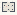

# SwarmIntelligence_Agent_Based_Modeling_ABM

Authored dimensions: {"width": 13, "depth": 10, "max_height": 3}

Source plan only: columns=x, rows=z. Red dots are manuscript/role primary anchors; blue dots are other placed objects; green crosses are utilities. Numbers refer to A rows below. Dark blue is source 0, cream lower structure, grey source wall-height threshold, ochre platforms. Museum overrides can change the built interpretation. Dots show anchors, not footprints or a proven route.

Map: [commons/maps/SwarmIntelligence_Agent_Based_Modeling_ABM/map_data.json](https://github.com/palletorsson/AdaResearch/blob/palm-scanner-door-entry/commons/maps/SwarmIntelligence_Agent_Based_Modeling_ABM/map_data.json)

Text: [commons/maps/SwarmIntelligence_Agent_Based_Modeling_ABM/final.md](https://github.com/palletorsson/AdaResearch/blob/palm-scanner-door-entry/commons/maps/SwarmIntelligence_Agent_Based_Modeling_ABM/final.md)

| Instance | x,z | Raw token | Recorded role | Registry / scene |
|---|---|---|---|---|
| A1 | 3,1 | `catalyst_prompter_box:0:0#emergence:vent#sequence:auto#lease_s:45` | secondary | [commons/artifacts/registry/hazards.json](https://github.com/palletorsson/AdaResearch/blob/palm-scanner-door-entry/commons/artifacts/registry/hazards.json) → [commons/hazards/becoming_catalyst/catalyst_prompter_box.tscn](https://github.com/palletorsson/AdaResearch/blob/palm-scanner-door-entry/commons/hazards/becoming_catalyst/catalyst_prompter_box.tscn) |
| A2 | 4,4 | `ant_colony_optimization` | primary | [commons/artifacts/registry/swarmintelligence.json](https://github.com/palletorsson/AdaResearch/blob/palm-scanner-door-entry/commons/artifacts/registry/swarmintelligence.json) → [algorithms/swarmintelligence/ant_colony_optimization/ant_colony_optimization.tscn](https://github.com/palletorsson/AdaResearch/blob/palm-scanner-door-entry/algorithms/swarmintelligence/ant_colony_optimization/ant_colony_optimization.tscn) |
| A3 | 9,4 | `physarum_colony` | secondary | [commons/artifacts/registry/swarmintelligence.json](https://github.com/palletorsson/AdaResearch/blob/palm-scanner-door-entry/commons/artifacts/registry/swarmintelligence.json) → [algorithms/swarmintelligence/physarum/PhysarumColony.tscn](https://github.com/palletorsson/AdaResearch/blob/palm-scanner-door-entry/algorithms/swarmintelligence/physarum/PhysarumColony.tscn) |
| A4 | 1,5 | `catalyst_foe` | secondary | [commons/artifacts/registry/hazards.json](https://github.com/palletorsson/AdaResearch/blob/palm-scanner-door-entry/commons/artifacts/registry/hazards.json) → [commons/hazards/catalyst_foe/catalyst_foe.tscn](https://github.com/palletorsson/AdaResearch/blob/palm-scanner-door-entry/commons/hazards/catalyst_foe/catalyst_foe.tscn) |
| A5 | 1,7 | `catalyst_vent:0:0#emit_interval_s:2.5#wave_size:3#start_delay_s:5.0#sequence:auto` | secondary | [commons/artifacts/registry/hazards.json](https://github.com/palletorsson/AdaResearch/blob/palm-scanner-door-entry/commons/artifacts/registry/hazards.json) → [commons/hazards/catalyst_foe/catalyst_vent.tscn](https://github.com/palletorsson/AdaResearch/blob/palm-scanner-door-entry/commons/hazards/catalyst_foe/catalyst_vent.tscn) |

Utilities are listed with exact coordinates and raw tokens in space.json. Read map_info.museum and utility_definitions before inferring pits, entrances, movement or collision.
