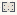

# SwarmIntelligence_FlowFields

Authored dimensions: {"width": 13, "depth": 10, "max_height": 3}

Source plan only: columns=x, rows=z. Red dots are manuscript/role primary anchors; blue dots are other placed objects; green crosses are utilities. Numbers refer to A rows below. Dark blue is source 0, cream lower structure, grey source wall-height threshold, ochre platforms. Museum overrides can change the built interpretation. Dots show anchors, not footprints or a proven route.

Map: [commons/maps/SwarmIntelligence_FlowFields/map_data.json](https://github.com/palletorsson/AdaResearch/blob/palm-scanner-door-entry/commons/maps/SwarmIntelligence_FlowFields/map_data.json)

Text: [commons/maps/SwarmIntelligence_FlowFields/final.md](https://github.com/palletorsson/AdaResearch/blob/palm-scanner-door-entry/commons/maps/SwarmIntelligence_FlowFields/final.md)

| Instance | x,z | Raw token | Recorded role | Registry / scene |
|---|---|---|---|---|
| A1 | 6,4 | `FlowFieldMain:90` | primary | [commons/artifacts/registry/algorithms_misc.json](https://github.com/palletorsson/AdaResearch/blob/palm-scanner-door-entry/commons/artifacts/registry/algorithms_misc.json) → [algorithms/pathfinding/flow_field/FlowFieldMain.tscn](https://github.com/palletorsson/AdaResearch/blob/palm-scanner-door-entry/algorithms/pathfinding/flow_field/FlowFieldMain.tscn) |
| A2 | 9,4 | `AntColonyV2` | secondary | [commons/artifacts/registry/swarmintelligence.json](https://github.com/palletorsson/AdaResearch/blob/palm-scanner-door-entry/commons/artifacts/registry/swarmintelligence.json) → [algorithms/swarmintelligence/ants_v2/AntColonyV2.tscn](https://github.com/palletorsson/AdaResearch/blob/palm-scanner-door-entry/algorithms/swarmintelligence/ants_v2/AntColonyV2.tscn) |
| A3 | 1,6 | `ecosystem_simulation` | secondary | [commons/artifacts/registry/algorithms_misc.json](https://github.com/palletorsson/AdaResearch/blob/palm-scanner-door-entry/commons/artifacts/registry/algorithms_misc.json) → [algorithms/emergentsystems/ecosystemsimulation/ecosystem.tscn](https://github.com/palletorsson/AdaResearch/blob/palm-scanner-door-entry/algorithms/emergentsystems/ecosystemsimulation/ecosystem.tscn) |

Utilities are listed with exact coordinates and raw tokens in space.json. Read map_info.museum and utility_definitions before inferring pits, entrances, movement or collision.
