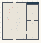

# Pattern_Foundry

Authored dimensions: {"width": 37, "depth": 38, "max_height": 8}

Source plan only: columns=x, rows=z. Red dots are manuscript/role primary anchors; blue dots are other placed objects; green crosses are utilities. Numbers refer to A rows below. Dark blue is source 0, cream lower structure, grey source wall-height threshold, ochre platforms. Museum overrides can change the built interpretation. Dots show anchors, not footprints or a proven route.

Map: [commons/maps/Pattern_Foundry/map_data.json](https://github.com/palletorsson/AdaResearch/blob/palm-scanner-door-entry/commons/maps/Pattern_Foundry/map_data.json)

Text: [commons/maps/Pattern_Foundry/final.md](https://github.com/palletorsson/AdaResearch/blob/palm-scanner-door-entry/commons/maps/Pattern_Foundry/final.md)

| Instance | x,z | Raw token | Recorded role | Registry / scene |
|---|---|---|---|---|
| A1 | 10,5 | `pattern_architecture` | primary | [commons/artifacts/registry/pattern_architecture.json](https://github.com/palletorsson/AdaResearch/blob/palm-scanner-door-entry/commons/artifacts/registry/pattern_architecture.json) → [commons/artifacts/regularity/pattern_architecture.tscn](https://github.com/palletorsson/AdaResearch/blob/palm-scanner-door-entry/commons/artifacts/regularity/pattern_architecture.tscn) |
| A2 | 7,7 | `pattern_tile_4x4:0:-0.5` | primary | [commons/artifacts/registry/arrays.json](https://github.com/palletorsson/AdaResearch/blob/palm-scanner-door-entry/commons/artifacts/registry/arrays.json) → [commons/primitives/arrays/pattern_tile_puzzle.tscn](https://github.com/palletorsson/AdaResearch/blob/palm-scanner-door-entry/commons/primitives/arrays/pattern_tile_puzzle.tscn) |
| A3 | 7,10 | `pattern_tile_mirror:0:-0.5` | primary | [commons/artifacts/registry/arrays.json](https://github.com/palletorsson/AdaResearch/blob/palm-scanner-door-entry/commons/artifacts/registry/arrays.json) → [commons/primitives/arrays/pattern_tile_puzzle.tscn](https://github.com/palletorsson/AdaResearch/blob/palm-scanner-door-entry/commons/primitives/arrays/pattern_tile_puzzle.tscn) |
| A4 | 15,10 | `pattern_machine_c:0:0` | secondary | [commons/artifacts/registry/pattern_machine_c.json](https://github.com/palletorsson/AdaResearch/blob/palm-scanner-door-entry/commons/artifacts/registry/pattern_machine_c.json) → [commons/artifacts/pattern_machine_c/pattern_machine_c.tscn](https://github.com/palletorsson/AdaResearch/blob/palm-scanner-door-entry/commons/artifacts/pattern_machine_c/pattern_machine_c.tscn) |
| A5 | 30,11 | `pattern_studio_plate:0:0#room:curved` | secondary | [commons/artifacts/registry/arrays.json](https://github.com/palletorsson/AdaResearch/blob/palm-scanner-door-entry/commons/artifacts/registry/arrays.json) → [commons/primitives/arrays/pattern_studio_plate.tscn](https://github.com/palletorsson/AdaResearch/blob/palm-scanner-door-entry/commons/primitives/arrays/pattern_studio_plate.tscn) |
| A6 | 5,15 | `pattern_tile_herringbone:0:-0.5` | secondary | [commons/artifacts/registry/arrays.json](https://github.com/palletorsson/AdaResearch/blob/palm-scanner-door-entry/commons/artifacts/registry/arrays.json) → [commons/primitives/arrays/pattern_tile_puzzle.tscn](https://github.com/palletorsson/AdaResearch/blob/palm-scanner-door-entry/commons/primitives/arrays/pattern_tile_puzzle.tscn) |
| A7 | 17,16 | `pattern_maker_station:0:-0.49` | secondary | [commons/artifacts/registry/arrays.json](https://github.com/palletorsson/AdaResearch/blob/palm-scanner-door-entry/commons/artifacts/registry/arrays.json) → [commons/artifacts/pattern_maker_station/pattern_maker_station.tscn](https://github.com/palletorsson/AdaResearch/blob/palm-scanner-door-entry/commons/artifacts/pattern_maker_station/pattern_maker_station.tscn) |
| A8 | 6,17 | `pattern_machine_a:90:0#lesson:shared_recipe` | primary | [commons/artifacts/registry/pattern_machine_a.json](https://github.com/palletorsson/AdaResearch/blob/palm-scanner-door-entry/commons/artifacts/registry/pattern_machine_a.json) → [commons/artifacts/pattern_machine_a/pattern_machine_a.tscn](https://github.com/palletorsson/AdaResearch/blob/palm-scanner-door-entry/commons/artifacts/pattern_machine_a/pattern_machine_a.tscn) |
| A9 | 14,20 | `pattern_mill:0:0` | secondary | [commons/artifacts/registry/pattern_mill.json](https://github.com/palletorsson/AdaResearch/blob/palm-scanner-door-entry/commons/artifacts/registry/pattern_mill.json) → [commons/artifacts/pattern_mill/pattern_mill.tscn](https://github.com/palletorsson/AdaResearch/blob/palm-scanner-door-entry/commons/artifacts/pattern_mill/pattern_mill.tscn) |
| A10 | 17,20 | `pattern_tile_plate:180:-0.49` | secondary | [commons/artifacts/registry/arrays.json](https://github.com/palletorsson/AdaResearch/blob/palm-scanner-door-entry/commons/artifacts/registry/arrays.json) → [commons/primitives/arrays/pattern_tile_plate.tscn](https://github.com/palletorsson/AdaResearch/blob/palm-scanner-door-entry/commons/primitives/arrays/pattern_tile_plate.tscn) |
| A11 | 30,21 | `drag_catwalk:0:0` | secondary | [commons/artifacts/registry/drag_catwalk.json](https://github.com/palletorsson/AdaResearch/blob/palm-scanner-door-entry/commons/artifacts/registry/drag_catwalk.json) → [commons/artifacts/drag_catwalk/drag_catwalk.tscn](https://github.com/palletorsson/AdaResearch/blob/palm-scanner-door-entry/commons/artifacts/drag_catwalk/drag_catwalk.tscn) |
| A12 | 15,23 | `tiling_demo:180:-1.6` | secondary | [commons/artifacts/registry/arrays.json](https://github.com/palletorsson/AdaResearch/blob/palm-scanner-door-entry/commons/artifacts/registry/arrays.json) → [commons/primitives/arrays/tiling_demo.tscn](https://github.com/palletorsson/AdaResearch/blob/palm-scanner-door-entry/commons/primitives/arrays/tiling_demo.tscn) |
| A13 | 14,26 | `pattern_machine_d:180:0` | secondary | [commons/artifacts/registry/pattern_machine_d.json](https://github.com/palletorsson/AdaResearch/blob/palm-scanner-door-entry/commons/artifacts/registry/pattern_machine_d.json) → [commons/artifacts/pattern_machine_d/pattern_machine_d.tscn](https://github.com/palletorsson/AdaResearch/blob/palm-scanner-door-entry/commons/artifacts/pattern_machine_d/pattern_machine_d.tscn) |
| A14 | 9,27 | `pattern_tile_brick:0:-0.5` | secondary | [commons/artifacts/registry/arrays.json](https://github.com/palletorsson/AdaResearch/blob/palm-scanner-door-entry/commons/artifacts/registry/arrays.json) → [commons/primitives/arrays/pattern_tile_puzzle.tscn](https://github.com/palletorsson/AdaResearch/blob/palm-scanner-door-entry/commons/primitives/arrays/pattern_tile_puzzle.tscn) |
| A15 | 30,35 | `super_drag_mirror:180:0` | secondary | [commons/artifacts/registry/super_drag_mirror.json](https://github.com/palletorsson/AdaResearch/blob/palm-scanner-door-entry/commons/artifacts/registry/super_drag_mirror.json) → [commons/artifacts/super_drag_mirror/super_drag_mirror.tscn](https://github.com/palletorsson/AdaResearch/blob/palm-scanner-door-entry/commons/artifacts/super_drag_mirror/super_drag_mirror.tscn) |
| A16 | 21,36 | `wall_drawing_291:180` | secondary | [commons/artifacts/registry/wall_drawing_291.json](https://github.com/palletorsson/AdaResearch/blob/palm-scanner-door-entry/commons/artifacts/registry/wall_drawing_291.json) → [commons/artifacts/wall_drawing_291/wall_drawing_291.tscn](https://github.com/palletorsson/AdaResearch/blob/palm-scanner-door-entry/commons/artifacts/wall_drawing_291/wall_drawing_291.tscn) |

Utilities are listed with exact coordinates and raw tokens in space.json. Read map_info.museum and utility_definitions before inferring pits, entrances, movement or collision.
