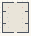

# Ribbon_Patterns_02

Authored dimensions: {"width": 27, "depth": 31, "max_height": 4}

Source plan only: columns=x, rows=z. Red dots are manuscript/role primary anchors; blue dots are other placed objects; green crosses are utilities. Numbers refer to A rows below. Dark blue is source 0, cream lower structure, grey source wall-height threshold, ochre platforms. Museum overrides can change the built interpretation. Dots show anchors, not footprints or a proven route.

Map: [commons/maps/Ribbon_Patterns_02/map_data.json](https://github.com/palletorsson/AdaResearch/blob/palm-scanner-door-entry/commons/maps/Ribbon_Patterns_02/map_data.json)

Text: [commons/maps/Ribbon_Patterns_02/final.md](https://github.com/palletorsson/AdaResearch/blob/palm-scanner-door-entry/commons/maps/Ribbon_Patterns_02/final.md)

| Instance | x,z | Raw token | Recorded role | Registry / scene |
|---|---|---|---|---|
| A1 | 6,5 | `SimultaneousContrast:0#pin:1#plinth:0#lesson:context` | primary | [commons/artifacts/registry/color.json](https://github.com/palletorsson/AdaResearch/blob/palm-scanner-door-entry/commons/artifacts/registry/color.json) → [algorithms/color/simultaneous_contrast/SimultaneousContrast.tscn](https://github.com/palletorsson/AdaResearch/blob/palm-scanner-door-entry/algorithms/color/simultaneous_contrast/SimultaneousContrast.tscn) |
| A2 | 20,5 | `MetamerismLab:0#pin:1#plinth:0#lesson:carrier` | primary | [commons/artifacts/registry/color.json](https://github.com/palletorsson/AdaResearch/blob/palm-scanner-door-entry/commons/artifacts/registry/color.json) → [algorithms/color/metamerism_lab/MetamerismLab.tscn](https://github.com/palletorsson/AdaResearch/blob/palm-scanner-door-entry/algorithms/color/metamerism_lab/MetamerismLab.tscn) |
| A3 | 6,11 | `spherecolors:0:0:0.8#pin:1#plinth:0#label_in_space:true` | secondary | [commons/artifacts/registry/color.json](https://github.com/palletorsson/AdaResearch/blob/palm-scanner-door-entry/commons/artifacts/registry/color.json) → [algorithms/color/spherecolors/spherecolors.tscn](https://github.com/palletorsson/AdaResearch/blob/palm-scanner-door-entry/algorithms/color/spherecolors/spherecolors.tscn) |
| A4 | 20,11 | `hue_carousel:0:0:0.8#pin:1#plinth:0` | secondary | [commons/artifacts/registry/color.json](https://github.com/palletorsson/AdaResearch/blob/palm-scanner-door-entry/commons/artifacts/registry/color.json) → [commons/artifacts/hue_carousel/hue_carousel.tscn](https://github.com/palletorsson/AdaResearch/blob/palm-scanner-door-entry/commons/artifacts/hue_carousel/hue_carousel.tscn) |
| A5 | 5,15 | `grabcolorcollection#pin:1#plinth:0` | secondary | [commons/artifacts/registry/color.json](https://github.com/palletorsson/AdaResearch/blob/palm-scanner-door-entry/commons/artifacts/registry/color.json) → [algorithms/color/grabcolor/grabcolorcollection.tscn](https://github.com/palletorsson/AdaResearch/blob/palm-scanner-door-entry/algorithms/color/grabcolor/grabcolorcollection.tscn) |
| A6 | 20,16 | `color_mixing:0:0:0.55#pin:1#plinth:0` | secondary | [commons/artifacts/registry/color.json](https://github.com/palletorsson/AdaResearch/blob/palm-scanner-door-entry/commons/artifacts/registry/color.json) → [algorithms/color/color_mixing/color_mixing.tscn](https://github.com/palletorsson/AdaResearch/blob/palm-scanner-door-entry/algorithms/color/color_mixing/color_mixing.tscn) |
| A7 | 6,19 | `dark_side_prism:0:0:0.6#pin:1#plinth:0` | secondary | [commons/artifacts/registry/color.json](https://github.com/palletorsson/AdaResearch/blob/palm-scanner-door-entry/commons/artifacts/registry/color.json) → [algorithms/color/dark_side_prism.tscn](https://github.com/palletorsson/AdaResearch/blob/palm-scanner-door-entry/algorithms/color/dark_side_prism.tscn) |
| A8 | 20,20 | `prism#pin:1#plinth:0` | secondary | [commons/artifacts/registry/lab.json](https://github.com/palletorsson/AdaResearch/blob/palm-scanner-door-entry/commons/artifacts/registry/lab.json) → [commons/artifacts/prism/prism.tscn](https://github.com/palletorsson/AdaResearch/blob/palm-scanner-door-entry/commons/artifacts/prism/prism.tscn); [commons/artifacts/registry/primitives.json](https://github.com/palletorsson/AdaResearch/blob/palm-scanner-door-entry/commons/artifacts/registry/primitives.json) → [commons/primitives/prism/prism.tscn](https://github.com/palletorsson/AdaResearch/blob/palm-scanner-door-entry/commons/primitives/prism/prism.tscn) |
| A9 | 2,23 | `grab_stick_scanner:0:0:0.4#pin:1#plinth:0` | secondary | [commons/artifacts/registry/color.json](https://github.com/palletorsson/AdaResearch/blob/palm-scanner-door-entry/commons/artifacts/registry/color.json) → [algorithms/color/color_scanner/grab_stick_scanner.tscn](https://github.com/palletorsson/AdaResearch/blob/palm-scanner-door-entry/algorithms/color/color_scanner/grab_stick_scanner.tscn) |
| A10 | 6,25 | `two_roads:0:0:0.45#pin:1#plinth:0` | secondary | [commons/artifacts/registry/color.json](https://github.com/palletorsson/AdaResearch/blob/palm-scanner-door-entry/commons/artifacts/registry/color.json) → [commons/artifacts/two_roads/two_roads.tscn](https://github.com/palletorsson/AdaResearch/blob/palm-scanner-door-entry/commons/artifacts/two_roads/two_roads.tscn) |
| A11 | 20,25 | `color_scanner:0:0:0.45#pin:1#plinth:0` | secondary | [commons/artifacts/registry/color.json](https://github.com/palletorsson/AdaResearch/blob/palm-scanner-door-entry/commons/artifacts/registry/color.json) → [algorithms/color/color_scanner/color_scanner.tscn](https://github.com/palletorsson/AdaResearch/blob/palm-scanner-door-entry/algorithms/color/color_scanner/color_scanner.tscn) |
| A12 | 24,28 | `grab_stick:90:0:0.4#pin:1#plinth:0` | secondary | [commons/artifacts/registry/color.json](https://github.com/palletorsson/AdaResearch/blob/palm-scanner-door-entry/commons/artifacts/registry/color.json) → [algorithms/color/color_scanner/grab_stick.tscn](https://github.com/palletorsson/AdaResearch/blob/palm-scanner-door-entry/algorithms/color/color_scanner/grab_stick.tscn) |

Utilities are listed with exact coordinates and raw tokens in space.json. Read map_info.museum and utility_definitions before inferring pits, entrances, movement or collision.
