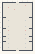

# Ribbon_Patterns_03

Authored dimensions: {"width": 31, "depth": 49, "max_height": 4}

Source plan only: columns=x, rows=z. Red dots are manuscript/role primary anchors; blue dots are other placed objects; green crosses are utilities. Numbers refer to A rows below. Dark blue is source 0, cream lower structure, grey source wall-height threshold, ochre platforms. Museum overrides can change the built interpretation. Dots show anchors, not footprints or a proven route.

Map: [commons/maps/Ribbon_Patterns_03/map_data.json](https://github.com/palletorsson/AdaResearch/blob/palm-scanner-door-entry/commons/maps/Ribbon_Patterns_03/map_data.json)

Text: [commons/maps/Ribbon_Patterns_03/final.md](https://github.com/palletorsson/AdaResearch/blob/palm-scanner-door-entry/commons/maps/Ribbon_Patterns_03/final.md)

| Instance | x,z | Raw token | Recorded role | Registry / scene |
|---|---|---|---|---|
| A1 | 23,3 | `drag_catwalk:0#pin:1#plinth:0` | primary | [commons/artifacts/registry/drag_catwalk.json](https://github.com/palletorsson/AdaResearch/blob/palm-scanner-door-entry/commons/artifacts/registry/drag_catwalk.json) → [commons/artifacts/drag_catwalk/drag_catwalk.tscn](https://github.com/palletorsson/AdaResearch/blob/palm-scanner-door-entry/commons/artifacts/drag_catwalk/drag_catwalk.tscn) |
| A2 | 6,5 | `fabric_shader_studio:0#pin:1#plinth:0` | primary | [commons/artifacts/registry/fabric_shader_studio.json](https://github.com/palletorsson/AdaResearch/blob/palm-scanner-door-entry/commons/artifacts/registry/fabric_shader_studio.json) → [commons/artifacts/fabric_shader_studio/fabric_shader_studio.tscn](https://github.com/palletorsson/AdaResearch/blob/palm-scanner-door-entry/commons/artifacts/fabric_shader_studio/fabric_shader_studio.tscn) |
| A3 | 12,7 | `super_drag_mirror:0#pin:1#plinth:0` | primary | [commons/artifacts/registry/super_drag_mirror.json](https://github.com/palletorsson/AdaResearch/blob/palm-scanner-door-entry/commons/artifacts/registry/super_drag_mirror.json) → [commons/artifacts/super_drag_mirror/super_drag_mirror.tscn](https://github.com/palletorsson/AdaResearch/blob/palm-scanner-door-entry/commons/artifacts/super_drag_mirror/super_drag_mirror.tscn) |
| A4 | 6,18 | `pulsar_visualizer#pin:1#plinth:0` | secondary | [commons/artifacts/registry/arrays.json](https://github.com/palletorsson/AdaResearch/blob/palm-scanner-door-entry/commons/artifacts/registry/arrays.json) → [algorithms/arrays/pulsar/pulsar_visualizer.tscn](https://github.com/palletorsson/AdaResearch/blob/palm-scanner-door-entry/algorithms/arrays/pulsar/pulsar_visualizer.tscn) |
| A5 | 23,18 | `standalone_disco:0:0:0.7#pin:1#plinth:0` | secondary | [commons/artifacts/registry/commons_artifacts.json](https://github.com/palletorsson/AdaResearch/blob/palm-scanner-door-entry/commons/artifacts/registry/commons_artifacts.json) → [commons/context/discofloor/standalone_disco_floor.tscn](https://github.com/palletorsson/AdaResearch/blob/palm-scanner-door-entry/commons/context/discofloor/standalone_disco_floor.tscn) |
| A6 | 6,24 | `coloredlines:0:0:0.2#pin:1#plinth:0#embedded:true` | secondary | [commons/artifacts/registry/color.json](https://github.com/palletorsson/AdaResearch/blob/palm-scanner-door-entry/commons/artifacts/registry/color.json) → [algorithms/color/colorlines/coloredlines.tscn](https://github.com/palletorsson/AdaResearch/blob/palm-scanner-door-entry/algorithms/color/colorlines/coloredlines.tscn) |
| A7 | 23,24 | `RotatingLaser:0:0:0.6#pin:1#plinth:0#beam_length:6#rig_height:4` | secondary | [commons/artifacts/registry/color.json](https://github.com/palletorsson/AdaResearch/blob/palm-scanner-door-entry/commons/artifacts/registry/color.json) → [algorithms/color/rotating_laser/RotatingLaser.tscn](https://github.com/palletorsson/AdaResearch/blob/palm-scanner-door-entry/algorithms/color/rotating_laser/RotatingLaser.tscn) |
| A8 | 6,28 | `minimalglitch:0:0:0.6#pin:1#plinth:0#embedded:true` | secondary | [commons/artifacts/registry/color.json](https://github.com/palletorsson/AdaResearch/blob/palm-scanner-door-entry/commons/artifacts/registry/color.json) → [algorithms/color/minimalglitch/minimalglitch.tscn](https://github.com/palletorsson/AdaResearch/blob/palm-scanner-door-entry/algorithms/color/minimalglitch/minimalglitch.tscn) |
| A9 | 23,28 | `textureglitch:0:0:0.45#pin:1#plinth:0` | secondary | [commons/artifacts/registry/color.json](https://github.com/palletorsson/AdaResearch/blob/palm-scanner-door-entry/commons/artifacts/registry/color.json) → [algorithms/color/textureglitch/textureglitch.tscn](https://github.com/palletorsson/AdaResearch/blob/palm-scanner-door-entry/algorithms/color/textureglitch/textureglitch.tscn) |
| A10 | 6,32 | `glitchcolor:0:0:0.65#pin:1#plinth:0` | secondary | [commons/artifacts/registry/color.json](https://github.com/palletorsson/AdaResearch/blob/palm-scanner-door-entry/commons/artifacts/registry/color.json) → [algorithms/color/glitchcolor/glitchcolor.tscn](https://github.com/palletorsson/AdaResearch/blob/palm-scanner-door-entry/algorithms/color/glitchcolor/glitchcolor.tscn) |
| A11 | 23,32 | `advancedglitch:0:0:0.65#pin:1#plinth:0#embedded:true` | secondary | [commons/artifacts/registry/color.json](https://github.com/palletorsson/AdaResearch/blob/palm-scanner-door-entry/commons/artifacts/registry/color.json) → [algorithms/color/advancedglitch/advancedglitch.tscn](https://github.com/palletorsson/AdaResearch/blob/palm-scanner-door-entry/algorithms/color/advancedglitch/advancedglitch.tscn) |
| A12 | 6,36 | `colortrails:0:0:0.5#pin:1#plinth:0` | secondary | [commons/artifacts/registry/color.json](https://github.com/palletorsson/AdaResearch/blob/palm-scanner-door-entry/commons/artifacts/registry/color.json) → [algorithms/color/colortrails/colortrails.tscn](https://github.com/palletorsson/AdaResearch/blob/palm-scanner-door-entry/algorithms/color/colortrails/colortrails.tscn) |
| A13 | 23,36 | `neon_garden:0:0:0.65#pin:1#plinth:0` | secondary | [commons/artifacts/registry/color.json](https://github.com/palletorsson/AdaResearch/blob/palm-scanner-door-entry/commons/artifacts/registry/color.json) → [commons/artifacts/neon_garden/neon_garden.tscn](https://github.com/palletorsson/AdaResearch/blob/palm-scanner-door-entry/commons/artifacts/neon_garden/neon_garden.tscn) |
| A14 | 6,41 | `strobe_lasers:0:0:0.4#pin:1#plinth:0` | secondary | [commons/artifacts/registry/color.json](https://github.com/palletorsson/AdaResearch/blob/palm-scanner-door-entry/commons/artifacts/registry/color.json) → [algorithms/color/strobe_lasers/strobe_lasers.tscn](https://github.com/palletorsson/AdaResearch/blob/palm-scanner-door-entry/algorithms/color/strobe_lasers/strobe_lasers.tscn) |
| A15 | 23,41 | `disco_lights#pin:1#plinth:0` | secondary | [commons/artifacts/registry/color.json](https://github.com/palletorsson/AdaResearch/blob/palm-scanner-door-entry/commons/artifacts/registry/color.json) → [algorithms/color/colorball/disco_lights.tscn](https://github.com/palletorsson/AdaResearch/blob/palm-scanner-door-entry/algorithms/color/colorball/disco_lights.tscn) |
| A16 | 6,45 | `one_bulb_room:0:0:0.6#pin:1#plinth:0` | secondary | [commons/artifacts/registry/color.json](https://github.com/palletorsson/AdaResearch/blob/palm-scanner-door-entry/commons/artifacts/registry/color.json) → [commons/artifacts/one_bulb_room/one_bulb_room.tscn](https://github.com/palletorsson/AdaResearch/blob/palm-scanner-door-entry/commons/artifacts/one_bulb_room/one_bulb_room.tscn) |
| A17 | 23,45 | `laser_turret#pin:1#plinth:0` | secondary | [commons/artifacts/registry/vectors.json](https://github.com/palletorsson/AdaResearch/blob/palm-scanner-door-entry/commons/artifacts/registry/vectors.json) → [commons/artifacts/turret_targeting/laser_turret.tscn](https://github.com/palletorsson/AdaResearch/blob/palm-scanner-door-entry/commons/artifacts/turret_targeting/laser_turret.tscn) |

Utilities are listed with exact coordinates and raw tokens in space.json. Read map_info.museum and utility_definitions before inferring pits, entrances, movement or collision.
