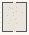

# Symmetry_Seventeen

Authored dimensions: {"width": 25, "depth": 30, "max_height": 8}

Source plan only: columns=x, rows=z. Red dots are manuscript/role primary anchors; blue dots are other placed objects; green crosses are utilities. Numbers refer to A rows below. Dark blue is source 0, cream lower structure, grey source wall-height threshold, ochre platforms. Museum overrides can change the built interpretation. Dots show anchors, not footprints or a proven route.

Map: [commons/maps/Symmetry_Seventeen/map_data.json](https://github.com/palletorsson/AdaResearch/blob/palm-scanner-door-entry/commons/maps/Symmetry_Seventeen/map_data.json)

Text: [commons/maps/Symmetry_Seventeen/final.md](https://github.com/palletorsson/AdaResearch/blob/palm-scanner-door-entry/commons/maps/Symmetry_Seventeen/final.md)

| Instance | x,z | Raw token | Recorded role | Registry / scene |
|---|---|---|---|---|
| A1 | 7,5 | `wallpaper_cage:0:0` | primary | [commons/artifacts/registry/symmetry.json](https://github.com/palletorsson/AdaResearch/blob/palm-scanner-door-entry/commons/artifacts/registry/symmetry.json) → [algorithms/symmetry/wallpaper_cage/wallpaper_cage.tscn](https://github.com/palletorsson/AdaResearch/blob/palm-scanner-door-entry/algorithms/symmetry/wallpaper_cage/wallpaper_cage.tscn) |
| A2 | 14,5 | `loom_alhambra_p6m:0:0` | secondary | [commons/artifacts/registry/pattern_loom.json](https://github.com/palletorsson/AdaResearch/blob/palm-scanner-door-entry/commons/artifacts/registry/pattern_loom.json) |
| A3 | 8,6 | `wall_pattern_gallery:90:0` | secondary | [commons/artifacts/registry/shaders.json](https://github.com/palletorsson/AdaResearch/blob/palm-scanner-door-entry/commons/artifacts/registry/shaders.json) → [commons/artifacts/wall_pattern_gallery/wall_pattern_gallery.tscn](https://github.com/palletorsson/AdaResearch/blob/palm-scanner-door-entry/commons/artifacts/wall_pattern_gallery/wall_pattern_gallery.tscn) |
| A4 | 10,6 | `pattern_loom:0:0` | secondary | [commons/artifacts/registry/pattern_loom.json](https://github.com/palletorsson/AdaResearch/blob/palm-scanner-door-entry/commons/artifacts/registry/pattern_loom.json) → [commons/artifacts/pattern_loom/pattern_loom.tscn](https://github.com/palletorsson/AdaResearch/blob/palm-scanner-door-entry/commons/artifacts/pattern_loom/pattern_loom.tscn) |
| A5 | 6,7 | `loom_escher_mirror:0:0` | secondary | [commons/artifacts/registry/pattern_loom.json](https://github.com/palletorsson/AdaResearch/blob/palm-scanner-door-entry/commons/artifacts/registry/pattern_loom.json) |
| A6 | 14,9 | `mill_alhambra_p6m:0:0` | secondary | [commons/artifacts/registry/pattern_machine_c.json](https://github.com/palletorsson/AdaResearch/blob/palm-scanner-door-entry/commons/artifacts/registry/pattern_machine_c.json); [commons/artifacts/registry/pattern_mill.json](https://github.com/palletorsson/AdaResearch/blob/palm-scanner-door-entry/commons/artifacts/registry/pattern_mill.json) |
| A7 | 11,10 | `pattern_tile_puzzle:90:0` | secondary | [commons/artifacts/registry/arrays.json](https://github.com/palletorsson/AdaResearch/blob/palm-scanner-door-entry/commons/artifacts/registry/arrays.json) → [commons/primitives/arrays/pattern_tile_puzzle.tscn](https://github.com/palletorsson/AdaResearch/blob/palm-scanner-door-entry/commons/primitives/arrays/pattern_tile_puzzle.tscn) |
| A8 | 20,10 | `vr_tile_editor:0:0#lesson:symmetry_compare` | primary | [commons/artifacts/registry/arrays.json](https://github.com/palletorsson/AdaResearch/blob/palm-scanner-door-entry/commons/artifacts/registry/arrays.json) → [commons/primitives/arrays/vr_tile_editor.tscn](https://github.com/palletorsson/AdaResearch/blob/palm-scanner-door-entry/commons/primitives/arrays/vr_tile_editor.tscn) |
| A9 | 5,13 | `mill_persian_p4:0:0` | secondary | [commons/artifacts/registry/pattern_mill.json](https://github.com/palletorsson/AdaResearch/blob/palm-scanner-door-entry/commons/artifacts/registry/pattern_mill.json) |
| A10 | 11,13 | `mill_escher_p4g:0:0` | secondary | [commons/artifacts/registry/pattern_mill.json](https://github.com/palletorsson/AdaResearch/blob/palm-scanner-door-entry/commons/artifacts/registry/pattern_mill.json) |
| A11 | 13,17 | `kaleidoscope:0:0#plinth:0.90` | secondary | [commons/artifacts/registry/lab.json](https://github.com/palletorsson/AdaResearch/blob/palm-scanner-door-entry/commons/artifacts/registry/lab.json) → [commons/artifacts/kaleidoscope/kaleidoscope.tscn](https://github.com/palletorsson/AdaResearch/blob/palm-scanner-door-entry/commons/artifacts/kaleidoscope/kaleidoscope.tscn) |
| A12 | 8,18 | `pattern_atlas_gallery:90:0` | secondary | [commons/artifacts/registry/pattern_atlas.json](https://github.com/palletorsson/AdaResearch/blob/palm-scanner-door-entry/commons/artifacts/registry/pattern_atlas.json) → [commons/artifacts/pattern_atlas_gallery/pattern_atlas_gallery.tscn](https://github.com/palletorsson/AdaResearch/blob/palm-scanner-door-entry/commons/artifacts/pattern_atlas_gallery/pattern_atlas_gallery.tscn) |
| A13 | 6,21 | `pattern_artifact:0:0#plinth:0.90` | secondary | [commons/artifacts/registry/dna_grammar_artifacts.json](https://github.com/palletorsson/AdaResearch/blob/palm-scanner-door-entry/commons/artifacts/registry/dna_grammar_artifacts.json) → [commons/artifacts/pattern_artifact/pattern_artifact.tscn](https://github.com/palletorsson/AdaResearch/blob/palm-scanner-door-entry/commons/artifacts/pattern_artifact/pattern_artifact.tscn) |
| A14 | 14,21 | `tile_meander_floor:0:0` | secondary | [commons/artifacts/registry/arrays.json](https://github.com/palletorsson/AdaResearch/blob/palm-scanner-door-entry/commons/artifacts/registry/arrays.json) → [commons/artifacts/pompeii_mosaic_floor/tile_meander_floor.tscn](https://github.com/palletorsson/AdaResearch/blob/palm-scanner-door-entry/commons/artifacts/pompeii_mosaic_floor/tile_meander_floor.tscn) |

Utilities are listed with exact coordinates and raw tokens in space.json. Read map_info.museum and utility_definitions before inferring pits, entrances, movement or collision.
