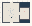

# Tutorial_Pattern

Authored dimensions: {"width": 28, "depth": 21, "max_height": 8}

Source plan only: columns=x, rows=z. Red dots are manuscript/role primary anchors; blue dots are other placed objects; green crosses are utilities. Numbers refer to A rows below. Dark blue is source 0, cream lower structure, grey source wall-height threshold, ochre platforms. Museum overrides can change the built interpretation. Dots show anchors, not footprints or a proven route.

Map: [commons/maps/Tutorial_Pattern/map_data.json](https://github.com/palletorsson/AdaResearch/blob/palm-scanner-door-entry/commons/maps/Tutorial_Pattern/map_data.json)

Text: [commons/maps/Tutorial_Pattern/final.md](https://github.com/palletorsson/AdaResearch/blob/palm-scanner-door-entry/commons/maps/Tutorial_Pattern/final.md)

| Instance | x,z | Raw token | Recorded role | Registry / scene |
|---|---|---|---|---|
| A1 | 8,6 | `grid_model:180:-0.8` | secondary | [commons/artifacts/registry/arrays.json](https://github.com/palletorsson/AdaResearch/blob/palm-scanner-door-entry/commons/artifacts/registry/arrays.json) → [algorithms/arrays/grid_model/grid_model.tscn](https://github.com/palletorsson/AdaResearch/blob/palm-scanner-door-entry/algorithms/arrays/grid_model/grid_model.tscn) |
| A2 | 11,7 | `pattern_studio_plate:0:-0.45` | secondary | [commons/artifacts/registry/arrays.json](https://github.com/palletorsson/AdaResearch/blob/palm-scanner-door-entry/commons/artifacts/registry/arrays.json) → [commons/primitives/arrays/pattern_studio_plate.tscn](https://github.com/palletorsson/AdaResearch/blob/palm-scanner-door-entry/commons/primitives/arrays/pattern_studio_plate.tscn) |
| A3 | 6,8 | `pattern_tile_plate:180:-0.49#p4m` | secondary | [commons/artifacts/registry/arrays.json](https://github.com/palletorsson/AdaResearch/blob/palm-scanner-door-entry/commons/artifacts/registry/arrays.json) → [commons/primitives/arrays/pattern_tile_plate.tscn](https://github.com/palletorsson/AdaResearch/blob/palm-scanner-door-entry/commons/primitives/arrays/pattern_tile_plate.tscn) |
| A4 | 8,8 | `pattern_tile_plate:180:-0.49#p4m` | secondary | [commons/artifacts/registry/arrays.json](https://github.com/palletorsson/AdaResearch/blob/palm-scanner-door-entry/commons/artifacts/registry/arrays.json) → [commons/primitives/arrays/pattern_tile_plate.tscn](https://github.com/palletorsson/AdaResearch/blob/palm-scanner-door-entry/commons/primitives/arrays/pattern_tile_plate.tscn) |
| A5 | 10,8 | `pattern_tile_plate:180:-0.49#p4m` | secondary | [commons/artifacts/registry/arrays.json](https://github.com/palletorsson/AdaResearch/blob/palm-scanner-door-entry/commons/artifacts/registry/arrays.json) → [commons/primitives/arrays/pattern_tile_plate.tscn](https://github.com/palletorsson/AdaResearch/blob/palm-scanner-door-entry/commons/primitives/arrays/pattern_tile_plate.tscn) |
| A6 | 8,9 | `dark_sphere` | decoration | [commons/artifacts/registry/lsystems.json](https://github.com/palletorsson/AdaResearch/blob/palm-scanner-door-entry/commons/artifacts/registry/lsystems.json) → [commons/artifacts/dark_sphere/dark_sphere.tscn](https://github.com/palletorsson/AdaResearch/blob/palm-scanner-door-entry/commons/artifacts/dark_sphere/dark_sphere.tscn) |
| A7 | 22,9 | `pattern_maker_station:180:0#lesson:fixed_motif` | primary | [commons/artifacts/registry/arrays.json](https://github.com/palletorsson/AdaResearch/blob/palm-scanner-door-entry/commons/artifacts/registry/arrays.json) → [commons/artifacts/pattern_maker_station/pattern_maker_station.tscn](https://github.com/palletorsson/AdaResearch/blob/palm-scanner-door-entry/commons/artifacts/pattern_maker_station/pattern_maker_station.tscn) |
| A8 | 8,10 | `pattern_tile_mirror:0:-0.5` | secondary | [commons/artifacts/registry/arrays.json](https://github.com/palletorsson/AdaResearch/blob/palm-scanner-door-entry/commons/artifacts/registry/arrays.json) → [commons/primitives/arrays/pattern_tile_puzzle.tscn](https://github.com/palletorsson/AdaResearch/blob/palm-scanner-door-entry/commons/primitives/arrays/pattern_tile_puzzle.tscn) |
| A9 | 9,11 | `pattern_tile_puzzle:0:-0.5` | secondary | [commons/artifacts/registry/arrays.json](https://github.com/palletorsson/AdaResearch/blob/palm-scanner-door-entry/commons/artifacts/registry/arrays.json) → [commons/primitives/arrays/pattern_tile_puzzle.tscn](https://github.com/palletorsson/AdaResearch/blob/palm-scanner-door-entry/commons/primitives/arrays/pattern_tile_puzzle.tscn) |
| A10 | 11,12 | `panel_bridge_loom:0:-0-49#shafts:8` | secondary | [commons/artifacts/registry/panel_bridge.json](https://github.com/palletorsson/AdaResearch/blob/palm-scanner-door-entry/commons/artifacts/registry/panel_bridge.json) → [commons/ui/panel_bridge/test_panel_bridge.tscn](https://github.com/palletorsson/AdaResearch/blob/palm-scanner-door-entry/commons/ui/panel_bridge/test_panel_bridge.tscn) |
| A11 | 7,13 | `script_runner:0:-0.5` | secondary | [commons/artifacts/registry/script_runner.json](https://github.com/palletorsson/AdaResearch/blob/palm-scanner-door-entry/commons/artifacts/registry/script_runner.json) → [commons/primitives/script_runner/script_runner.tscn](https://github.com/palletorsson/AdaResearch/blob/palm-scanner-door-entry/commons/primitives/script_runner/script_runner.tscn) |
| A12 | 10,14 | `pulsar_compact:0:-0.5` | secondary | [commons/artifacts/registry/arrays.json](https://github.com/palletorsson/AdaResearch/blob/palm-scanner-door-entry/commons/artifacts/registry/arrays.json) → [algorithms/arrays/pulsar/pulsar_glass_tubes.tscn](https://github.com/palletorsson/AdaResearch/blob/palm-scanner-door-entry/algorithms/arrays/pulsar/pulsar_glass_tubes.tscn) |

Utilities are listed with exact coordinates and raw tokens in space.json. Read map_info.museum and utility_definitions before inferring pits, entrances, movement or collision.
