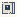

# WaveFunctions_AirMusic

Authored dimensions: {"width": 13, "depth": 12, "max_height": 3}

Source plan only: columns=x, rows=z. Red dots are manuscript/role primary anchors; blue dots are other placed objects; green crosses are utilities. Numbers refer to A rows below. Dark blue is source 0, cream lower structure, grey source wall-height threshold, ochre platforms. Museum overrides can change the built interpretation. Dots show anchors, not footprints or a proven route.

Map: [commons/maps/WaveFunctions_AirMusic/map_data.json](https://github.com/palletorsson/AdaResearch/blob/palm-scanner-door-entry/commons/maps/WaveFunctions_AirMusic/map_data.json)

Text: [commons/maps/WaveFunctions_AirMusic/final.md](https://github.com/palletorsson/AdaResearch/blob/palm-scanner-door-entry/commons/maps/WaveFunctions_AirMusic/final.md)

| Instance | x,z | Raw token | Recorded role | Registry / scene |
|---|---|---|---|---|
| A1 | 1,1 | `GlassRack:0:0.7#config:spiral_tube` | secondary | [commons/artifacts/registry/wavefunctions.json](https://github.com/palletorsson/AdaResearch/blob/palm-scanner-door-entry/commons/artifacts/registry/wavefunctions.json) → [commons/glass_rack/GlassRack.tscn](https://github.com/palletorsson/AdaResearch/blob/palm-scanner-door-entry/commons/glass_rack/GlassRack.tscn) |
| A2 | 9,1 | `GlassRack:-90:0.7#config:fractional_distillation` | secondary | [commons/artifacts/registry/wavefunctions.json](https://github.com/palletorsson/AdaResearch/blob/palm-scanner-door-entry/commons/artifacts/registry/wavefunctions.json) → [commons/glass_rack/GlassRack.tscn](https://github.com/palletorsson/AdaResearch/blob/palm-scanner-door-entry/commons/glass_rack/GlassRack.tscn) |
| A3 | 1,2 | `lab_table` | secondary | [commons/artifacts/registry/wavefunctions.json](https://github.com/palletorsson/AdaResearch/blob/palm-scanner-door-entry/commons/artifacts/registry/wavefunctions.json) → [commons/lab/table/table.tscn](https://github.com/palletorsson/AdaResearch/blob/palm-scanner-door-entry/commons/lab/table/table.tscn) |
| A4 | 9,2 | `lab_table` | secondary | [commons/artifacts/registry/wavefunctions.json](https://github.com/palletorsson/AdaResearch/blob/palm-scanner-door-entry/commons/artifacts/registry/wavefunctions.json) → [commons/lab/table/table.tscn](https://github.com/palletorsson/AdaResearch/blob/palm-scanner-door-entry/commons/lab/table/table.tscn) |
| A5 | 4,4 | `dark_sphere` | decoration | [commons/artifacts/registry/lsystems.json](https://github.com/palletorsson/AdaResearch/blob/palm-scanner-door-entry/commons/artifacts/registry/lsystems.json) → [commons/artifacts/dark_sphere/dark_sphere.tscn](https://github.com/palletorsson/AdaResearch/blob/palm-scanner-door-entry/commons/artifacts/dark_sphere/dark_sphere.tscn) |
| A6 | 5,5 | `SystemsMusicTest:0:0.5:0.9` | secondary | [commons/artifacts/registry/wavefunctions.json](https://github.com/palletorsson/AdaResearch/blob/palm-scanner-door-entry/commons/artifacts/registry/wavefunctions.json) → [commons/audio/systems/air_points/SystemsMusicTest.tscn](https://github.com/palletorsson/AdaResearch/blob/palm-scanner-door-entry/commons/audio/systems/air_points/SystemsMusicTest.tscn) |
| A7 | 1,8 | `RackAmbientDrone:0:1` | secondary | [commons/artifacts/registry/wavefunctions.json](https://github.com/palletorsson/AdaResearch/blob/palm-scanner-door-entry/commons/artifacts/registry/wavefunctions.json) → [commons/audio/rack_presets/rack_ambient_drone.tscn](https://github.com/palletorsson/AdaResearch/blob/palm-scanner-door-entry/commons/audio/rack_presets/rack_ambient_drone.tscn) |
| A8 | 7,8 | `BigPipeSystem:90:1#path:straight,straight,up,straight,down,straight,straight` | secondary | [commons/artifacts/registry/wavefunctions.json](https://github.com/palletorsson/AdaResearch/blob/palm-scanner-door-entry/commons/artifacts/registry/wavefunctions.json) → [algorithms/wavefunctions/big_pipe_system/BigPipeSystem.tscn](https://github.com/palletorsson/AdaResearch/blob/palm-scanner-door-entry/algorithms/wavefunctions/big_pipe_system/BigPipeSystem.tscn) |
| A9 | 3,9 | `air_music_display_case:0:1` | secondary | [commons/artifacts/registry/wavefunctions.json](https://github.com/palletorsson/AdaResearch/blob/palm-scanner-door-entry/commons/artifacts/registry/wavefunctions.json) → [commons/artifacts/air_music_display_case/air_music_display_case.tscn](https://github.com/palletorsson/AdaResearch/blob/palm-scanner-door-entry/commons/artifacts/air_music_display_case/air_music_display_case.tscn) |
| A10 | 5,9 | `resonating_metallophone:0#stand:table` | primary | [commons/artifacts/registry/wavefunctions.json](https://github.com/palletorsson/AdaResearch/blob/palm-scanner-door-entry/commons/artifacts/registry/wavefunctions.json) → [algorithms/wavefunctions/resonance/resonating_metallophone.tscn](https://github.com/palletorsson/AdaResearch/blob/palm-scanner-door-entry/algorithms/wavefunctions/resonance/resonating_metallophone.tscn) |

Utilities are listed with exact coordinates and raw tokens in space.json. Read map_info.museum and utility_definitions before inferring pits, entrances, movement or collision.
