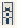

# Trans_Introduction

Authored dimensions: {"width": 13, "depth": 23, "max_height": 2}

Source plan only: columns=x, rows=z. Red dots are manuscript/role primary anchors; blue dots are other placed objects; green crosses are utilities. Numbers refer to A rows below. Dark blue is source 0, cream lower structure, grey source wall-height threshold, ochre platforms. Museum overrides can change the built interpretation. Dots show anchors, not footprints or a proven route.

Map: [commons/maps/Trans_Introduction/map_data.json](https://github.com/palletorsson/AdaResearch/blob/palm-scanner-door-entry/commons/maps/Trans_Introduction/map_data.json)

Text: [commons/maps/Trans_Introduction/final.md](https://github.com/palletorsson/AdaResearch/blob/palm-scanner-door-entry/commons/maps/Trans_Introduction/final.md)

| Instance | x,z | Raw token | Recorded role | Registry / scene |
|---|---|---|---|---|
| A1 | 9,2 | `matrix_4x4_viewer:270:1#pose:translate#plinth` | secondary | [commons/artifacts/registry/transforms.json](https://github.com/palletorsson/AdaResearch/blob/palm-scanner-door-entry/commons/artifacts/registry/transforms.json) → [algorithms/transforms/matrix_viewer/matrix_4x4_viewer.tscn](https://github.com/palletorsson/AdaResearch/blob/palm-scanner-door-entry/algorithms/transforms/matrix_viewer/matrix_4x4_viewer.tscn) |
| A2 | 7,6 | `z_translation_cube:0:1` | secondary | [commons/artifacts/registry/transforms.json](https://github.com/palletorsson/AdaResearch/blob/palm-scanner-door-entry/commons/artifacts/registry/transforms.json) → [commons/artifacts/axis_translation_cube/z_translation_cube.tscn](https://github.com/palletorsson/AdaResearch/blob/palm-scanner-door-entry/commons/artifacts/axis_translation_cube/z_translation_cube.tscn) |
| A3 | 3,9 | `transform_composition:0:0#plinth:0.60` | secondary | [commons/artifacts/registry/transforms.json](https://github.com/palletorsson/AdaResearch/blob/palm-scanner-door-entry/commons/artifacts/registry/transforms.json) → [commons/artifacts/transform_composition/transform_composition.tscn](https://github.com/palletorsson/AdaResearch/blob/palm-scanner-door-entry/commons/artifacts/transform_composition/transform_composition.tscn) |
| A4 | 3,15 | `rotation_gimbal:0:0#plinth:0.60` | secondary | [commons/artifacts/registry/transforms.json](https://github.com/palletorsson/AdaResearch/blob/palm-scanner-door-entry/commons/artifacts/registry/transforms.json) → [commons/artifacts/rotation_gimbal/rotation_gimbal.tscn](https://github.com/palletorsson/AdaResearch/blob/palm-scanner-door-entry/commons/artifacts/rotation_gimbal/rotation_gimbal.tscn) |
| A5 | 8,17 | `balance_puzzle:90:1#plinth` | secondary | [commons/artifacts/registry/furniture.json](https://github.com/palletorsson/AdaResearch/blob/palm-scanner-door-entry/commons/artifacts/registry/furniture.json) → [commons/primitives/balance/balance_puzzle.tscn](https://github.com/palletorsson/AdaResearch/blob/palm-scanner-door-entry/commons/primitives/balance/balance_puzzle.tscn) |
| A6 | 3,18 | `adjustable_landing:0:0#plinth:0` | primary | [commons/artifacts/registry/transforms.json](https://github.com/palletorsson/AdaResearch/blob/palm-scanner-door-entry/commons/artifacts/registry/transforms.json) → [commons/artifacts/adjustable_landing/adjustable_landing.tscn](https://github.com/palletorsson/AdaResearch/blob/palm-scanner-door-entry/commons/artifacts/adjustable_landing/adjustable_landing.tscn) |

Utilities are listed with exact coordinates and raw tokens in space.json. `utility-index.json` resolves active codes to the literal utility registry and scene, separately from the ordinary artifact registry. Their scene sources and the grid/museum dispatch context are included. Unresolved/special dispatch stays explicitly labelled. Read map_info.museum and utility_definitions before inferring pits, entrances, movement or collision.
