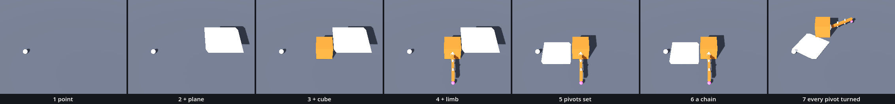

# A Body of Parts — the first assemblage

The organism left us with a limb that is one branch of the tree: `Hip`, with thirteen nodes below it. We moved that one node with B, and everything below it followed. Its three bars were one cube, used three times. Here we take the parts made so far, the point, the plane, the cube and the limb, keep each as a scene of its own, and put them together under one root. Two ideas make it work: instancing, which makes nodes from a saved scene, and composition, a scene made of scenes.

In the hall, [the reading](../../../../commons/maps/Trans_Introduction/final.md) puts us on a travelling cube: "Relative to the room, you are moving. Relative to the cube, you may be standing still." The hall carries its rider with a line of code: "`_translate_rider` adds that difference to your position too." A child in a scene tree needs no such line. Two halls on, [a room](../../../../commons/maps/Trans_Scale/final.md) is multiplied by four: "The food and the figure belong to `room`, so the same multiplication reaches their positions as well as their dimensions."

This study takes two sessions. The first instances the parts, gives them pivots, and moves, turns and scales the body. It ends at **Stop here**. The second asks who is whose parent, and carries the body.

Every message and number on this page comes from running the study in Godot 4.6. Parts marked *(editor)* describe the editor's own windows and were not watched.

## Find the family in the hall

A lesson starts in its hall, with one question: does the hall show one work at several values of one axis? If it does, predict which two look most alike before you read anything beside them.

Trans_Introduction holds three works with a declared axis, beside the route. None of them is shown as a family. The Matrix 4x4 Viewer has the axis `pose`, with six values: none, translate, rotate, scale, shear, project. The hall sets one of them: `translate`. The Balance Puzzle has `tell` (mark, none, ghost, exemplar) and the Rotation Gimbal has `regime` (free, approaching, locked, past); both stand once, at their defaults. We read this from the hall's map file; we did not walk it.

So the question changes. Find the viewer, name its axis, and say which of the six values you are looking at. Then write down which two of the six you expect to look most alike on its wireframe cube. Nobody has rendered that sheet. Keep the guess: this study ends with a sheet of our own.

## Open the study

Open the [Body of Parts study](README.md), then `body.tscn`. This scene does not inherit the organism's. It inherits `plane.tscn`: the floor, the camera, A and B, the walk, the marble on M and the view from below on V. The cube and the limb are not inherited. They come in as parts. There are no new keys.

`body.tscn` adds one node, `Body`: an empty `Node3D` on the floor at (0, 0, 0.9), which runs `body.gd`. The folder `parts/` holds four scenes: `point_part.tscn`, `plane_part.tscn`, `cube_part.tscn` and `limb_part.tscn`.

Run it. In front of the line from A to B, on the floor, stand a pale point, a pale square plate, an orange cube and the limb, reaching towards us. In the first second each of the four turns 30 degrees on its own spot. Then they hold still.

`body.gd` is ours. The download holds the finished version. We will take it apart and build it again.

## Parts are scenes

A branch of a tree can be saved as a file *(editor)*: in the Scene dock, right-click a node, choose **Save Branch as Scene**, and name the file. The node and everything below it go into the new scene, and the old scene keeps an instance of it in the same place. The download holds what that leaves for three branches. We wrote those files by hand:

- `cube_part.tscn` is `Cube` from `cube.tscn`, with its `Body`. It runs `cube.gd`, unchanged.
- `limb_part.tscn` is `Hip` from `organism.tscn`, with the thirteen nodes below it. Its root is named `Limb`.
- `point_part.tscn` is `A` from `line.tscn`: the pale sphere, 7.5 cm in radius.

A branch has to be saved in the scene where it was made. In a scene that only inherits it, the editor answers: "Can't save a branch which is part of an inherited scene." We found that message as text in Godot 4.6 and did not watch it.

`plane_part.tscn` was not cut from a study. It is a mesh node whose mesh is a file, `parts/walk.tres`: one walk of ours, D, S, A, W, closed with Enter, filled with F, and saved as Plane's *In your room* saved yours. A supplied script of three lines gives it its body.

We went one step further in the limb: each of its three bars is an instance of `cube_part.tscn`. A scene made of scenes. The old studies lost nothing. `cube.tscn` and `organism.tscn` still run on their own, and one turn of the limb still leaves `55 of 88 cells`.

## The first instance

Replace everything in `body.gd` with this:

```gdscript
extends Node3D

func _ready() -> void:
	var scene: PackedScene = load("res://parts/point_part.tscn")
	var point: Node3D = scene.instantiate()
	print(point, " in the tree: ", point.is_inside_tree())
	add_child(point)
	point.position = Vector3(-0.8, 0.075, 0.0)
	print(point, " in the tree: ", point.is_inside_tree())
	print(get_child_count(), " child, at ", point.global_position)
```

Run it. One pale point lies on the floor, to the left. The Output panel reads:

```
Point:<MeshInstance3D#29813114336> in the tree: false
Point:<MeshInstance3D#29813114336> in the tree: true
1 child, at (-0.8, 0.075, 0.9)
```

`load()` reads the file, as it read `my_plane.tres` in Plane's room. For a scene file it gives a `PackedScene`: the scene as a recipe, with no node in it yet. `instantiate()` follows the recipe and gives back the root of a new set of nodes. That is an instance. The first line of output shows that this is not enough: the point exists, and it is not in the tree. `add_child()` makes it a child of the node our script runs on, and only then is it in the room. Its `position` is counted from its parent, `Body`, which stands at z = 0.9.

Each call of `instantiate()` makes a new copy. We called it twice and compared the two with `==`: `false`. The long number in the output is the node's own, and differs from run to run.

## Three more

Replace `_ready()` with this:

```gdscript
func _ready() -> void:
	var point: Node3D = load("res://parts/point_part.tscn").instantiate()
	add_child(point)
	point.position = Vector3(-0.8, 0.075, 0.0)

	var plane: Node3D = load("res://parts/plane_part.tscn").instantiate()
	add_child(plane)

	var cube: Node3D = load("res://parts/cube_part.tscn").instantiate()
	add_child(cube)
	cube.position = Vector3(0.55, 0.25, 0.0)

	var limb: Node3D = load("res://parts/limb_part.tscn").instantiate()
	add_child(limb)
	limb.position = Vector3(0.55, 0.25, 0.25)

	print(get_child_count(), " children")
	print_tree_pretty()
```

Run it. The cube stands on the floor with the limb at its front face. The plane is not on the floor. It hangs in the air to the right, 1.12 m up. The output:

```
4 children
 ┖╴Body
    ┠╴Point
    ┠╴Plane
    ┃  ┖╴Body
    ┃     ┖╴CollisionShape3D
    ┠╴Cube
    ┃  ┖╴Body
    ┃     ┖╴CollisionShape3D
    ┖╴Limb
       ┖╴Upper
          ┠╴Bar
          ┃  ┖╴Body
          ┃     ┖╴CollisionShape3D
          ┖╴Lower
```

and eight more lines, down to `Toe`: `Lower` and `Foot` each hold a `Bar` as `Upper` does. `print_tree_pretty()` prints a node and all below it. Eleven lines of code put 21 nodes under `Body`: each instance arrives whole. The cube came with its `Body`, and its `_ready()` built its mesh when it entered the tree. An instance we never added had no mesh at all: `<Object#null>`.

The three `Bar`s are the cube part again. One file is used four times here. Open `cube_part.tscn` and set **Draft** to `my one face` *(editor)*. We wrote that value into the file: the cube and all three bars came back with 2 triangles each. Set it back to `repaired`.

## A pivot

Why does the plane hang in the air? Add `print(plane.get_aabb())` at the end of `_ready()`. It prints `[P: (0.75, 1.12, 0.0), S: (0.899999, 0.00001, 0.9)]`. `get_aabb()` gives the box around a mesh in the node's own numbers: where it begins, P, and how large it is, S. Our walk began at (0.75, 1.12, 0), where B stood, and went 0.9 m to the right and 0.9 m towards us. The mesh kept those numbers. The plane's own origin is the room's origin on the day of the walk, and its middle lies at (1.2, 1.12, 0.45) from there.

A turn goes about a node's origin. We turned this plane by 30 degrees, `plane.rotation.y = deg_to_rad(30.0)`: its middle swung 0.66 m away, as the limb did with its pivots `outside`.

So we give the plane an origin where we want one: an empty parent. Replace the plane's two lines with these six:

```gdscript
	var plane: Node3D = load("res://parts/plane_part.tscn").instantiate()
	var pivot := Node3D.new()
	add_child(pivot)
	pivot.position = Vector3(-0.2, 0.02, 0.0)
	pivot.add_child(plane)
	plane.position = -Vector3(1.2, 1.12, 0.45)
```

Run it. The plate lies on the floor between the point and the cube. `Node3D.new()` makes a bare node: it has a transform and nothing to draw. It stands where the plane's middle should be, 2 cm above the floor. The plane is its child, moved back by its own middle, so the middle falls on the pivot. The plane's node now stands at (−1.4, −1.1, 0.45) in the room, under the floor, and nobody sees a node. With `pivot.rotation.y = deg_to_rad(30.0)` the plate turns on the spot: its middle stayed at (−0.2, 0.02, 0.9).

## One function, four parts

Every part gets a pivot. Replace everything in `body.gd` with this:

```gdscript
extends Node3D

func _ready() -> void:
	add_part("point", self, Vector3(-0.8, 0.075, 0.0), Vector3.ZERO)
	add_part("plane", self, Vector3(-0.2, 0.02, 0.0), Vector3(1.2, 1.12, 0.45))
	add_part("cube", self, Vector3(0.55, 0.25, 0.0), Vector3.ZERO)
	add_part("limb", self, Vector3(0.55, 0.25, 0.25), Vector3.ZERO)

func add_part(kind: String, parent: Node3D, at: Vector3, middle: Vector3) -> Node3D:
	var pivot := Node3D.new()
	parent.add_child(pivot)
	pivot.global_position = to_global(at)
	var part: Node3D = load("res://parts/" + kind + "_part.tscn").instantiate()
	pivot.add_child(part)
	part.position = -middle
	pivot.name = part.name + "Pivot"
	return pivot
```

Run it. The body looks as it did. The root now has four children, the pivots, and 25 nodes below it: `PointPivot > Point`, `PlanePivot > Plane`, `CubePivot > Cube`, `LimbPivot > Limb`.

`add_part()` does for any part what we did for the plane. `at` is where the pivot stands, in the body's own numbers. `to_global()` turns that into a place in the room, and `global_position` puts the pivot there, whoever its parent is. `middle` is the spot of the part that should sit on the pivot; for three of our parts that is their own origin, `Vector3.ZERO`. `self` is the node the script runs on: for now every pivot is a child of the root. The `+` joins three pieces of text into the file's path, and the name lets us write `$CubePivot/Cube`.

## Move, turn, scale

Three things to try, each for one run, at the end of `_ready()`. Remove each before the next.

**Move the root.**

```gdscript
	position.x += 0.5
	print($LimbPivot/Limb/Upper/Lower/Foot/Toe.global_position, " ", $CubePivot.position, " ", $CubePivot/Cube.position)
```

The whole body stands half a metre to the right. The toe went from (0.55, 0.12, 2.05) to (1.05, 0.12, 2.05), and so did every one of the 25 nodes. Nothing below the root was told anything: the pivot's `position` is still (0.55, 0.25, 0) and the cube's is still (0, 0, 0).

**Turn one part.** Add `$LimbPivot/Limb/Upper/Lower.rotation.y = deg_to_rad(30.0)`. The limb bends at the knee. The path walks into the instance as if we had built it here. Nine nodes moved, `Lower` and the eight below it; the toe is at (0.85, 0.12, 1.97). The cube, the plane, the point and the limb's first bar did not move. A turn commands what hangs below it and nothing else.

**Scale the root.** Add `scale = Vector3(2, 2, 2)`. The body is twice as large, and twice as long: the cube is 1 m on an edge and stands at (1.1, 0.5, 0.9), and the point and the cube are 2.72 m apart where they were 1.36. This is the hall's line, `room.scale = Vector3.ONE * FACTOR`. It reaches positions as well as sizes, because both are counted from the root.

Now stretch the root along one direction, and turn the limb's pivot:

```gdscript
	scale = Vector3(1, 1, 2)
	$LimbPivot.rotation.y = deg_to_rad(30.0)
	print(rad_to_deg($LimbPivot/Limb.global_basis.x.angle_to($LimbPivot/Limb.global_basis.z)))
```

It prints `123.004494272166`. It is the organism's number, and the organism's rule: under a parent stretched along one direction, a turned child shears. Its x and z axes no longer stand at a right angle, and they are 1.32 and 1.80 long. With `Vector3(2, 2, 2)` the same line prints `90.0000025044782`. An even scale keeps every angle. So scale a root evenly, and stretch leaves.

## Stop here: what we have

This is the end of the first session. `body.gd` should be the script under *One function, four parts*. Run the study and check four things: a point, a plate, a cube and a limb stand on the floor in front of the line from A to B, and nothing moves; the plate lies on the floor, not in the air; B walks as before, and M drops the marble; nothing is printed.

## The argument: who is whose parent?

So far every pivot is the root's child. Now let each part be the child of the one before it, in the order we made them: the point, the plane, the cube, the limb. A first try: keep what `add_part()` returns, and add each pivot to the one before.

```gdscript
func _ready() -> void:
	var point := add_part("point", self, Vector3(-0.8, 0.075, 0.0), Vector3.ZERO)
	var plane := add_part("plane", self, Vector3(-0.2, 0.02, 0.0), Vector3(1.2, 1.12, 0.45))
	var cube := add_part("cube", self, Vector3(0.55, 0.25, 0.0), Vector3.ZERO)
	var limb := add_part("limb", self, Vector3(0.55, 0.25, 0.25), Vector3.ZERO)
	point.add_child(plane)
	plane.add_child(cube)
	cube.add_child(limb)
	print(get_child_count(), " children")
```

Run it. The body looks right, and Godot reports three errors. The first:

```
Can't add child 'PlanePivot' to 'PointPivot', already has a parent 'Body'.
```

The output reads `4 children`. Nothing was moved. A node has one parent, and `add_child()` does not take a node away from the parent it has. Godot says so and leaves the tree as it was. Had we not read the message, we would have a body that we believe is a chain and that is not one.

The repair is to name the right parent when the part is added. That is what `add_part()`'s second parameter was waiting for. Replace everything in `body.gd` with this:

```gdscript
extends Node3D

# 0 flat   1 a chain   2 a chain with offset pivots   3 two chains from one hip
@export_enum("flat", "a chain", "a chain with offset pivots", "two chains from one hip") var parenting := 0

# where each pivot stands, in the body's own numbers: metres from the root
var point_at := Vector3(-0.8, 0.075, 0.0)
var plane_at := Vector3(-0.2, 0.02, 0.0)
var cube_at := Vector3(0.55, 0.25, 0.0)
var limb_at := Vector3(0.55, 0.25, 0.25)
var walk_middle := Vector3(1.2, 1.12, 0.45)   # the middle of our walk, in the walk's own numbers

var shift := Vector3.ZERO       # how far every pivot stands from its part's middle
var speed := deg_to_rad(30.0)   # radians per second
var limit := deg_to_rad(30.0)   # the turn stops here
var angle := 0.0
var pivots: Array[Node3D] = []

func _ready() -> void:
	if parenting == 2:
		shift = Vector3(-0.25, 0.0, 0.0)
	if parenting == 0:
		add_part("point", self, point_at, Vector3.ZERO)
		add_part("plane", self, plane_at, walk_middle)
		add_part("cube", self, cube_at, Vector3.ZERO)
		add_part("limb", self, limb_at, Vector3.ZERO)
	if parenting == 1 or parenting == 2:
		var point := add_part("point", self, point_at, Vector3.ZERO)
		var plane := add_part("plane", point, plane_at, walk_middle)
		var cube := add_part("cube", plane, cube_at, Vector3.ZERO)
		add_part("limb", cube, limb_at, Vector3.ZERO)
	if parenting == 3:
		var plane := add_part("plane", self, plane_at, walk_middle)
		add_part("point", plane, point_at, Vector3.ZERO)
		var cube := add_part("cube", self, cube_at, Vector3.ZERO)
		add_part("limb", cube, limb_at, Vector3.ZERO)

func add_part(kind: String, parent: Node3D, at: Vector3, middle: Vector3) -> Node3D:
	var pivot := Node3D.new()
	parent.add_child(pivot)
	pivot.global_position = to_global(at + shift)
	var part: Node3D = load("res://parts/" + kind + "_part.tscn").instantiate()
	pivot.add_child(part)
	part.position = -(middle + shift)
	pivot.name = part.name + "Pivot"
	pivots.append(pivot)
	return pivot

func _process(delta: float) -> void:
	angle += speed * delta
	if angle > limit:
		angle = limit
	for pivot in pivots:
		pivot.rotation.y = angle
```

This is the `body.gd` in the download. The same four parts go to the same four places. Only the second word of each `add_part()` line differs: who the parent is. The four trees, each pivot with its part beside it:

```
0 flat              1 a chain, and 2            3 two chains from one hip
Body                Body                        Body
├── PointPivot      └── PointPivot              ├── PlanePivot
├── PlanePivot          ├── Point               │   ├── Plane
├── CubePivot           └── PlanePivot          │   └── PointPivot
└── LimbPivot               ├── Plane           └── CubePivot
                            └── CubePivot           ├── Cube
                                ├── Cube            └── LimbPivot
                                └── LimbPivot
```

At value 2 the tree is the chain's, and `shift` moves every pivot 0.25 m to the left of its part's middle; the part moves back by as much, as the limb's bars slid on their pins. `_process()` is the organism's: one angle grows by `speed * delta`, and every pivot in the list is turned by it. It stops at 30 degrees, one second after the start.

**Write your prediction before you render.** Four bodies of the same four parts in the same four places. At rest, which two will look most alike? One second later, with every pivot turned 30 degrees, which two? Which two will differ most? And if the root alone is turned 30 degrees and no pivot? Write it down, with a reason for each.

Then look. Select `Body` and choose **Parenting** in the Inspector *(editor)*, or change the `0` at the end of the `@export_enum` line, and run. For stills of all four, run `sheet.gd` as the [README](README.md) says. It brings a camera of its own that looks straight down. This is what our sheet measured:

| `parenting` | the root's children | toe after the turn (x, z) | the toe went |
| --- | --- | --- | --- |
| 0 flat | 4 | (1.00, 1.93) | 0.47 m |
| 1 a chain | 1 | (1.12, −0.50) | 2.61 m |
| 2 a chain with offset pivots | 1 | (0.75, −0.72) | 2.77 m |
| 3 two chains from one hip | 2 | (1.45, 1.57) | 1.02 m |

At rest the four stills do not differ on one pixel: 0.00% of the frame for all six pairs, from the study's camera and from the top. There is no closest pair at rest. All four are one picture.

With the root turned 30 degrees and no pivot, they agree again: 0.00%, six pairs, both cameras. The course's outline expected the difference to show here. It does not. The root commands every part in all four trees, so its turn cannot tell them apart.

With every pivot turned, every pair differs. The closest pair is flat and two chains: 0.55% of the frame from the top, 1.47% from the study's camera. In both, the plane and the cube turn on their own spots; only the point and the limb ride along. The farthest pair is the chain with offset pivots and two chains, 4.77% and 5.32%, a hair ahead of offset pivots and flat. The outline expected the two chains of values 1 and 2 to be farthest apart. They are the second closest pair, 2.97% and 2.58%: the same curl, bent at other places. The outline was right about the last part: flat leaves the toe 0.47 m from where it rested, the chain swings it 2.61 m.

The claim: an assemblage's structure is invisible at rest, and invisible while only the root moves. It shows when a part inside it moves. The tree, not the parts, says what the body does.

## What the body owes

A hierarchy is a command chain. The root moves and the leaves obey, and nothing in the picture shows who commanded whom: our four stills at rest were the same picture to the pixel. Paul Klee drew the chain as brain, muscle, bone, from active to passive. Godot draws it as a tree, and we chose its root.

Look at what we chose. The chain runs point, plane, cube, limb, because that is the order in which we made them. The point commands the body for no better reason than that it came first. In two chains the plane commands the point. Neither order was in the parts. A default is a decision somebody made earlier, and the first node we made is not a neutral centre. Whoever turns out to be the root of your room, write down why.

The tree also hides its own mistakes. Three refused `add_child()` calls left a body that looked finished.

## Carry the root

The place this chapter asks for is to pick the whole body up, with an XR hand or a desktop carry, and find that the parts come with it, pivots and all.

On the desktop the hand is B. Add one line at the top of `_process()`:

```gdscript
	position = $"../B".position
```

Run it. The body jumps to B and hangs at the height of the walk, 1.12 m: picked up. The pivots turn as before. Hold A: B carries all 25 nodes to the left. With B at x = −0.73 our toe was at (0.27, 1.24, 1.03): still (1.0, 0.12, 1.03) from the root, as on the floor. No `position` below the root had changed. Press M: the marble fell from one metre above B onto the carried plane, `marble at 1.24 m`. The bodies came too.

Then do what Trans_Scale does to its room. For one run, add `scale = Vector3.ONE * 4.0` under the new line. The carried cube is 2 m on an edge, and the toe is (4.0, 0.48, 4.12) from the root: four times its place at scale 1. Every angle is kept. The body's relations survive the scale, which is what a hierarchy is for. The hall's last question still stands: "There is a difference between preserving a shape and preserving what someone can do there."

Here is what was not checked. No headset was used and no hand: B moves at one height and on four keys, and a hand also turns what it holds. We did not walk the body into the hall. Remove the two lines.

## Try

Take out the two lines with `limit`. The turn goes on: at value 1 the chain winds through itself, and after twelve seconds it lies where it rested.

Repair the first try another way: `plane.reparent(point)` in place of `point.add_child(plane)`, and so for the other two. The root had 1 child, and the plane's pivot read (0.6, −0.055, 0) from its new parent without having moved in the room.

Use your own walk: copy your `my_plane.tres` over `parts/walk.tres`, print the plane's `get_aabb()`, and set `walk_middle` to P plus half of S. A square walk of 1.2 m gave us (1.35, 1.12, 0.6), and its middle fell on the pivot.

Misspell a path: `load("res://parts/kube_part.tscn").instantiate()`. We got `Cannot open file 'res://parts/kube_part.tscn'.` and then `Attempt to call function 'instantiate' in base 'null instance' on a null instance.` With `preload()` in place of `load()` the same slip is found before the study starts: `Preload file "res://parts/kube_part.tscn" does not exist.`

Ask who owns a node: `print($PointPivot.owner)` gives `<Object#null>`, and `print($LimbPivot/Limb/Upper.owner)` names the `Limb`. The owner is the scene a node is saved with. We saved our body from code, with `PackedScene.new()`, `pack(self)` and `ResourceSaver.save()`: the file held the root and nothing else, because nodes added by code have no owner.

## The process

A body made by more than one operation has a recipe. Ours, one still after each step, from one camera:

point → + plane → + cube → + limb → pivots set → a chain → every pivot turned



`sheet.gd` makes the strip, and counts what each step claims. The root has 1, 2, 3, 4, 4, 1, 1 children, and 1, 4, 7, 21, 25, 25, 25 nodes below it. Two steps changed the picture most, and almost equally: setting the pivots, which brought the plane down from where it was walked (14.30% of the tile), and the turn (14.34%). One step changed the tree most and the picture not at all: *a chain* differs from *pivots set* on 0.00% of the tile. That tile is the chapter's claim.

## In your room

Your room's first assemblage: at least three parts of different origin under one root.

Copy `room.tscn`, `room.gd` and `my_plane.tres` from your Organism folder into this one. One part made in code is already there: your cube, with its joint and its arm. Draw one by hand: a new scene with one `MeshInstance3D` named `Ring`, its mesh a new `TorusMesh` with an inner radius of 0.12 and an outer radius of 0.2, saved as `my_ring.tscn` *(editor)*. Carry one in: ask a classmate for a part scene of theirs, with the scripts it names, and copy the files into your folder. If you work alone, `parts/limb_part.tscn` can stand in. At the end of `_ready()` in `room.gd`, add:

```gdscript
	var ring: Node3D = load("res://my_ring.tscn").instantiate()
	$Cube.add_child(ring)
	ring.position = Vector3(0, 0.37, 0)
	var guest: Node3D = load("res://parts/limb_part.tscn").instantiate()
	$Cube/Joint.add_child(guest)
	guest.position = Vector3(0, 0, 0.3)
```

Run `room.tscn`. We made the same room by writing its files. The ring lies on the cube. The guest hangs from the end of the arm and sweeps with it: in one second its toe went from (1.05, 1.53, 1.8) to (1.73, 1.53, 1.59), and the ring did not move. We hung the guest from `Joint` and not from `Arm`: the arm is a stretched leaf.

Here the cube is the root. Is that your choice? Make it one. Write one line in your README saying why that part commands. Hand in your room with its process strip: one still after each part you added, in order, with the operation named under it.

## What we borrowed

| Part | From | How far we go |
| --- | --- | --- |
| `plane.tscn` and all it inherits | Point Plane | Inherited. The root runs `plane.gd` unchanged. |
| `cube.gd` | Point Cube | Ours, unchanged. It runs on the cube part: four times in this body. |
| `parts/cube_part.tscn`, `parts/limb_part.tscn`, `parts/point_part.tscn` | Saved from our own studies | Use: `load()`, `instantiate()`, `add_child()`. |
| `parts/plane_part.tscn`, `parts/walk.tres` | Supplied here | Use: a saved walk as a mesh. Put your own `my_plane.tres` in its place and print its `get_aabb()`. |
| `parts/plane_part.gd` | Supplied here | Use: it makes the plane's body from its mesh, with the three lines of Plane's room. |
| `get_aabb()`, `print_tree_pretty()` | Godot | Use: the box around a mesh in the node's own numbers; a node and all below it, printed. |
| `sheet.gd` | Supplied here | Use: it renders the four values of `parenting` in three poses, measures them, and makes the process strip. |

What we made is `body.gd`: one function that instances a part under a pivot under a parent, four parts, an axis that chooses the parents, and one angle that turns every pivot.

## What we carry forward

We leave with scenes as parts: `load()`, `instantiate()` and `add_child()`; with a pivot as an empty parent; with a tree we can print and a parent we can choose; and with one rule: a node has one parent.

The next stop, *The chessboard*, takes one of these parts, `cube_part.tscn`, and instances it 64 times. We wrote `add_part()` four times by hand. There a loop inside a loop does the writing, and a rule over x and z gives each cube its colour.
