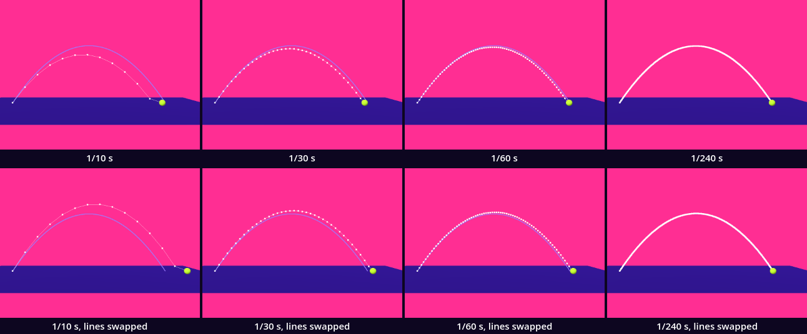
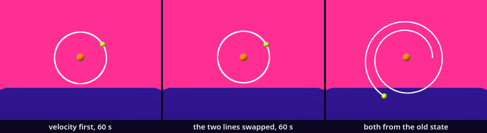
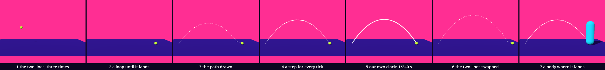

# The bullet — a curve made of steps

The mover of the earlier chapters walked `speed * delta` metres in every frame, at a velocity that never changed. Here we throw a ball and move it with two lines of our own: gravity changes the velocity, the velocity changes the place. We run the two lines in a loop, keep every place in an array, and draw the array as a line, as Point Trace drew a hand's route. You have vectors, loops, arrays, `delta` and meshes. One idea is new: integration, the adding up of small steps into a path.

This is a new project, like every stop of this course: in the Project Manager choose **Import** and open this folder's `project.godot`.

Every message and number on this page comes from running the kit in Godot 4.6. Parts marked *(editor)* describe the editor's own windows and were not watched.

## Find the family in the hall

A lesson starts in its hall, with one question: does the hall show one work at several values of one axis?

The launch hall, [VFM_05_Launch](../../../../commons/maps/VFM_05_Launch/final.md), opens in a chamber. Press FIRE and "An amber marker leaves its pad, rises, falls, and stops at the landing height." PAIR adds a second flight at the same speed: "thirty in one lane and sixty in the other". That is one work at two values of its angle, made by a button. The hall's text shows how the marker is placed: `launch_velocity(index) * t` and `Vector3.DOWN * 0.5 * gravity * t * t`. That is a formula. It is asked where the marker is at the time `t`, and it takes no steps.

[Change_Intro](../../../../commons/maps/Change_Intro/final.md) holds seventeen works. One, a staircase, declares this lesson's axis in the registry: `tick`, with the values once, coarse, fine, dense and limit, which are 1, 3, 9, 27 and 81 readings of one smooth motion. The hall sets none of them, so the staircase stands at `fine`: nine readings, one value. The hall's text passes it in half a sentence: "frame-sized steps on the staircase". Two more works there are each set to one value of an axis they declare: the bridge to `longhand` of its `evidence` (result, trace, longhand), the synthesis stand to `hero` of its `mode` (auto, hero, series). In the launch hall a demonstration of force declares `measure` (both, acceleration, velocity, none), and the hall sets none. One value each, and no family.

The field trip, [VFM_07_Gravity](../../../../commons/maps/VFM_07_Gravity/final.md), shows steps as steps: "A little change of velocity. A step in position." Its bodies are advanced "240 times per model second".

So no hall shows our family, one launch at several lengths of step. We read this from the halls' map files, the artifact registry and the works' scripts; we did not walk them.

Find the staircase, or picture it: a smooth curve and nine flat steps read off it. Write down what you expect at 81. Will you still see steps? Keep the guess.

## Open the kit

Open `launch.tscn` *(editor: double-click it in the FileSystem dock, at the lower left)*. The editor's own view shows a white floor and Godot's preview light: the look is put on by a script when the scene runs. Press Play (F5).

A lime ball leaves the floor on the left, rises, and comes down on the right 1.2 seconds later. Behind it stays a row of white dots on a thin line. The Output panel, at the bottom of the editor, reads:

```
dt 1/60 s: 73 steps, landed 4.867 m from the launch
```

Space fires again. M takes the next length of step and fires. The lavender disc on the floor is the Mark: the place a formula gives for this launch. The cyan capsule at the back is the Walker; W, A, S and D walk it.

`Bullet` in that scene is an instance of `bullet.tscn`. Open it: a `Node3D` with two children, `Ball`, a sphere of 0.1 m radius, and `Path`, a `MeshInstance3D` with no mesh yet. Its script, `bullet.gd`, is ours. The download holds the finished version. We take it apart and build it again.

## Two lines

Replace everything in `bullet.gd` with this:

```gdscript
extends Node3D

const Look := preload("res://supplied/look.gd")
const RADIUS := 0.1                          # the ball's, in metres

var gravity := Vector3(0, -9.8, 0)           # metres per second, every second
var velocity := Vector3(4, 6, 0)             # metres per second, as it leaves
var at := Vector3(0, 0.1, 0)                 # where the bullet is, counted from this node
var dt := 0.1                                # seconds in one step

func _ready() -> void:
	$Ball.material_override = Look.paint(Look.BODY)
	for i in 3:
		velocity += gravity * dt
		at += velocity * dt
		print(i + 1, ": velocity ", velocity, " at ", at)
	$Ball.position = at
```

Run it. The ball hangs in the air, up and to the right of the launch. The output:

```
1: velocity (4.0, 5.02, 0.0) at (0.4, 0.602, 0.0)
2: velocity (4.0, 4.04, 0.0) at (0.8, 1.006, 0.0)
3: velocity (4.0, 3.06, 0.0) at (1.2, 1.312, 0.0)
```

`velocity` says how far the ball goes in a second: 4 m to the right and 6 m up. `gravity` says how much the velocity changes in a second: 9.8 m/s, downward. `dt` is the length of one step, a tenth of a second. The first line of the loop takes a tenth of gravity off the velocity: 6 − 0.98 is 5.02. The second moves the ball by a tenth of that new velocity: 0.4 m to the right, 0.502 m up. `at` is the ball's place, counted from the `Bullet` node, and the last line puts the mesh there.

The mover did the second line. The first is new: the velocity is a variable too, and every step changes it before it is used.

## Until it lands

Replace everything with this:

```gdscript
extends Node3D

const Look := preload("res://supplied/look.gd")
const RADIUS := 0.1                          # the ball's, in metres

var gravity := Vector3(0, -9.8, 0)           # metres per second, every second
var velocity := Vector3(4, 6, 0)             # metres per second, as it leaves
var at := Vector3(0, 0.1, 0)                 # where the bullet is, counted from this node
var dt := 0.1                                # seconds in one step
var path: Array = []                         # every place it has been, one for each step
var flying := true

func _ready() -> void:
	$Ball.material_override = Look.paint(Look.BODY)
	path = [at]
	fly()

func fly() -> void:
	while flying:
		step()
	$Ball.position = at
	print(path.size() - 1, " steps, landed ", snappedf(at.x, 0.001), " m from the launch")

func step() -> void:
	velocity += gravity * dt
	at += velocity * dt
	if at.y <= RADIUS:
		at.y = RADIUS
		flying = false
	path.append(at)
```

Run it. The ball lies on the floor, far to the right. The output: `12 steps, landed 4.8 m from the launch`.

`while` repeats its lines as long as its condition is true. We do not know the number of steps beforehand, so `for` does not fit. `step()` holds the two lines and then asks about the floor: a ball whose middle is no higher than its own radius has landed. It is put on the floor and `flying` turns false, which ends the loop. `path` gets every place. If a `while` never ends, the window freezes: press Stop (F8), the square at the top right of the editor *(editor)*, and read the condition again. That is ordinary.

The flight took no time. The loop ran twelve times inside `_ready()`, before the first frame was drawn. The curve is thirteen places in a list.

## The path, drawn

Add two lines under `var flying`:

```gdscript
var line: StandardMaterial3D
var dots: StandardMaterial3D
```

Replace `_ready()` with this:

```gdscript
func _ready() -> void:
	$Ball.material_override = Look.paint(Look.BODY)
	$Path.mesh = ImmediateMesh.new()
	$Path.cast_shadow = GeometryInstance3D.SHADOW_CASTING_SETTING_OFF
	line = Look.paint(Look.LINE)
	line.shading_mode = BaseMaterial3D.SHADING_MODE_UNSHADED
	dots = line.duplicate()
	dots.use_point_size = true
	dots.point_size = 7.0
	path = [at]
	fly()
	draw_path()
```

And add this function at the end of the script:

```gdscript
func draw_path() -> void:
	var mesh: ImmediateMesh = $Path.mesh
	mesh.clear_surfaces()
	mesh.surface_begin(Mesh.PRIMITIVE_LINE_STRIP, line)
	for point: Vector3 in path:
		mesh.surface_add_vertex(point)
	mesh.surface_end()
	mesh.surface_begin(Mesh.PRIMITIVE_POINTS, dots)
	for point: Vector3 in path:
		mesh.surface_add_vertex(point)
	mesh.surface_end()
```

Run it. Thirteen white dots stand in an arc from the launch to the ball, joined by thin straight lines.

Point Trace handed its list to a supplied display. This is what was inside it. An `ImmediateMesh` is a mesh written one vertex at a time: `surface_begin()` says what the vertices make, `surface_add_vertex()` adds one, `surface_end()` closes the surface. We write the path twice: as a line strip, each place joined to the next, and as points, with a material that makes a point 7 pixels wide. Unshaded means the white is the same in the sun and out of it. The two need two materials: with `use_point_size` on, our line strip was drawn as dots and nothing between them.

Look at the picture. Nothing in it is curved. It is twelve straight pieces, and the corner at the top turns by nearly 14°.

## One step for every frame

`fly()` runs the whole flight inside one frame. Now Godot calls us once for every frame. Take the last two lines, `fly()` and `draw_path()`, out of `_ready()`, and replace the function `fly()` with this:

```gdscript
func _process(delta: float) -> void:
	if not flying:
		return
	dt = delta
	step()
	$Ball.position = at
	draw_path()
	if not flying:
		print(path.size() - 1, " steps, landed ", snappedf(at.x, 0.001), " m from the launch")
```

Run it. The ball flies, and the flight takes the time it says: a little over a second. Read the output, then run it twice more.

`_process(delta)` is called once for every frame Godot draws, and `delta` is how long the last frame took. So a step is as long as a frame, and frames are not all equally long. `sheet.gd` did the same five times in one window. The flights took 74, 73, 73, 73 and 73 steps and landed 4.8708, 4.8695, 4.8339, 4.8667 and 4.8667 m from the launch. In the first three the frames were between 12.5 and 17.1 ms long; in the last two every frame was 1/60 s. Your numbers will be others. The same throw lands in different places, and which one depends on what else the computer was doing.

Now change one word: `_process` becomes `_physics_process`. Run it, and run it again: `73 steps, landed 4.867 m from the launch`, every time.

`_physics_process(delta)` is called a fixed number of times in a second, whatever the frames do, and its `delta` is always the same. Here it is 1/60 s. The number is `Engine.physics_ticks_per_second`; you find it under **Project > Project Settings > Physics > Common** *(editor)*. A step that is always the same length gives a flight that is always the same.

## Our own clock

The engine's tick is one length of step. We want to choose ours. Replace everything with this:

```gdscript
extends Node3D

const Look := preload("res://supplied/look.gd")
const RADIUS := 0.1                          # the ball's, in metres
const RATES := [4, 10, 30, 60, 240]          # what M steps through

@export var launch := Vector3(4, 6, 0)       # metres per second, as it leaves
@export var start := Vector3(0, 0.1, 0)      # where it leaves from, counted from this node
@export var steps_per_second := 60           # our own clock

var gravity := Vector3(0, -9.8, 0)           # metres per second, every second
var velocity := Vector3.ZERO                 # metres per second, now
var at := Vector3.ZERO                       # where the bullet is, counted from this node
var dt := 0.0                                # seconds in one step
var path: Array = []                         # every place it has been, one for each step
var flying := false
var clock := 0.0                             # seconds that have passed and are not stepped yet
var walker: Node3D                           # who can be hit; nobody, if the scene has no Walker
var hit := false
var line: StandardMaterial3D
var dots: StandardMaterial3D

func _ready() -> void:
	$Ball.material_override = Look.paint(Look.BODY)
	$Path.mesh = ImmediateMesh.new()
	$Path.cast_shadow = GeometryInstance3D.SHADOW_CASTING_SETTING_OFF
	line = Look.paint(Look.LINE)
	line.shading_mode = BaseMaterial3D.SHADING_MODE_UNSHADED
	dots = line.duplicate()
	dots.use_point_size = true
	dots.point_size = 7.0
	walker = get_node_or_null("../Walker")
	fire()

func fire() -> void:
	dt = 1.0 / steps_per_second
	velocity = launch
	at = start
	path = [at]
	flying = true
	hit = false
	clock = 0.0

func pull() -> Vector3:
	return gravity

func step() -> void:
	velocity += pull() * dt
	at += velocity * dt
	if at.y <= RADIUS:
		at.y = RADIUS
		flying = false
	path.append(at)
	if walker != null and not hit:
		meet(walker)
	if not flying:
		print("dt 1/", steps_per_second, " s: ", path.size() - 1, " steps, landed ", snappedf(at.x - start.x, 0.001), " m from the launch")

func meet(body: Node3D) -> void:
	var above := to_global(at) - body.global_position   # from the body's feet to the ball
	if Vector2(above.x, above.z).length() < 0.3 + RADIUS and above.y > 0.0 and above.y < 1.8:
		hit = true
		print("hit at step ", path.size() - 1, ", ", snappedf(above.y, 0.01), " m above the feet")

func _physics_process(delta: float) -> void:
	if Input.is_action_just_pressed("pause"):
		fire()
	if Input.is_action_just_pressed("drop"):
		steps_per_second = RATES[(RATES.find(steps_per_second) + 1) % RATES.size()]
		fire()
	if not flying:
		return
	clock += delta
	while flying and clock >= dt:
		step()
		clock -= dt
	$Ball.position = at
	draw_path()

func draw_path() -> void:
	var mesh: ImmediateMesh = $Path.mesh
	mesh.clear_surfaces()
	mesh.surface_begin(Mesh.PRIMITIVE_LINE_STRIP, line)
	for point: Vector3 in path:
		mesh.surface_add_vertex(point)
	mesh.surface_end()
	mesh.surface_begin(Mesh.PRIMITIVE_POINTS, dots)
	for point: Vector3 in path:
		mesh.surface_add_vertex(point)
	mesh.surface_end()
```

This is the `bullet.gd` in the download. Run it: the first screen again, and `dt 1/60 s: 73 steps, landed 4.867 m from the launch`. Press M three times, waiting for each landing: 240 steps a second, then 4, then 10. At 10 the ball moves in twelve jumps, and the output reads `dt 1/10 s: 12 steps, landed 4.8 m from the launch`.

Five things are new.

- **The clock.** `_physics_process()` adds each tick's `delta` to `clock`, and as long as the clock holds a whole `dt` it takes a step and pays for it with `clock -= dt`. At 240 steps a second that is four steps in a tick. At 10 it is one step in six ticks, and the ball waits between them. The hall of the field trip keeps time the same way.
- **`steps_per_second`** is exported, and `dt` is 1 divided by it. We export the whole number and not `dt`, because 60 can be typed exactly and 1/60 cannot: 0.0167 is another step.
- **`fire()`** sets everything a flight starts from. Space, the action `pause`, calls it; M, the action `drop`, takes the next of five rates first. `Input.is_action_just_pressed()` asks whether a key went down in this tick. The next chapter opens input; here we only use it.
- **`pull()`** answers what pulls on the bullet: gravity, the same everywhere. It is a function so that another scene can answer differently.
- **`meet()`** asks whether the ball is inside the Walker. It waits for its section.

## The planted bug: the two lines, swapped

In `step()`, swap the first two lines:

```gdscript
	at += velocity * dt
	velocity += pull() * dt
```

Run it. The ball flies. Nothing is red, nothing is yellow, and the output is one calm line:

```
dt 1/60 s: 75 steps, landed 5.0 m from the launch
```

Thirteen centimetres further than before. Press M three times, to 10 steps a second: `dt 1/10 s: 14 steps, landed 5.6 m from the launch`, eighty centimetres further, and 0.6 m higher at the top. Godot printed no error and no warning; `verify.gd` checks that silence. Reading an error is ordinary, and a red line would have named its own place in the script. This fault gives you nothing to read. Both orders are a throw. Only one is the throw we wrote down.

The swapped ball moves first, with the velocity of the step before, and only then lets gravity act: it hears of gravity one step late. The lower row of the sheet below shows it. Swapped, each path runs above the formula's curve, where ours runs under it.

A check catches what the eye cannot. `verify.gd` has it: after one step at 1/10 s the ball must be at (0.4, 0.602, 0), and swapped it is at (0.4, 0.7, 0). Put the two lines back now: the velocity first.

## The argument: how long is a step?

The axis is the length of one step, the same launch every time. The values are 1/10, 1/30, 1/60 and 1/240 s.

**Write your prediction before you render.** Which two of the four will look most alike? Where will each land? Write it down, with a reason.

The course's outline made its own: 1/60 and 1/240 will look most alike, with landing points a few centimetres apart, and 1/10 is visibly a polygon and lands somewhere else.

Then look: press M and read the Output panel. For stills, run `sheet.gd` as the [README](README.md) says; it needs a terminal. You can go on without it: the tables are what our run measured.



Each flight was photographed alone, from the side, from 6.6 m. The lavender curve is the formula's, the one the launch hall uses: no steps. By it the ball lands 4.898 m from the launch and rises to 1.937 m.

| step | steps | lands at | short of the formula | highest place | sharpest corner | most under the formula |
| --- | --- | --- | --- | --- | --- | --- |
| 1/10 s | 12 | 4.800 m | 9.8 cm | 1.642 m | 13.85° | 53.9 cm |
| 1/30 s | 36 | 4.800 m | 9.8 cm | 1.838 m | 4.68° | 19.1 cm |
| 1/60 s | 73 | 4.867 m | 3.1 cm | 1.887 m | 2.34° | 9.8 cm |
| 1/240 s | 293 | 4.883 m | 1.5 cm | 1.924 m | 0.59° | 2.5 cm |

| pair | stills differ on | landings apart | highest places apart |
| --- | --- | --- | --- |
| 1/10 and 1/30 | 0.49% of the still | 0.00 cm | 19.6 cm |
| 1/10 and 1/60 | 0.83% | 6.67 cm | 24.5 cm |
| 1/10 and 1/240 | 1.36% | 8.33 cm | 28.2 cm |
| 1/30 and 1/60 | 0.85% | 6.67 cm | 4.9 cm |
| 1/30 and 1/240 | 1.40% | 8.33 cm | 8.6 cm |
| 1/60 and 1/240 | 1.19% | 1.66 cm | 3.7 cm |

The closest pair depends on what you count, and the outline's answer wins only one column of three.

By the stills' pixels the closest pair is 1/10 and 1/30. That is a fact about the measure. It counts pixels that differ, and a path of thirteen dots has few pixels to differ with: the four flights cover 0.29%, 0.44%, 0.66% and 1.19% of the still. The pixel count of the earlier kits compares ink, and it is the wrong ruler for a drawing made of marks.

By the landing, 1/10 and 1/30 are again the closest: they land on the same spot. A flight can only end on a step, and both have a step that ends at 1.2 s. So 1/10 does not land "somewhere else": it lands where 1/30 lands, 9.8 cm short. 1/60 and 1/240 land 1.7 cm apart, which is "a few centimetres", as predicted.

By the curve itself the outline is right: 1/60 and 1/240 are the closest pair, 3.7 cm apart at the top. And 1/10 is a polygon: its sharpest corner turns 13.85°, where 1/240 turns 0.59°.

The last column of the first table is the plainest. In the air every stepped ball is under the formula's ball of the same moment, by half of gravity times the time flown times `dt`. Four times as many steps, a quarter of the gap: 9.8 cm becomes 2.5 cm. No number marks a step below which the path "is" the curve. What changes between 1/60 and 1/240 is the drawing: at 1/60 the dots stand apart in our still, at 1/240 they touch.

The claim, as measured: a simulated curve is a row of places, and its distance from the curve it stands for is proportional to the step. Above some step the steps are what you see. Below it they are still there.

**Decide.** One difference here could be followed. Every path lies under the formula's curve, on one side only. The next intervention would be to move the ball by the average of the old and the new velocity, one more line in `step()`, and to read that last column again. Or settle: one of these four steps is the one your room needs, and the tables are enough to choose it. Either is right. Write your decision and the reason in your [field note](FIELD_NOTE.md); ours is there as an example of the form, not of the answer.

## What a step owes

A stepped curve owes the true one a distance. At 1,000 steps a second our ball still lands 0.2 cm short: the debt gets small and is never paid.

It can owe more than a distance. Take the field trip. `orbit.tscn` is supplied: the base, a `Centre`, and an instance of `bullet.tscn` named `Orbit` that starts 1 m to the right of the centre, going up at 2 m/s, and runs `orbit.gd`. Replace everything in `orbit.gd` with this:

```gdscript
extends "res://bullet.gd"

const CENTRE := Vector3(0, 1.6, 0)   # what pulls, counted from this node
const PULL := 4.0                    # metres per second, every second, at one metre from it

func _ready() -> void:
	super()
	$"../Centre".material_override = Look.paint(Look.THIRD)

func pull() -> Vector3:
	var arm := CENTRE - at
	return arm.normalized() * PULL / arm.length_squared()
```

`extends "res://bullet.gd"` makes this script everything `bullet.gd` is, with one answer changed: the pull points at the centre and weakens with the square of the distance. `super()` runs the `_ready()` it inherited. `step()` is the same two lines. Open `orbit.tscn` and press F6, Run Current Scene, beside Play at the top right *(editor)*. The ball goes round the orange centre in a circle, once in 3.1 seconds, and the dots close into a ring. We stepped it for 60 seconds: 19 turns, never nearer than 0.984 m and never further than 1.017 m.

The outline expected the planted bug to break this: swap the two lines, and the orbit spirals outward. We swapped them and stepped 60 seconds again: between 0.984 and 1.017 m. The swap does not open the orbit. What does is this, in place of the first two lines of `step()` in `bullet.gd`:

```gdscript
	var before := velocity
	velocity += pull() * dt
	at += before * dt
```

Run `orbit.tscn` with that. The ring opens into a spiral. After one turn the ball is 1.377 m from the centre, and after 7.98 seconds it lies on the floor:

```
dt 1/60 s: 479 steps, landed -1.858 m from the launch
```

At 240 steps a second it takes 25.97 seconds. A shorter step slows the leak and does not stop it.



In these three lines both updates read the state from before the step. In our two lines, in either order, the second reads what the first has just written. That is what holds the orbit. On the launch the swap and the three lines gave the same flights, because gravity does not ask where the ball is; the orbit tells them apart. The three lines are called explicit Euler, ours semi-implicit Euler. Textbooks say explicit Euler adds energy at every step. We did not compute an energy; we measured the distance, and it grows. Put our two lines back.

The engine makes the same choice and does not show it. We threw the supplied marble, a `RigidBody3D`, with our launch and with its damping off. It rose to 1.887 m at 60 ticks a second, 1.642 m at 10, 1.838 m at 30 and 1.924 m at 240: our own four heights, to the millimetre. We conclude that the engine steps a body as our two lines do, in our order, and that "physics ticks per second" is its `dt`. As shipped the marble rose to 1.814 m: a project setting, `default_linear_damp`, is 0.1 and slows every such body a little in every tick. Nothing on the screen says so. Bodies of the engine's own arrive in a later chapter.

## Stand where it lands

The place this chapter asks for: stand where you predict it will land, let it hit you, then move to where it lands.

Run `launch.tscn`. Walk the Walker onto the Mark: S brings it towards you, D takes it to the right. Press Space. When the ball's path goes through the Walker, the output gains a line before the landing. Ours was:

```
hit at step 67, 0.6 m above the feet
```

`meet()` wrote it. `get_node_or_null("../Walker")` looked, once, for a node named Walker beside the Bullet; where there is none it gives `null` and nobody is asked about. In every step `meet()` measures from the Walker's feet to the ball, with `to_global()`, because `at` is counted from the Bullet and the Walker stands in the room. A ball less than 0.4 m from the Walker's middle line, and between the feet and 1.8 m, is a hit. The hit is soft: a line is printed and nothing is pushed. The ball has no collider, and the engine's physics does not know it is there.

We sent the Walker to the Mark on its autopilot. It stopped 4.84 m from the launch and stood. Then we fired at every step:

| step | what happened to the Walker |
| --- | --- |
| 1/240 s | hit 0.69 m above the feet |
| 1/60 s | hit 0.60 m above the feet |
| 1/30 s | hit 0.42 m above the feet |
| 1/10 s | hit 0.10 m above the feet: the first step inside the body was the landing itself |
| 1/4 s | not hit: the ball landed 4.0 m from the launch, 0.9 m short of the Mark |

The Walker stood where it stood through all five. Then it walked to where the last one lands, 4.0 m from the launch, and was hit there, 0.10 m above the feet. The step decides whether the formula's place is the place to stand.

A coarse step can also miss a body that is in the way. We stood the Walker 3.57 m from the launch, under the arc. At 1/60 s it was hit 1.70 m up, at 1/10 s 1.37 m up. At 1/4 s it was not hit: the ball was at 3.0 m and then at 4.0 m, and never where the body is. Point Trace's display missed what the hand did between two samples. This is the same gate, and now it decides what a body meets. Try it: M until the output says `dt 1/4 s`.

No headset was used. The Walker was walked by its autopilot in the checks, not by a hand on the keys.

## The process

the two lines, three times → a loop until it lands → the path drawn → a step for every tick → our own clock → the two lines swapped → a body where it lands



`sheet.gd` makes the strip and counts what each step claims. The ball has taken 3, 12, 12, 73, 293, 14 and 73 steps, and 0, 0, 13, 74, 294, 15 and 74 places are drawn. The body where it lands changed the picture most, 5.55% of the tile, and did not change the flight.

## In your room

Launch something in your room with your own integrator, and keep the step you chose and why.

The kit's body for the room is the folder `guests/bullet/`: `bullet.tscn` and its own `bullet.gd`, our script with the two colours written out, a launch small enough for a place, and a ball that leaves again after a second on the floor. Copy the whole folder into the `guests/` folder of your room project. Open the room's `room.gd` and add one line to `GUESTS`, under the last one:

```gdscript
	"res://guests/bullet/bullet.tscn",
```

Run the room. We did this in a copy of the room. The output:

```
My room: place 2 is res://guests/bullet/bullet.tscn
the bullet, dt 1/60 s: 59 steps, landed 1.18 m from the launch
```

Walk to place 2 and into the arc. The room's walker is named `Walker` too, so the bullet finds it and prints a line that begins `the bullet hit at step`. The room's own test walked its walker at the guest: it arrived 0.07 m from the middle of the place. Nothing stopped it: this guest has no collider.

Now make it yours. In the room's copy of `guests/bullet/bullet.gd`, change two lines:

```gdscript
@export var launch := Vector3(0.6, 7, 0)     # metres per second, as it leaves
@export var steps_per_second := 30           # our own clock
```

A place is 1.6 m wide, so keep the throw inside it: two times the first number times the second, divided by 9.8, is how far it goes, and 1.2 m is the most. Ours goes 0.857 m by that sum and prints `the bullet, dt 1/30 s: 42 steps, landed 0.84 m from the launch`. We chose 30 because at that step the dots stand apart, and a visitor sees what the curve is made of. Write one line in your README: the step you chose, and why.

## What we borrowed

| Part | From | How far we go |
| --- | --- | --- |
| `supplied/base.tscn`, `supplied/look.gd` | the kit base | Use: the floor, the sky, the light; `Look.paint()` and the palette's roles. |
| `supplied/walker.tscn` | the kit base | Use: the keys walk it; the checks use `walk_to()`. `meet()` asks about a node named `Walker`. |
| `mark.gd`, `orbit.tscn` | supplied with this kit | Use: the disc where the formula lands this launch, which does not follow `launch`; the scene of the field trip. |
| the trace display | Point Trace | Understand: `draw_path()` is what it hid. |
| `ImmediateMesh` | Godot | Understand: `surface_begin()`, `surface_add_vertex()`, `surface_end()`, `clear_surfaces()`. |
| `_physics_process()`, `Engine.physics_ticks_per_second` | Godot | Use: the engine's fixed clock and its rate. |
| `get_node_or_null()`, `to_global()`, `snappedf()`, `super()` | Godot | Use: a node that may not be there; a place in the room; a number rounded for printing; the inherited function. |
| `verify.gd`, `sheet.gd` | supplied with this kit | Use: the checks, and the stills with their measurements. |

What we made is `bullet.gd`: two lines that step a velocity and a place, a clock that decides when they run, a list of places drawn as a line, and a soft hit. And `orbit.gd`: the same body under another pull.

## What we carry forward

We leave with integration: a velocity changed by a pull, a place changed by the velocity, and the second reading what the first wrote. With a fixed step and a clock that pays for it; with `_physics_process()` beside `_process()`; with `ImmediateMesh`. And with one rule for anything that moves by steps: a body is only where its steps put it, and what stands between two steps is not met.
