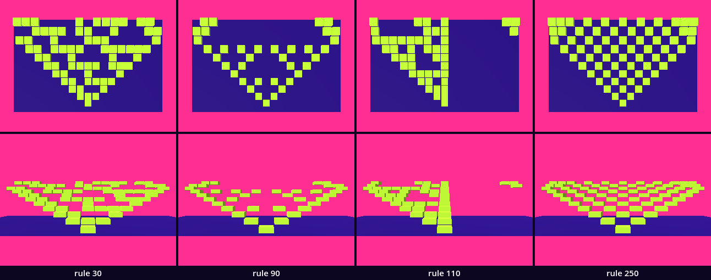
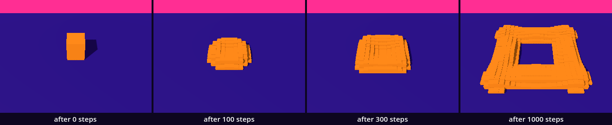
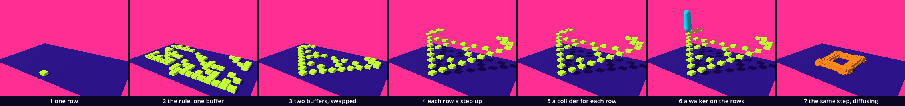

# Rules in time — a row that writes the next row

Until now a body was built once: a loop ran, and the mesh was there. Here the body is a history. One row of cells is on or off. A rule of eight answers makes the next row from it, and the next from that, and every row is kept as a step of a stair you can walk. You have all the parts: a packed array, a loop, `%`, a `MultiMesh`, a collider. One idea is new: the buffer. We read from one row and write to another, and then the two change places.

This is a new project, like every stop of this course: in the Project Manager choose **Import** and open this folder's `project.godot`.

In the hall, [CA_GameOfLife](../../../../commons/maps/CA_GameOfLife/final.md) lays the rows of Rule 30 across a basin as tiles: "The line can pass through it; your foot would need support." One hall earlier, the board of [CA_Introduction](../../../../commons/maps/CA_Introduction/final.md) shows the loop this lesson is built on, and says what it is for: "An answer written at the left cannot slip into the question being asked at the right."

This study takes two sessions. The first builds the stair and ends at **Stop here**. The second compares four rules on a sheet, runs a second rule on the same step, and walks both.

Every message and number on this page comes from running the study in Godot 4.6. Parts marked *(editor)* describe the editor's own windows and were not watched. No headset was used anywhere.

## Find the family in the hall

A lesson starts in its hall, with one question: does the hall show one work at several values of one axis?

Not side by side. The bridge of CA_GameOfLife declares the axis `rule` with four values, 30, 90, 110 and 250, and the hall stands on one of them: its history study sets Rule 30, fifteen cells across, at most twenty-four rows. The board in CA_Introduction comes nearer. It is placed at Rule 90, and its small panel has buttons for 30, 90, 110 and 184, so a visitor can put four members of the family on one board, one after the other. That is a family in time, not on a wall. Two more works there declare an axis and stand at one value: the stand that holds the dark sphere, and the sphere. We read this from the halls' map files, their scripts and the artifact registry; we did not walk them.

So stand at the bridge and write one prediction down: of 30, 90, 110 and 250, which floor would you least like to cross on foot? Keep it. This study builds all four.

## Open the study

Open the [study](README.md), then `cellular.tscn`. It inherits the supplied base: the violet floor, the sky that runs from violet down to a pink horizon, the light, and a camera, which we moved back and up to see the whole floor. It adds two nodes. `Automaton` is an empty `Node3D` at (0, 0, 1.7) that runs `cellular.gd`. `Walker` is the supplied walker, at the front left. The editor's own view shows a white floor and its preview light, because the look is applied by a script when the scene runs.

Run it. One lime tile lies at the front. Every quarter of a second a row of tiles appears behind the last one and 0.15 m higher, until eleven rows stand: a triangle with holes in it, rising away from us. The Output panel, at the bottom of the editor, prints each row as it is laid.

`cellular.gd` is ours. You find it in the FileSystem dock, at the lower left. The download holds the finished version. We will take it apart and build it again.

## One row

Replace everything in `cellular.gd` with this:

```gdscript
extends Node3D

const Look := preload("res://supplied/look.gd")

@export var n := 17                    # cells in a row
@export var cell := 0.4                # metres: a cell's width and depth
@export var rise := 0.15               # metres: a tile's thickness, and how much higher the next row stands

var now := PackedByteArray()    # the row we read: one byte for each cell, 0 or 1
var tile := BoxMesh.new()       # one mesh for every cell

func _ready() -> void:
	tile.size = Vector3(cell * 0.9, rise, cell * 0.9)
	tile.material = Look.paint(Look.BODY)
	now.resize(n)
	@warning_ignore("integer_division")
	now[n / 2] = 1
	lay_row()

func lay_row() -> void:
	var row := Node3D.new()
	add_child(row)
	var tiles := MultiMesh.new()
	tiles.transform_format = MultiMesh.TRANSFORM_3D
	tiles.mesh = tile
	tiles.instance_count = now.count(1)
	var drawn := MultiMeshInstance3D.new()
	drawn.multimesh = tiles
	row.add_child(drawn)
	var k := 0          # which tile comes next
	for i in n:
		if now[i] == 1:
			tiles.set_instance_transform(k, Transform3D(Basis(), Vector3(x_of(i), rise / 2.0, 0.0)))
			k += 1
	print(now)

func x_of(i: int) -> float:
	return (i - (n - 1) / 2.0) * cell
```

Run it. One lime tile, and one line in the output:

```
[0, 0, 0, 0, 0, 0, 0, 0, 1, 0, 0, 0, 0, 0, 0, 0, 0]
```

`now` is a buffer: seventeen bytes side by side, and nothing else. `resize(n)` makes them, all 0. We set the middle one to 1: 17 / 2 is 8 as a whole number, and the line above it tells Godot that we mean that. This one live cell is the seed.

`lay_row()` turns the buffer into something to see. `count(1)` says how many cells are alive, and the `MultiMesh` of the pendulum chapter draws that many tiles from one mesh. `x_of()` is the chessboard's index turned into a place, with the middle cell over the node's middle.

## The rule

A cell's next state depends on three cells of the row before: its left neighbour, itself, its right neighbour. Three cells that are each 0 or 1 can stand in eight ways, and a rule gives one answer for each. This is Rule 90:

| left, self, right | 111 | 110 | 101 | 100 | 011 | 010 | 001 | 000 |
| --- | --- | --- | --- | --- | --- | --- | --- | --- |
| read as a number | 7 | 6 | 5 | 4 | 3 | 2 | 1 | 0 |
| the answer | 0 | 1 | 0 | 1 | 1 | 0 | 1 | 0 |

Read the eight answers as one binary number, 01011010, and you have 64 + 16 + 8 + 2 = 90. The rule is its own name. In code, `left * 4 + self * 2 + right` is the middle row of the table, and `(rule >> index) & 1` reads the answer: `>>` moves the number's binary digits `index` places to the right, and `& 1` keeps the last one.

Replace the lines from the first `@export` to `var tile` with these:

```gdscript
@export_range(0, 255) var rule := 90   # the eight answers, written as one number
@export var n := 17                    # cells in a row
@export var rows := 11                 # rows we keep
@export var cell := 0.4                # metres: a cell's width and depth
@export var rise := 0.15               # metres: a tile's thickness, and how much higher the next row stands

var now := PackedByteArray()    # the row we read: one byte for each cell, 0 or 1
var made := 0                   # rows laid so far
var tile := BoxMesh.new()       # one mesh for every cell
```

At the end of `_ready()`, under `lay_row()`, add a loop, and under `_ready()` a new function:

```gdscript
	while made < rows:
		step()
		lay_row()

func step() -> void:
	for i in n:
		var index := now[(i - 1 + n) % n] * 4 + now[i] * 2 + now[(i + 1) % n]
		now[i] = (rule >> index) & 1
```

In `lay_row()`, replace `add_child(row)` with these two lines, so that each row lies behind the one before:

```gdscript
	row.position = Vector3(0.0, 0.0, -made * cell)
	add_child(row)
```

and replace the `print` line with these two:

```gdscript
	print(made, " ", now)
	made += 1
```

**Before you run, predict row 1.** By the table a cell is alive next when exactly one of its two neighbours is alive. The seed has two dead neighbours, and each of them has the seed beside it. So row 1 should be two cells with a gap between them. And the table treats left and right alike, so the floor should be the same on both sides.

Run it. The output begins:

```
0 [0, 0, 0, 0, 0, 0, 0, 0, 1, 0, 0, 0, 0, 0, 0, 0, 0]
1 [0, 0, 0, 0, 0, 0, 0, 1, 1, 1, 1, 1, 1, 1, 1, 1, 1]
2 [1, 1, 1, 1, 1, 1, 0, 1, 0, 1, 0, 1, 0, 1, 0, 1, 0]
```

Row 1 is ten cells, from one left of the seed to the right end of the row. The floor on the screen is a ragged field that leans to the right. Godot printed nothing else: no error, no warning. The code ran exactly as written, and reading a result like this one is ordinary work.

The fault is in the last line of `step()`. It writes row 1 into `now` while the loop is still reading row 0 from `now`. Cell 7 is right: it read cells 6, 7 and 8, all old. Cell 8 is wrong: its left neighbour is cell 7, which is already new. Every wrong answer becomes the next cell's left neighbour, so the mistake runs to the right end in one step, the way the loop runs. Of the 187 cells of our floor, 72 differ from their mirror image; Rule 90 should have none.

## Two buffers

The repair is a second row. Add one line under `var now`, and one under `now.resize(n)`:

```gdscript
var next := PackedByteArray()   # the row we write
```

```gdscript
	next.resize(n)
```

Then replace `step()` with this:

```gdscript
func step() -> void:
	for i in n:
		var index := now[(i - 1 + n) % n] * 4 + now[i] * 2 + now[(i + 1) % n]
		next[i] = (rule >> index) & 1
	var spare := now
	now = next
	next = spare
```

Run it:

```
0 [0, 0, 0, 0, 0, 0, 0, 0, 1, 0, 0, 0, 0, 0, 0, 0, 0]
1 [0, 0, 0, 0, 0, 0, 0, 1, 0, 1, 0, 0, 0, 0, 0, 0, 0]
2 [0, 0, 0, 0, 0, 0, 1, 0, 0, 0, 1, 0, 0, 0, 0, 0, 0]
```

Two cells, as predicted, and on the floor a triangle with triangular holes: Sierpinski's. Every question now goes to the old row and every answer to the new one. The field trip hall [CA_EdgeOfChaos](../../../../commons/maps/CA_EdgeOfChaos/final.md) says it of its own rule: "Every cell reads the previous volume." The last three lines are the swap: the two names change places, and no byte is copied. What was written becomes what is read.

## The ring

Read the last rows of the output:

```
8 [1, 0, 0, 0, 0, 0, 0, 0, 0, 0, 0, 0, 0, 0, 0, 0, 1]
9 [1, 1, 0, 0, 0, 0, 0, 0, 0, 0, 0, 0, 0, 0, 0, 1, 1]
```

In row 8 the triangle has reached both ends. In row 9 cell 0 is alive because exactly one of its neighbours was, and that neighbour is cell 16, at the other end. That is `(i - 1 + n) % n`: for cell 0 it is 16. `%` is the chessboard's remainder; here it bends the row into a ring. The hall says it of its own board: "What looks like a line on the desk is a ring to the calculation."

A grid has to end somewhere, and a ring is one choice. Make it visible. Add a line under the `rule` line:

```gdscript
@export var ring := true               # the two ends of a row are neighbours; unticked, beyond an end is dead
```

Add a function above `step()`:

```gdscript
func cell_at(i: int) -> int:
	if ring:
		return now[(i + n) % n]
	if i < 0 or i >= n:
		return 0
	return now[i]
```

and in `step()` replace the line that begins `var index` with:

```gdscript
		var index := cell_at(i - 1) * 4 + now[i] * 2 + cell_at(i + 1)
```

Run it: the same rows. Now change `true` to `false` in the `ring` line and run again. Rows 0 to 8 are the same, and row 9 reads

```
9 [0, 1, 0, 0, 0, 0, 0, 0, 0, 0, 0, 0, 0, 0, 0, 1, 0]
```

The two floors differ on 6 cells, all in the last two rows, at the border. Set `ring` back to `true`.

## Rows in time

So far the whole history is made before the first frame. Give it a pace. Add one line under the `ring` line and one under `var made`:

```gdscript
@export var pace := 0.25               # seconds from one row to the next; 0 lays every row at once
```

```gdscript
var clock := 0.0                # seconds since the last row
```

In `_ready()`, change the `while` line to `while pace <= 0.0 and made < rows:`. Add a function under `_ready()`:

```gdscript
func _process(delta: float) -> void:
	if pace <= 0.0 or made >= rows:
		return
	clock += delta
	if clock >= pace:
		clock -= pace
		step()
		lay_row()
```

And in `lay_row()`, change the `row.position` line, so that each row stands one `rise` higher than the last:

```gdscript
	row.position = Vector3(0.0, made * rise, -made * cell)
```

Run it. The rows arrive one at a time, four a second, and each stands 0.15 m above the one before. In our run all eleven were laid after 2.50 s. Depth and height now both mean time: the row furthest from us and highest up is the latest.

`clock` saves up `delta`, the time since the last frame; when a quarter of a second is there, we take one step and keep what is left over.

## A body

Walk the walker into the stair: D to the right until it stands before the seed, then W. It goes through every tile, on the ground. The tiles are a `MultiMesh`: there for the eye. We sent the walker's autopilot the same way and it arrived at the far end with its feet at 0.00 m.

Each row gets one body. Replace `lay_row()` with this:

```gdscript
func lay_row() -> void:
	var row := StaticBody3D.new()
	row.position = Vector3(0.0, made * rise, -made * cell)
	add_child(row)
	var tiles := MultiMesh.new()
	tiles.transform_format = MultiMesh.TRANSFORM_3D
	tiles.mesh = tile
	tiles.instance_count = now.count(1)
	var drawn := MultiMeshInstance3D.new()
	drawn.multimesh = tiles
	row.add_child(drawn)
	var k := 0          # which tile comes next
	var start := -1     # where the run of live cells we are in began; -1: we are in none
	for i in n + 1:
		if i < n and now[i] == 1:
			tiles.set_instance_transform(k, Transform3D(Basis(), Vector3(x_of(i), rise / 2.0, 0.0)))
			k += 1
			if start < 0:
				start = i
		elif start >= 0:
			var box := BoxShape3D.new()
			box.size = Vector3((i - start) * cell, rise, cell)
			var collider := CollisionShape3D.new()
			collider.shape = box
			collider.position = Vector3((x_of(start) + x_of(i - 1)) / 2.0, rise / 2.0, 0.0)
			row.add_child(collider)
			start = -1
	print(made, " ", now)
	made += 1
```

The row is now a `StaticBody3D`, and its colliders are merged. A run is a stretch of live cells with no gap. `start` remembers where the run began; the first dead cell after it closes the run with one box as long as the run. The loop goes one past the end, `n + 1`, so that a run which reaches the last cell is closed too. Rule 90 has few neighbours side by side: 37 tiles, 33 boxes. Rule 30 will have 69 tiles and 31 boxes.

Run it and walk again. The walker steps onto the seed and stands 0.15 m up. Then it stops. Row 1 is two tiles with a gap of one cell, 0.4 m, and the walker is 0.6 m wide.

## Stop here: what we have

This is the end of the first session. `cellular.gd` should have seven `@export` lines, five `var` lines and six functions: `_ready`, `_process`, `cell_at`, `step`, `lay_row`, `x_of`. Run the study and check three things: eleven rows arrive one by one and rise; the output's row 1 is two cells; the walker stands on the seed.

## The argument: which rule?

The axis is `rule`, from one live cell. The values are 30, 90, 110 and 250. To change it, select `Automaton` in the Scene dock, at the upper left, and set **Rule** in the Inspector, at the right *(editor)*; or change the 90 in the script's first `@export` line. Keep to one of the two ways. A value set in the Inspector is saved in the scene, and the scene's value wins over the script's line: with 30 saved in a scene and 90 in the line, our floor was Rule 30's, and nothing was printed about it.

**Write your prediction before you render.** Four floors of eleven rows. Which two will look most alike? Which are the same on both sides of the middle? And look at the numbers: 90 and 250 differ in two of their eight answers, and so do 30 and 90. Will those two pairs be equally alike?

The course's outline made its own: 90 and 250 will look most alike, one triangle with Sierpinski's holes and one a checker; 30 and 110 are both lopsided.

Then look: run each rule. For stills of each floor alone, run `sheet.gd` as the [README](README.md) says; it needs a terminal. You can go on without it: the table is what our run measured.



| pair | differ on, from above | from the front | cells that differ, of 187 | answers that differ, of 8 |
| --- | --- | --- | --- | --- |
| 30 and 90 | 12.45% of the still | 7.97% | 46 | 2 |
| 30 and 110 | 15.50% | 9.50% | 56 | 3 |
| 30 and 250 | 13.24% | 8.06% | 49 | 4 |
| 90 and 110 | 15.52% | 11.03% | 58 | 3 |
| 90 and 250 | 8.19% | 4.83% | 29 | 2 |
| 110 and 250 | 15.92% | 10.96% | 59 | 3 |

The closest pair is 90 and 250, in every column. The outline's prediction held. Every tile of Rule 90 is also a tile of Rule 250: the checker is Sierpinski's triangle with its holes filled.

The second part held for one rule and half held for the other. Rule 110 is lopsided by weight: 33 tiles left of the middle and 3 right of it, and those 3 came round the ring. Rule 30 is not: 32 left and 30 right. Its two sides differ in arrangement, on 48 cells of 187. Rules 90 and 250 differ from their mirror on none.

Now the last column. 30 and 90 are two answers apart, as 90 and 250 are, and they differ on 46 cells where the closest pair differs on 29. 30 and 250 are four answers apart and closer than three of the pairs that are three apart. Counting the answers that differ does not tell us how far apart two floors will be.

The claim, as measured: a rule of eight bits decides between a checker, a fractal, a lopsided growth and a disorder, and the eight bits do not say which. We found out by running them. Our sheet is eleven rows from one seed. We counted two other floors without rendering them, and the pair stayed the closest: with dead ends, 27 of 187 cells; on a ring of 33 cells and 17 rows, 70 of 561.

**Decide.** One difference here could be followed. The eye's closest pair is not closest for a body: a marble dropped over the middle of row 4 fell to the ground through Rule 90 (`0.10 m`) and stayed on a tile of Rule 250 (`0.85 m`). The next intervention would be the cell's size: make `cell` smaller than the marble is wide, 0.2 m, and drop it again. Or settle: one of these four is the floor your room needs. Either is right. Write your decision and the reason in your [field note](FIELD_NOTE.md); ours is there as an example of the form, not of the answer.

## The same step, another rule

The second body of this chapter is in `diffusion.gd`, on the scene `diffusion.tscn`. Open that scene and press F6, which runs the scene that is open instead of the project's main scene *(editor: the button **Run Current Scene** is at the upper right)*. An orange block stands in the middle of the floor with the walker on top of it. The block spreads, hollows, and becomes a square wall that grows outward and settles.

A cell here holds two numbers instead of one bit: how much it has of a substance A and of a substance B. The rule is no longer a table. B is made from A where both are present, both spread to their neighbours, A is fed in everywhere and B is taken out. The supplied part of the file makes four buffers, draws B as tiles, and hands the collider B's heights. The step is the part to write. The download holds it finished, as it did `cellular.gd`: in `diffusion.gd`, delete `around()` and `step()` and type them again:

```gdscript
func around(buffer: PackedFloat32Array, x: int, z: int) -> float:
	var left := buffer[z * g + (x - 1 + g) % g]
	var right := buffer[z * g + (x + 1) % g]
	var back := buffer[(z - 1 + g) % g * g + x]
	var front := buffer[(z + 1) % g * g + x]
	return (left + right + back + front) / 4.0

func step() -> void:
	for z in g:
		for x in g:
			var i := z * g + x
			var eaten := a[i] * b[i] * b[i]
			a_next[i] = a[i] + 0.32 * (around(a, x, z) - a[i]) - eaten + feed * (1.0 - a[i])
			b_next[i] = b[i] + 0.16 * (around(b, x, z) - b[i]) + eaten - (feed + kill) * b[i]
	var spare := a
	a = a_next
	a_next = spare
	spare = b
	b = b_next
	b_next = spare
	steps += 1
```

It is the stair's step, twice. A floor of 24 by 24 cells lies in one buffer, row after row: cell (x, z) is number `z * g + x`. `around()` is the neighbourhood: the mean of the four cells beside this one, with the same `%` at every edge, so this floor is a ring both ways. Each cell moves towards that mean, B half as fast as A. `eaten` is what B takes from A. Everything is read from `a` and `b`, written to `a_next` and `b_next`, and then swapped.

Run it. In our run the most B in one cell was 0.420 after 1000 steps, and 360 of the 576 cells held a tenth or more, which is where `show_b()` begins to draw a tile. A second pool run beside the first held the same numbers, to the last digit.



The field trip hall, [Reaction_Diffusion_Systems](../../../../commons/maps/ProceduralGeneration_Reaction_Diffusion_Systems/final.md), has a desk that steps through six pairs of `feed` and `kill`; ours is one.

## What the floor owes

A grid must end. We tried both endings: the ring and the dead end differ on 2, 6, 3 and 4 cells for rules 30, 90, 110 and 250, always from row 9 on, always at the border. Neither is the rule's own. The rule is defined on a row without ends, and no machine has one. The pool wraps too: its wall grows until it meets itself coming round.

Rule 30 looks like chance and has none in it. We ran it twice and got the same eleven rows; its middle column read 1, 1, 0, 1, 1, 1, 0, 0, 1, 1, 0 both times. That column has been used as a random number generator. It is the seeds chapter again: whoever has the rule and the first row has every "random" number in advance.

The pool is not Turing's own equations. In 1952 Alan Turing proposed that two substances which react and spread at different speeds could make the spots and stripes of living bodies. Ours is a later and simpler scheme by Gray and Scott, as the hall's footnote says. The hall also says where that leaves us: "Pattern formation alone has not made a solid that can bear your weight." Ours bears weight because of one line that hands B to a collider, and one threshold, a tenth, below which a cell counts as nothing. Both are our decisions; the pattern has no part in them. The course's outline carries a question from its Queer 3D reference into this chapter: can twisted rooms transcend power? We leave it as a question. What the kit shows is smaller: a floor made by its own neighbours' rule, whose author still chose the edge, the seed and what counts as there.

## Stand on the history

The place this chapter asks for is to stand on the history and walk up Sierpinski's rows.

Use the keys: D and W to walk, J to jump, C to look through the walker's eyes. We sent the autopilot, from in front of the seed straight up the middle, on each of the four floors:

| rule | what the walker did |
| --- | --- |
| 30 | climbed six rows, to 0.90 m, fell through a gap and was stopped on the ground under row 7, its feet at 0.00 m |
| 90 | stepped onto the seed and was stopped there, its feet at 0.15 m |
| 110 | arrived on the last row, its feet at 1.65 m |
| 250 | stepped onto the seed and was stopped there, at 0.15 m |

Rule 110 keeps its middle column alive in every row, so the middle is a stair. Rules 90 and 250 put two tiles either side of a one-cell gap in row 1, and the walker does not fit between them.

Sierpinski's rows can be walked by their edge, which moves one cell to the left with every row. Sent that way, the walker climbs a row at every step, 0.15 m each, and reaches row 8 at 1.35 m. Told to stop there, it oversteps onto row 9, slides back, and comes to rest hanging on row 9's front edge, its feet at 1.46 m: "arrived" by its own signal, but on an edge, not on a tile.

The pool moves a body that stands still. The walker started on the seed block, 0.60 m up. In the first steps B rose under it and lifted it to 0.86 m; 600 steps later it stood on the ground, 0.00 m, in the hollow middle, with a wall around it. It had not walked. Then we sent it out: it arrived outside, and its feet were 0.22 m up as it crossed the wall.

No headset was used and no hand was on the keys: every walk above was the autopilot's.

## Try

Give both names one buffer: in `_ready()` write `next = now` in place of `next.resize(n)`. The leaning floor of *The rule* is back, row for row. A packed array's name is a handle: `=` gives a second name for the same bytes, and the swap then swaps nothing. `next = now.duplicate()` would make a copy.

Leave the swap out: delete the last three lines of `step()`. Eleven rows, each one tile: the seed, eleven times. The rule writes into `next` and nobody reads it.

Set `rule` to 0, then 255, then 184, with `rows` at 17 and `pace` at 0, in the way you chose for the argument: the Inspector or the script's lines, not both. In `diffusion.gd`, set `feed` to 0.035 and `kill` to 0.065; we did not render that one.

## The process

A body made by more than one operation has a recipe. Ours, one still after each step, from one standpoint:

one row → the rule, one buffer → two buffers, swapped → each row a step up → a collider for each row → a walker on the rows → the same step, diffusing



`sheet.gd` makes the strip and counts what each step holds. There are 1, 68, 37, 37, 37, 37 tiles in the first six, and 0, 0, 0, 0, 33, 33 colliders. The last step changed the tile most, 15.33%: it is another body. Of the stair's own steps the faulty rule changed it most, 14.51%, and its repair nearly as much, 13.26%: in the picture the fault and the fix are the same size. One step changed the body and not the picture: *a collider for each row* differs from the step before on 0.00% of the tile.

## In your room

Let a rule grow one part of your room over time; keep the rule number.

The body this kit hands to your room is in `guests/cellular/`: a small stair, 1.53 m wide and deep, 17 rows of Rule 90, a row every 0.8 s. Its script is the `cellular.gd` you wrote with its colour written out: a guest may name nothing outside its own folder.

Copy the folder `guests/cellular/` from this kit into the `guests/` folder of your room project. Open the room's `room.gd` and add one line to `GUESTS`, under the last one:

```gdscript
	"res://guests/cellular/cellular.tscn",
```

Run the room. We did, in a copy with the example guest still in the list. The output read `My room: place 2 is res://guests/cellular/cellular.tscn`, and then the rows, one by one. The room's walker, sent to place 2, arrived 0.08 m from its middle with its feet at 0.32 m: it walks up the little stair and stands on it.

Now make it yours. In the room's copy, open `guests/cellular/cellular.gd` and change the 90 in the first `@export` line to a rule you chose; try several first in this kit, where the floor is large. If you changed `step()` here, paste yours in there. We set 30 in our copy: the room ran with no error, the output's rows were Rule 30's, and the walker arrived on the guest as before, 0.08 m from the middle of place 2 with its feet at 0.32 m.

Write the rule number in your README, with one line: what this rule grows, and what it leaves out. Hand in your room with its process strip and your field note.

## What we borrowed

| Part | From | How far we go |
| --- | --- | --- |
| `supplied/base.tscn`, `look.gd` | Supplied | Use: the floor, sky and light; `Look.paint()`, `Look.BODY`, `Look.THIRD`. |
| `supplied/walker.tscn` | Supplied | Use: the keys, or `walk_to(points)`; a walk ends "arrived", "blocked", "fell" or "stopped". |
| `PackedByteArray`, `PackedFloat32Array` | Godot | Use: `resize()`, `fill()`, `count()`, `duplicate()`. A name is a handle to the bytes. |
| `MultiMesh` | Godot, the pendulum chapter | Use: `instance_count`, `set_instance_transform()`. |
| `StaticBody3D`, `BoxShape3D` | Godot | Use: one body for each row, one box for each run. |
| `_ready()` and `show_b()` of `diffusion.gd` | Supplied here | Use: four buffers, B drawn as tiles, and a `HeightMapShape3D` that takes one height for each cell. Not opened further. |
| the numbers 0.055 and 0.062 | Gray and Scott's model | Use. |
| `sheet.gd` | Supplied here | Use: it photographs the four rules, measures the pairs and makes the strip. |

What we made is `cellular.gd`: a row in a buffer, a rule read from one number, a step that reads one buffer and writes another and swaps them, a choice at the ends, a row laid every quarter of a second, and one body for each row with a box for each run.

## What we carry forward

We leave with the buffer and the swap; with a rule that is a number; with `%` as a ring; with a body that is a record of its own making; and with one habit: when a floor leans, ask which row the rule was reading.

The next stop, *The tree and its mad branch*, keeps the idea of a rule applied to its own result and drops the grid: a function that calls itself.
