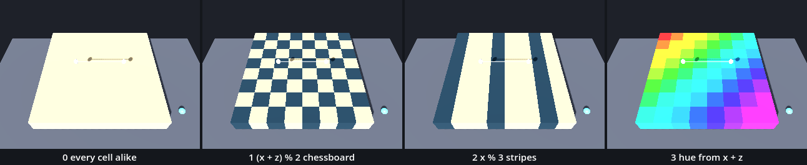
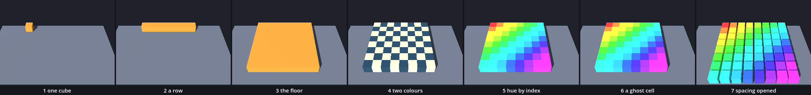

# The Chessboard — purely repetitive and therefore structural

The body of parts left us with scenes as parts: `load()`, `instantiate()`, `add_child()`. We wrote `add_part()` four times by hand, and one part, the cube, was already used four times in one body. Here we take that part, `cube_part.tscn`, and let a loop do the writing: a row of eight, then eight rows, a floor of 64 cubes. Then every cube gets its colour from a rule over its two indices. Two ideas are new: a loop inside a loop, and a material made in code. The title is Paul Klee's phrase for the chessboard.

In the halls, [Array](../../../../commons/maps/Array/final.md) repeats a cube in a loop: "The same instruction makes the many by changing what it receives." [Point_Line_Grid](../../../../commons/maps/Point_Line_Grid/final.md) ends on a plan of five rows by five: "Two indices can become an instruction for placing it." Its [making passage](../../../../commons/maps/Point_Line_Grid/tutorial.md) shows the loop we write here, with two materials: `light if (x+z)%2 == 0 else dark`. The grid arrives in this chapter and not before. The first line of the course ran between two points and did not need one.

This study takes two sessions. The first builds the floor and colours it. It ends at **Stop here**. The second compares four rules on a sheet, makes one cell a ghost, and opens the spacing until the marble falls through.

Every message and number on this page comes from running the study in Godot 4.6. Parts marked *(editor)* describe the editor's own windows and were not watched.

## Find the family in the hall

A lesson starts in its hall, with one question: does the hall show one work at several values of one axis? If it does, predict which two look most alike before you read anything beside them.

Array holds two works with a declared axis. The line of cubes that counts along z and the square grid of sixteen both have the axis `notation`, with five values: label, none, tape, tally, plate. The hall sets one value for both, `plate`: the numbers stand "on plates at the cubes’ feet". Neither work is shown as a family. But the row beside them, which declares no axis, wears what would be the first value: labels in the air. So the hall shows two notations, on two different works, and the reading uses the difference: collect a cube from the row and its label goes with it, while in the grid "its plate remains." Point_Line_Grid has one such work, the Modulor figure, with the axis `measure` (body, scale, canon, module, crowd), set to `scale`. One value again. We read this from the halls' map files and the artifact registry; we did not walk them.

So find the grid in Array, name its axis, and say which of the five values you are standing on. Then write down which two of the five you expect to look most alike. Nobody has rendered that sheet. Keep the guess: this study ends with a sheet of our own.

## Open the study

Open the [Chessboard study](README.md), then `chessboard.tscn`. Like the body of parts, it inherits `plane.tscn`: the ground, the camera, A and B, the walk, the marble on M and the view from below on V. `body.tscn` and the scenes before it are still in the folder and still run on their own. There are no new keys.

`chessboard.tscn` adds one node, `Chessboard`: an empty `Node3D` on the ground at (−1.75, 0, −2), which runs `chessboard.gd`. It also moves the waiting marble 0.6 m to the right, out of the floor's way.

Run it. A floor of 64 cubes lies on the ground, 4 m by 4 m and half a metre high, light and dark by turns. A and B hang over it. Press M: the marble falls from one metre above B and stays on the floor; the Record reads `marble at 0.60 m`. Hold S for a moment, until B is over the middle of the next cell towards us, and press M again. The marble is gone, and the Record reads `marble at 0.10 m`. One of the 64 is a ghost, and nothing in the picture says which.

`chessboard.gd` is ours. The download holds the finished version. We will take it apart and build it again.

## One cube

Replace everything in `chessboard.gd` with this:

```gdscript
extends Node3D

func _ready() -> void:
	var scene: PackedScene = load("res://parts/cube_part.tscn")
	var cube: MeshInstance3D = scene.instantiate()
	add_child(cube)
	cube.position = Vector3(0, 0.25, 0)
	print(get_child_count(), " cube, at ", cube.global_position)
```

Run it. One orange cube stands on the ground in the far left corner. The Output panel reads `1 cube, at (-1.75, 0.25, -2.0)`.

These are the three calls of the last chapter: load the scene, make an instance, add it. The cube is half a metre on every edge and is built around its own middle, so a height of 0.25 stands it on the ground. Its `position` is counted from `Chessboard`. This corner is where our floor begins.

## A row: one loop

Replace everything with this:

```gdscript
extends Node3D

var n := 8          # cubes along one side
var spacing := 0.5  # metres from one cube's middle to the next

func _ready() -> void:
	var scene: PackedScene = load("res://parts/cube_part.tscn")
	for x in range(n):
		var cube: MeshInstance3D = scene.instantiate()
		add_child(cube)
		cube.position = Vector3(x * spacing, 0.25, 0)
		print(x, " at ", cube.position)
	print(get_child_count(), " cubes")
```

Run it. Eight cubes stand in a row along the back, touching. The output begins

```
0 at (0.0, 0.25, 0.0)
1 at (0.5, 0.25, 0.0)
```

and goes on to `7 at (3.5, 0.25, 0.0)` and `8 cubes`.

This is Trace's loop. `range(n)` hands out 0, 1, 2, up to 7, and the three indented lines run once for each. What is new is what we do with the number. `x` is an index: it says which cube. `x * spacing` turns it into a place: cube 3 stands 1.5 m from cube 0. The spacing is the cube's own width, so each one touches the next.

## The floor: a loop inside a loop

One row is a loop. A floor is that loop, run once for every row. Replace everything with this:

```gdscript
extends Node3D

var n := 8          # cubes along one side
var spacing := 0.5  # metres from one cube's middle to the next
var cubes: Array[MeshInstance3D] = []

func _ready() -> void:
	var scene: PackedScene = load("res://parts/cube_part.tscn")
	for z in range(n):
		for x in range(n):
			var cube: MeshInstance3D = scene.instantiate()
			add_child(cube)
			cube.position = Vector3(x * spacing, 0.25, z * spacing)
			cubes.append(cube)
			if cubes.size() <= 10:
				print(cubes.size(), ": x ", x, ", z ", z)
	print(cubes.size(), " cubes; the last at ", cubes[-1].position)
```

Run it. An orange floor of 4 m by 4 m covers the ground under A and B. The output:

```
1: x 0, z 0
2: x 1, z 0
```

and so on to `8: x 7, z 0`, then `9: x 0, z 1`, `10: x 1, z 1`, and at the end `64 cubes; the last at (3.5, 0.25, 3.5)`.

Read the order. The inner loop runs whole for every turn of the outer one: `x` counts from 0 to 7 while `z` waits at 0, then `z` steps to 1 and `x` starts again. Eight times eight is 64 bodies, and 192 nodes. Each cube is placed by its two indices: `x` says how far to the right, `z` how far towards us. The list `cubes` keeps them in the order they were made, so cube (x, z) is `cubes[z * n + x]`.

To watch it happen, set a breakpoint on the line with `cube.position` and step over it with F10 *(editor)*: the Debugger shows `x` and `z` among the local variables, as it showed the cube's triangles.

The organism's lattice was made this way. Open `lattice.gd`: `for column in columns:` and, inside it, `for row in rows:`. Its 88 cells share one mesh with one material. That is the next question.

## A material made in code

The floor is orange because every cube wears the material saved in `cube_part.tscn`. Now we make our own. Add two lines under `var cubes`:

```gdscript
var light := Color(0.62, 0.55, 0.4)   # two colours of our own
var dark := Color(0.08, 0.16, 0.2)
```

Choose your own two if you like; our numbers below are for these. Then replace `_ready()` with this, and add the function under it:

```gdscript
func _ready() -> void:
	var scene: PackedScene = load("res://parts/cube_part.tscn")
	var material := StandardMaterial3D.new()
	material.albedo_color = light
	for z in range(n):
		for x in range(n):
			var cube: MeshInstance3D = scene.instantiate()
			add_child(cube)
			cube.position = Vector3(x * spacing, 0.25, z * spacing)
			cube.material_override = material
			cubes.append(cube)
	cubes[0].material_override.albedo_color = dark
	print("materials: ", count_materials(), "; the last cube is ", cubes[63].material_override.albedo_color)

func count_materials() -> int:
	var seen: Array = []
	for cube in cubes:
		if not seen.has(cube.material_override):
			seen.append(cube.material_override)
	return seen.size()
```

Run it. We changed the colour of one cube, the first, and the whole floor is dark. The output: `materials: 1; the last cube is (0.08, 0.16, 0.2, 1.0)`.

`StandardMaterial3D.new()` makes a material, as `Node3D.new()` made a pivot. `albedo_color` is its colour, and `material_override` puts it on a mesh node. We made one material, before the loops, and gave that one to all 64 cubes. A change made through cube 0 is a change to the only material there is, and cube 63 reads it. `count_materials()` counts them: `has()` asks whether a list already holds a thing.

Now move the two material lines from before the loops into the inner loop, so that its end reads:

```gdscript
			var material := StandardMaterial3D.new()
			material.albedo_color = light
			cube.material_override = material
			cubes.append(cube)
```

Run it. The floor is light, and one cube in the far left corner is dark. The output: `materials: 64; the last cube is (0.62, 0.55, 0.4, 1.0)`.

Where `new()` stands decides. Before the loops it runs once; inside the inner loop it runs 64 times. One material shared, or one each: the picture cannot tell until something changes.

The orange was shared too. With no material code at all, `count_materials()` gave 1: every instance of a scene wears the material saved in that scene. We changed one cube's orange and all 64 changed, and so did a cube instanced afterwards.

## Two colours by a rule

Take out the line that begins `cubes[0]`. Replace `material.albedo_color = light` with a choice:

```gdscript
			if (x + z) % 2 == 0:
				material.albedo_color = light
			else:
				material.albedo_color = dark
```

Run it. A chessboard: 32 cells light and 32 dark, and every cell differs from the cells beside it.

`%` gives what is left over after a division: `5 % 2` is 1, `6 % 2` is 0, `7 % 3` is 1. One step to the right or one step towards us changes `x + z` by one, so the leftover goes from 0 to 1 and back. The rule never names a cell. It is asked 64 times and answers from two numbers.

Two materials would have done here, and the hall's plan uses two. We keep one for each cube, because the next rule needs more than two colours.

## A hue from the index

Replace the four lines of the choice with one:

```gdscript
			material.albedo_color = Color.from_hsv((x + z) / (2 * n), 0.8, 0.6)
```

`Color.from_hsv()` makes a colour from three numbers between 0 and 1: a hue, once round the colour circle from red to red, a saturation and a value. `x + z` runs from 0 to 14, and `2 * n` is 16, so the hue should run from 0 to 0.875: most of the circle, one step along every diagonal.

Run it. The whole floor is red. The output still says `materials: 64`, and the last cube is `(0.6, 0.12, 0.12, 1.0)`: red, at the far end of a ramp that should have reached magenta.

Godot said why before the study started. Run with the debugger attached, the output begins:

```
WARNING: Integer division. Decimal part will be discarded.
```

`x`, `z` and `n` are whole numbers, and Godot divides a whole number by a whole number into a whole number: 14 / 16 is 0. Every hue is 0, and hue 0 is red. Nothing crashed, and 64 materials were made; the mistake is in what they were told. In the editor the same warning marks the line *(editor)*; we read it from a run started with `-d`.

The repair is one word:

```gdscript
			material.albedo_color = Color.from_hsv(float(x + z) / (2 * n), 0.8, 0.6)
```

`float()` turns a whole number into a number with a decimal part, and the division keeps its decimals: 14 / 16 is 0.875. Run it. Fifteen bands cross the floor on the diagonal, from red in the far left corner through yellow, green, cyan and blue to magenta in the near right one. The kinds of number have names, and the Families chapter gives them.

## Stop here: what we have

This is the end of the first session. `chessboard.gd` should be the script under *A material made in code*, with the material made inside the inner loop and coloured by the repaired `from_hsv` line. Run the study and check four things: a floor of 64 cubes in fifteen diagonal bands of colour; B walks over it as before; M drops the marble and it stays on the floor, `marble at 0.60 m`; the output begins `materials: 64`.

## The argument: which rule?

We have tried three rules over the same cubes. Now they become one axis. Replace everything in `chessboard.gd` with this:

```gdscript
extends Node3D

# 0 every cell alike   1 chessboard   2 stripes   3 hue from x + z
@export_enum("every cell alike", "(x + z) % 2 chessboard", "x % 3 stripes", "hue from x + z") var rhythm := 1

var n := 8                              # cubes along one side
var spacing := 0.5                      # metres from one cube's middle to the next
var light := Color(0.62, 0.55, 0.4)     # two colours of our own
var dark := Color(0.08, 0.16, 0.2)
var cubes: Array[MeshInstance3D] = []

func _ready() -> void:
	var scene: PackedScene = load("res://parts/cube_part.tscn")
	for z in range(n):
		for x in range(n):
			var cube: MeshInstance3D = scene.instantiate()
			add_child(cube)
			cube.position = Vector3(x * spacing, 0.25, z * spacing)
			var material := StandardMaterial3D.new()
			material.albedo_color = colour_of(x, z)
			cube.material_override = material
			cubes.append(cube)

func colour_of(x: int, z: int) -> Color:
	if rhythm == 0:
		return light
	if rhythm == 1:
		if (x + z) % 2 == 0:
			return light
		return dark
	if rhythm == 2:
		if x % 3 == 0:
			return dark
		return light
	return Color.from_hsv(float(x + z) / (2 * n), 0.8, 0.6)

func count_materials() -> int:
	var seen: Array = []
	for cube in cubes:
		if not seen.has(cube.material_override):
			seen.append(cube.material_override)
	return seen.size()
```

The loops did not change. The rule moved into a function of its own: `colour_of()` takes the two indices and returns a colour, and `rhythm` chooses which of four rules answers. Value 2 is new: `x % 3` is 0 in columns 0, 3 and 6, so one dark stripe is followed by two light ones, and `z` does not enter the rule.

**Write your prediction before you render.** Four floors of the same 64 cubes, seen from the study's camera, 5.9 m from the middle of the floor. Which two will look most alike? Which floors have a direction, and which have none? Write it down, with a reason for each.

Then look. Select `Chessboard` and choose **Rhythm** in the Inspector *(editor)*, or change the `1` at the end of the `@export_enum` line, and run. For stills of all four, run `sheet.gd` as the [README](README.md) says.



This is what our sheet measured. In all four the floor covers the same 29.65% of the frame.

| pair | differ on, of the frame | of the floor | average colours apart |
| --- | --- | --- | --- |
| every cell alike, chessboard | 15.04% | about 1/2 | 71.43 |
| every cell alike, stripes | 11.12% | 3/8 | 53.67 |
| chessboard, stripes | 14.26% | about 1/2 | 17.77 |
| hue, and any of the three | 29.22% | nearly all | 22.85 to 65.85 |

Cell by cell, the closest pair is `every cell alike` and the stripes: they differ on the 24 dark cells and agree on the other 40. The course's outline expected the chessboard and the stripes to be the closest, "where both read as texture". From 5.9 m they are not: they disagree on half the floor, as much as the chessboard and the plain floor do. The camera that looks straight down gave the same order.

The last column is the stills' average colour: what is left of a floor when the cells can no longer be told apart. There the order turns round. The chessboard and the stripes are the closest pair, 17.77 against 53.67, and the plain floor and the chessboard the farthest. So the outline's prediction holds at a distance where both are one grey. We did not render from that distance; the average is arithmetic on the stills.

The outline also said the hue ramp is the only floor with a direction. We counted. Swap `x` and `z` in the rule and 30 cells of the stripes change colour, and none of the other three floors'. Turn the floor half round and 48 cells of the stripes change, and 56 of the hue ramp. Two floors have a direction; the plain floor and the chessboard have none.

The claim: structure is the repetition rule, not the cube. The same 64 bodies, the same 192 nodes and the same 64 materials make four different floors.

## One cell is a ghost

Point One made a sphere solid or a ghost with one `if`. Add two lines under `var dark`:

```gdscript
var ghost_x := 5                        # the cell that is there for the eye and not for a body
var ghost_z := 5
```

and two lines in the inner loop, after `cube.material_override = material`:

```gdscript
			if x == ghost_x and z == ghost_z:
				cube.get_node("Body/CollisionShape3D").disabled = true
```

This is the `chessboard.gd` in the download. `and` wants both sides to be true, so the condition holds for one cell of 64. `get_node()` is `$` for a node we hold in a variable: it finds the shape inside this cube. `disabled` switches the shape off. The mesh and its colour stay.

Run it. Nothing changed: the still is the same to the pixel. Press M with B where it starts, over cell (5, 4): `marble at 0.60 m`. Walk B to the next cell towards us and press M: `marble at 0.10 m`. The marble lies on the ground, inside the cube. What we see and what stops a body are two properties, and 63 colliders look exactly like 64.

## A gap you can see and cannot pass

So far `spacing` is the cube's width and the cubes touch. Let s be the spacing, w the cube's width, 0.5 m, and d the marble's diameter, 0.2 m. The gap between two cubes is g = s − w. The simple prediction: the marble passes when g > d, so from s = 0.70 on. **Write that down, and your own guess beside it.** Then set `spacing` to 0.55 and add one line at the end of `_ready()`, outside both loops:

```gdscript
	$"../Marble".drop(to_global(Vector3(3.5 * spacing, 2.0, 4 * spacing)))
```

It drops the marble from 2 m over the middle between cube 3 and cube 4 of row 4: an index of 3.5. Run, wait, read the Record; then change `spacing` and run again. For the last column we wrote 0.75 in place of 2.0, which lets the marble go 15 cm above the cubes.

| s | g = s − w | dropped from 2 m | let go at 0.75 m |
| --- | --- | --- | --- |
| 0.55 | 0.05 | `marble at 0.59 m`, on top | 0.59, on top |
| 0.60 | 0.10 | 0.35, stuck | 0.57, on top |
| 0.65 | 0.15 | 0.34, stuck | 0.55, on top |
| 0.70 | 0.20 | 0.10, through | 0.09, through |
| 0.75 | 0.25 | 0.10, through | 0.09, through |

Then we closed in a millimetre at a time, once widening from a spacing that held the marble and once narrowing from one that let it pass.

*Observed.* Let go gently, the marble passes at s = 0.700 and not at 0.699: the boundary sits on g = d, from both sides. Dropped from 2 m, it passes from s = 0.679, a gap of 0.179 m, 2.1 cm narrower than the marble; both directions gave the same millimetre. And from s = 0.60 to 0.678 the dropped marble does neither. It ends between the two cubes, 0.31 to 0.44 m up: under their tops and over the ground. At s = 0.6 we see a gap of 10 cm, the marble cannot pass it, and dropped hard it does not stay out of it either.

*Inferred.* The dropped marble arrives at about 5 m a second, and physics runs 60 steps a second, so it moves about 9 cm between two steps: it is inside the gap before the engine finds the contact. The cube's collider is a trimesh, twelve triangles and nothing inside, and it then holds the marble from both sides. Two runs support this. With solid boxes (`BoxShape3D`) for the cubes' shapes in a copy, the same drop went through to the ground from s = 0.60 on, a gap half the marble's width. And at 120 steps a second nothing stuck at the spacings we tried: on top at s = 0.68, through at 0.70.

*Unexplained.* Why 0.679. The engine lets touching bodies overlap by 0.01 m, and twice that would give 0.68. But with that allowance set to 0.002 m in a copy, the switch moved to between 0.685 and 0.690, not to 0.70, and one spacing below it, 0.660, passed alone. We leave it there.

The prediction was right for a marble let go gently and 2 cm wrong for one that falls. Geometry says what can pass. What does pass also depended on how fast the body came and how often the engine looked. Set `spacing` back to 0.5 and take the line out.

## What the floor owes

The grid is the ground nobody examines. The editor opens on one. A voxel is a cell of one. The frame buffer, where every still on this page ended, is one: 1280 by 720 cells with one colour each (after Jacob Gaboury's *Image Objects*). It is a choice. The first line of this course did not need it, and that ruling stands: the grid arrives here, in the twelfth chapter, as one rule among others, and `x * spacing` is the line where we chose it. Our floor begins in the far left corner because (0, 0) does. Nothing in the floor argues for that corner.

HSV promises equal steps of hue. Our fifteen bands are each 1/16 of the circle from the next, and they are not equal to the eye. We asked each band's colour for its luminance with `get_luminance()`: the brightest, a yellow-green, has 0.553, and the darkest, a blue, 0.167. Pure yellow has 3.7 times the luminance of pure blue at the same saturation and value. On the screen the steps differ too: from the top camera the two bands either side of yellow are among the closest neighbours, 46 apart, and the blue ones stand 60 and 63 apart, counted in 255ths over the three channels. So the yellow reads as brighter, and as one wider band. A hue is a number; a colour is what an eye makes of it.

## Walk the floor

The place this chapter asks for is to walk the floor and fall through the ghost. This study has no walker. The marble is the body here: it rests on a solid cell at 0.60 m and falls through the ghost to 0.10 m.

In Array a sphere writes into the hall's own floor, and "a consumed cell leaves a hollow". The reading says what a marble cannot: "Underfoot, absence asks something of our balance." A walker would add its own weight, its width and its eye height: the fall would be its own, half a metre, and a walker is wider than our marble, so the gap would switch at another spacing. A headset would add the body that flinches before the ghost cell. None of this was checked: no walker ran on this floor and no headset was used.

## What the floor costs

The floor adds 192 nodes to the tree: 64 cubes, each with a `Body` and a shape. It adds 64 meshes of 12 triangles, 64 collision shapes and 64 materials. Nothing is shared but the scene file. `_ready()` built it in about 7 ms on our machine.

What it costs to draw, a headless run cannot say: it draws no frames. With a window, `sheet.gd` asked the renderer. From the strip's camera it took 5 draw calls without the floor and 325 with it: 5 for every cube, with the light's shadow on. From the top camera, where the light casts no shadow, it took 1 for every cube. One shared material or 64, the count was the same. We did not measure the time of a frame.

Sixty-four is small. For thousands of copies of one mesh Godot has `MultiMesh`, one node that draws them all. It belongs to a later chapter, the pendulum's.

## Try

Swap `x` and `z` in the position: `Vector3(z * spacing, 0.25, x * spacing)`. Cube 1 now stands at (0, 0.25, 0.5), and the chessboard looks as it did. So do the plain floor and the hue ramp. Only the stripes show it: 30 cells change. A swapped pair of indices hides in every rule that treats the two alike.

Start the outer loop one late: `for z in range(1, n):`. Add `print(cubes.size())` at the end of `_ready()`: `56`. The back row is missing, and Godot has nothing to say.

Name both loop variables `x`. Godot refuses before the study starts: `Parse Error: There is already a for loop iterator named "x" declared in this scope.`

In place of the three material lines, write `cube.material_override = cube.material_override.duplicate()`, and print `count_materials()` at the end of `_ready()`: `64`, and the floor is orange. `duplicate()` copies a material: each cube has its own copy of the part's orange, and one can change alone.

## The process

A body made by more than one operation has a recipe. Ours, one still after each step, from one camera:

one cube → a row → the floor → two colours → hue by index → a ghost cell → spacing opened



`sheet.gd` makes the strip and counts what each step claims. There are 1, 8, 64, 64, 64, 64, 64 cubes; 1, 1, 1, 64, 64, 64, 64 materials; 1, 1, 1, 2, 15, 15, 15 colours; and 1, 8, 64, 64, 64, 63, 63 colliders. Opening the spacing to 0.6 changed the picture most, 43.42% of the tile, and added nothing: the far corner cube went from (3.5, 3.5) to (4.2, 4.2), seven times the change in `spacing`. The loop inside the loop added most: 56 cubes. And one step changed the body and not the picture: *a ghost cell* differs from *hue by index* on 0.00% of the tile.

## In your room

Lay a floor for your room, with a rhythm rule of your own and two colours you chose.

Copy `room.tscn`, `room.gd`, `my_plane.tres` and `my_ring.tscn` from your Body of Parts folder into this one. Save a copy of `chessboard.gd` as `my_floor.gd`. In `room.tscn`, add a `Node3D` named `MyFloor` at (−1.75, 0.6, −2) and attach `my_floor.gd` to it *(editor)*. In `my_floor.gd`, set `light` and `dark` to your two colours, decide where the ghost is, and replace `colour_of()` with a rule of your own. Ours:

```gdscript
func colour_of(x: int, z: int) -> Color:
	if (x + 2 * z) % 3 == 0:
		return dark
	return light
```

Run `room.tscn`. We made the same room by writing its files. The floor lies under the plane you walked, its top at 1.10 m, 2 cm below the plane. With our rule 22 cells are dark: every third diagonal. We put the ghost at (1, 4). The marble dropped over cell (3, 4) stayed at 1.20 m; over the ghost it fell through the floor to the ground, 0.10 m.

Write one line in your README: what your rule repeats, and what it leaves out. Hand in your room with its process strip: one still after each operation, in order, with the operation named under it.

## What we borrowed

| Part | From | How far we go |
| --- | --- | --- |
| `plane.tscn` and all it inherits | Point Plane | Inherited. The root runs `plane.gd` unchanged. |
| `parts/cube_part.tscn`, `cube.gd` | A Body of Parts, Point Cube | Ours, unchanged: instanced 64 times. |
| `marble.gd` | Point Plane | Use: `drop(at)` puts the marble at a place in the room and lets it fall. The Record shows its height. |
| `StandardMaterial3D`, `albedo_color`, `material_override` | Godot | Use: a material made with `new()`, its colour, and the mesh node it is put on. |
| `Color.from_hsv()`, `get_luminance()` | Godot | Use: a colour from hue, saturation and value, each from 0 to 1; how bright a colour is. |
| `has()`, `duplicate()`, `float()` | Godot | Use: whether a list holds a thing; a copy of a material; a whole number as one with decimals. |
| `disabled` on a `CollisionShape3D` | Godot, Point One | Use: the shape stays and stops nothing. |
| `sheet.gd` | Supplied here | Use: it renders the four values of `rhythm`, measures them, and makes the process strip. |

What we made is `chessboard.gd`: two loops, one inside the other, that instance one part 64 times and place each by its indices; a material for each cube; a function that answers a colour for two indices; an axis that chooses the rule; and one `if` that makes a ghost.

## What we carry forward

We leave with a loop inside a loop; with an index turned into a position; with a material made in code, and the difference between one shared and one each; with `%`, and a rule that is asked instead of a list that is written; and with `float()`.

The next stop, *Families*, takes the four `if rhythm ==` lines as its question. We described four floors by four branches in one function. There a body is described once, in a single class with two exported fields, and swept into a sheet like ours. It also names the kinds of number that made our floor red.
