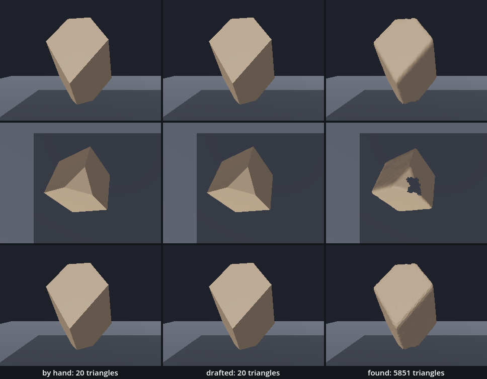
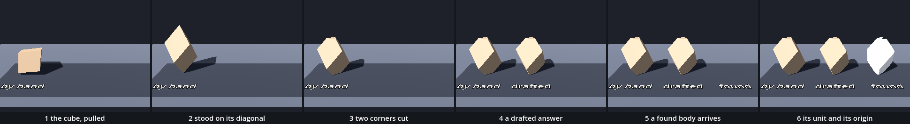

# Collage — a found body joins the family

Families left us with a class: a name, two typed fields, a `build()`, a count of triangles, and a sheet that reads back what was built. Every body on that sheet was ours down to the last corner. Here two bodies arrive that are not. One is a recreation: the stone in Dürer's engraving *Melencolia I*, which we build as a class and then ask a drafter to build again. The other is found: a file made somewhere else, in its own units. One idea is new, importing a file. Everything else returns.

This is a new project, like every stop of this course: in the Project Manager choose **Import** and open this folder's `project.godot`. Leave your Families folder as it is. The first time Godot opens the project it imports one file, `found.gltf` *(editor)*; from a terminal the same import took about four seconds.

In the hall, [Primitives_Melencolia](../../../../commons/maps/Primitives_Melencolia/final.md) stands the stone beside a seated figure: "The stone has six pentagonal faces and two triangular ends. Its mesh begins with a rhombohedron and cuts off two opposite corners." Its [making passage](../../../../commons/maps/Primitives_Melencolia/tutorial.md) gives the order: "It stretches a cube along its body diagonal, rotates that diagonal upright, and clips opposite corners." We build it in that order. And it says what a recreation is: "Those hidden surfaces are decisions we have made."

What this kit could not do: the chapter's found body is one you scanned with a phone or drew in a headset. Nothing here was scanned and no headset was used. The download holds a stand-in, and the page says each time what it is.

This study takes two sessions. The first builds the solid, asks a drafter, and brings the found body in. It ends at **Stop here**. The second compares the three, asks what a collage owes, and exports your room.

Every message and number on this page comes from running the study in Godot 4.6. Parts marked *(editor)* describe the editor's own windows and were not watched.

## Find the family in the hall

A lesson starts in its hall, with one question: does the hall show one work at several values of one axis?

This hall does not. Its 19 works are of 12 kinds. Four pyramids and four cubes each stand at one setting: one value, four times. The tableau with the stone has an axis, `apparatus`, with four values, and stands once. Look for a second thing here: a body that was not built by code. We searched the scenes and scripts of all 12 kinds for an imported mesh file and found none. Every body in the hall, the stone and the sleeping dog included, is made by a script. We read this from the hall's map file and the artifact registry; we did not walk it.

## Open the study

Open the [Collage study](README.md), then `collage.tscn`. Like the family, it inherits `plane.tscn`: the ground, the camera, A and B, the walk, the marble on M and the view from below on V. `family.tscn` and the scenes before it are still in the folder and still run on their own. There are no new keys.

`collage.tscn` adds two nodes at (−1.8, 0, 0.9): `Sheet`, the sweep sheet of the last stop, and `Collage`, an empty `Node3D` which runs `collage.gd`.

Run it. Three bodies stand on the sheet over three plates: `by hand`, `drafted`, `found`. The first two are alike, clay-coloured, with flat faces. The third is paler and has a ragged hole in its top. The Output panel, at the bottom of the editor, reads:

```
by hand: 20 triangles
drafted: 20 triangles
scan_mesh arrived as [P: (-0.804559, 4.3, -59.32127), S: (75.61543, 99.03934, 75.02676)]
found: 5851 triangles
```

Three scripts are ours: `solid.gd`, `found.gd` and `collage.gd`, in the FileSystem dock at the lower left. The download holds the finished versions. We take them apart and build them again.

## The cube, pulled

Replace everything in `solid.gd` with this:

```gdscript
class_name Solid
extends MeshInstance3D

@export_range(1.0, 2.0) var stretch: float = 1.53   # how far the cube is pulled along one diagonal

func _ready() -> void:
	build()

func build() -> void:
	stretch = clampf(stretch, 1.0, 2.0)
	var corners: Array[Vector3] = [
		Vector3(-0.25, -0.25, -0.25),   # 0 the low end of the diagonal
		Vector3(0.25, -0.25, -0.25),    # 1
		Vector3(0.25, 0.25, -0.25),     # 2
		Vector3(-0.25, 0.25, -0.25),    # 3
		Vector3(-0.25, -0.25, 0.25),    # 4
		Vector3(0.25, -0.25, 0.25),     # 5
		Vector3(0.25, 0.25, 0.25),      # 6 the high end of the diagonal
		Vector3(-0.25, 0.25, 0.25),     # 7
	]
	for i in range(corners.size()):
		var p := corners[i]
		corners[i] = p + Vector3.ONE * (p.x + p.y + p.z) / 3.0 * (stretch - 1.0)
	var faces: Array = [
		[4, 7, 6, 5], [5, 6, 2, 1], [2, 6, 7, 3],   # the three that meet at corner 6
		[1, 2, 3, 0], [0, 3, 7, 4], [0, 4, 5, 1],   # the three that meet at corner 0
	]
	var surface := SurfaceTool.new()
	surface.begin(Mesh.PRIMITIVE_TRIANGLES)
	surface.set_smooth_group(-1)
	for face in faces:
		for i in range(1, face.size() - 1):
			surface.add_vertex(corners[face[0]])
			surface.add_vertex(corners[face[i]])
			surface.add_vertex(corners[face[i + 1]])
	surface.generate_normals()
	mesh = surface.commit()

func triangles() -> int:
	var arrays := mesh.surface_get_arrays(0)
	return arrays[Mesh.ARRAY_VERTEX].size() / 3
```

and everything in `collage.gd` with this:

```gdscript
extends Node3D

func _ready() -> void:
	var solid := Solid.new()
	add_child(solid)
	$"../Sheet".hang(solid, "by hand")
	print(solid.triangles(), " triangles, ", solid.get_aabb().size, " m")
```

Run it. One clay block stands on the sheet over a plate that says `by hand`. The output: `12 triangles, (0.765, 0.765, 0.765) m`.

Almost nothing here is new. The class has the family's shape: a name, an exported field with its type and its range, and a `build()` that keeps the field inside its limits. The eight corners are Point Cube's, with Point Cube's numbers.

The first loop is the pull. `p.x + p.y + p.z` says how far a corner lies along the diagonal from corner 0 to corner 6: −0.75 for corner 0, 0.75 for corner 6, and ±0.25 for the six between. Each corner moves along the direction (1, 1, 1) by a third of that, times `stretch − 1`. The two ends move furthest, away from each other. With `stretch` at 1 nothing moves and the block is the cube.

`faces` holds, for each face, its corners in order, clockwise seen from outside. The inner loop is Plane's fan: the first corner, then each pair along the edge. A face of four corners gives two triangles.

`triangles()` is not the family's. Our loop hands over three corners for every triangle and no list of corner numbers, so the count is the corners divided by 3.

The number 1.53 is not ours. The hall's script works it out with a cosine, from an angle of 72° between two edges of a face: 1.5302. We take that number to two decimals; you will compute it when `cos()` arrives.

## Stood on its diagonal

In `build()`, add one line above `var surface`:

```gdscript
	var upright := Quaternion(Vector3.ONE, Vector3.UP)
```

and replace the three `add_vertex` lines with:

```gdscript
			surface.add_vertex(upright * corners[face[0]])
			surface.add_vertex(upright * corners[face[i]])
			surface.add_vertex(upright * corners[face[i + 1]])
```

Run it: `12 triangles, (0.788675, 1.325019, 0.788675) m`. The block stands on one corner, 1.33 m from point to point.

A `Quaternion` made from two directions is a turn that carries the first onto the second: here the diagonal, (1, 1, 1), onto straight up. `upright * corner` is the corner after that turn. The supplied `segment.gd` has used the same call since Lines, to lay its cylinder from A to B. It is the hall's line too: `Quaternion(diagonal, Vector3.UP)`.

## Two corners cut

Add a second field under the first:

```gdscript
@export_range(0.0, 0.5) var cut: float = 0.38       # how far along each edge the two end corners are cut off
```

keep it inside its limits, under the line that does so for `stretch`:

```gdscript
	cut = clampf(cut, 0.0, 0.5)
```

and replace the `var faces` list, all four lines of it, with:

```gdscript
	for end in [[6, 2, 5, 7], [0, 1, 3, 4]]:
		for i in range(1, 4):
			corners.append(corners[end[0]] + (corners[end[i]] - corners[end[0]]) * cut)
	var faces: Array = [
		[4, 7, 10, 9, 5], [5, 9, 8, 2, 1], [2, 8, 10, 7, 3],        # around the high end
		[1, 2, 3, 12, 11], [13, 12, 3, 7, 4], [11, 13, 4, 5, 1],    # around the low end
		[8, 9, 10], [11, 12, 13],                                   # the two cuts
	]
```

Run it: `20 triangles, (0.788675, 0.989348, 0.788675) m`. Both points are gone. The body stands on a small triangle and ends in one, 0.99 m high.

Corner 6 has three neighbours: 2, 5 and 7. The new loop starts at corner 6 and goes `cut` of the way towards each: three new corners, numbered 8, 9 and 10 because `append()` adds at the end. Then the same from corner 0 towards 1, 3 and 4: corners 11, 12 and 13. Corners 6 and 0 stay in the list, and no face names them any more.

Each old face lost one corner and got two. Where `[4, 7, 6, 5]` had 6, the new list has 10 and 9: the corner on the edge it arrives by, then the corner on the edge it leaves by. Six faces of five corners give three triangles each, and the two cuts one each: 20. Twelve corners, six faces with five and two with three: the hall's count. Measured against the hall's own construction, our twelve corners lie within 0.08 mm of it, which is the two decimals of 1.53.

The 0.38 is the hall's as well, and the hall says what it is: the angle and the depth of the cut "are modelling choices, not a claim that the engraving establishes these unique values".

## Three lines for a drafter

Now we ask for the same body from somewhere else, with Point Cube's three lines: what should change, what must not, and one observation that would prove the answer wrong.

```
Change:    write drafted_solid.gd: the solid from Dürer's engraving Melencolia I, as a body I can stand beside the one I coded by hand.

Keep:      extends MeshInstance3D, and no class_name. Two exported fields, stretch: float = 1.53 and cut: float = 0.38. A build() that makes the mesh and is called from _ready(), and a triangles() that returns how many triangles the mesh lists. The solid is a cube with edges of 0.5 m, pulled along one of its diagonals until it is `stretch` times as long, with that diagonal standing upright, and with the two corners on that diagonal cut off, `cut` of the way along each edge that meets there. Its middle is the node's origin. Godot draws the side of a triangle from which its corners run clockwise.

Wrong if:  its box, get_aabb().size, is not about 0.79 m wide and 0.99 m high, or I can see into it from any side.
```

The second line describes the body in words and sends no code of ours.

The download holds one answer, `drafted_solid.gd`, and it is a real one. The session that built this kit, itself an AI assistant, put these three lines, under one sentence saying that we are learning Godot 4.6, to a second assistant of its own kind (Claude, on 1 October 2026), told it to use no tools, and kept the script as it came back, byte for byte. It is one answer, from one assistant, on one day. Put the lines to an assistant of your own and stand its answer here instead.

Add four lines at the end of `_ready()` in `collage.gd`:

```gdscript
	var drafted: MeshInstance3D = load("res://drafted_solid.gd").new()
	add_child(drafted)
	$"../Sheet".hang(drafted, "drafted")
	print(drafted.triangles(), " triangles, ", drafted.get_aabb().size, " m")
```

Run it. Two bodies, alike, over `by hand` and `drafted`:

```
20 triangles, (0.788675, 0.989348, 0.788675) m
20 triangles, (0.788675, 0.989347, 0.788675) m
```

Check it against the third line before you read it. The box is right, to the last digit but one. Nothing we can see is open, and we counted: all 20 of its triangles face outward. The answer passes.

Now read it. It does not look like ours. It makes the turn from three directions and their dot products, where we used a `Quaternion`. It lists 36 corners and a list of 60 corner numbers, where ours lists 60 corners and no numbers. Its `triangles()` asks first which of the two the mesh has. Its fields have no range. Two routes, one body: its twelve corners lie within a ten-thousandth of a millimetre of ours.

## A body we did not write

`found.gltf` is the third body. glTF is a file format for 3D bodies, and a `.gltf` file is text. Open it in a text editor outside Godot and read its fourth line: "A stand-in for a phone scan: made by a script, not scanned." It is our own solid, made to arrive the way a scan does: one skin of 5,851 small triangles, its edges rounded, its surface lumpy by a few millimetres, the face it stood on missing, a ragged patch missing on top where no camera looked, nothing inside, its numbers in centimetres, and its origin where a scanner's would be, off to one side.

Godot does not read this file when the study runs. It read it once, when it imported the project, and made a scene of its own from it, kept in the hidden folder `.godot`. Beside the file it wrote `found.gltf.import`, which holds the settings it used. `load("res://found.gltf")` hands us that scene.

Replace everything in `found.gd` with this:

```gdscript
class_name Found
extends Node3D

@export var file := "res://found.gltf"   # a body somebody else made, as a file

var part: MeshInstance3D                 # the mesh inside the file, once build() has brought it in

func _ready() -> void:
	build()

func build() -> void:
	var body: Node3D = load(file).instantiate()
	add_child(body)
	part = body.get_child(0)

func triangles() -> int:
	var arrays := part.mesh.surface_get_arrays(0)
	return arrays[Mesh.ARRAY_INDEX].size() / 3
```

A found body gets a class too, so that it can stand in the row and answer the same question. Given an imported file, `load()` gives a scene, as it did for the parts of A Body of Parts, and `instantiate()` makes its nodes. Godot made two nodes of this file: a `Node3D` named `scan`, and under it a `MeshInstance3D` named `scan_mesh`. `get_child(0)` is that mesh node. Its mesh has a list of corner numbers, so here `triangles()` is the family's.

Three bodies written out would be three blocks. Replace everything in `collage.gd` with the family's loop:

```gdscript
extends Node3D

@export var made := "by hand, drafted, found"   # how each body was made, in the order they stand

func _ready() -> void:
	for word in made.split(","):
		var how := word.strip_edges()
		var body := make(how)
		if body == null:
			push_error("no body here was made this way: " + how)
			continue
		add_child(body)
		$"../Sheet".hang(body, how)
		print(how, ": ", body.triangles(), " triangles")

func make(how: String) -> Node3D:
	if how == "by hand":
		return Solid.new()
	if how == "drafted":
		return load("res://drafted_solid.gd").new()
	if how == "found":
		return Found.new()
	return null
```

`made` is the axis of this chapter: how a body was made, one word for each place on the sheet. `make()` returns the body for a word, and `null`, nothing, for a word nobody answers to. Then the loop says so with Point Cube's `push_error()` and goes on.

Run it.

```
by hand: 20 triangles
drafted: 20 triangles
found: 5851 triangles
```

Two bodies. Three plates. Over `found` stands nothing. Godot printed no error and no warning. The body was made, hung and counted, and it is not in the picture.

The first idea is to pull the camera back and look for it. Read its box first.

## Read its box before you move the camera

In `found.gd`, add two lines at the end of `build()`:

```gdscript
	var box := part.get_aabb()
	print(part.name, " arrived as ", box)
```

Run it. One new line:

```
scan_mesh arrived as [P: (-0.804559, 4.3, -59.32127), S: (75.61543, 99.03934, 75.02676)]
```

`get_aabb()` gives the box a mesh fits in. Godot calls it an AABB. `P` is the box's lowest corner and `S` its size, in the mesh's own numbers. The size says 99 high. Godot's unit is the metre, and so is glTF's. The file's numbers are centimetres, and nothing in a glTF file can say so. So the body is 99 m high: a hundred times too large. `P` says more: its lowest point is 4.3 m above its own origin. Measured in the room, the middle of the body is 43 m from its plate, and not one of its 2,993 corners is in the camera's view. The plate is where the body's origin is. The body is somewhere else.

## Its unit, then its origin

Add a second field under the first in `found.gd`:

```gdscript
@export var unit: float = 0.01           # metres for one unit of the file: 0.01 for centimetres
```

and one line at the end of `build()`:

```gdscript
	body.scale = Vector3.ONE * unit
```

Run it. The body is there and the right size, and in the wrong place: it floats 4 cm above the ground, 43 cm from its plate, to the right and behind. A scale shrinks the distance to the origin with everything else.

One more line under it:

```gdscript
	body.position = -(box.position + Vector3(box.size.x, 0.0, box.size.z) / 2.0) * unit
```

Run it. The found body stands on its plate, and the output is the four lines we started from.

`box.position` is the lowest corner. Half the width and half the depth further is the middle of the foot. The minus sign moves that point to our node's origin, and `* unit` is there because `box` is still in the file's numbers. The sheet stands a body where its origin is, so now it stands on its foot.

The same repair can be made where the file comes in. Select `found.gltf` in the FileSystem dock, at the lower left. The Import dock, a tab beside the Scene dock at the upper left, shows its settings: set **Root Scale** to 0.01 and press **Reimport** *(editor)*. We did not watch that dock. We wrote the same value into `found.gltf.import`, where the dock keeps it, and imported again: the arrival line then read `S: (0.756154, 0.990393, 0.750268)`, in metres. Two more settings, tried the same way: **Root Type** made the root a `StaticBody3D`, and the physics setting of the mesh node gave it a collider. Do one repair, not both: with Root Scale at 0.01 and `unit` at 0.01 the body stood 1 cm high.

## Stop here: what we have

This is the end of the first session. Run the study and check three things: three bodies on three plates; the found one stands on the ground, over its plate; the output is the four lines under *Open the study*. `drafted_solid.gd` is unchanged.

## The argument: how was it made?

The axis is `made`. This study has three values: by hand, drafted, found. The course's outline has a fourth, sculpted in VR, and this kit has no honest way to make one: add the word `sculpted` to `made` and Godot says `ERROR: no body here was made this way: sculpted`. That place on the sheet is yours.

**Write your prediction before you render.** Three bodies, each seen alone from 2 m. Which two will look most alike? Which is the odd one, and by what: its outline, its surface, or its count of triangles? Write it down, with a reason for each.

The outline made its own: "The hand-coded and the AI-coded will look most alike: same instruction, same primitives. The scan is the outlier by triangle count, not by silhouette."

Then look. For stills of each body alone, run `sheet.gd` as the [README](README.md) says; it needs a terminal. You can go on without it: the table is what our run measured.



Each body was photographed alone, from 2 m: from the side, from straight above, and from the side with every triangle lit flat. All three wear the sheet's one paint here, so that bodies are compared and not materials. The solid covers 20.3% of the still.

| pair | differ on, from the side | from above | lit flat |
| --- | --- | --- | --- |
| by hand and drafted | 0.00% of the still | 0.00% | 0.00% |
| by hand and found | 2.91% | 3.61% | 2.68% |
| drafted and found | 2.91% | 3.61% | 2.68% |

| | by hand | drafted | found |
| --- | --- | --- | --- |
| triangles | 20 | 20 | 5,851 |
| corners listed | 60 | 36 | 2,993 |

The closest pair is by hand and drafted, as the outline said, and closer than it said: the two stills are one still, pixel for pixel, from all three standpoints. The reason it gave does not hold. The primitives were not the same: one body came out of `SurfaceTool`, the other was handed to an `ArrayMesh` as lists. What was the same was the description, and it left nothing about the shape open.

The two part where the three lines were silent. We asked both for a `cut` of 0.9. Ours wrote 0.5 back into its field and stood 0.88 m high: we had drawn a limit there. The drafted one kept 0.9 and stood 0.53 m high: it had drawn its limit at 1. The two stills then differ on 14.88% of the frame. Asked for a `stretch` of 3, ours built 2 and the drafted one built 3. Neither limit is Dürer's.

The found body is the odd one by every measure, and by very different amounts. Its outline differs from the solid's on 0.96% of the still, a band 5 pixels wide around the body; from above, where the hole shows, on 2.04%. Its triangles are 293 times the solid's. And it has what the other two do not: 137 edges that belong to one triangle only, in two rings, one around its missing foot and one around the hole on top.

That is the outline's second sentence, and here is the limit of what we measured: our found body was made from the solid. Its outline was always going to be near. The sheet shows how to measure a scan against a made body. It cannot say what a scan of yours will show.

The claim, as measured: how a body was made showed less in its outline than in its count and its faults. Between the two made bodies there was nothing in the picture and nothing in the count; they differ in how they are written down and in where their limits lie. Between made and found there were 5 pixels of outline, 293 times the triangles, and two holes.

One more number. In the material its own file brought, the found body differs from the solid on 20.30% of the still: every pixel of the body. A found body arrives with its own surface.

**Decide.** One difference here could be followed. From above, where its hole shows, the found body's outline differs twice as much as from the side. The next intervention would be to stand the camera somewhere else, behind it or below: from where does it pass for the made one, and from where not at all? We did not look from there. Or settle: three bodies stand on one sheet and the table says how they differ. Either is right. Write your decision and the reason in your [field note](FIELD_NOTE.md); ours is there as an example of the form, not of the answer.

## What the collage owes

A recreation owes its precedent the differences. Dürer left one view of the stone, in ink. Ours has a far side, an angle of 72° and a cut of 0.38, and none of the three is in the engraving: they are the hall's choices, and now ours. The hall says it of its whole tableau: "Those hidden surfaces are decisions we have made." To these we added two limits, 0.5 and 2, and the drafted answer added others. A class that recreates a body also says which other bodies may stand beside it.

The drafted answer passed every check we had, and that is still not knowing what it does. We know what it does at the few values we tried. It came from an assistant that learned from other people's code, and it is right here because three lines left it no room.

A scan owes more. Ours has 5,851 triangles; the outline of this course speaks of millions, and somebody decides how many to keep, in Blender or in the scanning app. We thinned nothing here. It has holes where the camera did not go, and it has no inside: one skin, drawn from one side. And whose bodies scan well is not neutral. The outline of this course says so, and this kit could not test it: we had no scanner and no body in front of one.

## One floor

The place this chapter asks for is a room where bodies made in code and a body brought in as a file share one floor.

On the desktop the walker is B. Hold S until B stands over the row: it is then above the found body. Press M: the marble falls through it and the Record reads `marble at 0.10 m`. It falls through the solid as well. For the marble, made and found are alike: neither is there. *Try* gives them bodies, and then they differ.

Here is what was not checked. No walker ran along this row and no headset was used. A hand could turn the found body over and look through its foot; B moves at one height on four keys.

## Try

In `found.gd`, set `unit` to 1.0 and run. No body, and this time a shadow with a ragged edge lies over most of the room. Nothing in the picture casts it. We are standing inside the found body, and a skin drawn from one side cannot be seen from within. Set it back to 0.01.

In `solid.gd`, change the default of `cut` to 0.0: the pulled cube on its point, 1.33 m high. With `stretch` at 1.0 as well it is Point Cube's cube on a corner, 0.87 m high. Set both back.

Ask every body for a cut of 0.9: in `collage.gd`, under `var body := make(how)`, add `body.set("cut", 0.9)`. The solid by hand stands 0.88 m high, the drafted one 0.53 m, and the found one as before: it has no field of that name, and `set()` said nothing, as in the family.

Give two of them a body. At the end of `build()` in `solid.gd` add `create_trimesh_collision()`, and at the end of `build()` in `found.gd` add `part.create_trimesh_collision()`. Then, at the end of `_ready()` in `collage.gd`, outside the loop: `$"../Marble".drop($"../Sheet".hung[0].global_position + Vector3(0, 1.2, 0))`. The Record reads `marble at 1.08 m`: it rests on the solid's top. With `hung[2]` and `Vector3(0, 1.7, 0)` the marble lands on the found body's top, rolls off, leaves the ground, and the number in the Record goes far below zero.

## The process

A body made by more than one operation has a recipe. Ours, one still after each step, from one camera:

the cube, pulled → stood on its diagonal → two corners cut → a drafted answer → a found body arrives → its unit and its origin



`sheet.gd` makes the strip and counts what each step claims. The first body has 8, 8, then 12 corners and 12, 12, then 20 triangles with area, and stands 0.765, 1.325, then 0.989 m high. There are 1, 1, 1, 2, 3, 3 bodies. The last one listed 5,851 triangles in both of the last two steps; it stood 99.04 m high in the fifth and 0.99 m in the sixth. Standing the block on its diagonal changed the picture most: 6.96% of the tile. The found body's arrival changed it least, 0.57%, a plate and nothing more, and changed the counts most.

## In your room

SYNTHESIS II: your room, with your family and one found body, exported as a build. The mini project starts from that build.

Copy `room.tscn`, `room.gd`, `my_plane.tres`, `my_ring.gd`, `my_floor.gd` and `my_family.gd` from your Families folder into this one. Copy, do not move: the Families folder keeps the originals. If you have your scan from the first week, copy its file here too.

At the end of `_ready()` in `room.gd`, add:

```gdscript
	var solid := Solid.new()
	add_child(solid)
	solid.position = Vector3(-0.3, 1.6, -1.2)
	var found := Found.new()
	found.file = "res://found.gltf"   # the name of your own file goes here
	found.unit = 0.01                 # and its unit, read from the box it prints
	add_child(found)
	found.position = Vector3(0.9, 1.1, -1.2)
```

The two fields are set before `add_child()`, as in the family. With a file of your own, run once and read the line it prints: a size in the hundreds means centimetres and a `unit` of 0.01; a size that reads like metres means a `unit` of 1.0. `Found` expects one mesh directly under the file's root. A file built deeper stops at the `part` line with `Trying to assign value of type 'Node3D' to a variable of type 'MeshInstance3D'.`, and a wrong name gives `Resource file not found`.

Run `room.tscn`. We made the same room by writing its files. The solid and the found body stand side by side on the floor, at 1.10 m, the found one 0.99 m high with 5,851 triangles, beside the ring family and the carried globe.

Then export. Make the room the main scene, in **Project > Project Settings > Application > Run**, and export with **Project > Export…** as in Point Cube; the download holds the preset `Windows Desktop` *(editor)*. If Godot says the export templates are missing, they are the ones fetched for Point Cube. We exported from the command line:

```
godot --headless --path . --export-debug "Windows Desktop" <folder>/my-room.exe
```

It took four seconds and wrote three files: `my-room.exe`, the engine, about 96 MB; `my-room.pck`, the project; and `my-room.console.exe`. We started the build on the machine that made it, with a window and without one. It ran 300 frames with no message and printed the line `scan_mesh arrived as …`: the found body is in the build.

The file is not. The pack holds `found.gltf.import` and the scene Godot made at import. `found.gltf` itself, with the line that says what it is, stayed behind. A build carries what Godot made of a found body, not what you were given.

Not checked: no build was copied to another computer, none was made for a headset, and the export window was not watched.

In your README, keep three things: where your found body came from and who or what made it; its unit and what was missing from it; and your three lines with the answer as it came back. Hand in the build, your process strip and your field note.

## What we borrowed

| Part | From | How far we go |
| --- | --- | --- |
| `plane.tscn` and all it inherits | Point Plane | Inherited. The root runs `plane.gd` unchanged. |
| `sweep_sheet.tscn`, `sweep_sheet.gd` | Families | Use: `hang(member, title)`. It paints a body and finds its foot only if the body is itself a mesh; a body from a file stands where its origin is. |
| the eight corners and their numbers | Point Cube | Use: unchanged. |
| the stretch 1.53, the cut 0.38, the order of the three steps | the hall: `commons/scenes/demos/durer/DurerPolyhedron.gd` | Recreated here from the cube's corners; the hall clips at a height, we cut along the edges. |
| `Quaternion(from, to)` | Godot, and `segment.gd` since Lines | Use: a turn that carries one direction onto another; `turn * point` is the point after it. |
| `drafted_solid.gd` | Supplied here | One real answer to the three lines. Read it; never edit it. |
| `found.gltf` | Supplied here | A stand-in for a scan, made by a script from our own solid. Not a scan. |
| `load()` of an imported file, `get_child()` | Godot, A Body of Parts | Use: the scene Godot made of the file; the first node under one. |
| `get_aabb()` | Godot | Use: the box a mesh fits in, as its lowest corner and its size, in the mesh's own numbers. |
| `sheet.gd` | Supplied here | Use: it photographs each body alone, measures the pairs, and makes the process strip. |

What we made is `solid.gd`, a class with two fields that pulls a cube, stands it up and cuts two corners; `found.gd`, a class that brings a file in, reads its box, and gives it a unit and an origin; and `collage.gd`, a loop that stands one body for each word.

## What we carry forward

We leave with a body recreated from a precedent and the list of what we decided for it; with a drafted answer checked before it was read; with a file brought in, measured before it was looked for, and given a unit and an origin; and with one rule for everything that arrives from outside: read its box before you move the camera.

This is the last stop of the short track. The mini project starts from the build you just made: a room with a floor, a family, a recreation and one body you did not write.
