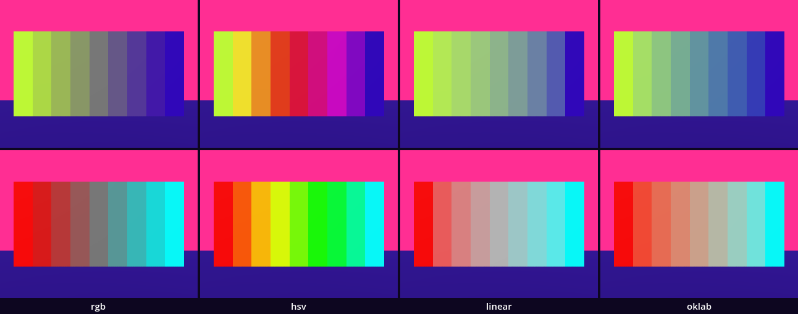
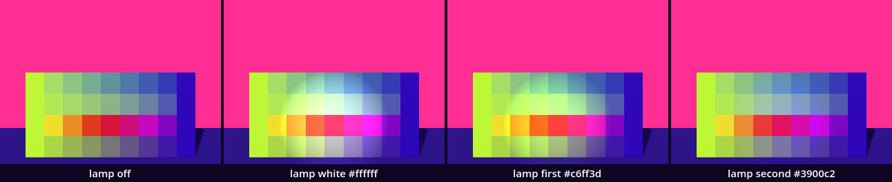
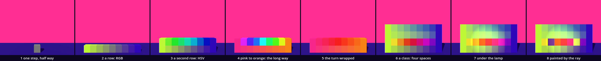

# A colour has many faces — a wall of steps between two colours

We take two colours that are each other's opposite and build a wall of nine steps from one to the other, by four different rules: four walls with the same two ends and four different middles. A lamp we carry changes what the painted steps look like, and a ray repaints them. You have every part already: a loop, a material from `paint()`, a script used as a class with exported fields. One idea is new: interpolation, the rule that says what lies between two values.

This is a new project. Import its `project.godot` in the Project Manager.

In the halls, [Color_Walls](../../../../commons/maps/Color_Walls/final.md) ends at a bench with a row of small cubes between red and blue, and a button: "The agreement about where to begin and end did not decide how to travel." [Color_Flashlight](../../../../commons/maps/Color_Flashlight/final.md) hands you a lamp: "The lamp carries a value, but it cannot carry a complete account of what you will see wherever you point it."

This study takes two sessions. The first builds the wall and ends at **Stop here**. The second compares four walls on a sheet and carries the lamp.

Every message and number on this page comes from running the study in Godot 4.6. Parts marked *(editor)* describe the editor's own windows and were not watched. Where Godot stops at a red line, read it: reading an error is ordinary work.

## Find the family in the hall

A lesson starts in its hall, with one question: does the hall show one work at several values of one axis?

Color_Walls nearly does. The bench near its far wall holds a row of sixteen cubes, red at one end and blue at the other, and the button **RGB / HSV** changes the rule that colours the ones between. That is one work at two values of this lesson's axis, shown one after the other and never side by side. Color_Flashlight shows a family outright: its four lamps are four copies of one scene with four values of `light_color`: red, green, blue and white. The registry also declares an axis for three works of Color_Walls and for the lamp table; each stands once, at its first value. We read this from the halls' map files, their scripts and the artifact registry; we did not walk them.

So stand at the bench before you press the button, and write down one prediction: between red and blue, which rule gives the darker middle, and why? This study measures the same question on a wall of our own.

## Open the study

Open the [Colour faces study](README.md), then `faces.tscn`. It inherits the supplied `base.tscn`, the floor, the sky, the sun and a fixed camera, and adds the supplied walker. The editor's own view shows a white floor under Godot's preview light; the look is put on by a script when the scene runs.

Run it (F5). A wall stands on the violet floor, four rows of nine steps, lime at its left end and a deep violet at its right. The walker, a cyan capsule, stands in front of the left end, and where its lamp reaches the wall the lime steps look yellow. The Output panel, at the bottom of the editor, reads:

```text
rgb: the middle is 808080
hsv: the middle is e11b44
linear: the middle is 96bc93
oklab: the middle is 6a9ca8
```

A and D walk the walker along the wall, C looks through its eyes, Space gives the lamp its next colour, M paints.

Two scripts are ours: `faces.gd` and `wall.gd`, in the FileSystem dock at the lower left. The download holds the finished versions; we build them again.

## Between two numbers

Replace everything in `faces.gd` with this:

```gdscript
extends Node3D

const Look := preload("res://supplied/look.gd")

var first := Look.BODY
var second := first.inverted()

func _ready() -> void:
	print(lerp(0.0, 10.0, 0.25), " ", lerp(0.0, 10.0, 0.5), " ", lerp(4.0, 8.0, 0.5))
	var middle := first.lerp(second, 0.5)
	print(first.to_html(false), " ", second.to_html(false), " ", middle.to_html(false))
	var step := MeshInstance3D.new()
	var mesh := BoxMesh.new()
	mesh.size = Vector3(0.4, 0.45, 0.2)
	step.mesh = mesh
	step.material_override = Look.paint(middle)
	step.position = Vector3(0, 0.225, -1)
	add_child(step)
```

Run it. One grey box stands on the floor.

```
2.5 5.0 6.0
c6ff3d 3900c2 808080
```

`lerp(a, b, t)` returns the value that lies `t` of the way from `a` to `b`. A quarter of the way from 0 to 10 is 2.5; half way from 4 to 8 is 6. The third number is the weight: 0 gives `a`, 1 gives `b`. That is interpolation; `lerp` is short for linear interpolation.

A colour has its own `lerp()`, which does to red, green and blue what the first line did to one number. `first` is BODY, the look's lime. `inverted()` gives the colour that has what the first lacks, channel by channel. Together they make white, so half way between them every channel is a half: `808080`, a grey. Paul Klee put this grey at the centre of his colour circle: every pair of opposites meets there. `to_html(false)` writes a colour as six digits, two for each channel.

## A row

Replace everything in `faces.gd` with this:

```gdscript
extends Node3D

const Look := preload("res://supplied/look.gd")

var first := Look.BODY
var second := first.inverted()
var steps := 9

func _ready() -> void:
	for i in steps:
		var t := i / float(steps - 1)
		add_step(first.lerp(second, t), i, 0)
		print(i, ": t ", t, " ", first.lerp(second, t).to_html(false))

func add_step(colour: Color, column: int, row: int) -> void:
	var step := MeshInstance3D.new()
	var mesh := BoxMesh.new()
	mesh.size = Vector3(0.4, 0.45, 0.2)
	step.mesh = mesh
	step.material_override = Look.paint(colour)
	step.position = Vector3((column - 4) * 0.4, 0.225 + row * 0.45, -1)
	add_child(step)
```

Run it. Nine steps stand in a row, 3.6 m long: lime, three duller greens, a grey, three dull violets, violet. From the output:

```
0: t 0.0 c6ff3d
1: t 0.125 b4df4e
```

```
4: t 0.5 808080
```

```
8: t 1.0 3900c2
```

The loop is the chessboard's. What is new is `t`, the index turned into a weight: step 0 gets 0, step 8 gets 1, the seven between them get eighths. `add_step()` makes one step; the next section needs it twice.

`float()` matters. Without it, `i / (steps - 1)` divides a whole number by a whole number, as the chessboard's red floor did. We ran that: `1: t 0 c6ff3d` down to step 7, then `8: t 1 3900c2`. Eight lime steps, one violet, and no message.

## A second way: around the circle

RGB is one description of a colour. Another is hue, saturation and value: where on the colour circle, how far from grey, how bright. Every `Color` has them as `h`, `s` and `v`, each from 0 to 1, and `Color.from_hsv()` goes the other way.

Replace the function `_ready()` with this:

```gdscript
func _ready() -> void:
	for i in steps:
		var t := i / float(steps - 1)
		add_step(first.lerp(second, t), i, 0)
		var h := lerpf(first.h, second.h, t)
		var s := lerpf(first.s, second.s, t)
		var v := lerpf(first.v, second.v, t)
		add_step(Color.from_hsv(h, s, v), i, 1)
		print(i, ": hue ", snappedf(h, 0.01), " ", Color.from_hsv(h, s, v).to_html(false))
```

Run it. A second row stands on the first: lime, three greens, a turquoise, three blues, violet. Every step is as strong as the two ends, and none is grey.

```
0: hue 0.22 c6ff3d
```

```
4: hue 0.47 1be1b8
```

```
8: hue 0.72 3900c2
```

The same two ends, the same nine weights, another middle. The upper row moved along the circle from hue 0.22 to hue 0.72 and never came near its centre.

`lerpf()` is `lerp()` for numbers with decimals only. With plain `lerp()` in the line `var h :=`, Godot stops before the study starts:

```text
Parse Error: The variable type is being inferred from a Variant value, so it will be typed as Variant. (Warning treated as error.)
```

`lerp()` takes numbers, vectors and colours, so Godot cannot say what comes back, and `:=` asks it to.

## The long way round

Now another pair. Replace the two lines that begin with `var first` and `var second` with:

```gdscript
var first := Look.SKY
var second := Look.THIRD
```

Run it. The lower row goes from the sky's pink to orange through a coral red. The upper row goes pink, magenta, violet, blue, cyan, two greens, yellow, orange: seven steps of nine lie nowhere between pink and orange.

```
0: hue 0.92 ff2e93
```

```
4: hue 0.5 26ffff
```

```
8: hue 0.08 ff8b1f
```

Godot printed nothing else: no error and no warning. Read the hues. Pink is 0.92 and orange is 0.08. On the circle they are neighbours: 0.92, then red at 1.0, which is also 0.0, then 0.08. That is 0.16 of a turn. `lerpf()` does not know that hue is a circle. It walks the number line down from 0.92 to 0.08, 0.84 of a turn, through every colour there is.

The repair is to look at the difference before walking it. Replace the line `var h := lerpf(first.h, second.h, t)` with:

```gdscript
		var turn := second.h - first.h
		if turn > 0.5:
			turn -= 1.0
		elif turn < -0.5:
			turn += 1.0
		var h := fposmod(first.h + turn * t, 1.0)
```

Run it. The upper row now goes from pink to orange across red:

```
4: hue 1.0 ff2627
```

A turn of more than half the circle is the long way, so we take a whole turn off it and go the other way round. `fposmod(x, 1.0)` brings a number back into 0 to 1: 1.04 becomes 0.04. The hall's bench does the same.

Now set the pair back:

```gdscript
var first := Look.BODY
var second := first.inverted()
```

Run it, and compare with the output three runs ago:

```
4: hue 0.97 e11b44
```

The middle of the upper row was a turquoise, `1be1b8`. Now it is a red, and the row goes from lime by yellow, orange, red and magenta to violet. We did not ask for that. Opposite colours are exactly half a turn apart, so both ways round are equally long. Our run measured `second.h - first.h` as 0.50000004: a half, and a rounding error in the eighth decimal. That was enough for `turn > 0.5`. An accident of arithmetic chose the way, and the row looks as certain as any other.

## The wall becomes a class

Two rows by hand are the start of four. Open `wall.gd` and replace everything in it with this:

```gdscript
extends Node3D
## One wall of steps from `first` to `second`, mixed in `space`.

const Look := preload("res://supplied/look.gd")

@export var space := "rgb"               # the space the two colours are mixed in
@export var steps := 9                   # how many steps the wall has
@export var size := Vector2(0.4, 0.45)   # one step: its width and its height, in metres
@export var first := Look.BODY           # the colour of the first step
@export var second := Look.BODY.inverted()   # the colour of the last step

var boxes: Array[MeshInstance3D] = []

func _ready() -> void:
	build()

func build() -> void:
	steps = maxi(steps, 2)
	for i in steps:
		var t := i / float(steps - 1)
		var box := MeshInstance3D.new()
		var mesh := BoxMesh.new()
		mesh.size = Vector3(size.x, size.y, 0.2)
		box.mesh = mesh
		box.material_override = Look.paint(mix(t))
		box.position = Vector3((i - (steps - 1) / 2.0) * size.x, size.y / 2.0, 0)
		add_child(box)
		box.create_trimesh_collision()
		boxes.append(box)

func mix(t: float) -> Color:
	if space == "rgb":
		return first.lerp(second, t)
	if space == "hsv":
		var turn := second.h - first.h
		if turn > 0.5:
			turn -= 1.0
		elif turn < -0.5:
			turn += 1.0
		var h := fposmod(first.h + turn * t, 1.0)
		return Color.from_hsv(h, lerpf(first.s, second.s, t), lerpf(first.v, second.v, t))
	push_error("wall.gd has no space called " + space)
	return Color.BLACK
```

Then replace everything in `faces.gd` with this:

```gdscript
extends Node3D

const Wall := preload("res://wall.gd")

@export var spaces := "rgb, hsv"   # one wall for each name, from the floor up

var walls: Array[Node3D] = []

func _ready() -> void:
	for word in spaces.split(","):
		var wall := Wall.new()
		wall.space = word.strip_edges()
		wall.position = Vector3(0, walls.size() * wall.size.y, -1)
		add_child(wall)
		walls.append(wall)
		print(wall.space, ": the middle is ", wall.mix(0.5).to_html(false))
```

Run it. The same two rows in the same place: the picture cannot tell that anything happened.

```
rgb: the middle is 808080
hsv: the middle is e11b44
```

`wall.gd` is the family lesson's class without a name of its own: `preload()` hands us the script, and `Wall.new()` makes a member. Its fields are exported, each with a start value, so a wall with nothing set is nine steps from lime to its opposite in RGB. `mix()` holds the last three sections, one branch for each space. `build()` is the loop, and it gives every step a body with `create_trimesh_collision()`, as Point Plane did. `maxi(steps, 2)` is the class deciding: no way from one colour to another has fewer than two steps.

The last two lines of `mix()` are for a name the class does not know. In `faces.gd`, change `"rgb, hsv"` to `"rgb, hsl"` and run. The upper wall is black, the output reads `hsl: the middle is 000000`, and our run's log holds ten lines that begin

```text
ERROR: wall.gd has no space called hsl
```

`push_error()` writes a line of our own into Godot's error list: nine for the nine steps and one for our `print`. The family lesson's sheet stood four identical bodies under four numbers and said nothing. This wall says it ten times. Change `hsl` back to `hsv`.

## Two more spaces

In `wall.gd`, replace the line `const Look := preload("res://supplied/look.gd")` with:

```gdscript
const Look := preload("res://supplied/look.gd")
const Oklab := preload("res://oklab.gd")
```

Put these lines into `mix()`, above the line with `push_error`:

```gdscript
	if space == "linear":
		var light := first.srgb_to_linear().lerp(second.srgb_to_linear(), t)
		return light.linear_to_srgb()
	if space == "oklab":
		return Oklab.mix(first, second, t)
```

And in `faces.gd`, replace the line that begins with `@export var spaces` with:

```gdscript
@export var spaces := "rgb, hsv, linear, oklab"   # one wall for each name, from the floor up
```

Run it. Four walls stand on each other, 1.8 m high: four middles between the same two colours.

```
rgb: the middle is 808080
hsv: the middle is e11b44
linear: the middle is 96bc93
oklab: the middle is 6a9ca8
```

The third wall mixes light. The numbers in a `Color` are not amounts of light: a screen's 0.5 gives much less than half the light of its 1.0. The numbers are spaced so that equal steps look roughly equal to an eye, and that spacing is called sRGB. `srgb_to_linear()` turns the numbers into amounts of light, we mix those, and `linear_to_srgb()` turns the result back. We ran it without the way back: the middle came out `4d804b`, far too dark.

The fourth is lent. `oklab.gd` holds OKLab, a space published by Björn Ottosson in 2020 and built so that equal distances in it look about equally different. Its contract is one line: `Oklab.mix(a, b, t)` returns the colour `t` of the way from `a` to `b` in that space. We use it and do not open it.

## Stop here: what we have

This is the end of the first session. `wall.gd` should be the class under *The wall becomes a class* with the second `const` line and the two new branches in `mix()`. `faces.gd` should be the short script under the same heading, with four names in `spaces`. Run the study and check three things: four rows of nine steps; all four begin lime and end violet; the output's four lines end in `808080`, `e11b44`, `96bc93` and `6a9ca8`.

## The argument: which two walls look alike?

The axis is `space`, the space the same two colours are mixed in. Its values are `rgb`, `hsv`, `linear` and `oklab`.

**Write your prediction before you render.** Which two of the four walls will look most alike? Which one stands apart? Will any wall besides RGB's reach a grey? Write it down, with a reason.

The course's outline made its own: RGB and linear light "will look most alike: both pass through a grey middle, Klee's central grey, and differ only in where the grey falls. HSV swings round through the hues in between and never reaches grey."

Then look. The four walls in the running study are the sheet. For stills of each wall alone, run `sheet.gd` as the [README](README.md) says; it needs a terminal. You can go on without it: the tables below are what our run measured.



Each wall was photographed alone, its steps drawn 1.8 m high, from 4.4 m, with no shadow. It covers 49.59% of the still. The kits' usual measure counts the pixels on which two stills differ, and here it cannot rank anything: every pair differs on 38.57% of the still, the seven inner steps. So we measured how far apart the steps are. For each pair of walls, step against step, the table gives the mean distance between the rendered colours: in red, green and blue together, each counted to 255, and in OKLab, times 100.

| pair | apart in RGB | apart in OKLab |
| --- | --- | --- |
| rgb and oklab | 36.1 | 5.4 |
| linear and oklab | 37.0 | 7.6 |
| rgb and linear | 45.2 | 11.0 |
| rgb and hsv | 88.8 | 13.8 |
| hsv and linear | 109.0 | 17.3 |
| hsv and oklab | 116.8 | 16.4 |

The closest pair is RGB and OKLab, by both rulers. Linear and OKLab follow within one unit of RGB distance. The outline's pair, RGB and linear light, is third: that part of the prediction did not hold.

Now the grey. The middle step of each wall, as rendered, and the least saturated step each wall has:

| wall | middle | its saturation | least saturated step |
| --- | --- | --- | --- |
| rgb | `#777777` | 0.000 | 0.000 |
| hsv | `#d8153c` | 0.902 | 0.781 |
| linear | `#8db38a` | 0.229 | 0.199 |
| oklab | `#61939f` | 0.388 | 0.313 |

Only RGB reaches grey. Linear light passes through none between these two colours; its middle is a pale green. HSV never comes near, as the outline said.

The lower row of the sheet is the same four spaces between red and cyan. There RGB and linear light both reach a grey, `#777777` and `#b3b3b3`, the second lighter, as the outline describes. Still they are not the closest pair: linear and OKLab are, 33.9 apart in RGB, with RGB and linear third at 73.9. So the grey depends on the pair as well as on the space. `inverted()` takes the opposite in RGB's own numbers, and RGB then finds its grey for every pair. Another space finds one only when the pair is opposite in its terms too.

The claim, as measured: the middle between two colours is not in the colours but in the space they are mixed in. Between lime and its opposite RGB put a grey, linear light a pale green, OKLab a dull turquoise and HSV a red. HSV walks around the grey, and for opposites a rounding error picks which way.

**Decide.** One difference here could be followed. Linear light found Klee's grey between red and cyan and missed it between lime and its opposite. The next intervention would be to change what "opposite" means. Take the complement in linear light: with `a` for `first.srgb_to_linear()`, it is `Color(1 - a.r, 1 - a.g, 1 - a.b).linear_to_srgb()`. Give it to the walls as `second`, and predict which wall reaches grey now. Or settle: one of these four is the mixing your room needs, and the tables are enough to choose it. Either is right. Write your decision and its reason in your [field note](FIELD_NOTE.md); ours is an example of the form, not of the answer.

## What a colour space owes

Every space on this wall is a standard somebody set. sRGB was proposed in 1996 for the monitors of that time. The measurements under it go back to 1931 and to seventeen observers in two English laboratories, averaged into one "standard observer". OKLab was fitted to earlier models, and those to what groups of people judged equally different. Each describes an average eye, and nobody has that eye. Film shows the same history plainly: the reference prints that photo labs calibrated on, Kodak's Shirley cards, showed a white woman for decades, and other skin was printed by her measure.

Our own measuring owes something too. We had no eye to ask, only rulers, and a ruler prefers itself. We divided the largest of each wall's eight gaps by the smallest. By distance in RGB the RGB wall is perfectly even, 1.00, and the OKLab wall is not, 2.06. By distance in OKLab it is the other way round: 2.13 and 1.00. "Most alike" in the table above was read off two such rulers.

The engine has its own arithmetic, and it was not the one we expected. The colours we type are sRGB numbers, and `lerp()` mixes the numbers. We expected two lights on one surface to be added as light. We measured a wall painted `808080`: 66.0 of 255 in the ambient light alone, 119.0 with the sun, 191.3 with our lamp, 244.8 with both. The sun and the lamp added as numbers make 244.3; added as light they would make 211.2. This renderer adds a second light on the screen's numbers. Neither sum is paint. Color_Walls says of its coloured glass: "This is a blend of screen colours, not a simulation of the wavelengths passing through real glass." And the HSV wall goes by red because of the eighth decimal of a subtraction.

Josef Albers, who taught colour at the Bauhaus, at Black Mountain and at Yale, wrote that it "deceives continually". The next section lets it.

## Carry the lamp along the wall

The place this chapter asks for: carry a light along the wall, then paint with it. Replace everything in `faces.gd` with this:

```gdscript
extends Node3D

const Wall := preload("res://wall.gd")

@export var spaces := "rgb, hsv, linear, oklab"   # one wall for each name, from the floor up

var walls: Array[Node3D] = []
var lamp := SpotLight3D.new()
var ray := RayCast3D.new()
var lights: Array[Color] = [Color.WHITE]   # the colours the lamp can have
var light := 0                             # which of them it has now

func _ready() -> void:
	for word in spaces.split(","):
		var wall := Wall.new()
		wall.space = word.strip_edges()
		wall.position = Vector3(0, walls.size() * wall.size.y, -1)
		add_child(wall)
		walls.append(wall)
		print(wall.space, ": the middle is ", wall.mix(0.5).to_html(false))
	lights.append(walls[0].first)
	lights.append(walls[0].second)
	lamp.spot_angle = 25.0
	lamp.light_energy = 3.0
	lamp.light_color = lights[light]
	add_child(lamp)
	ray.target_position = Vector3(0, 0, -6)
	lamp.add_child(ray)

func _process(_delta: float) -> void:
	lamp.position = $Walker.position + Vector3(0, 0.7, 0)
	if Input.is_action_just_pressed("pause"):
		light = (light + 1) % lights.size()
		lamp.light_color = lights[light]
		print("the lamp is ", lamp.light_color.to_html(false))
	if Input.is_action_just_pressed("drop"):
		paint()

func paint() -> void:
	if not ray.is_colliding():
		print("the ray met nothing")
		return
	var step: MeshInstance3D = ray.get_collider().get_parent()
	var skin: StandardMaterial3D = step.material_override
	var before := skin.albedo_color
	skin.albedo_color = before.lerp(lamp.light_color, 0.5)
	print("painted ", before.to_html(false), " to ", skin.albedo_color.to_html(false))
```

Run it. Press C to look through the walker's eyes: the wall stands in the lower half of the view. Walk along it with D and A. The walker keeps facing the wall, and a pool of light several steps wide goes with you.

The lamp is a `SpotLight3D`: a light with a place, a direction and a cone, here 25 degrees. `_process()` puts it 0.7 m above the walker's feet in every frame, a lamp held at the hip. It is not the walker's child, so it does not turn when the walker turns: it points at the wall. `light_color` is the hall's own line, `spot.light_color = light_color`. Space, the action `pause`, takes the next colour of a list: white, the wall's first colour, its second. `%` is the chessboard's remainder: after the last colour the list starts again.

Stand in front of the middle of the wall and press Space: `the lamp is c6ff3d`. Look at the grey step at the bottom. Press Space again, `the lamp is 3900c2`, and look again.



We measured that step in four stills, made in the sheet's plain studio with our script and its lamp; your running scene adds the look's sky and tinted light, so its pixels differ a little. The step is painted `808080`. With the lamp off it is rendered `#767676`; under the white lamp `#bcbcbc`; under the lime lamp `#a4bc7b`, a green-grey; under the violet lamp `#7b76a3`, a violet-grey. The two coloured lamps put it 90.7 apart in RGB, more than twice the distance between the RGB wall and the OKLab wall. One paint, two colours, and the step did not change. This is Albers's exercise done with a lamp: make one colour look like two. No eye was asked; the numbers are pixels.

The lime lamp adds green and red to the grey step and almost no blue. And a screen has a ceiling. Where the scene starts, the white lamp falls on the wall's lime end, and the lime step is rendered `#ffff5a`, a yellow, where it was `#bdf734`: its green was already at the top, and only red and blue could still rise.

Now paint. With the lamp lime, stand in front of the red step in the middle of the second row and press M:

```
the lamp is c6ff3d
painted e11b44 to d38d40
```

`ray` is a `RayCast3D`: a line from the lamp six metres straight ahead, which reports the first body it meets. Every step has a body, and the body's parent is the step. The ray starts inside the walker and does not report it: a ray reports what it enters, not what it is in. Then `lerp()` once more: the step's paint goes half way to the lamp's colour, and with the next M half of what is left. Color_Paint, this chapter's field trip, has the same part: "A ray leaves the nozzle and finds the canvas you are aiming at."

So there are two ways to change what a step looks like. The lamp changes what reaches the surface; walk on and the step is as it was. The ray changes the surface, and the step stays changed under every light.

What a body did, measured headless: on its autopilot the walker walked along the wall and arrived; with D held for half a second it went 1 m to the right, still facing the wall, the lamp with it. Walked at the wall, it was stopped 0.3 m from the wall's face. A marble dropped over the top wall came to rest on it, at 1.90 m. No headset was used and nobody held the keys. A hand would aim the lamp up, down and across; ours points one way, at one height.

## The process

one step, half way → a row in RGB → a second row in HSV → pink to orange, the long way → the turn wrapped → a class, four spaces → under the lamp → painted by the ray



All eight were made in the sheet's studio, seen from where the walker's eyes are in front of the middle of the wall. The class changed the picture most, 39.96% of the tile: two rows became four. In the fourth tile the upper row holds every colour there is, between pink and orange, and nothing in the picture says it is a fault.

## In your room

Choose your room's palette by argument: one pair of colours, one mixing space, one sentence.

Copy the folder `guests/colour-faces/` from your copy of this kit into your room project's `guests/` folder. In `room.gd`, add its line to the list:

```gdscript
const GUESTS: Array[String] = [
	"res://guests/example/example.tscn",
	"res://guests/colour-faces/colour-faces.tscn",
]
```

Your list has your own guests in it; add the line under the last. Run the room. The Output panel names the place, for us:

```
My room: place 2 is res://guests/colour-faces/colour-faces.tscn
```

Walk to it: a wall of nine steps, 1.44 m wide and 1 m high, with the name of its space above it. It stopped our walker 0.40 m from the middle of its place.

The guest is our wall, packed to travel. Its colours are not in its script but in `palette.tres` beside it: a Resource, a file of values that every script can load. The file is short:

```text
first = Color(0.7764706, 1, 0.23921569, 1)
second = Color(0.22352941, 0, 0.7607843, 1)
space = "oklab"
steps = 9
because = "Lime and its complement, mixed in OKLab: ..."
```

Let the room read the same file. In `room.gd`, under the line that begins `const Look`, add:

```gdscript
const PALETTE := preload("res://guests/colour-faces/palette.tres")
```

and in `_mark_places()`, under the line `mark.mesh = square`, add:

```gdscript
		mark.material_override = Look.paint(PALETTE.mix(((number - 1) % COLUMNS) / float(COLUMNS - 1)))
```

Run the room. Every row of squares on the floor runs from the palette's first colour to its second in eight steps, and the guest wall shows the same way in nine. One file, two readers.

Then make the palette yours. Double-click `palette.tres` in the FileSystem dock, at the lower left; the Inspector, at the right, shows **First**, **Second**, **Space**, **Steps** and **Because**; save with Ctrl+S *(editor)*. Or open the file in any text editor: a colour is four numbers from 0 to 1, red, green, blue and alpha, as `print(Look.SKY)` shows them. We did it in the text: pink and orange in `"hsv"`. The first row of squares ran `ff2e93`, `ff2c75`, `ff2a56`, on to `ff8b1f`, and the guest's plate read `hsv`.

Choose a pair, choose one of the four spaces, and write into **Because** the one sentence that argues for them: what the middle of your palette is, and why your room should have it. Hand in your room with your field note.

## What we borrowed

| Part | From | How far we go |
| --- | --- | --- |
| `supplied/base.tscn`, `look.gd`, `walker.tscn` | Supplied | Use: the floor, the sky, the sun, the fixed camera; `paint(color)` and the palette's names; a body the keys walk and a `StaticBody3D` stops. |
| `oklab.gd` | Supplied here | Use: `Oklab.mix(a, b, t)`, the colour `t` of the way from `a` to `b` in OKLab. |
| `guests/colour-faces/` | Supplied here | Understand: `palette.gd` is our `mix()` in a Resource; change `palette.tres`. |
| `lerp()`, `lerpf()`, `Color.lerp()` | Godot | Use: the value `t` of the way from one to another. |
| `h`, `s`, `v`, `Color.from_hsv()`, `inverted()`, `to_html()` | Godot | Use: a colour's place on the circle and back; its opposite in RGB; its six digits. |
| `srgb_to_linear()`, `linear_to_srgb()` | Godot | Use: from screen numbers to amounts of light and back. |
| `fposmod()`, `push_error()` | Godot | Use: a number brought back into a range; a line of our own in the error list. |
| `SpotLight3D`, `RayCast3D` | Godot | Use: a light with a colour and a cone; a line that reports the first body it meets. |
| `sheet.gd` | Supplied here | Use: it photographs each wall alone, measures the pairs and the lamp, makes the strip. |

## What we carry forward

We leave with `lerp()` and the weight `t`; with a colour as three channels and as a place on a circle; with the wrapped difference for anything that goes round; with the knowledge that the numbers in a `Color` are not amounts of light; and with one sentence for every mixture: the middle is in the space, not in the colours. Shaders, which come next in the outline, have a function called `mix()`. It is this chapter's `lerp()`.
