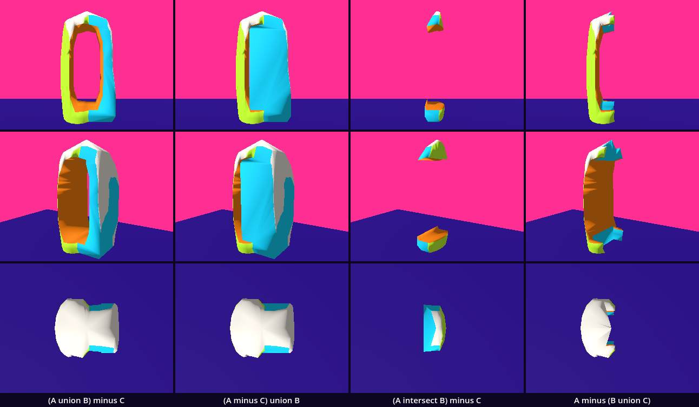
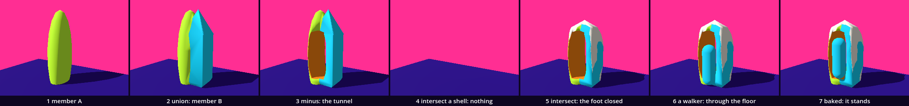

# Combine — union, subtraction, intersection

So far a body was made by adding: corners, triangles, parts under one root. Here a body is made by three verbs between bodies. We take two members of the Families class, a round one and a blocky one, and unite them. We bore the implicit body's tunnel through the two. We cut what is left to the skin of a found body. Then we bake the result into a mesh with a collider and walk into it. You have every idea this needs: meshes and materials, position and scale, a collider, a count of triangles. One node is new: the `CSGCombiner3D`.

This is a new project, like every stop of this course: in the Project Manager choose **Import** and open this folder's `project.godot`.

In the halls, [Boolean_Verbs](../../../../commons/maps/Boolean_Verbs/final.md) says what a solid is for these verbs: "Each primitive describes a region: we can ask whether a point belongs to it." And it warns about its own exhibits: "You can pass through a surface that your eye has already accepted." [Boolean_Works](../../../../commons/maps/Boolean_Works/final.md) makes the hollow large and asks this lesson's question: "When the negative gets big enough to stand in, can you stand in it?"

This study takes two sessions. The first carves the body and bakes it. It ends at **Stop here**. The second puts the same operands in four orders on a sheet, counts what baking cost, and hands the body to your room.

Every message and number on this page comes from running the study in Godot 4.6. Parts marked *(editor)* describe the editor's own windows and were not watched.

## Find the family in the hall

A lesson starts in its hall, with one question: does the hall show one work at several values of one axis?

Boolean_Verbs does not. Three works stand on one line down its middle, union, intersection and difference. Each declares two axes in the registry and stands once, at one value. But the bench at the end shows this lesson's axis at two values. Two remainders stand side by side, "One is labelled `A − B`; the other, `B − A`", and the reading says: "Its order decides whose region may remain and whose will do the cutting." Boolean_Works shows nine works, each once.

The family is one hall further, in Boolean_Gallery: twenty-four objects in six rows, and each row is one work at the four values of one axis. The union row has the axis `fusion`: lobed, distinct, necked, single. We read all of this from the halls' map files, the artifact registry and the readings; we did not walk them.

So stand at the union row and write down which two of the four you expect to look most alike. Keep the guess. This study ends with a sheet of four of our own.

## Open the study

Open the [Combine study](README.md), then `combine.tscn`: double-click it in the FileSystem dock, at the lower left of the editor *(editor)*. The editor's view shows a white floor and Godot's own preview light. The sky, violet above a pink horizon, and the violet floor are made by a script when the scene runs.

The scene has three things. The base: a floor, a sky, a sun and a fixed camera. `Carved`: an empty `Node3D` which runs `combine.gd`. `Walker`: the supplied desktop body, a capsule 1.8 m high. The folder `borrowed/` holds three small parts from earlier chapters; we meet them one at a time.

Run it (F5). A body 2.85 m high stands on the floor: a round lime wall at the left, a flat cyan wall at the right, an off-white lumpy top, and a tunnel through the middle with orange walls. The walker comes from the right, turns to the door, steps up and stops inside. The Output panel, at the bottom of the editor, reads:

```
((A union B) minus C) intersect S: 768 triangles listed, 574 in the result
the walker arrived, its feet at 0.3 m
```

Now the keys are yours: W, A, S, D walk, C changes between the fixed camera and the walker's eyes. Walk out backwards with S and in again with W.

`combine.gd` is ours. The download holds the finished version. We will take it apart and build it again.

## One operand

Replace everything in `combine.gd` with this:

```gdscript
extends Node3D

const Look := preload("res://supplied/look.gd")
const Member := preload("res://borrowed/member.gd")

var carver: CSGCombiner3D     # holds the operands, in order

func _ready() -> void:
	carver = CSGCombiner3D.new()
	add_child(carver)
	var a := CSGMesh3D.new()
	a.mesh = Member.make(16)
	a.material = Look.paint(Look.BODY)
	a.position = Vector3(-0.22, 1.2, 0.0)
	a.scale = Vector3(0.96, 4.2, 1.5)
	carver.add_child(a)
	await get_tree().process_frame
	print(triangles(a.mesh), " triangles listed, ", triangles(carver.bake_static_mesh()), " in the result")

func triangles(mesh: Mesh) -> int:
	if mesh == null:
		return 0
	@warning_ignore("integer_division")
	return mesh.get_faces().size() / 3
```

Run it. A tall lime egg stands left of the middle, taller than the picture, and its lower end is under the floor. The walker waits at the front right. The output: `288 triangles listed, 256 in the result`.

CSG is short for constructive solid geometry: a body made from other bodies. A `CSGCombiner3D` holds bodies as its children and shows what they make together. Each child is an operand, and a `CSGMesh3D` is an operand made from any mesh. Ours is `Member.make(16)`, the member of 16 segments from Families, in a small version: open `borrowed/member.gd`, its function is seven lines. `material` is the operand's paint. With `scale` we stretch the globe, 1 m across, into an egg 0.96 m wide, 4.2 m high and 1.5 m deep.

`triangles()` counts what a mesh lists: `get_faces()` hands over the corners of every triangle, three for each.

Two things in the output. The combiner does not work out its result when a child is added. It does so after the frame, and `await get_tree().process_frame` waits for that. Asked in the same frame, `bake_static_mesh()` returns `null`, and our count would be 0. And the result has 256 triangles where the member lists 288: Families counted 32 triangles at the poles that have no area, and the combiner drops them.

## Union: a second operand

One operand took six lines. Four operands will need a function. Replace everything with this:

```gdscript
extends Node3D

const Look := preload("res://supplied/look.gd")
const Member := preload("res://borrowed/member.gd")
const Tunnel := preload("res://borrowed/tunnel.gd")
const Scan := preload("res://borrowed/scan.gd")

const UNION := CSGShape3D.OPERATION_UNION
const MINUS := CSGShape3D.OPERATION_SUBTRACTION
const INTERSECT := CSGShape3D.OPERATION_INTERSECTION

var carver: CSGCombiner3D     # holds the operands, in order
var listed := 0               # triangles the operands list
var built := 0                # triangles of the result

func _ready() -> void:
	carver = CSGCombiner3D.new()
	add_child(carver)
	var a := operand(Member.make(16), Look.BODY)
	a.position = Vector3(-0.22, 1.2, 0.0)
	a.scale = Vector3(0.96, 4.2, 1.5)
	var b := operand(Member.make(4), Look.SECOND)
	b.position = Vector3(0.2, 1.2, 0.0)
	b.scale = Vector3(1.633, 4.2, 1.633)
	b.rotation.y = PI / 4.0
	put(a, UNION)
	put(b, UNION)
	await get_tree().process_frame
	built = triangles(carver.bake_static_mesh())
	print(listed, " triangles listed, ", built, " in the result")

func operand(mesh: Mesh, color: Color) -> CSGMesh3D:
	var shape := CSGMesh3D.new()
	shape.mesh = mesh
	shape.material = Look.paint(color)
	listed += triangles(mesh)
	return shape

func put(shape: CSGShape3D, verb: int, into: CSGShape3D = carver) -> void:
	shape.operation = verb
	into.add_child(shape)

func triangles(mesh: Mesh) -> int:
	if mesh == null:
		return 0
	@warning_ignore("integer_division")
	return mesh.get_faces().size() / 3
```

Run it. A cyan block with a pointed top stands in the egg's right side. The output: `312 triangles listed, 296 in the result`.

`operand()` makes one operand from a mesh and a colour and adds its triangles to `listed`. `put()` gives it a verb and makes it a child of the combiner. The verb is the property `operation`, and it has three values: union, subtraction, intersection. We gave them short names at the top. A union keeps every point that is in either body.

B is the member of 4 segments, the one Families found to be another body: a block with a pyramid on top and one below. Turned an eighth of a circle, its flat sides face us.

Look at the colours. Every face of the result wears the paint of the operand it came from: lime from A, cyan from B. Where the two overlap, neither skin is drawn. The hall says it of its first exhibit: "the buried surfaces at the overlap do not belong to the result's visible boundary."

## Subtraction, and the order of the children

In `_ready()`, add two lines under the four lines of `b`:

```gdscript
	var c := operand(Tunnel.make(24), Look.THIRD)
	c.position = Vector3(0.0, 0.3, 0.0)
```

and one line under `put(b, UNION)`:

```gdscript
	put(c, MINUS)
```

Run it. A tunnel goes through the two bodies, 0.8 m wide and 2.1 m high, and we see through it to the floor behind. Its walls are orange. The output: `408 triangles listed, 392 in the result`.

C is the implicit body, in a small version. Open `borrowed/tunnel.gd`: `value(p)` is one function of a point, below 0 inside the tunnel and above 0 outside, and the tunnel has no corner until `make(24)` asks that function along 24 spokes. We lift it 0.3 m, so the tunnel's floor is one step above the ground.

A subtraction keeps what is in the body so far and not in the operand. The tunnel itself is not drawn anywhere. What we see of it is the orange wall: the face where C cut, in C's paint. The hall's heading for it is "A face neither of them brought".

Now the order. A combiner reads its children from the first to the last, and each verb acts on the result so far. We wrote A, union B, minus C: (A union B) minus C.

Move the line `put(c, MINUS)` one line up, above `put(b, UNION)`, and run. The cyan block stands in the tunnel and closes it; a narrow slot is left at its side. The output: `408 triangles listed, 364 in the result`. This is (A minus C) union B: the tunnel was bored through A alone, and then B was added whole.

Move the line up once more, above `put(a, UNION)`, and run. The tunnel is gone. The two bodies stand as they did before this section, and the output says `408 triangles listed, 296 in the result`: the 296 of the union. Godot printed nothing else. The first child was a subtraction, and there was nothing yet to take from.

Put the line back under `put(b, UNION)`. The same three operands and the same three lines gave three bodies. Operand order is child order.

## The found body, and nothing at all

The third verb cuts the body to the skin of a found body. Add one line under the two lines of `c`:

```gdscript
	var s := operand(Scan.make(false), Look.BONE)
```

and one line under `put(c, MINUS)`:

```gdscript
	put(s, INTERSECT)
```

An intersection keeps only the points that are in both. `borrowed/scan.gd` is the found body from Collage, in a small version. It is a stand-in: a script made its lumpy skin, and nothing was scanned.

Run it. The floor is empty. The walker stands on it alone. The output:

```
748 triangles listed, 0 in the result
```

Nothing else was printed: no error and no warning. Three operands that made a body of 392 triangles, and a fourth of 340, make nothing. Whether the editor marks the node with a warning sign we did not watch *(editor)*. In the running scene there is the empty floor and the 0.

Reading a result like this is ordinary work, and the count is where to start. A scanner sees a body from outside and never from below, so its skin has no face where the body stood. `Scan.make(false)` is such a skin: a shell. Our check counted 20 edges in it that belong to one triangle only, the rim of the open foot. An intersection asks of every point: is it inside both? A shell has no inside. Godot's combiner takes an operand that is not closed as no body at all, and says nothing. United with A, or taken from A, the shell changed nothing: 256 triangles, A alone. Intersected, it leaves nothing.

The repair is to give the scan the face it never had. Change `false` to `true`:

```gdscript
	var s := operand(Scan.make(true), Look.BONE)
```

`make(true)` adds a fan of 20 triangles from the middle of the foot to its rim. Run it. The body is back, and it has changed: it stands on the floor with a flat foot, its top is a lumpy off-white cap 2.85 m up, and nothing reaches under the floor any more. The output: `768 triangles listed, 574 in the result`.

## Walk in

The tunnel's floor is 0.30 m above the ground: one step for the walker, which climbs up to 0.35 m. Send it in. Add these lines at the end of `_ready()`:

```gdscript
	if has_node("../Walker"):
		var walker := $"../Walker"
		walker.walk_to([Vector3(0.0, 0.0, 2.0), Vector3(0.0, 0.0, 0.0)])
		var how: String = await walker.walk_ended
		print("the walker ", how, ", its feet at ", snappedf(walker.global_position.y, 0.01), " m")
```

`walk_to()` is the walker's autopilot: a list of points, walked in straight lines. `walk_ended` is its signal, and `how` says how the walk ended. The `if` is there because this script will also run with no walker beside it.

Run it. The walker walks to the door and on to the middle of the body, without a step up. The output ends with:

```
the walker arrived, its feet at 0.0 m
```

It arrived, and its feet are on the ground: 0.30 m under the floor we see it standing on. Hold D: it walks out through the wall. We also put the walker on the tunnel's floor, at 0.30 m: a second later its feet were at 0.00 m. A marble dropped in the hollow came to rest at 0.10 m, on the ground.

This is the hall's own failure, and now it is ours. A CSG body is a picture. The combiner hands triangles to the renderer and tells the physics nothing. Boolean_Works has a wall like that: "Walk toward the uncut part. It does not stop you."

## Bake

Add one line under `var carver`:

```gdscript
var body: MeshInstance3D      # the baked result
```

In `_ready()`, add one line under the `print` line that reports the triangles, above `if has_node`:

```gdscript
	bake()
```

And add this function above `func triangles`:

```gdscript
func bake() -> void:
	body = MeshInstance3D.new()
	body.mesh = carver.bake_static_mesh()
	add_child(body)
	var solid := StaticBody3D.new()
	var collider := CollisionShape3D.new()
	collider.shape = carver.bake_collision_shape()
	solid.add_child(collider)
	body.add_child(solid)
	carver.queue_free()
```

Run it. The picture is the same. The walker turns at the door, steps up and stops in the tunnel. The output ends with:

```
the walker arrived, its feet at 0.3 m
```

Hold D, then A: each wall stops it within 0.06 m of the middle. Walk on with W: it leaves by the back and steps down.

`bake_static_mesh()` returns the result as an ordinary mesh: corners, triangles and the four paints. `bake_collision_shape()` returns the same triangles as a shape for the physics. We give the mesh to a `MeshInstance3D` and the shape to a `StaticBody3D`, as the plane got its collider. Then the combiner is freed. What stands in the scene now is a mesh and a body. The operands and the verbs are gone from it.

There is a shorter way, and it is for a prototype only. A combiner has a property `use_collision`. With it ticked, a walker put on the tunnel's floor stayed there, and the marble rested at 0.40 m. But the combiner works its collider out again whenever an operand changes, and it is the collider itself: a `CSGCombiner3D`, not a `StaticBody3D`. The supplied walker steps only onto a `StaticBody3D`. Sent in from outside it was blocked at the door, 0.80 m in front of the middle.

## Stop here: what we have

This is the end of the first session. `combine.gd` should be the script under *Union: a second operand* with the lines of `c` and `s`, three `put` lines after `put(a, UNION)`, the walker's lines, `var body`, the `bake()` line and the function. Run it and check three things: the body stands on the floor with an orange tunnel through it; the output ends with `the walker arrived, its feet at 0.3 m`; A and D do not take the walker through the walls.

## The argument: which order?

We tried three orders by moving one line. Now the order becomes an axis. Replace everything in `combine.gd` with this:

```gdscript
extends Node3D

const Look := preload("res://supplied/look.gd")
const Member := preload("res://borrowed/member.gd")
const Tunnel := preload("res://borrowed/tunnel.gd")
const Scan := preload("res://borrowed/scan.gd")

const UNION := CSGShape3D.OPERATION_UNION
const MINUS := CSGShape3D.OPERATION_SUBTRACTION
const INTERSECT := CSGShape3D.OPERATION_INTERSECTION
const ORDERS := ["(A union B) minus C", "(A minus C) union B", "(A intersect B) minus C", "A minus (B union C)"]

@export_range(0, 3) var order := 0   # which line of ORDERS
@export var baked := true            # false: the combiner as it is, a picture with nothing in it for a body
@export var b_x := 0.2               # where B stands: metres to the right of the middle

var carver: CSGCombiner3D     # holds the operands, in order
var body: MeshInstance3D      # the baked result
var listed := 0               # triangles the operands list
var built := 0                # triangles of the result

func _ready() -> void:
	carver = CSGCombiner3D.new()
	add_child(carver)
	var a := operand(Member.make(16), Look.BODY)
	a.position = Vector3(-0.22, 1.2, 0.0)
	a.scale = Vector3(0.96, 4.2, 1.5)
	var b := operand(Member.make(4), Look.SECOND)
	b.position = Vector3(b_x, 1.2, 0.0)
	b.scale = Vector3(1.633, 4.2, 1.633)
	b.rotation.y = PI / 4.0
	var c := operand(Tunnel.make(24), Look.THIRD)
	c.position = Vector3(0.0, 0.3, 0.0)
	var s := operand(Scan.make(true), Look.BONE)
	put(a, UNION)
	if order == 0:
		put(b, UNION)
		put(c, MINUS)
	elif order == 1:
		put(c, MINUS)
		put(b, UNION)
	elif order == 2:
		put(b, INTERSECT)
		put(c, MINUS)
	else:
		var bracket := CSGCombiner3D.new()
		put(bracket, MINUS)
		put(b, UNION, bracket)
		put(c, UNION, bracket)
	put(s, INTERSECT)
	await get_tree().process_frame
	built = triangles(carver.bake_static_mesh())
	print(verbs(), ": ", listed, " triangles listed, ", built, " in the result")
	if baked:
		bake()
	if has_node("../Walker"):
		var walker := $"../Walker"
		walker.walk_to([Vector3(0.0, 0.0, 2.0), Vector3(0.0, 0.0, 0.0)])
		var how: String = await walker.walk_ended
		print("the walker ", how, ", its feet at ", snappedf(walker.global_position.y, 0.01), " m")

func operand(mesh: Mesh, color: Color) -> CSGMesh3D:
	var shape := CSGMesh3D.new()
	shape.mesh = mesh
	shape.material = Look.paint(color)
	listed += triangles(mesh)
	return shape

func put(shape: CSGShape3D, verb: int, into: CSGShape3D = carver) -> void:
	shape.operation = verb
	into.add_child(shape)

func verbs() -> String:
	return "(" + ORDERS[order] + ") intersect S"

func bake() -> void:
	body = MeshInstance3D.new()
	body.mesh = carver.bake_static_mesh()
	add_child(body)
	var solid := StaticBody3D.new()
	var collider := CollisionShape3D.new()
	collider.shape = carver.bake_collision_shape()
	solid.add_child(collider)
	body.add_child(solid)
	carver.queue_free()

func triangles(mesh: Mesh) -> int:
	if mesh == null:
		return 0
	@warning_ignore("integer_division")
	return mesh.get_faces().size() / 3
```

`_ready()` changed in one place: an `if` chooses the order of B and C, and the verb of B. The found body is last in all four, and its verb stays. The fourth order has a bracket, and a bracket is a combiner inside the combiner: B and C are united in it first, and the whole bracket is taken from A. A result can be an operand. `verbs()` writes the order out as a line of text.

**Write your prediction before you render.** Four bodies from the same four operands. Which two will look most alike? Put the four in order of volume, the largest first. Write it down, with a reason for each.

The course's outline made its own: the first two will be the closest pair, because they "differ only where C overlaps B, so with C's tunnel through A alone they are the same body", and the third "will lose most of its volume".

Then look. Select `Carved` in the Scene dock, at the upper left, and set **Order** in the Inspector, at the right *(editor)*; or change the `0` in the line `var order := 0` and run. For stills of all four, run `sheet.gd` as the [README](README.md) says; it needs a terminal. You can go on without it: the tables below are what our run measured.



Each body was baked and photographed alone, from the front along the tunnel, from the front right, and from straight above. The numbers are the share of the still on which two bodies differ.

| pair | from the front | from the front right | from above |
| --- | --- | --- | --- |
| (A union B) minus C, (A minus C) union B | 14.50% | 12.12% | 0.42% |
| (A union B) minus C, (A intersect B) minus C | 16.15% | 26.33% | 13.58% |
| (A union B) minus C, A minus (B union C) | 10.26% | 17.24% | 9.23% |
| (A minus C) union B, (A intersect B) minus C | 24.30% | 27.33% | 13.84% |
| (A minus C) union B, A minus (B union C) | 17.75% | 23.66% | 9.52% |
| (A intersect B) minus C, A minus (B union C) | 9.06% | 14.96% | 8.67% |

| order | triangles | volume | the walker, sent to the middle |
| --- | --- | --- | --- |
| (A union B) minus C | 574 | 1.859 m³ | arrived, its feet at 0.30 m |
| (A minus C) union B | 544 | 3.239 m³ | blocked at the door, 0.80 m in front of the middle |
| (A intersect B) minus C | 150 | 0.196 m³ | arrived, on what is left of the floor, at 0.30 m |
| A minus (B union C) | 422 | 0.793 m³ | arrived, on the ground, at 0.00 m |

From the front right and from above, the first two orders are the closest pair, as the outline predicted. From above they are nearly one picture, 0.42%: the roof hides what B does in the tunnel. From the front, along the tunnel, the closest pair is the last two, 9.06%.

That 9.06% needs a second look. The last two are small bodies in a wide still, and they share no pixel: 9.06% is all that the two cover together. So we counted every pair again, against the pixels that either body covers. By that count the last two differ on 100.0% from every standpoint, and the first two are the closest pair from all three: 59.5% from the front, 44.2% from the front right, 2.9% from above. From the front it is close: the first and the fourth differ on 60.7%.

So the prediction held for the eye. It does not hold for a count or for a body. By volume the closest pair is the last two, 0.60 m³ apart; the first two are 1.38 m³ apart, which is B standing in the tunnel. And the walker tells them apart at once: one has a door and the other a wall.

The outline's condition held exactly. With B at `b_x` 0.95, clear of the tunnel, the first two orders gave the same body: the same 576 triangles, the same volume, and 0.00% of the still.

The third order lost most, as predicted: 0.196 m³, a tenth of the first. What is left is two pieces, a slab of floor and a piece of roof in the air above it.

The claim: Boolean combination does not commute. Union does: A union B and B union A enclosed the same 4.523 m³. Subtraction does not: A minus B enclosed 1.723 m³ and B minus A 1.530 m³. The order of the verbs is part of the form, and the same operands gave a door, a wall, two fragments and an open bay.

**Decide.** One difference here could be followed. Between the first two orders everything turns on how far B reaches into the tunnel: at `b_x` 0.2 the walker is blocked, at 0.95 the two orders are one body. The next intervention would be to sweep `b_x` with `order` at 1, say 0.2, 0.45, 0.7 and 0.95, and to find where the walker first gets through. Or settle: one of the four is the body your room needs, and the tables are enough to choose it. Either is right. Write your decision and the reason in your [field note](FIELD_NOTE.md); ours is there as an example of the form, not of the answer.

## What the carving owes

The picture of an inside is not an inside. Before baking, our tunnel was 574 triangles for the eye and nothing for a body. Baking did not change the picture: the two stills differ on 0.00%. Boolean_Works hangs "CARVE THE FUNCTION, WALK THE HOLLOW" over a model with no collider, and its reading says: "The invitation stays ahead of the place." An interior is an agreement between the renderer and the physics, and someone has to write it. Ours is the ten lines of `bake()`.

Baking has a cost, and it is not in the total. The four operands list 768 triangles and the baked body has 574: what is buried or cut away is not kept. The cost is at the seams. Where two skins cross, the combiner cuts triangles to fit and leaves small ones. Under one square centimetre there were 0 triangles after A, 4 after the union, 16 after the tunnel and 26 in the finished body; the smallest is 0.016 cm². The tunnel's wall, 48 triangles as the function gave it, is 81 in the result. We guess that a bent body would fold at these first; nothing was bent here. The budget's question, how many triangles and where, comes back.

The baked mesh forgets its verbs. In *In your room* we save it as a file: 66,196 bytes of corners, triangles and four paints. There is no operand in it and no order. The tunnel cannot be moved in that file. To carve again you need the script.

And the verbs ask for a closed skin. The found body had none, and Godot treated it as nothing without a word. We closed it with a foot that no scanner saw: 20 triangles we made up.

## Walk the four

The place this chapter asks for is to walk into the tunnel before baking and after. We did both with the supplied walker: before, it stood under the floor and walked through the walls; after, it stepped up, stood in the hollow at 0.30 m, and was stopped by both walls. The table above has the other three orders.

Do it with your own hands. Run the scene, wait for the walker to stop, press C for its eyes, and walk with W, A, S and D. Then write `var baked := false` and walk the same route. Then set `order` to 1 and meet the wall where the door was.

Here is what was not checked. No headset was used, and nobody had their hands on the keys: every walk on this page is the autopilot, or a key pressed by a script. A body in a headset would meet a door 0.8 m wide with its shoulders. A capsule reports only that it arrived.

## The process

A body made by more than one operation has a recipe. Ours, one still after each step, from one camera:

member A → union: member B → minus: the tunnel → intersect a shell: nothing → intersect: the foot closed → a walker: through the floor → baked: it stands



`sheet.gd` makes the strip and counts. The result has 256, 296, 392, 0, 574, 574 and 574 triangles; the walker's feet are at 0.00 m in the sixth tile and at 0.30 m in the seventh. The step that changed the picture most is the fourth, the shell: 23.45% of the tile, the whole body gone. The step that changed what a body can do, the bake, changed 2.26% of the tile: the walker, standing 0.30 m higher.

## In your room

The room gets one carved body, with its verbs written over its door.

First keep the bake. Add this at the end of `combine.gd`:

```gdscript
func keep(path := "res://guests/combine/carved.tres") -> void:
	if body == null:
		print("nothing to keep: nothing is baked")
		return
	body.mesh.set_meta("verbs", verbs())
	body.mesh.set_meta("listed", listed)
	ResourceSaver.save(body.mesh, path)
	print("kept ", path, ": ", built, " triangles and one line of verbs")

func _process(_delta: float) -> void:
	if Input.is_action_just_pressed("pause"):
		keep()
```

This is the `combine.gd` in the download. `ResourceSaver.save()` writes a resource as a file. Since the mesh forgets its verbs, `set_meta()` writes them onto it as a text, with the count of the operands' triangles. Set `order` back to 0, run the scene and press Space:

```
kept res://guests/combine/carved.tres: 574 triangles and one line of verbs
```

The folder `guests/combine/` now holds the guest: `combine.tscn`, the mesh `carved.tres`, and `carved_body.gd`, which gives the mesh a collider and hangs its line over the door. Nothing in the folder names a file outside it.

Copy the folder `guests/combine/` from this project into the `guests/` folder of your room project: copy, do not move. Open the room's `room.gd` and add one line to `GUESTS`, under the last one:

```gdscript
	"res://guests/combine/combine.tscn",
```

Run the room. We did, in a copy of the room with only the example in it. The Output said `My room: place 2 is res://guests/combine/combine.tscn`. The room's own test walked the walker along the aisle to place 2 and at the guest: it arrived 0.08 m from the middle of the place, its feet at 0.30 m. It stands in the hollow, in your room. Over the door hangs: `((A union B) minus C) intersect S`, and under it `768 triangles listed, 574 baked`.

Now make the body yours. Change what you like in `combine.gd`: the segments of the two members, where B stands, the order. Run, and read the walker's line. If it ends with `0.3 m`, the body can be stood in. Then press Space and copy the folder again, over the old one. Ours: `b_x` at 0.3, B 10 cm further right. That body has 582 triangles of 768 listed, it is 1.49 m wide, and the walker arrived in it at 0.30 m.

Write one line in your room's README: your verbs in their order, and the two counts from over the door. Hand in your room with its process strip and your field note.

## What we borrowed

| Part | From | How far we go |
| --- | --- | --- |
| `supplied/base.tscn`, `look.gd` | the kit base | Use: the floor, the sky, the sun, the camera; `Look.paint()` and the palette's roles. |
| `supplied/walker.tscn` | the kit base | Use: `walk_to(points)`, `walk_ended(how)`, the keys. It steps only onto a `StaticBody3D`. |
| `borrowed/member.gd` | Families | Understand: `Member.make(segments)` returns a globe 1 m across with that many segments and half as many rings. |
| `borrowed/tunnel.gd` | Implicit bodies | Understand: `Tunnel.value(p)` is below 0 inside; `Tunnel.make(spokes)` asks it along spokes and returns a closed skin. A small version, not that chapter's mesher. |
| `borrowed/scan.gd` | Collage | Use: `Scan.make(closed)` returns a lumpy skin, a shell or with its foot. A stand-in: nothing was scanned. |
| `CSGCombiner3D`, `CSGMesh3D`, `operation` | Godot | Use: operands as children, in order; union, subtraction, intersection; a combiner as an operand. |
| `bake_static_mesh()`, `bake_collision_shape()`, `use_collision` | Godot | Use: the result as a mesh and as a shape; the combiner's own collider, for a prototype. |
| `get_faces()`, `set_meta()`, `ResourceSaver.save()` | Godot | Use: the corners of every triangle; a text written onto a resource; a resource as a file. |
| `guests/combine/carved_body.gd` | Supplied here | Use: it gives the kept mesh a collider and hangs its line of verbs over the door. |
| `sheet.gd` | Supplied here | Use: it photographs the four orders, measures every pair, and makes the process strip. |

What we made is `combine.gd`: four operands with a paint each, three verbs, an axis that puts them in four orders, a bake that makes the result a mesh with a collider, and a function that keeps it as a file with its verbs written on it.

## What we carry forward

We leave with a body made by verbs between bodies; with child order as operand order, and a bracket as a combiner inside a combiner; with the rule that an operand must be a closed skin, and that Godot is silent when it is not; with the bake, and what it costs and forgets; and with one question for every hollow: where was the physics told?

The next stop, *Many bodies with rules*, leaves the single carved body. The hall says where it goes: "The question moves from what a hollow permits one body to what a shared ground permits many."
