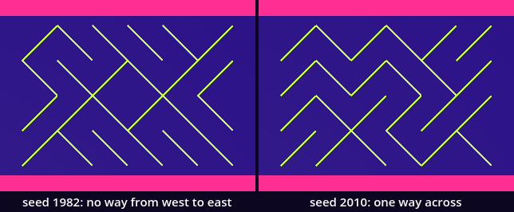
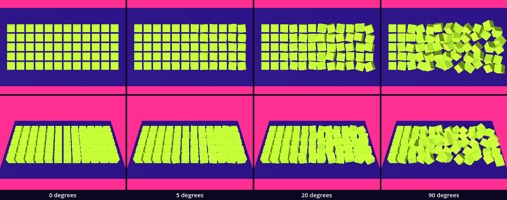
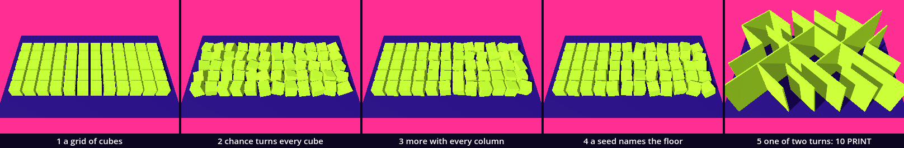

# Disturbed order — chance enters the grid

In 1968 Georg Nees had a plotter draw rows of squares and let chance turn and shift each one, a little more in every row. He called the sheet *Schotter*, gravel. Here we make it as a floor: the Chessboard's grid of cubes, each turned and slid by a number we did not choose, more with every column. Then a second body from one rule: 10 PRINT as a maze of walls, one of two turns for each cell. You already have the two loops and `instantiate()` from the Chessboard, `paint()` from the look, colliders and the walker. Two ideas are new: a generator of random numbers, and its seed.

This is a new project. In the Project Manager choose **Import** and open this folder's `project.godot`.

The study is one class day with a stop in the middle, at **Stop here**. Every message and number on this page comes from running the study in Godot 4.6. Parts marked *(editor)* describe the editor's own windows and were not watched.

## Find the family in the hall

A lesson starts in its hall, with one question: does the hall show one work at several values of one axis?

[Randomness_10_PRINT_Algorithm](../../../../commons/maps/Randomness_10_PRINT_Algorithm/final.md) does, twice. The work that prints 10 PRINT at the scale of a room stands there in two of its three forms: as low ridges on the floor, "a contour without giving the body a boundary", and as twelve slabs 2.4 m high with gaps "about seventy centimetres wide". One axis, `form`, at two values, and the reading sends you from one to the other. Beside the screen stands a board after François and Vera Molnar, 1959: four grids of a hundred diagonals, with exactly one, five, thirty and fifty of them turned the other way. That is one work at four values of one axis, and it is this lesson's question: "Where does a field of parallel lines become something else? There is no example between five and thirty."

[Random_Definition](../../../../commons/maps/Random_Definition/final.md) shows one value of its axis: two grids of coloured cubes from the same seed, which stay alike when you press REPLAY. We read all of this from the halls' map files, the artifact registry and the readings; we did not walk them.

So stand in front of the Molnar board and write down two things: which two of the four grids look most alike, and between which two the order stops. Keep the note. This study ends with a sheet of four floors of our own.

## Open the study

Open `schotter.tscn`: double-click it in the FileSystem dock, at the lower left of the editor. It inherits `supplied/base.tscn`: the floor, the sky and the sun. The editor's own view shows a white floor and Godot's preview light; the look is put on by a script when the scene runs. The scene adds two nodes. `Schotter` is an empty `Node3D` at (−3.3, 0, −1.2), which runs `schotter.gd`. `Walker` is the supplied walker, standing on the first column.

Run it: the Play button at the top right of the editor, or F5. Sixty lime cubes lie on the floor, twelve columns of five. At the left they stand in order. Towards the right each is turned and pushed a little further out of line. The Output panel, at the bottom of the editor, reads:

```
seed 1968, amplitude 20.0: the last cube turned (-5.9, 19.9, 17.2)
```

Press Space: another floor, and a second line, `seed 1969, amplitude 20.0: the last cube turned (-8.8, -2.6, -13.8)`. W, A, S and D walk the walker, and C changes between the camera above the floor and the walker's eyes.

`schotter.gd` is ours. The download holds the finished version, and the folder `steps/` holds the script as it is after each step below. If you lose your place, copy a step's contents into `schotter.gd`. Now we take it apart and build it again.

## The floor, in order

Replace everything in `schotter.gd` with this:

```gdscript
extends Node3D

const Look := preload("res://supplied/look.gd")

var columns := 12    # cubes along the walk, left to right
var rows := 5        # cubes across it
var spacing := 0.6   # metres from one cube's middle to the next: a gap of 0.1 m

func _ready() -> void:
	var part: PackedScene = load("res://borrowed/cube_part.tscn")
	var paint := Look.paint(Look.BODY)
	for x in range(columns):
		for z in range(rows):
			var cube: MeshInstance3D = part.instantiate()
			cube.material_override = paint
			cube.position = Vector3(x * spacing, 0.25, z * spacing)
			add_child(cube)
	print(get_child_count(), " cubes in order")
```

Run it. Sixty cubes in a grid, and `60 cubes in order`. If a red line comes instead, read it: it names the file and the line. That is ordinary, and here it is most often a missing tab.

This is the Chessboard's floor. `borrowed/cube_part.tscn` is its cube, half a metre on every edge, with a collider. One material is made before the loops and shared by all sixty. The position is set before `add_child()`, so that no cube is ever in the scene at the wrong place. Two things differ from the Chessboard. The spacing is 0.6 m, which leaves a gap of 0.1 m between two cubes: a cube that turns needs room. And the outer loop runs along x. Nees's sheet grows disordered from top to bottom; our floor will grow from left to right, so that the camera sees all of it from the side and a walker can walk down it.

## Chance enters

Add two lines under `var spacing`:

```gdscript
var amplitude := 20.0   # degrees: the most a cube may turn
var rng := RandomNumberGenerator.new()
```

In the inner loop, add two lines above `add_child(cube)`:

```gdscript
			var turn := deg_to_rad(amplitude)
			cube.rotation = Vector3(rng.randf_range(-turn, turn), rng.randf_range(-turn, turn), rng.randf_range(-turn, turn))
```

And replace the `print` line with this one:

```gdscript
	print("the last cube turned ", get_child(-1).rotation_degrees.snappedf(0.1))
```

Run it. Every cube is tipped a little, each its own way, and some corners have gone into the ground: a cube turns about its own middle, and the middle stays where it was. Run it again: another floor. In our check two builds printed `the last cube turned (18.9, -9.7, 15.3)` and `the last cube turned (-12.8, 13.1, -2.7)`. Yours will be two other lines. (A number may read like 9.400001. It is 9.4; the kind of number a rotation is kept in cannot hold 9.4 exactly.)

`RandomNumberGenerator.new()` makes a generator, and `rng.randf_range(-turn, turn)` asks it for one number between the two it is given. We call that a draw. Every call is a new draw, so the three turns of a cube, about x, y and z, are three different numbers, and sixty cubes take 180. `rotation` wants radians, and `deg_to_rad()` makes them from our degrees. `get_child(-1)` is the last child, the cube made last.

We asked for nothing that would make two runs differ. In Godot 4.6 a new generator begins somewhere else in its numbers every time one is made.

## More with every column

Replace the two loops, from `for x` down to `add_child(cube)`, with this:

```gdscript
	for x in range(columns):
		var amount := float(x) / (columns - 1)          # 0 in the first column, 1 in the last
		var turn := deg_to_rad(amplitude) * amount      # the most a cube of this column may turn
		var slide := 0.25 * amplitude / 90.0 * amount   # and the most it may slide, in metres
		for z in range(rows):
			var cube: MeshInstance3D = part.instantiate()
			cube.material_override = paint
			cube.position = Vector3(x * spacing, 0.25, z * spacing)
			cube.position += Vector3(rng.randf_range(-slide, slide), 0.0, rng.randf_range(-slide, slide))
			cube.rotation = Vector3(rng.randf_range(-turn, turn), rng.randf_range(-turn, turn), rng.randf_range(-turn, turn))
			add_child(cube)
```

Run it. The first column stands in order and the last is the wildest. That is Schotter, lying down.

`amount` runs from 0 to 1 along the floor, and it multiplies both limits. So `amplitude` now means the most a cube of the *last* column may turn. A cube also slides along the floor, by two more draws: at most a quarter of a metre when the amplitude is 90, and 5.6 cm at our 20. Each cube takes five draws, and the floor takes 300. The first column draws as well, between −0 and 0: its draws are used up and change nothing.

`float(x)` is the Chessboard's repair. Without it `x / (columns - 1)` divides a whole number by a whole number and gives 0 for eleven columns and 1 for the last. We ran that: eleven columns in order and one wild.

## A seed: the floor returns

Add one line under `var amplitude`:

```gdscript
var seed_value := 1968
```

Make this the first line inside `_ready()`:

```gdscript
	rng.seed = seed_value
```

And replace the `print` line:

```gdscript
	print("seed ", rng.seed, ", amplitude ", amplitude, ": the last cube turned ", get_child(-1).rotation_degrees.snappedf(0.1))
```

Run it, twice. Both runs print `seed 1968, amplitude 20.0: the last cube turned (-5.9, 19.9, 17.2)`, and the floor is the one you saw when you opened the study.

The generator does not throw dice. It calculates each number from the one before, and the seed is where the calculation starts. The same seed gives the same 300 numbers in the same order, and our loops hand them to the same cubes. Such numbers are called pseudo-random. We wrote `seed_value` because `seed` alone is already the name of one of Godot's functions.

Look at what the line prints: `rng.seed`, the seed the generator holds, and not `seed_value`, the seed we asked for. The Families lesson's rule again: read back what was built.

## The next seed

One floor is a sample. To choose one we want to see many. Replace everything with this:

```gdscript
extends Node3D

const Look := preload("res://supplied/look.gd")

@export var amplitude := 20.0    # degrees: the most a cube of the last column may turn
@export var seed_value := 1968   # the floor's name: the same number returns the same floor

var columns := 12    # cubes along the walk, left to right
var rows := 5        # cubes across it
var spacing := 0.6   # metres from one cube's middle to the next: a gap of 0.1 m
var rng := RandomNumberGenerator.new()

func _ready() -> void:
	build()

func build() -> void:
	for old in get_children():
		old.free()
	rng.seed = seed_value
	var part: PackedScene = load("res://borrowed/cube_part.tscn")
	var paint := Look.paint(Look.BODY)
	for x in range(columns):
		var amount := float(x) / (columns - 1)          # 0 in the first column, 1 in the last
		var turn := deg_to_rad(amplitude) * amount      # the most a cube of this column may turn
		var slide := 0.25 * amplitude / 90.0 * amount   # and the most it may slide, in metres
		for z in range(rows):
			var cube: MeshInstance3D = part.instantiate()
			cube.material_override = paint
			cube.position = Vector3(x * spacing, 0.25, z * spacing)
			cube.position += Vector3(rng.randf_range(-slide, slide), 0.0, rng.randf_range(-slide, slide))
			cube.rotation = Vector3(rng.randf_range(-turn, turn), rng.randf_range(-turn, turn), rng.randf_range(-turn, turn))
			add_child(cube)
	print("seed ", rng.seed, ", amplitude ", amplitude, ": the last cube turned ", get_child(-1).rotation_degrees.snappedf(0.1))

func _process(_delta: float) -> void:
	if Input.is_action_just_pressed("pause"):
		seed_value += 1
		build()
```

This is the `schotter.gd` in the download. The making moved into a function of its own, `build()`, which first frees the cubes of the floor before. `pause` is the action on Space. The two `@export` lines put **Amplitude** and **Seed Value** in the Inspector, at the right of the editor, when `Schotter` is selected in the Scene dock, at the upper left *(editor)*.

Run it and press Space a few times: 1969, 1970, 1971. Each is another floor, and each comes back when you type its number. A seed is the name of a floor. When you find one you want to keep, write its number down.

## Stop here: what we have

`schotter.gd` is the script above. Run it and check four things: sixty cubes, the left column in order, the right one wildest; the first line is `seed 1968, amplitude 20.0: the last cube turned (-5.9, 19.9, 17.2)`; a second run prints the same line; Space prints `seed 1969`.

## 10 PRINT: one of two

Schotter draws a number from a range. The other famous way to let chance into a grid draws from two. Open `maze.tscn` and `maze.gd`, and replace everything in `maze.gd` with this:

```gdscript
extends Node3D

const Look := preload("res://supplied/look.gd")

@export var seed_value := 1982   # the year of the Commodore 64

var columns := 6
var rows := 4
var cell := 1.1              # metres: one cell of the grid
var leans: Array[int] = []   # for each cell, in the order it was made: 1 or -1
var rng := RandomNumberGenerator.new()

func _ready() -> void:
	rng.seed = seed_value
	var slab := BoxMesh.new()
	slab.size = Vector3(cell * sqrt(2.0), 2.0, 0.06)   # as long as the cell's diagonal
	slab.material = Look.paint(Look.BODY)
	for z in range(rows):
		for x in range(columns):
			var lean := rng.randi_range(0, 1) * 2 - 1   # 0 or 1, made into -1 or 1
			var wall := MeshInstance3D.new()
			wall.mesh = slab
			wall.position = Vector3((x + 0.5) * cell, 1.0, (z + 0.5) * cell)
			wall.rotation_degrees.y = 45.0 * lean
			add_child(wall)
			wall.create_trimesh_collision()
			leans.append(lean)
	print("seed ", rng.seed, ": ", leans.count(1), " walls lean one way, ", leans.count(-1), " the other")
```

Run this scene with **Run Current Scene**, the clapperboard button at the top right of the editor, or F6 *(editor)*. Twenty-four walls two metres high stand on the floor, each across its own cell from corner to corner. The output: `seed 1982: 9 walls lean one way, 15 the other`.

`randi_range(0, 1)` draws a whole number, 0 or 1, and each wall is turned by one of two angles, 45 or −45 degrees. That is all of the rule in the hall's one line of BASIC, where each character is one of two diagonals. No draw asks what stands beside it. The walls meet at the corners of the cells all the same, because the grid gave them the same end points, and passages appear that nobody drew. `create_trimesh_collision()` gives a wall its body in one call: a `StaticBody3D` with a shape made from the wall's triangles, the kind of shape Point Plane made by hand with `create_trimesh_shape()`.

The odds were even and the count is 9 to 15. The hall keeps these two apart: "A probability and a count are different instruments."



## A planted bug: `randomize()`

Many pages about random numbers in Godot, and many assistants, tell you to call `randomize()` before you draw. In `schotter.gd`, add it in `build()`, under `rng.seed = seed_value`:

```gdscript
	rng.randomize()
```

Run it twice. Godot says nothing: no error, no warning. In our check two builds printed

```
seed 5231314596287428713, amplitude 20.0: the last cube turned (-1.8, -15.3, 19.1)
seed -8091069983127240109, amplitude 20.0: the last cube turned (14.5, 1.8, 9.7)
```

and yours will print two other lines. The repeatable floor changes on every run, while `seed_value` is 1968 as before.

`randomize()` gives the generator a new seed, taken from the time, Godot's documentation says; we saw only that it is another in every run. The advice comes from older versions of Godot, which we did not run. In Godot 4.6 a new generator already begins somewhere new, as we saw in *Chance enters*, so the line is never needed for that; and placed after a seed it throws the seed away. The only sign is the number we chose to print: `rng.seed`, read back from the generator. Had we printed `seed_value`, the line would have said 1968 over a floor that 1968 did not make. Take the line out.

Three more faults, all silent, each run by us:

- Move `rng.seed = seed_value` into the inner loop. Every cube then starts the generator again and takes the same five numbers: the five cubes of a column lie exactly alike, and the last one turned `(-1.3, -5.8, -10.5)`.
- Add a draw nobody uses, `rng.randf()`, under the seed line. The line becomes `seed 1968, amplitude 20.0: the last cube turned (19.9, 17.2, 4.8)`. Compare it with ours: every number has moved one place along, and it is another floor under the same seed.
- Take `float()` away. The line still reads `(-5.9, 19.9, 17.2)`, over eleven columns in order. One number read back is not the floor.

## The argument: how much disorder?

The axis is `amplitude`, the most a cube of the last column may turn. The values are 0, 5, 20 and 90 degrees, all at seed 1968.

**Write your prediction before you render.** Which two of the four floors will look most alike? And at what amplitude does the floor stop reading as a grid?

The course's outline made its own: 0 and 5 will look most alike, because 5 degrees moves a cube's corner by less than the gap between cubes, so the grid still reads; and somewhere between 5 and 20 it stops reading as a grid.

Then look: select `Schotter` and change **Amplitude** in the Inspector *(editor)*, or change the number in the script, and run. For stills of all four, run `sheet.gd` as the [README](README.md) says; it needs a terminal. You can go on without it: the numbers below are what our run measured.



Each floor was photographed alone, twice, with its shadow off: in plan, from straight above and without perspective, as Nees's plotter drew, and from a raised standpoint 9.1 m away.

| pair | differ on, in plan | from the raised standpoint |
| --- | --- | --- |
| 0 and 5 | 1.81% of the still | 0.73% |
| 5 and 20 | 6.20% | 2.95% |
| 0 and 20 | 8.89% | 3.70% |
| 20 and 90 | 20.07% | 11.83% |
| 5 and 90 | 21.53% | 12.98% |
| 0 and 90 | 21.86% | 13.66% |

The closest pair is 0 and 5, from both standpoints. The first half of the prediction held. Its arithmetic was nearly right for our cube: at 5 degrees no corner moved more than 6.7 cm, and the gap is 10 cm.

For the second half we needed a measure of "reads as a grid". Ours: the grid's lines are the middles of the gaps, eleven between the columns and four between the rows, and we counted how much of them is still clear floor in the plan.

| amplitude | 0 | 5 | 7 | 10 | 15 | 20 | 45 | 90 |
| --- | --- | --- | --- | --- | --- | --- | --- | --- |
| grid lines clear | 100% | 100% | 99.9% | 98.1% | 89.7% | 80.7% | 51.2% | 41.0% |

The lines begin to close between 5 and 10 degrees. Counted on the cubes themselves, without a picture: with ten seeds, 1968 to 1977, the first cube put a corner over the middle of a gap at an amplitude of 5, 6 or 7 degrees. So the outline's "between 5 and 20" held, at its lower end. But nothing stops at one point. The floor is its own sheet: at 20 degrees no cube of the first four columns reaches over the middle of a gap, and every cube of the last six does.

Two more measurements belong to the claim.

Another seed at the same amplitude: seed 1968 and seed 1969 differ on 2.44% of the plan at 5 degrees, on 11.47% at 20 and on 28.85% at 90. The last is more than any pair of amplitudes in the table: counted in pixels, two floors with the same disorder are further apart than the floor in order is from rubble. But their grid lines are clear on 80.7% and 77.4% at 20 degrees, and on 41.0% and 43.2% at 90. The pixels tell which cube went where. How far the order has gone, we could only read off the grid.

And the same disorder with no gaps to disturb: with `spacing` at 0.5 the cubes touch and the floor in order is one lime slab. There 5 degrees changed 1.89% of the floor's pixels. With the gaps it changed 5.79%.

The claim, as measured: we see the disorder against the grid. The same five degrees show three times as much where there are gaps to cross, and the amount of disorder can be read from the grid's lines when it cannot be read from the difference between two floors.

**Decide.** One difference here could be followed. The amplitude moves two things at once, the turn and the slide. The next intervention would be to set `slide` to `0.0` and render the four floors again, or to keep the slide and turn about y only, as on Nees's flat sheet. Or settle: one of these floors, under a seed you found with Space, is the floor your room needs. Either is right. Write your decision and its reason in your [field note](FIELD_NOTE.md); ours is there as an example of the form, not of the answer.

## What chance owes

It is not chance. The same seed returns the same floor, cube for cube; the hall's reading is called "A pattern that returns". We measured how little is drawn: at one seed, amplitude 20 turns every cube exactly four times as far as amplitude 5, in the same direction. The seed decided every direction once. The four floors of our sheet are one gesture at four sizes, and not four samples.

A seed is not the whole name either. One unused draw gave another floor under the same number. The hall says it of its own grids: "The picture's name had left out part of its making." The name is the seed and this script together. Whether another version of Godot would calculate the same numbers from 1968, we did not test. The [Random Definition study](../random-definition/TUTORIAL.md), a small project of its own beside this one, takes that one question through six steps with cubes of colour; it is not needed here, and we did not run it for this lesson.

In 1965 Frieder Nake called a plotter drawing *Hommage à Paul Klee*, and the question it left is still open: can a pseudo-random number stand in for the artist's intuition? Look at what we chose and what the generator chose. We chose the cube, twelve by five, the gap, the amplitude, that disorder grows to the right, and, with Space, which floor to keep. The generator chose which way each cube leans. The hall says it of the Molnars' board: "Chance decides which cells turn. Their number was settled beforehand."

A seed is also a promise that someone else can keep. Whoever has 1968 and this script has this floor. To publish a seed is to hand the work over for remaking, whether or not you meant to.

And the grid never left. No cube's middle slides more than a quarter of a metre along x or along z; `x * spacing` is in every position we wrote. At 90 degrees 41.0% of the grid's lines are still clear, where 15.2% of the floor's whole rectangle is. This is disorder inside an order, as the title says. A floor with no grid under it is another program.

## Walk the floor, enter the maze

Run `schotter.tscn`, press C for the walker's eyes, and walk down the floor with W, on the cubes' tops. Then set the amplitude to 90 and walk again.

We sent the walker down the middle row on its autopilot. In order, its feet stayed at 0.50 m. At 5 degrees they moved between 0.49 and 0.51 m, at 20 between 0.46 and 0.55, at 90 between 0.38 and 0.68. The colliders follow the cubes: every `Body` is turned exactly as its mesh. And the walker arrived every time: at all four amplitudes with seed 1968, and at 90 degrees with seeds 1969 to 1972. The outline expected a walk "until the disorder makes it unwalkable". On this floor, for this walker, no amplitude did that. We think the reason is in the making: a cube turns about its own middle, so something is underfoot every 0.6 m, and the walker steps up 0.35 m.

Two other things stopped it, each under three of the five seeds 1968 to 1972 at 90 degrees. Gaps: with `spacing` at 0.8 the walker crossed the floor in order and the floor at 20 degrees, and at 90 it was blocked with its feet down between the cubes, as low as 0.06 m. And the body: a walker with `step_height` 0 crossed at 20 degrees and was blocked at 90. In both cases the seed decided. Unwalkable is not a property of a floor. It is a floor and a body together.

Now `maze.tscn`. Press C and walk in; the walls are higher than your eyes. Sent straight across, the walker was stopped by the first wall after 0.98 m. So we followed the corridors by rule, from every opening on the edge. A diagonal cuts its cell into two triangles, and each triangle opens on two sides, so a corridor may turn and never forks. Seed 1982 has 20 openings and 10 corridors, and not one leads from the west side to the east. The longest goes in at the west of the last row and comes out at the north after 11 cells; the walker walked it and arrived. Four triangles are reached by no corridor: one room with no door, in the middle of the plan above. You cannot lose your way in this maze, because there is never a choice. You can only be brought back out. Of the 100 seeds from 1982 on, four have a way across: 2010, 2029, 2031 and 2037. In 2010 the walker crossed from west to east in 16 cells.

Here is what was not checked. No headset was used and nobody walked with their hands on the keys: the walker was driven by its autopilot. Whether a person feels lost between walls two metres high, no number here says.

## The process

a grid of cubes → chance turns every cube → more with every column → a seed names the floor → one of two turns: 10 PRINT



`sheet.gd` makes the strip. Steps 2 and 3 have no seed in the lesson; for the strip their generator was given seed 1, so that it can be made again. The last step changed the tile most, 45.52%: it is another body. Among the four steps of the floor it was *more with every column*, 9.60%. And *a seed names the floor* changed 7.60% of the tile and nothing about what kind of floor it is.

## In your room

The kit hands your room one body: a patch of Schotter floor, 25 cubes of 0.2 m, in `guests/disturbed-order/`.

Copy the folder `guests/disturbed-order/` from this kit into the `guests/` folder of your room project. Then open `room.gd` in the room and add its line to the list, under the last one:

```gdscript
const GUESTS: Array[String] = [
	"res://guests/example/example.tscn",
	"res://guests/disturbed-order/disturbed-order.tscn",
]
```

Your list has your own guests above it. Run the room and walk to the patch. In our copy of the room it stood at place 2, the Output panel read `Disturbed order: seed 1968, amplitude 45.0`, and the walker, sent to the middle of the place, stepped onto the patch and stood on it, 0.10 m from the middle, its feet at 0.22 m.

Now the room's task: give your floor a seeded disorder of your own, and record the seed you keep. In the room project, open `guests/disturbed-order/disturbed-order.gd` and change the number in this line:

```gdscript
@export var seed_value := 2026   # the patch's name: change it, look, keep the one you want
```

Run, look, change it again, and try another `amplitude` too. We wrote 2026 and the room printed `Disturbed order: seed 2026, amplitude 45.0`. When you have the patch you want, write one line in your room's README: the seed, the amplitude, and what the seed alone does not record.

## What we borrowed

| Part | From | How far we go |
| --- | --- | --- |
| `supplied/base.tscn`, `look.gd` | the kit base | Use: the floor, sky and sun; `Look.paint(Look.BODY)`. No colour here is ours. |
| `supplied/walker.tscn` | the kit base | Use: W A S D, C, and `walk_to()` for the checks. |
| `borrowed/cube_part.tscn` | The Chessboard | Use: a cube of 0.5 m built round its own middle, with a box collider and no colour. |
| `RandomNumberGenerator`, `seed`, `randf_range()`, `randi_range()`, `randomize()` | Godot | Use: we decide when it draws and what a draw becomes. How it calculates we did not open. |
| `deg_to_rad()`, `rotation`, `rotation_degrees` | Godot | Use: radians from degrees; a node's turn about x, y and z. |
| `create_trimesh_collision()` | Godot | Use: a body from a mesh, in one call. Point Plane made that kind of shape with `create_trimesh_shape()`. |
| `verify.gd`, `sheet.gd` | Supplied here | Use: the checks, and the stills and measures of this page. |

What we made is `schotter.gd`: a seeded generator, five draws for each cube, limits that grow with the column, and a key for the next seed. And `maze.gd`: one draw of two for each cell.

## What we carry forward

We leave with a generator and a draw; with `randf_range()` and `randi_range()`; with a seed, and the habit of printing the one the generator holds; and with the knowledge that the same seed is the same floor only while the script stays the same.

Every cube here drew alone: cube 7 knows nothing of cube 8. The next stop, *Noise*, is chance that remembers its neighbour.
