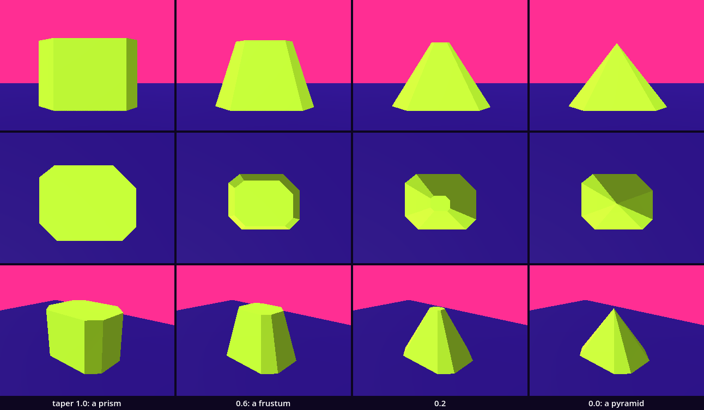
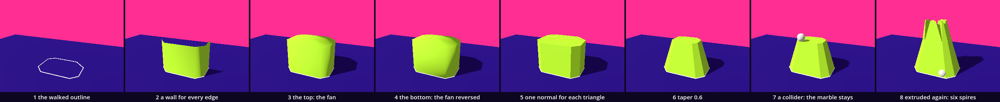

# Extrude — the plane is pulled into a solid

Plane left us with a walk that closed: a list of corners, a fan of triangles between them, a normal for each, and a collider a marble could rest on. The face had one side and no thickness. Here we pull it up. Every edge of the walk gets a wall, the fan becomes the lid, the same fan turned over becomes the bottom, and one function of our own, `extrude()`, returns the solid. A second number, the taper, narrows the top: 1 gives a prism, 0 a pyramid. No idea in this lesson is new. The list, the loop, the function that returns something, `SurfaceTool`, the normal and the collider all come back, in one place.

This is a new project, like every stop of this course: in the Project Manager choose **Import** and open this folder's `project.godot`. Leave your Plane folder as it is.

Every message and number on this page comes from running the study in Godot 4.6. Parts marked *(editor)* describe the editor's own windows and were not watched.

## Find the family in the hall

A lesson starts in its hall, with one question: does the hall show one work at several values of one axis? If it does, predict which two look most alike before you read anything beside them.

The hall is [Primitives_Polythedra](../../../../commons/maps/Primitives_Polythedra/final.md), and it does. A triangular prism stands there three times: once whole, beside the entrance, and four cells further in two side by side, one cut into four and one that is only its nine edges. It is one work, `prism_block`, at three of the five values of its axis `grain`: solid, quartered, shell. Two more works in the hall declare an axis, a cube and a tower of diamonds, and each stands once. We read this from the hall's map file, the artifact registry and the prism's script; we did not walk it.

The reading says of the prism: "The triangle has acquired a length." That sentence is this lesson. The prism's script builds it as a triangle "extruded 1 m along Z". And of the three: "Their visible construction changes; all three retain the original prism's collision surface." What the eye gets and what a body gets are made separately, as in Plane.

So stand where you see all three and write down which two you expect to look most alike. Nobody has rendered that sheet. Keep the guess: this study ends with a sheet of our own.

One more hall, behind us: in [Point_Triangle_Context](../../../../commons/maps/Point_Triangle_Context/final.md) a six-cornered L is filled by a fan, and "the fill can reach across the notch you left open." Our lid and our bottom are that fan. They inherit that.

## Open the study

Open the [Extrude study](README.md), then `extrude.tscn`. It inherits `supplied/base.tscn`: the floor, the sky, the light and the camera of every kit. The editor's own view shows a white floor and Godot's preview light; the look is put on by a script when the scene runs. The scene adds `Solid`, an empty mesh node with a `Body` and an empty `Shape` under it; the supplied `Marble` and `Walker`; and a `Readout`.

Run it (F5). A lime solid stands on the floor, 0.8 m high, with eight walls and a flat lid, and a white line runs round its foot. The Output panel, at the bottom of the editor, reads `8 corners walked, 84 vertices in the mesh, 0.80 m high`. Press M: a marble falls onto the lid and stays, and the readout says `marble at 0.90 m`. The cyan capsule at the left is the walker: W, A, S and D walk it, C looks through its eyes.

`extrude.gd` is ours. The download holds the finished version. We will take it apart and build it again.

## The walk is a list

Replace everything in `extrude.gd` with this:

```gdscript
extends Node3D

const Look := preload("res://supplied/look.gd")
const Segment := preload("res://supplied/segment.gd")

# A walk we recorded with borrowed/walk.tscn: eight corners on the floor,
# clockwise seen from above. Yours goes here.
var walk: Array[Vector3] = [Vector3(-0.4, 0, -0.4), Vector3(0.32, 0, -0.4), Vector3(0.6, 0, -0.12), Vector3(0.6, 0, 0.36), Vector3(0.43, 0, 0.53), Vector3(-0.37, 0, 0.53), Vector3(-0.59, 0, 0.31), Vector3(-0.59, 0, -0.25)]

func _ready() -> void:
	for i in range(walk.size()):
		var segment := Segment.new()
		add_child(segment)
		segment.show_between(walk[i - 1], walk[i])
		print(i, ": from ", walk[i - 1], " to ", walk[i])
```

Run it. Eight white lines lie on the floor and close into one outline. The output begins

```
0: from (-0.59, 0.0, -0.25) to (-0.4, 0.0, -0.4)
1: from (-0.4, 0.0, -0.4) to (0.32, 0.0, -0.4)
```

and ends with `7: from (-0.59, 0.0, 0.31) to (-0.59, 0.0, -0.25)`.

The list is Trace's list. We recorded it with a small recorder, which you will use for your own walk in *In your room*. The loop is Trace's loop, with one move that matters all day: an edge runs from the corner before to this corner, `walk[i - 1]` to `walk[i]`. When `i` is 0, the corner before is `walk[-1]`, and in Trace `[-1]` was the last one. So the first edge joins the last corner to the first, and the outline is closed without a line of code for it. `Segment.new()` makes a line node from the supplied script, as `SurfaceTool.new()` made a tool in Plane.

## A wall for every edge

Replace `_ready()` with this, and add the function under it:

```gdscript
func _ready() -> void:
	for i in range(walk.size()):
		var segment := Segment.new()
		add_child(segment)
		segment.show_between(walk[i - 1], walk[i])
	var mesh := extrude(walk, 0.8)
	$Solid.mesh = mesh
	$Solid.material_override = Look.paint(Look.BODY)

func extrude(outline: Array[Vector3], rise: float) -> ArrayMesh:
	var upper: Array[Vector3] = []
	for corner in outline:
		upper.append(corner + Vector3.UP * rise)
	var surface := SurfaceTool.new()
	surface.begin(Mesh.PRIMITIVE_TRIANGLES)
	for i in range(outline.size()):               # a wall for every edge
		surface.add_vertex(outline[i - 1])
		surface.add_vertex(outline[i])
		surface.add_vertex(upper[i])
		surface.add_vertex(outline[i - 1])
		surface.add_vertex(upper[i])
		surface.add_vertex(upper[i - 1])
	surface.generate_normals()
	return surface.commit()
```

Run it. A lime fence stands on the outline, 0.8 m high, with no lid.

`extrude()` is a function with two parameters and a return value: it is handed an outline and a height, and it hands back a mesh. First it makes `upper`, a copy of the outline lifted by `rise`. Then the edge loop again. An edge and its copy above are four corners, and a wall between them is two triangles: six calls of `add_vertex()`. Their order is Plane's rule: Godot draws the side from which a triangle's corners run clockwise. Our walk runs clockwise seen from above, and with it this order runs clockwise seen from outside.

So each wall has one side. We raised a camera and looked down into the fence: inside it we saw the floor and the white outline where the far walls should be. They show us their backs and are not drawn.

## Two caps

Add two loops to `extrude()`, between the wall loop and the line `surface.generate_normals()`:

```gdscript
	for i in range(1, outline.size() - 1):        # the top: the fan
		surface.add_vertex(upper[0])
		surface.add_vertex(upper[i])
		surface.add_vertex(upper[i + 1])
	for i in range(1, outline.size() - 1):        # the bottom: the fan, wound the other way
		surface.add_vertex(outline[0])
		surface.add_vertex(outline[i + 1])
		surface.add_vertex(outline[i])
```

Run it. The fence has a lid, and the solid is closed.

The first loop is Plane's fan, on the upper outline: every triangle starts at corner 0. Eight corners make six triangles. The second loop is the same fan on the floor with two corners swapped, so that its front faces down. It lies on the ground, and no camera here will see it. A solid still needs it: the walls and the two caps are 28 triangles, and every edge is now shared by exactly two of them.

Now look at the solid again. It is closed, and it looks wrong: soft, like a bar of soap. The lid is darker toward one side, and no wall ends in an edge.

## A solid that is shaded round

Godot printed nothing. Ask the mesh. Add one line at the end of `_ready()`:

```gdscript
	print("the top's first normal: ", mesh.surface_get_arrays(0)[Mesh.ARRAY_NORMAL][walk.size() * 6])
```

`surface_get_arrays(0)` hands over the mesh's lists; under `Mesh.ARRAY_NORMAL` is the list of normals, one for each vertex. The walls took six vertices for each of eight edges, so number 48 is the first vertex of the lid. Run it:

```
the top's first normal: (-0.18654, 0.903099, -0.386801)
```

The lid is flat and level. Its normal should point straight up: (0, 1, 0). This one leans.

`generate_normals()` does more than Plane asked of it. It gives each triangle its normal, and then, for vertices that stand in the same place, it replaces their normals by the average. A corner of the lid is also a corner of two walls, so its normal is pulled outward and down, and the light shades the lid as if it curved into the walls. In Plane this could not show: one flat face, and every triangle agreed. Here the mistake is silent, and the picture is the only report.

`SurfaceTool` keeps that averaging in what it calls a smooth group, and the group can be switched off. Add one line to `extrude()`, under `surface.begin(Mesh.PRIMITIVE_TRIANGLES)`:

```gdscript
	surface.set_smooth_group(-1)
```

Run it:

```
the top's first normal: (0.0, 1.0, -0.000015)
```

The solid has edges. Each wall is one flat shade, and the lid is one. The last number is not quite 0 because a mesh keeps its normals packed small; before the mesh was made, `SurfaceTool` held exactly (0, 1, 0).

We photographed both. From the side the smoothed solid and the flat one differ on 18.98% of the still, all of it inside the outline: the same triangles, the same silhouette, another body for the eye. This is what a hard edge is in a mesh: two faces that meet and do not share a normal.

## The taper

The function is ready for its second number. Replace everything in `extrude.gd` with this:

```gdscript
extends Node3D

const Look := preload("res://supplied/look.gd")
const Segment := preload("res://supplied/segment.gd")

@export var height := 0.8     # metres: how far the walk is pulled up
@export var taper := 1.0      # the size of the upper outline: 1 a prism, 0 a pyramid

# A walk we recorded with borrowed/walk.tscn: eight corners on the floor,
# clockwise seen from above. Yours goes here.
var walk: Array[Vector3] = [Vector3(-0.4, 0, -0.4), Vector3(0.32, 0, -0.4), Vector3(0.6, 0, -0.12), Vector3(0.6, 0, 0.36), Vector3(0.43, 0, 0.53), Vector3(-0.37, 0, 0.53), Vector3(-0.59, 0, 0.31), Vector3(-0.59, 0, -0.25)]

func _ready() -> void:
	for i in range(walk.size()):
		var segment := Segment.new()
		add_child(segment)
		segment.show_between(walk[i - 1], walk[i])
	var mesh := extrude(walk, height, taper)
	$Solid.mesh = mesh
	$Solid.material_override = Look.paint(Look.BODY)
	var vertices: PackedVector3Array = mesh.surface_get_arrays(0)[Mesh.ARRAY_VERTEX]
	print("%d corners walked, %d vertices in the mesh, %.2f m high" % [walk.size(), vertices.size(), mesh.get_aabb().size.y])

func centre_of(points: Array[Vector3]) -> Vector3:
	var sum := Vector3.ZERO
	for point in points:
		sum += point
	return sum / points.size()

# rise: metres up. top: the size of the upper outline, from 1 to 0.
func extrude(outline: Array[Vector3], rise: float, top: float) -> ArrayMesh:
	var centre := centre_of(outline)
	var upper: Array[Vector3] = []
	for corner in outline:
		upper.append(centre + (corner - centre) * top + Vector3.UP * rise)
	var surface := SurfaceTool.new()
	surface.begin(Mesh.PRIMITIVE_TRIANGLES)
	surface.set_smooth_group(-1)
	for i in range(outline.size()):               # a wall for every edge
		surface.add_vertex(outline[i - 1])
		surface.add_vertex(outline[i])
		surface.add_vertex(upper[i])
		surface.add_vertex(outline[i - 1])
		surface.add_vertex(upper[i])
		surface.add_vertex(upper[i - 1])
	for i in range(1, outline.size() - 1):        # the top: the fan
		surface.add_vertex(upper[0])
		surface.add_vertex(upper[i])
		surface.add_vertex(upper[i + 1])
	for i in range(1, outline.size() - 1):        # the bottom: the fan, wound the other way
		surface.add_vertex(outline[0])
		surface.add_vertex(outline[i + 1])
		surface.add_vertex(outline[i])
	surface.generate_normals()
	return surface.commit()
```

Run it. The same solid, and `8 corners walked, 84 vertices in the mesh, 0.80 m high`.

Three things changed. `centre_of()` adds the corners and divides by their number: the mean of the corners, (0, 0, 0.07) for our walk. One line in `extrude()` uses it: `corner - centre` is the arrow from the centre to a corner, and `* top` shortens it. At 1 the upper corner stands over the lower one. At 0 the arrow has no length, and all eight upper corners are the centre, lifted. And the two numbers moved to the top of the script, with `@export`, as Plane's `side` was. The function calls them `rise` and `top`; we hand it our `height` and our `taper`. A parameter is the function's own name for what it is given.

Change the `1.0` in the line `@export var taper := 1.0` to `0.6` and run: the walls lean in, under a smaller lid. Try `0.0`: a pyramid with eight sides. Set it back to `1.0`. You can also select the root node in the Scene dock, at the upper left, and set **Taper** in the Inspector, at the right *(editor)*; from then on the Inspector's number wins over the script's.

## A body: the marble and the collider

Add a function under `_ready()`:

```gdscript
func _process(_delta: float) -> void:
	if Input.is_action_just_pressed("drop"):
		$Marble.drop(centre_of(walk) + Vector3.UP * (height + 1.0))
	$Readout.text = "height %.2f m    taper %.2f\nmarble at %.2f m" % [height, taper, $Marble.position.y]
```

Run it and press M. The marble falls from one metre above the lid, through the solid, and the readout says `marble at 0.10 m`: it lies on the floor, inside. The solid is a mesh and nothing else. Add one line to `_ready()`, under the line that paints the solid:

```gdscript
	$Solid/Body/Shape.shape = mesh.create_trimesh_shape()
```

Run it and press M: `marble at 0.90 m`. The marble rests on the lid. This is Plane's call: a collision shape made from the mesh's own triangles. Because `extrude()` returns the mesh, one mesh serves both the eye and the body.

## The same move, as the project makes it

The museum has an extrude of its own, in a library called MeshGrammar: a rule that pushes chosen faces out by a distance and scales them. Those are our two numbers. A small version of it is in `borrowed/grammar_extrude.gd`. Add a third line under the two `const` lines:

```gdscript
const Grammar := preload("res://borrowed/grammar_extrude.gd")
```

a third field under `taper`:

```gdscript
@export var spire := false    # tick to hand the solid to the project's extrude as well
```

and two lines in `_ready()`, under `var mesh := extrude(walk, height, taper)`:

```gdscript
	if spire:
		mesh = Grammar.extrude_up(mesh, 0.5, 0.3)
```

This is the `extrude.gd` in the download. Change `false` to `true` and run: `8 corners walked, 192 vertices in the mesh, 1.30 m high`.

We asked for a spire and got a crown: six spires, side by side. `extrude_up()` pushes out every triangle that faces up, by 0.5 m, scaled to 0.3. Our function knew the outline: one lid, one centre. MeshGrammar knows triangles. The lid is a fan of six, and each was pushed out about its own middle. Press M: the marble came to rest between the spires, at 1.29 m.

In the hall Gallery_MeshGrammar two works do this in the open (read from its map file): `mesh_grammar_extruded_spire` extrudes the upward faces of a twenty-sided seed twice, each time scaled down, and `mesh_grammar_inset_towers` first shrinks a face inside itself and then extrudes the smaller one. Set `spire` back to `false`.

## The argument: how much taper?

The axis is `taper`, on the same walk at the same height. The values are 1.0, 0.6, 0.2 and 0.0.

**Write your prediction before you render.** Four solids, each seen alone. Which two will look most alike from the side? Which one stands apart? And where will the marble rest on each? Write it down, with a reason for each.

The course's outline made its own: "Seen from the side, 1.0 and 0.6 will look most alike: both are flat-topped blocks, and only the slope of the walls differs. 0.0 is the odd one: the top cap has no area and the solid ends in a point."

Then look. Change the number in the script and run, four times. For stills of each solid alone, run `sheet.gd` as the [README](README.md) says; it needs a terminal. You can go on without it: the table is what our run measured.



Each solid was photographed alone, from 2.5 m, with its shadow off: from the side, from straight above, and from over a corner.

| pair | differ on, from the side | from above | from a corner |
| --- | --- | --- | --- |
| 1.0 and 0.6 | 12.33% of the still | 17.91% | 9.67% |
| 1.0 and 0.2 | 30.34% | 23.50% | 18.35% |
| 1.0 and 0.0 | 28.95% | 23.86% | 17.39% |
| 0.6 and 0.2 | 8.30% | 6.59% | 7.48% |
| 0.6 and 0.0 | 12.07% | 7.72% | 8.73% |
| 0.2 and 0.0 | 3.36% | 2.84% | 2.05% |

The closest pair is 0.2 and 0.0, from all three standpoints. The outline's prediction was false. From the side 1.0 and 0.6 differ on 12.33%, as much as 0.6 and the pyramid do. And the one that stands apart is the prism: its nearest sibling is 12.33% away, the pyramid's 3.36%.

Part of this is the spacing. Our four values are 0.4, 0.4 and 0.2 apart, so the closest pair is also the nearest in number. We rendered six equal steps of 0.2 as well, from the side, each against the next: 8.19%, 6.32%, 4.26%, 3.79%, 3.36%. Equal steps of the number are not equal steps of the picture. The first step away from the prism changes 2.4 times as much as the last step into the pyramid. The outline of the solid moves about as much each time, 3.75% down to 2.66%. What falls is the difference inside it, 4.44% down to 0.69%: a wall that begins to lean catches the light differently over its whole face.

From above, 0.6, 0.2 and 0.0 have the same outline to the pixel: the foot hides the smaller top. They differ only in the shade of their walls.

The marble, dropped over the centre from one metre above the top:

| taper | the marble |
| --- | --- |
| 1.0 | rests on the lid at 0.90 m, where it landed |
| 0.6 | rests on the lid at 0.90 m, 0.20 m from where it landed |
| 0.2 | rests on the lid at 0.90 m, 0.03 m from where it landed |
| 0.0 | rests on the point, at 0.90 m |

The outline expected it to roll off the pyramid. Dropped exactly over the point, it stayed on the point. Dropped 1 cm to the side it rolled off, across the floor and over its edge. Nothing in a script's drop pushes the marble sideways; whether a hand could let go that exactly, we did not test.

The claim: one outline and two numbers make a family of solids, and the cube of the next chapter is this function called with a square and a taper of 1. Measured, the family is not evenly spread: the prism stands apart, and the members near the pyramid crowd together.

**Decide.** One difference here could be followed: on the lid of 0.6 the marble rolled 20 cm, and on the lid of 1.0 it lay where it fell. Both lids are flat and level. The next intervention would be to change one thing about the drop, its place or its height, and see whether the roll follows the lid's fan of triangles. Or settle: one of these four is the solid your room needs, and the table is enough to choose it. Either is right. Write your decision and the reason in your [field note](FIELD_NOTE.md); ours is there as an example of the form, not of the answer.

## What an extrusion owes

An extrusion remembers only its outline. Every wall is flat, and every level of the solid is the same shape, scaled. It cannot bulge, lean or twist. It is the default body of drawing software, and most buildings on a screen are the extrusion of their plan: what the plan does not say, the solid does not have.

It is also less whole than it looks. The mesh lists 84 vertices, and they stand in 16 places: every corner of the solid is there once for each triangle that touches it. `SurfaceTool` can let triangles share a vertex, with `index()`, when place and normal are the same. We tried it: 84 became 59. Four for each wall, eight for the lid, and 19 for the bottom, where the normals `SurfaceTool` made differ in the sign of a zero. No wall shares a vertex with the lid or with the next wall. They cannot: they need different normals there. A solid that looks like one piece is a set of flat pieces that meet.

The centre is a choice too. Ours is the mean of the corners, which a walk with many corners on one side pulls toward that side. And the caps are Plane's fan, with Plane's debt: on a walk with a dent, the lid reaches across the dent.

The project's extrude decides in silence as well. Handed our solid at taper 0.2, it found 16 triangles facing up, the six of the lid and ten of the leaning walls, and pushed out nine. Five of the others were under its floor of 0.01 m² and two were too thin, and nothing was printed.

## Stand on your walk

The place this chapter asks for is to stand on top of your walk.

The walker cannot climb 0.8 m. Sent at the solid on its autopilot, it was stopped by the wall, 0.3 m from the face, its feet on the floor. Change `height` to `0.3`, run, and walk at the solid with W: the walker steps up, as it steps onto anything no higher than 0.35 m. Ours arrived on top with its feet at 0.30 m. With `taper` at `0.0` as well, it walked up the side of the low pyramid and stood on the point, its feet at 0.29 m. Set both numbers back.

Here is what was not checked. The walker was walked by its autopilot, not by a hand on the keys. No headset was used: there this is a plinth made from your own path, at the height of your hand, and whether a hand finds its lid where the eye puts it is not something a marble can say.

## Try

Walk the other way round. Add `walk.reverse()` as the first line of `_ready()` and run. You look into an open room: the far walls from inside, the bottom on the floor, no lid. Press M: `marble at 0.10 m`. Every front faces in, and the marble fell through the back of the lid. The walker was stopped by the wall all the same. Godot printed nothing. The recorder you use below turns every walk clockwise for this reason. Take the line out.

Step past the end. In the segment loop write `walk[i]` and `walk[i + 1]`. Godot reports `Out of bounds get index '8' (on base: 'Array[Vector3]')`, the rest of `_ready()` does not run, and there is no solid. Run from the editor, the game pauses on that line *(editor)*. Eight corners are numbered 0 to 7; at the last one, `i + 1` is 8. Reading that message is ordinary work: it names the number that was asked for and the list that did not have it. Change it back.

## The process

A body made by more than one operation has a recipe. Ours, one still after each step, from one camera:

the walked outline → a wall for every edge → the top: the fan → the bottom: the fan reversed → one normal for each triangle → taper 0.6 → a collider: the marble stays → extruded again: six spires



`sheet.gd` makes the strip and counts. The solid has 0, 16, 22, 28, 28, 28, 28 and 64 triangles. The walls changed the picture most: 12.81% of the tile. The bottom cannot be seen from this camera, and it still changed 5.52% of the tile: it was added while the normals were smoothed, and its normals pulled at the walls' lower corners. The collider changed nothing but the marble, 0.58%. And in the last tile the marble lies on the floor, at 0.10 m: the six spires on the tapered solid shed it, where the six on the prism held it.

## In your room

A plinth in your room, extruded from a walk of your own, with its height and taper written on it; and one earlier body on top of it.

The kit's guest is that plinth: the folder `guests/extrude/`, with the scene `extrude.tscn` and the script `plinth.gd`, which holds a copy of `extrude()`. Copy the folder `guests/extrude/` from this kit into the `guests/` folder of your room project. Open the room's `room.gd` and add one line to `GUESTS`, under the last one:

```gdscript
	"res://guests/extrude/extrude.tscn",
```

Run the room and walk to it. In our copy of the room it stood at place 2, a lime plinth with a plate that reads `height 0.80 m`, `taper 0.80`. The walker, sent at it, was stopped 0.80 m from the middle of the place.

Now the walk. In this kit, open `borrowed/walk.tscn` and press F6, which runs the scene that is open *(editor; the button is at the top right, beside Play)*. Walk a loop with W, A, S and D: the white ball cannot leave the dark square, which is the size of a place in your room. Press Space. The loop closes, and the Output panel holds one line that begins `var walk: Array[Vector3] = [`. Select it, copy it, and paste it over the `var walk` line in your room's `guests/extrude/plinth.gd`. Set `height` and `taper` in the two lines above it.

Then the rider. At the end of `_ready()` in the same `plinth.gd`, add:

```gdscript
	var rider: Node3D = load("res://guests/example/example.tscn").instantiate()
	rider.position = centre_of(walk) + Vector3.UP * height
	add_child(rider)
```

with the path of any guest you already have. Run the room. We did this with a walk of seven corners, a height of 1.0 and a taper of 0.7: the example box stood on the lid with its feet at 1.00 m, and a marble dropped over it rested at 1.60 m. One thing to know: the plinth now needs that other guest's folder. In your room both are there. Handed to somebody else alone, it would not load its rider.

Write one line in your README: what your walk was, and one solid these two numbers cannot make from it. Hand in your room with its process strip and your field note.

## What we borrowed

| Part | From | How far we go |
| --- | --- | --- |
| `supplied/base.tscn`, `look.gd` | The kit base, The Look | Use: the floor, the sky, the light; `Look.paint(Look.BODY)`. |
| `supplied/segment.gd` | The kit base, Lines | Use: `show_between(a, b)` lays a line between two points. |
| `supplied/marble.tscn`, `walker.tscn` | The kit base | Use: `drop(at)`; a body on the keys that is stopped by colliders and steps up 0.35 m. |
| `borrowed/walk.tscn`, `walk.gd` | Trace and Plane, made small | Use: walk the Hand, Space closes; it prints the corners as one line of code, clockwise seen from above. It keeps where the Hand turned, not a position every few centimetres. |
| `borrowed/grammar_extrude.gd` | The project's MeshGrammar | Use: `extrude_up(mesh, distance, scale)` pushes out every triangle that faces up. Understand: it knows triangles, not outlines. |
| `SurfaceTool`: `add_vertex()`, `set_smooth_group(-1)`, `generate_normals()`, `commit()` | Godot, Plane | Understand: three vertices are a triangle; -1 keeps each triangle's own normal. |
| `create_trimesh_shape()`, `surface_get_arrays()`, `get_aabb()` | Godot, Plane | Use: a collider from a mesh; a mesh's lists; its box. |
| `sheet.gd`, `verify.gd` | Supplied here | Use: the stills and their measures; 56 checks. |

What we made is `extrude()`: a function that takes an outline, a height and a taper, builds a wall for every edge and two caps, keeps every triangle's own normal, and returns one mesh for the eye and for the body.

## What we carry forward

We leave with the edge loop, `[i - 1]` to `[i]`; with a function that returns a mesh; with a hard edge as two faces that do not share a normal; and with one rule: when a solid looks wrong and nothing was printed, ask the mesh for its numbers.

The next stop builds a cube from eight corners and twelve triangles, and lets a machine draft most of it. You will know what to check: which way every face is wound, and whether the solid is closed.
