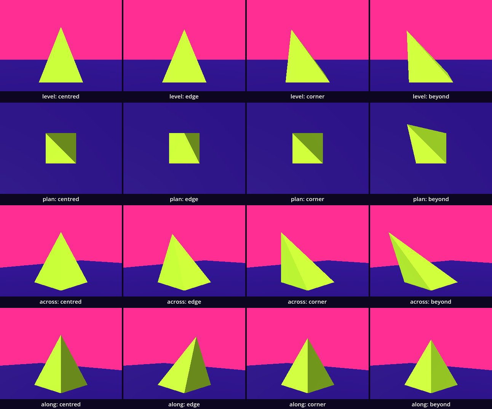
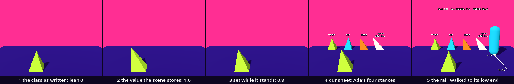

# The family in the editor — a field that rebuilds its body

The family chapter left us with a class: a name, two typed fields, a `build()` that made the mesh, and one rule for every sheet, read back what was built. It also left a gap. A field set after the body stood changed the field and not the body. Here we close that gap. We write a class whose field rebuilds the body the moment it is set, we let that class run inside the editor, and we open the supplied sweep sheet and write one of our own. You know classes, `@export`, types, instancing and loops. Three ideas are new: a setter, a method called from outside, and `@tool`.

This is a new project, like every stop of this course: in the Project Manager choose **Import** and open this folder's `project.godot`.

Every message and number on this page comes from running the study in Godot 4.6. Parts marked *(editor)* describe the editor's own windows and were not watched.

## Find the family in the hall

A lesson starts in its hall, with one question: does the hall show one work at several values of one axis?

[Primitives_Ignorance](../../../../commons/maps/Primitives_Ignorance/final.md) does, twice, and quietly. Its reading ends the third room with one line: "The old studies remain through the side opening: the rock, the star, the choir, the extra cubes." Through that opening the reference cube stands two times: once as it always stood, and once cut into eight, `grain:quartered`. Its axis `grain` has five values: solid, split, quartered, lattice, shell. Beside the cubes a dark sphere stands twice as well, as itself and as a `cairn`, two of the four values of its axis `body`. The cube's script declares its axis in the form we will read below: `@export_enum("solid", "split", "quartered", "lattice", "shell") var grain: String = "solid"`.

A field trip shows a whole family on one floor. In [Color_Context_Placed](../../../../commons/maps/Color_Context_Placed/final.md) one work, a stack of coloured pieces, stands fifteen times: at all five values of its axis `rule`, all seven of `stack` and all four of `pose`. "Here, the choices stand beside one another." The other field trip, Topology_Entropy_Morphogenesis, holds one work with two declared axes, both at their defaults.

And the family this lesson argues about stands nowhere. Ada's pyramid has an axis `apex_stance` with four values. We searched every hall's map for that word and found no placement that sets it: each pyramid in the halls has its apex over the middle. We read all of this from the halls' map files, their scripts and the artifact registry; we did not walk them.

So stand before the two cubes. The cube's own notes say: "The silhouette is constant; the number of pieces is not." Write down which of the three values the hall does not show (split, lattice, shell) you expect to look most like the quartered cube from the doorway. Nobody has rendered that sheet.

## Open the study

Open the [study](README.md), then `family_editor.tscn`. The editor's view shows a white floor under Godot's own preview light: the look is put on by a script, when the scene runs.

The scene has five nodes of its own. `Spire` is the body we make, an instance of `guests/family-editor/family-editor.tscn`; that folder goes to your room at the end. `Wall` is an empty `Node3D` at the back. `Rail` is supplied: a slider on the floor that you work with your body. `Walker` is you. `Readout` is a line of text in the air.

Run it (F5). In front stands a lime pyramid with its apex far out over one corner. At the back stand four more pyramids in four colours, named on plates: centred, edge, corner, and beyond, "off its base". At the right a cyan walker stands on a white line. The Output panel, at the bottom of the editor, reads:

```
centred asked: apex built over (0.0, 0.0)
edge asked: apex built over (0.0, -0.3)
corner asked: apex built over (-0.3, -0.3)
beyond asked: apex built over (-0.48, -0.48)
```

Hold W. The walker walks along the line, away from you, and the pyramid in front straightens up as it goes.

Two scripts are ours: `spire.gd`, in the folder `guests/family-editor/`, and `family_editor.gd`. You find both in the FileSystem dock, at the lower left. The download holds the finished versions. We take them apart and build them again.

## A class with one field

Replace everything in `spire.gd` with this:

```gdscript
extends Node3D
## The spire: a pyramid whose apex can walk off its base. One axis, `lean`:
## at 0 the apex is over the middle, at 1 over a corner, at 1.6 beyond the base.
## This folder goes to your room whole, so the script names nothing outside it
## and writes its colour out.

const BODY := Color("c6ff3d")   # the look's BODY colour, written out
const BASE := 0.6               # metres along one side of the base
const HEIGHT := 0.8             # metres from the ground up to the apex

@export_range(0.0, 1.6, 0.05) var lean: float = 0.0

var rebuilds := 0               # how many times the body has been built
var _skin: MeshInstance3D       # what the eye gets
var _shape: CollisionShape3D    # what a walker and a marble meet

func _ready() -> void:
	_skin = MeshInstance3D.new()
	var paint := StandardMaterial3D.new()
	paint.albedo_color = BODY
	paint.roughness = 0.8
	_skin.material_override = paint
	add_child(_skin)
	var body := StaticBody3D.new()
	_shape = CollisionShape3D.new()
	body.add_child(_shape)
	add_child(body)
	rebuild()

## Where the apex is, in the spire's own frame.
func apex() -> Vector3:
	return Vector3(-BASE / 2 * lean, HEIGHT, -BASE / 2 * lean)

## Whether the apex is still over the base.
func over_base() -> bool:
	return lean <= 1.0

func rebuild() -> void:
	var half := BASE / 2
	var ring := [Vector3(-half, 0, -half), Vector3(half, 0, -half), Vector3(half, 0, half), Vector3(-half, 0, half)]
	var surface := SurfaceTool.new()
	surface.begin(Mesh.PRIMITIVE_TRIANGLES)
	surface.set_smooth_group(-1)    # every face lit flat: a pyramid has edges
	for i in 4:
		for corner: Vector3 in [ring[i], ring[(i + 1) % 4], apex()]:
			surface.add_vertex(corner)
	for corner: Vector3 in [ring[0], ring[2], ring[1], ring[0], ring[3], ring[2]]:
		surface.add_vertex(corner)
	surface.generate_normals()
	_skin.mesh = surface.commit()
	_shape.shape = _skin.mesh.create_convex_shape()
	rebuilds += 1
```

Then replace everything in `family_editor.gd` with this:

```gdscript
extends Node3D

func _ready() -> void:
	print("lean ", $Spire.lean, ", apex at ", $Spire.apex(), ", built ", $Spire.rebuilds, " times")
```

Run it. The lime pyramid leans as before; the four at the back are gone. The output: `lean 1.6, apex at (-0.48, 0.8, -0.48), built 1 times`.

This is the family chapter's class with one field. `_ready()` makes two children, a mesh node for the eye and a collider for a body, and calls `rebuild()`. `rebuild()` is the SurfaceTool you know: four sides up to the apex, two triangles for the base, and a convex collider made from the same mesh. Two things differ from the Globe. The script has no `class_name`: the scene names it by its path, and a body that goes to your room must not claim a name another guest might claim. And three functions are not Godot's: `apex()`, `over_base()` and `rebuild()` are methods of our class, called by us. `$Spire.apex()` is such a call from outside.

The 1.6 is not in the script. The spire's scene file stores one line, `lean = 1.6`, as if someone had typed 1.6 into the Inspector. Godot hands a stored value to the node before the node enters the room, so `_ready()` built the body from 1.6.

## The field and the body disagree

Replace everything in `family_editor.gd` with this:

```gdscript
extends Node3D

func _ready() -> void:
	$Spire.lean = 0.0
	print("lean ", $Spire.lean, ", apex at ", $Spire.apex(), ", built ", $Spire.rebuilds, " times")
```

Run it. The output says `lean 0.0, apex at (0.0, 0.8, 0.0), built 1 times`. The picture says otherwise: the pyramid still leans. The field is 0, the method answers from the field, and the body was built once, when the field was 1.6. Godot printed no warning.

One more line, `$Spire.rebuild()`, would mend it, and we would have to remember that line after every change. Ada's own pyramid is written this way; we meet it under *The sheet, opened*. Here the field itself will call the method.

## A setter

In `spire.gd`, replace the declaration of `lean`, the line that begins with `@export_range`, with this:

```gdscript
@export_range(0.0, 1.6, 0.05) var lean: float = 0.0:
	set(value):
		lean = value
		rebuild()
```

A setter is a function that belongs to one field. The colon at the end of the line opens it. From now on every `lean = ...`, from this script, from another, or from the Inspector, runs these two lines instead of storing the value: we store it ourselves, then rebuild.

Run it. Started from the editor, the run stops at once *(editor)*: the script opens at the line `_skin.mesh = surface.commit()` and the Debugger panel, at the bottom, shows the message in red. We ran it from a terminal, where Godot prints the message and goes on:

```
SCRIPT ERROR: Invalid assignment of property or key 'mesh' with value of type 'ArrayMesh' on a base object of type 'Nil'.
   at: rebuild (res://guests/family-editor/spire.gd:53)
```

Read it from the end. `Nil` is nothing: `_skin` is empty. The line is in `rebuild()`. And `rebuild()` ran because the scene's stored `lean = 1.6` went through our setter, before the node was in the room, before `_ready()` had made `_skin`. Reading a red line like this one is ordinary work; this one names the line and the empty thing.

In the editor, press **Continue** in the Debugger panel *(editor)*. In our run the output went on: `lean 0.0, apex at (0.0, 0.8, 0.0), built 2 times`, and the pyramid stands upright. One red line, and then a picture that looks right. The course's outline expected errors to fill the Output; we got one for each value set too early, and a scene that works after it. That is the kind of fault that gets left in.

## Wait until the node is ready

Replace the declaration of `lean` in `spire.gd` once more, with this:

```gdscript
@export_range(0.0, 1.6, 0.05) var lean: float = 0.0:
	set(value):
		if value == lean:
			return
		lean = value
		if is_node_ready():
			rebuild()
```

Run it: `lean 0.0, apex at (0.0, 0.8, 0.0), built 2 times`, the pyramid upright, and no red line.

`is_node_ready()` is false until `_ready()` has finished. A value that comes earlier is kept, and `_ready()` builds from it. A value that comes later rebuilds at once. The first two lines save work: a value equal to the one we have changes nothing, so nothing is built.

## The class runs in the editor

So far the editor shows nothing where the spire stands: its body is made by a script, and the editor runs no script of ours. Add one line at the very top of `spire.gd`:

```gdscript
@tool
```

and add two lines at the end of `spire.gd`, which is the end of `rebuild()`:

```gdscript
	if Engine.is_editor_hint():
		print("rebuilt in the editor: lean ", lean)
```

Run it. Nothing changed in the running scene. `@tool` says: run this script inside the editor too. Save, close the scene's tab above the viewport and open `family_editor.tscn` again *(editor)*. The spire should now stand in the editor's view. Select `Spire` in the Scene dock, at the upper left, and drag **Lean** in the Inspector, at the right *(editor)*: the apex should follow, and the Output panel should print one line for each value.

We did not watch those windows. We started the editor without a window, with the scene open, and read its log. As the scene opened it printed `rebuilt in the editor: lean 1.6`. A second script then set `lean` to 0.5 on the open scene's spire, as the Inspector does: the editor printed `rebuilt in the editor: lean 0.5` and the body's box went from 0.78 m wide to 0.6 m. The same trial without the first line of `spire.gd`: nothing printed, the spire had no children and no body, and the 0.5 changed a stored number and nothing to see.

`Engine.is_editor_hint()` is true inside the editor and false in the running scene. With `@tool` every function of the script runs in both places, and this is how a line asks where it is. Ours uses it to say what the slider hides: every tick is a whole new body.

## Stop here: what we have

`spire.gd` begins with `@tool`, declares `lean` with the seven-line setter, and ends with the two lines that print in the editor. `family_editor.gd` is the five lines under *The field and the body disagree*. Run and check three things: the pyramid in front stands upright; the output ends in `built 2 times`; no line is red.

## The sheet, opened

The family chapter used a supplied sheet through one call, `hang()`. Open `supplied/sweep_sheet.gd` and read it: `hang()` is 18 lines. It adds the member to the scene, lifts a mesh until it stands on the ground, paints it if it has no paint, and lays a plate at its feet. It does not set the member and does not know which values exist. Both are our job, so we write the sheet ourselves, and we sweep a class we did not write.

Open `borrowed/ada_pyramid.gd`. It is Ada's pyramid, the one in the halls, with its mesh code replaced so that it stands in this project; its fields and four of its functions are Ada's line for line. The axis is declared in `borrowed/ada_pyramid.gd` like this:

```gdscript
@export_enum("centred", "edge", "corner", "beyond") var apex_stance: String = "centred"
```

`@export_enum` is `@export` with a list: the Inspector offers these four words and no others. Further down, `_apex_position()` in `borrowed/ada_pyramid.gd` reads:

```gdscript
	match apex_stance:
		"edge":
			var mid: Vector3 = (ring[0] + ring[1 % ring.size()]) * 0.5
			apex = Vector3(mid.x, pyramid_height, mid.z)
		"corner":
			apex = Vector3(ring[0].x, pyramid_height, ring[0].z)
		"beyond":
			apex = Vector3(ring[0].x * 1.6, pyramid_height, ring[0].z * 1.6)
	return apex
```

`match` is a row of `if`s on one value. There is no branch for `"centred"`: the apex starts over the middle and stays there unless a branch moves it. And the class has no setter. It builds once, in `_ready()`. One function we leave closed: `_base_ring()` lays out a base of three or six sides with `sin` and `cos`, and those two are opened at a later stop, the stair climber.

Replace everything in `family_editor.gd` with this:

```gdscript
extends Node3D

const Look := preload("res://supplied/look.gd")
const AdaPyramid := preload("res://borrowed/ada_pyramid.gd")

func _ready() -> void:
	var values := ["centred", "edge", "corner", "beyond"]
	for i in values.size():
		var member := AdaPyramid.new()
		member.position = Vector3(i * 1.2, 0, 0)
		$Wall.add_child(member)
		member.apex_stance = values[i]
		var plate := Look.label(values[i])
		plate.font_size = 36
		plate.position = member.position + Vector3(0, 1.1, 0)
		$Wall.add_child(plate)
		var apex := built_apex(member)
		print(values[i], " asked: apex built over ", Vector2(apex.x, apex.z))

## Where the apex of a built member is: the highest corner of its mesh.
func built_apex(member: Node3D) -> Vector3:
	var top := Vector3.ZERO
	for corner: Vector3 in member.get_node("Pyramid").mesh.get_faces():
		if corner.y > top.y:
			top = corner
	return top
```

Run it. Four pyramids stand at the back under four names. It looks finished. Now read the output:

```
centred asked: apex built over (0.0, 0.0)
edge asked: apex built over (0.0, 0.0)
corner asked: apex built over (0.0, 0.0)
beyond asked: apex built over (0.0, 0.0)
```

Four names, one body. We set `apex_stance` after `add_child()`, the body was built during `add_child()`, and Ada's class has no setter to notice. Godot printed nothing. `built_apex()` is why we can see it: it does not ask the field, it reads the mesh. `get_faces()` hands over every corner of every triangle, and the highest one is the apex as built. This is the family chapter's rule, kept: read back what was built.

Now the whole sheet. Replace everything in `family_editor.gd` with this:

```gdscript
extends Node3D
## The family in the editor. The spire leans with the rail, and behind it Ada's
## pyramid stands once for each value of its own enum: a sweep sheet of our own.

const Look := preload("res://supplied/look.gd")
const AdaPyramid := preload("res://borrowed/ada_pyramid.gd")

@export var axis := "apex_stance"   # the field of Ada's pyramid that we sweep
@export var spacing := 1.2          # metres from one member's middle to the next

func _ready() -> void:
	$Rail.value = $Spire.lean
	var values := values_of(AdaPyramid, axis)
	for i in values.size():
		var member := AdaPyramid.new()
		member.set(axis, values[i])    # before add_child(): this class builds once, in _ready()
		member.set_base_color(Look.BODIES[i % 4])
		member.position = Vector3(i * spacing, 0, 0)
		$Wall.add_child(member)
		var apex := built_apex(member)
		var title := values[i]
		if maxf(absf(apex.x), absf(apex.z)) > member.base_size / 2 + 0.001:
			title += "\noff its base"
		var plate := Look.label(title)
		plate.font_size = 36
		plate.position = member.position + Vector3(0, 1.1, 0)
		$Wall.add_child(plate)
		print(values[i], " asked: apex built over ", Vector2(apex.x, apex.z))

func _process(_delta: float) -> void:
	if $Rail.held:
		$Spire.lean = $Rail.value
	$Readout.text = "lean %.2f    over its base: %s    built %d times" % [$Spire.lean, $Spire.over_base(), $Spire.rebuilds]

## The values an exported enum offers, read from the class and not typed again.
func values_of(script: Script, field: String) -> PackedStringArray:
	for property: Dictionary in script.get_script_property_list():
		if property["name"] == field:
			return property["hint_string"].split(",")
	return PackedStringArray()

## Where the apex of a built member is: the highest corner of its mesh.
func built_apex(member: Node3D) -> Vector3:
	var top := Vector3.ZERO
	for corner: Vector3 in member.get_node("Pyramid").mesh.get_faces():
		if corner.y > top.y:
			top = corner
	return top
```

Run it. The four lines are right now, the four members stand in four colours, and the fourth plate reads `beyond`, `off its base`.

Three things changed. The value is set before `add_child()`, with `set()`, because the field's name is in a variable. The four words are gone from our script: `values_of()` asks the class. Every script can list its exported fields, and for an enum the list carries the words as one text, `centred,edge,corner,beyond`, which `split(",")` cuts up. A word that is read cannot be misspelt. And each plate says one thing about the body as built: whether its apex has left its own base. The `+ 0.001` is a millimetre of slack. The apex of `edge` is written as 0.3, half the base; the mesh gave it back as 0.299999982119 and Ada's own function as 0.300000011921. Exactly on the edge is no place for a comparison to stand.

## The argument: which two look alike?

The axis is `apex_stance`, read from Ada's class: centred, edge, corner, beyond. The base is 0.6 m, the height 0.8 m.

**Write your prediction before you render.** Four members, each seen alone from 2 m. Which two look most alike? From where would you look? And which of the three steps along the axis changes the body most?

The course's outline made its own: corner and beyond will look most alike. Its reason is in plan, where the four apexes stand over (0, 0), (0, −0.3), (−0.3, −0.3) and (−0.48, −0.48): corner and beyond are 0.255 m apart, the closest pair, while centred to edge and edge to corner are 0.3 m. The outline added what the distances cannot rank: beyond is the only member whose apex has left its base.

Then look. The row at the back of the running study is the sheet. For stills of each member alone, run `sheet.gd` as the [README](README.md) says; it needs a terminal. You can go on without it: the table is what our run measured.



Each member was photographed alone, in one colour, from 2 m, four ways: level, from the front; in plan, straight down with no perspective, as a map is drawn; across, square to the diagonal the apex walks along; and along that diagonal, so that the apex walks away from the eye. The numbers are the share of the still on which two members differ.

| pair | level | plan | across | along |
| --- | --- | --- | --- | --- |
| centred and edge | 0.49% | 2.07% | 4.42% | 6.35% |
| centred and corner | 5.98% | 3.98% | 11.25% | 0.79% |
| centred and beyond | 7.87% | 6.54% | 12.95% | 7.59% |
| edge and corner | 5.75% | 4.10% | 8.85% | 6.00% |
| edge and beyond | 7.58% | 6.54% | 11.04% | 10.27% |
| corner and beyond | 3.64% | 6.54% | 11.14% | 6.80% |

The outline's prediction did not hold from any of the four. From three standpoints the closest pair is centred and edge; along the diagonal it is centred and corner. The pair that is closest in metres is closest in no picture.

The reason is the standpoint. From the front, the apex of `edge` has moved straight away from the eye, and the two outlines differ by a band of 3.44 pixels. Along the diagonal the same happens to `corner`. In plan, the outline is the square of the base for three of the four, and only `beyond` breaks it: there the three pairs with `beyond` in them measure the same 6.54%, of which 2.42% is outline.

Our own spire lets us take the diagonal in small steps, since it is Ada's pyramid at lean 0, 1 and 1.6. In plan, the stills from lean 0 to 0.8 are the same picture: together they differ on 0.02% of the still. The apex walks along the line between the two lit faces and the two dark ones, and from above nothing shows. Then the step that reaches 1.0 changes 4.01%, with the outline still the square of the base, and the step from 1.0 to 1.2, which takes the apex off the base, 4.91%.

The claim, as measured: one exported word carries this pyramid from a monument to a lean-to. The step that takes the apex off its base is the shortest of the three in metres, 0.255 against 0.3 and 0.3, and the largest in pixels from three of the four standpoints (plan 6.54%, across 11.14%, along 6.80%). Only from the front is another step larger, edge to corner at 5.75% against 3.64%. No eye was asked: every "alike" here is a count of pixels.

**Decide.** One difference here could be followed. Which pair is closest turned on where the eye stood, and something else stood still in all four: the light. The look's sun shines across the diagonal the apex walks, 88° from it, so the line between lit and dark lies along that diagonal; and by the sun's direction one dark face first turns to it at lean 0.96, just where the apex reaches the corner. Some of what the table counts is that face. The next intervention would be to turn each member a quarter turn under the same sun and photograph the four again. Or settle: the table already says that the plates need the words `off its base`, because from the front nothing else tells `beyond` from a pyramid that merely leans. Either is right. Write your decision and your reason in your [field note](FIELD_NOTE.md); ours is there as an example of the form, not of the answer.

## What the slider hides

A slider makes a value look free. Each one is a whole new mesh and a new collider. For our six triangles that took about 0.04 ms in our run; we did not measure a larger body. The setter's first two lines are what keeps it cheap: handed the same value 180 times, the setter without them built 180 times, ours once.

A `@tool` script runs its bugs where you work. With the planted bug put back, the red line was logged inside the editor as the scene opened. We did not try a tool script that loops for ever or deletes a node; it would do so in the editor. And what a tool script builds can end up in your files. Our spire hangs its mesh on a child that the scene does not own, and the scene saved from the editor held `lean = 0.5` and no mesh. An earlier version of the spire was itself the mesh node, and its triangles were written into `family_editor.tscn` on save.

Defaults are not free to change. A scene stores a value only where it differs from the default; change the default in the script and every placement that stored nothing changes with it. The header of Ada's pyramid says how its axes were added: 4 sides and `centred` rebuild the old body exactly, "so all 8 existing placements are untouched".

And the words on a sheet must come from the code. We handed Ada's pyramid five words its `match` does not know, among them `centre`, `past` and `Beyond` with a capital. Each built the centred body, the field kept the word, and Godot said nothing. A plate that read the field back would have said `past` over a pyramid that stands straight. This project has published such a sheet: sixteen identical frames, because the values it named were typed from memory and were not the code's.

## Walk the rail, walk at the spire

The place this chapter asks for is to change the family while you hold the body. At a desk there is no hand, so the slider is a place to stand. No headset was used.

Run the study. You stand on the rail's high end. Hold W: the walker walks along the rail and the spire straightens; S brings it back. `$Rail.held` is true while you stand on the rail, `$Rail.value` is where, and the one line in `_process()` hands it to `lean`. Our check script pressed the keys for half a second each: W took the walker 0.97 m along the rail and lean from 1.6 to 0.77, S brought it back to 1.6, and D stepped it off the rail, where lean stayed 1.6. Then our walker, on its autopilot, walked from the high end to the low end: lean went from 1.6 to 0 and the spire was built 49 times on the way. Stepped off, the spire kept its value. Stepped on again 0.73 m along, it read lean 0.72: the range's step of 0.05 belongs to the Inspector, and the rail does not ask it.

Then walk at the spire itself. With the autopilot, along the diagonal:

| lean | from the side it leans to | from the far side |
| --- | --- | --- |
| 0 | stopped, 0.60 m from the middle | stopped, 0.60 m from the middle |
| 1.0 | stopped, 0.73 m out | walked up it: arrived, feet at 0.42 m |
| 1.6 | stopped, 0.92 m out | walked up it: arrived, feet at 0.31 m |

At 1.6 the walker is stopped over bare floor: the base's corner is 0.42 m from the middle, and the apex hangs out beyond it, 0.8 m up. And from the far side the spire is no longer a wall. Trying lean by lean in steps of 0.1, the walker was stopped up to 0.8 and walked up from 0.9. For a body the category changed there, before the apex left the base, at a value that no picture in the table marks. The four on the wall were not walked at for this: they have no collider, and the walker goes through them.

Not checked: nobody walked with their hands on the keys. The keys were pressed by a script.

## The process

the class as written → the value the scene stores → set while it stands → our sheet → the rail walked



The steps changed 2.48%, 1.77%, 3.79% and 7.19% of the tile; the last changed it most, because a walker entered the picture.

## In your room

Copy the folder `guests/family-editor/` from this project into the `guests/` folder of your room, add the line `"res://guests/family-editor/family-editor.tscn",` to `GUESTS` in `room.gd`, and run the room. In ours the Output read `My room: place 2 is res://guests/family-editor/family-editor.tscn`, and the walker, sent at it from the aisle, was stopped 0.44 m from the middle of the place.

Now your own body. Turn your room's main body into a family: give its script one exported axis with a setter that rebuilds, as `lean` has, and `@tool` at the top. Then hang its sheet at the entrance, as a guest of its own. Make a folder `guests/my-sheet/` in the room and copy your body's script into it; ours is a copy of `spire.gd`. Make a new scene with a `Node3D` as its root, save it as `guests/my-sheet/my-sheet.tscn` *(editor: **Scene > New Scene**, **3D Scene**, then Ctrl+S)*, and attach a new script `guests/my-sheet/sheet.gd` with this in it:

```gdscript
extends Node3D
## My sheet: my body once for each value of its axis, small, in a row of 1.6 m.

const Member := preload("res://guests/my-sheet/spire.gd")
const VALUES := [0.0, 0.5, 1.0, 1.6]
const INK := Color("ffffff")      # the look's INK and SHADE, written out
const SHADE := Color("0d0620")

func _ready() -> void:
	for i in VALUES.size():
		var member := Member.new()
		member.lean = VALUES[i]
		member.scale = Vector3(0.5, 0.5, 0.5)
		member.position = Vector3(-0.6 + i * 0.4, 0, 0)
		add_child(member)
		var plate := Label3D.new()
		plate.text = str(member.lean)
		plate.pixel_size = 0.002
		plate.modulate = INK
		plate.outline_modulate = SHADE
		plate.position = member.position + Vector3(0, 0.55, 0)
		add_child(plate)
```

Put its line first in `GUESTS`, so that the sheet stands at place 1, straight ahead of where you start. **Write your prediction first**: which two of your members will look most alike, and from where. Then run. We did this with the spire standing in for your body: four spires at half size on place 1, named 0.0, 0.5, 1.0 and 1.6, and no error in 180 frames. Hand in your room with your sheet, your field note and one line in its README: your axis, and the value at which your body becomes something else for a walker.

## What we borrowed

| Part | From | How far we go |
| --- | --- | --- |
| `supplied/base.tscn`, `look.gd` | The base | Use: the floor, the fixed camera, the look; `Look.label()`, `Look.BODIES`. |
| `supplied/sweep_sheet.gd` | The base | Understand: we read its `hang()` and wrote our own sheet. |
| `supplied/walker.tscn` | The base | Use: the keys; `walk_to()` for the checks. |
| `borrowed/ada_pyramid.gd` | Ada, `commons/primitives/pyramid/pyramid.gd` | Understand: set `apex_stance` before `add_child()`; it builds once. We read its enum and its `match`. |
| `borrowed/slider_rail.gd` | Supplied here | Use: `held` is true while the walker stands on the rail, `value` is where. |
| `set(value):`, `is_node_ready()` | Godot | Use: a function that runs when a field is set; false until `_ready()` has finished. |
| `@tool`, `Engine.is_editor_hint()` | Godot | Use: the script runs in the editor too; true there. |
| `@export_enum`, `match` | Godot | Understand: a field with a list of words; a row of `if`s on one value. |
| `get_script_property_list()`, `get_faces()` | Godot | Use: a script's exported fields with their lists; every corner of a mesh. |
| `sheet.gd` | Supplied here | Use: it photographs each member alone and measures the pairs. |

What we made is `spire.gd`, a class whose one field rebuilds its body, in the running scene and in the editor, and `family_editor.gd`, a sheet that reads its values from the class it sweeps and says what was built.

## What we carry forward

A setter and its two guards; methods of our own; `@tool` and the question a script can ask about where it runs; values read from the code; and a readback that reads the body and not the field.

The next stop, *The budget*, counts what a body costs: triangles measured, and a claim about them tested.
