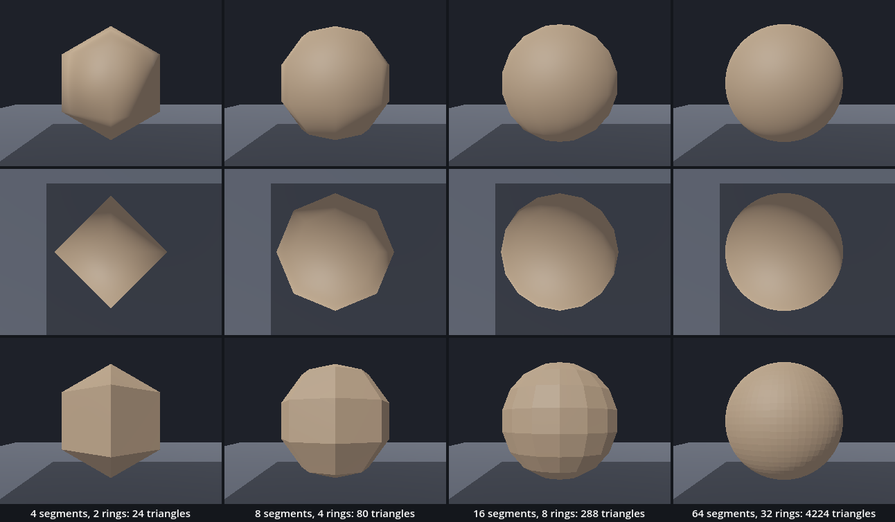
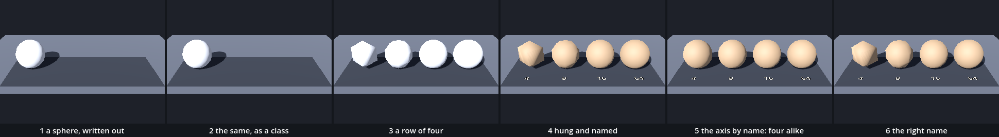

# Families — one body in a single class

The chessboard left us with `colour_of()`, a function that held four floors in four `if rhythm ==` branches, and with a warning about whole numbers that we repaired without naming it. A fifth floor would have needed a fifth branch. Here a body is described once, as a class: a name, two fields with their types, and a function that builds the mesh. Every pair of numbers is then a member, with no new code. A loop makes four members and stands them side by side on a sheet. Three ideas are new: a class, a type, and a field that can be set from outside.

This is a new project, like every stop of this course. It has its own folder: in the Project Manager choose **Import** and open this folder's `project.godot`. Leave your Chessboard folder as it is.

In the hall, [Primitives_Ignorance](../../../../commons/maps/Primitives_Ignorance/final.md) asks what we accept when we call something round: "The formula specifies a sphere. The mesh gives us one finite construction through which to encounter it." Its [making passage](../../../../commons/maps/Primitives_Ignorance/tutorial.md) shows the two lines this lesson is built on: `sphere_mesh.radial_segments = segment_count` and `sphere_mesh.rings = ring_count`. And it says what two numbers mean for one body: "Resolution has a distribution. It does not arrive as a single quantity called detail."

This study takes two sessions. The first builds the class and the row of four. It ends at **Stop here**. The second compares the four on a sheet, asks what a class owes, and walks the row.

Every message and number on this page comes from running the study in Godot 4.6. Parts marked *(editor)* describe the editor's own windows and were not watched.

## Find the family in the hall

A lesson starts in its hall, with one question: does the hall show one work at several values of one axis? If it does, predict which two look most alike before you read anything beside them.

This time it does. At the far end of the second room of Primitives_Ignorance stands a counter: four numbered spheres on stands, turning. One line of its script reads `const STEPS := [4, 8, 16, 64]`, and further down it gives each sphere that many segments and half as many rings. That is this lesson's axis at this lesson's four values, built into one work. The hall asks for a guess before the numbers: "Keep the counts hidden at first." So stand in front of the counter and write down which two of the four you expect to look most alike. This study measures that guess.

The halls show the idea three more times. In the same room three pairs of spheres stand under three names: `sphere_high` with 16 rings and 16 segments, `sphere_mid` with 7 and 7, `sphere_low` with 1 and 10. That is one body at three settings, named as three works. In the encounter hall, Primitives_Polythedra, one prism stands three times, at three of the five values of its axis `grain`: solid, quartered and shell. And in Point_Animatedcube, the hall of the cube lesson, five pyramids stand at `base_sides` 3, 4, 5, 6 and 8: four in a line against the back wall, and the eight-sided one a row forward, at the end of the line. It is the plainest family in the sequence: one body, one whole number, five values. We read all of this from the halls' map files, their scripts and the artifact registry; we did not walk them.

## Open the study

Open the [Families study](README.md), then `family.tscn`. Like the chessboard, it inherits `plane.tscn`: the ground, the camera, A and B, the walk, the marble on M and the view from below on V. `chessboard.tscn` and the scenes before it are still in the folder and still run on their own. There are no new keys.

`family.tscn` adds two nodes, both on the ground at (−1.8, 0, 0.9). `Sheet` is supplied: a dark sheet of paper on the floor, and one function, `hang()`. `Family` is an empty `Node3D` which runs `family.gd`. The marble waits further to the right, at (3.2, 0.1, 1.2), clear of the sheet.

Run it. Four bodies stand in a row on the sheet, 1.2 m apart. On the ground in front of each lies a number: 4, 8, 16, 64. The first is a block with a point on top, the second has corners, the last two look round. The Output panel, at the bottom of the editor, reads:

```
4 asked, 4 built: 24 triangles
8 asked, 8 built: 80 triangles
16 asked, 16 built: 288 triangles
64 asked, 64 built: 4224 triangles
```

Two scripts are ours: `family.gd` and `globe.gd`. You find both in the FileSystem dock, at the lower left of the editor. The download holds the finished versions. We will take them apart and build them again.

## A sphere, written out

Replace everything in `family.gd` with this:

```gdscript
extends Node3D

func _ready() -> void:
	var sphere := SphereMesh.new()
	sphere.radial_segments = 16
	sphere.rings = 8
	var body := MeshInstance3D.new()
	body.mesh = sphere
	add_child(body)
	body.position = Vector3(0, 0.5, 0)
	print(sphere.radial_segments, " segments, ", sphere.rings, " rings")
```

Run it. One white sphere stands at the left end of the sheet. The output: `16 segments, 8 rings`.

Nothing here is new. Point One had a `SphereMesh`; `new()` made a material in the chessboard and makes a mesh and a node here. `radial_segments` is how many times the sphere is cut around, like the slices of an orange. `rings` is how many circles lie between the two poles. A `SphereMesh` is 1 m across unless we say otherwise, so a height of 0.5 stands it on the ground.

For a second sphere with other numbers we would write these lines again. The chessboard did that with its four branches.

## The body moves into a class

Open `globe.gd` and replace everything in it with this:

```gdscript
class_name Globe
extends MeshInstance3D

var segments := 16
var rings := 8

func _ready() -> void:
	build()

func build() -> void:
	var sphere := SphereMesh.new()
	sphere.radial_segments = segments
	sphere.rings = rings
	mesh = sphere
```

Then replace everything in `family.gd` with this:

```gdscript
extends Node3D

func _ready() -> void:
	var member := Globe.new()
	add_child(member)
	member.position = Vector3(0, 0.5, 0)
	print(member.segments, " segments, ", member.rings, " rings")
```

Run it. The same sphere in the same place: `16 segments, 8 rings`. The picture cannot tell that anything happened.

A class is a description of a kind of thing. `MeshInstance3D` is one, and `SphereMesh`, and `Node3D`. Every script we have written began with `extends`: it says which class our script adds to. `globe.gd` says: a Globe is a `MeshInstance3D` with two more variables and one more function. `class_name Globe` gives that description a name which every script in the project can use. So `Globe.new()` works as `MeshInstance3D.new()` did, with no path and no `load()`.

The variables of a class are its fields. `build()` reads them and makes the mesh. `_ready()` calls `build()` when the node enters the room, as it has run for every node since Point Zero. `mesh = sphere` has no `$` and no name in front: a Globe is the mesh node, so `mesh` is its own.

## A second member

Replace everything in `family.gd` with this:

```gdscript
extends Node3D

func _ready() -> void:
	var first := Globe.new()
	add_child(first)
	first.position = Vector3(0, 0.5, 0)
	var second := Globe.new()
	second.segments = 4
	second.rings = 2
	add_child(second)
	second.position = Vector3(1.2, 0.5, 0)
	print(first.segments, " and ", second.segments, " segments")
```

Run it. The sphere, and 1.2 m to its right another body: a block with a pyramid on top and one below, standing on its point. The output: `16 and 4 segments`. One description, two members. We changed two fields and wrote no new body.

The order matters. Move the two lines `second.segments = 4` and `second.rings = 2` below `add_child(second)` and run: two spheres, alike. The output still reads `16 and 4 segments`. The field says 4. The body was built when the node entered the room, and then the field said 16. A field and a body can disagree, and the picture is the body. Add `second.build()` under the two lines and the block is back. Then put the lines above `add_child(second)` again and take `second.build()` out.

## The kinds of number have names

In `globe.gd`, replace the two lines that begin with `var` with these:

```gdscript
@export_range(4, 64) var segments: int = 16   # cuts around, like the slices of an orange
@export_range(1, 32) var rings: int = 8       # circles between the two poles
```

Run it. Nothing changed: `16 and 4 segments`.

`: int` is a type. It says what kind of value the variable holds. There are four kinds we have used all along:

- `int`, a whole number: 16, −3, 0.
- `float`, a number with a decimal part: 0.5, 1.2, 16.0.
- `String`, a text, in quotes: `"16"`, `"segments"`.
- `bool`, `true` or `false`.

`Vector3` and `Color` are types too, and since the last section so is `Globe`. Until now we wrote `:=` and Godot filled in the type from the value: `var n := 8` in the chessboard was an `int` all along. Writing `: int` changes nothing for Godot. It changes what we can read.

To see the kinds at work, add one line at the top of `_ready()` in `family.gd`:

```gdscript
	print(7 / 2, " ", 7 / 2.0, " ", int("16") + 1, " ", str(16) + "1")
```

Run it: `3 3.5 17 161`. An `int` divided by an `int` is an `int`: 7 / 2 is 3, and the half is gone. With one `float` in it the division keeps its decimals. `int()` makes a whole number of a text, so `int("16") + 1` is 17. `str()` makes a text of a number, and `+` joins two texts: 161.

This is the chessboard's red floor. There `(x + z) / (2 * n)` divided an `int` by an `int`, and 14 / 16 was 0. Godot warned us then and warns us now. Run with the debugger attached, the output begins:

```
WARNING: Integer division. Decimal part will be discarded.
```

In the editor the warning is listed in the Debugger panel at the bottom, under **Errors**, and a mark stands beside the line in the script *(editor)*; we read it from a run started with `-d`. Take the `print` line out.

A typed variable refuses another kind of value. Change `second.segments = 4` to `second.segments = "4"`, a text. Godot refuses before the study starts:

```
Parse Error: Cannot assign a value of type "String" as "int".
```

Change it back. This refusal is the loud kind: it names the line, and nothing runs until it is repaired.

`@export` is the third idea. A line that starts with `@` is a note to Godot about the line it stands on. `@export` says: show this field in the Inspector, the panel at the right of the editor, where it can be set without opening the script. `@export_range(4, 64)` adds the smallest and the largest value the Inspector will offer *(editor)*. Our members are made in code, so there is nothing to select while we edit; we will set the fields from the script, and you can go on without the Inspector.

Now the rule of the hall's counter: half as many rings as segments. In `family.gd`, replace `second.rings = 2` with:

```gdscript
	second.rings = second.segments / 2
```

Run it. The same two bodies, and the warning again, for this line. Here the discarded part is what we want: 4 / 2 is 2, and 5 / 2 would be 2, because a sphere has no half ring. We say so with a second note, on a line of its own above:

```gdscript
	@warning_ignore("integer_division")
	second.rings = second.segments / 2
```

Run it: the warning is gone.

## Count the triangles

Add a function at the end of `globe.gd`:

```gdscript
func triangles() -> int:
	var arrays := mesh.surface_get_arrays(0)
	return arrays[Mesh.ARRAY_INDEX].size() / 3
```

and in `family.gd` replace the `print` line with:

```gdscript
	print(first.triangles(), " and ", second.triangles(), " triangles")
```

Run it: `288 and 24 triangles`.

A mesh is lists. `surface_get_arrays(0)` hands them over: one list of corners, and under `Mesh.ARRAY_INDEX` a list of corner numbers, three for every triangle, as the cube's `triangles` held three corner numbers in each row. The size of that list divided by 3 is the number of triangles the mesh lists. A function of a class is called on a member: `first.triangles()`.

That division is an `int` by an `int` too, and Godot does not warn. It warns only where it knows the types before the study runs, and it cannot know what `arrays[...]` holds until then.

288 is 2 × 16 × 9: two triangles for every segment in every band, and 8 rings make 9 bands. Not all of them can be seen. At each pole the triangles of a band have two corners in the same place, so 16 at the top and 16 at the bottom are slivers with no area: 256 of the 288 cover anything. The hall's counter shows both numbers on each tag, and the reading says why: "Even counting depends on what the instrument agrees to include." Our function counts what the mesh lists.

## A row

Two members by hand are the start of four branches again. Replace everything in `family.gd` with this:

```gdscript
extends Node3D

var numbers: Array[int] = [4, 8, 16, 64]

func _ready() -> void:
	var place := 0
	for n in numbers:
		var member := Globe.new()
		member.segments = n
		@warning_ignore("integer_division")
		member.rings = n / 2
		add_child(member)
		member.position = Vector3(place * 1.2, 0.5, 0)
		place += 1
		print(n, ": ", member.triangles(), " triangles")
```

Run it. Four white bodies in a row. The output:

```
4: 24 triangles
8: 80 triangles
16: 288 triangles
64: 4224 triangles
```

This is Trace's loop and the chessboard's `x * spacing`. `Array[int]` is a list that holds whole numbers and nothing else, as `Array[MeshInstance3D]` held the cubes. The loop takes one number at a time, makes a member, sets its two fields, and only then adds it. From 4 to 64 the triangles go from 24 to 4224: sixteen times the segments, 176 times the triangles.

## The sheet

The row should say which member is which. That is the supplied part. Take out the line `var place := 0`, and replace the last four lines of the loop with these three:

```gdscript
		add_child(member)
		$"../Sheet".hang(member, str(n))
		print(n, ": ", member.triangles(), " triangles")
```

Run it. The four stand where they stood, now in one clay colour, and on the ground in front of each lies its number. The output is the same.

`hang()` is the sheet's whole contract. It stands a member next in the row, 1.2 m from the one before, writes the text we give it on a plate at the member's feet, and paints a member that has no material of its own. It does not build a member, set it or count it. What stands on the sheet is what the sheet was handed, under the name it was told.

## The axis by name

A sheet that can show one field should be able to show any. So the field becomes a text too: its name. And the values move into one text, as they would be typed into a box. Replace everything in `family.gd` with this:

```gdscript
extends Node3D

@export var axis := "radial_segments"    # the field we sweep, by its name
@export var values := "4, 8, 16, 64"     # its values, as typed into one text field

func _ready() -> void:
	for word in values.split(","):
		var title := word.strip_edges()
		var member := Globe.new()
		member.set(axis, title)
		@warning_ignore("integer_division")
		member.rings = member.segments / 2
		add_child(member)
		$"../Sheet".hang(member, title)
		print(title, ": ", member.triangles(), " triangles")
```

Three calls are new. `split(",")` cuts a text at every comma and returns the pieces as a list. `strip_edges()` takes the spaces off both ends of a piece. And `member.set(axis, title)` does what `member.segments = 4` did, with the name of the field as a text. That lets the name come from a variable. Select `Family` in the Scene dock, at the upper left, and the Inspector shows **Axis** and **Values** as two text boxes *(editor)*.

Run it. Four bodies on the sheet, and under them 4, 8, 16, 64. It looks finished. Now read the Output panel:

```
4: 288 triangles
8: 288 triangles
16: 288 triangles
64: 288 triangles
```

Four members, one body. Look again at the picture: four spheres, alike, over four different numbers. Godot printed nothing else: no error, no warning, with the debugger attached or without.

The name is wrong. `radial_segments` is what `SphereMesh` calls it; we wrote that word in `build()`. Our class calls its field `segments`. `set()` with a name the class does not have does nothing, and it says nothing. Each member kept its 16, the sheet stood four of them in a row, and the plates said what we had asked for.

Change the first line to

```gdscript
@export var axis := "segments"           # the field we sweep, by its name
```

and run. The block, the cornered one and the two round ones are back: 24, 80, 288 and 4224 triangles.

Look at what `set()` was handed. `title` is a text, `"4"`, and `segments` is an `int`. Under *The kinds of number have names*, `second.segments = "4"` was refused before the study started. The outline of this course expected `set()` to refuse it too, in silence, and planned this lesson around that. We ran it, and Godot 4.6 does not refuse: it turns the text `"4"` into the number 4 and says nothing. Here is what `set()` did with other values, each tried on a field typed `int`:

| handed to `set()` | the field afterwards |
| --- | --- |
| the text `"16"` | 16 |
| the text `"sixteen"`, or an empty text | 0 |
| the text `"4 8 16 64"` | 481664 |
| 3.5 | 3 |
| `true` | 1 |
| a `Vector3`, a list, `null` | unchanged |
| any value, under a name the class does not have | unchanged |

And the other way round: a field typed `String` handed the number 16 was left unchanged. So was a `bool` handed the text `"false"`. In every row Godot printed nothing. `set()` converts what it can, refuses what it cannot, and reports neither. The `=` we wrote before is the loud way; `set()` is the quiet one, and a sheet built on it needs a check of its own.

The check is to ask the member what it has. Replace the last two lines of the loop with:

```gdscript
		$"../Sheet".hang(member, str(member.get(axis)))
		print(title, " asked, ", member.get(axis), " built: ", member.triangles(), " triangles")
```

`get()` is the other half of `set()`: it reads a field by its name. Now the plate says what the member holds, and the output says what we asked beside what was built. Run it:

```
4 asked, 4 built: 24 triangles
8 asked, 8 built: 80 triangles
16 asked, 16 built: 288 triangles
64 asked, 64 built: 4224 triangles
```

Put the wrong name back once, to see the check work. The plates read `<null>` four times, and the first line of the output is `4 asked, <null> built: 288 triangles`. The sheet can no longer look finished when it is not. Set the name right again.

## The class decides

One more thing can be asked of a field: a value no body should have. Change `values` to `"2, 8, 16, 640"` and run:

```
2 asked, 2 built: 16 triangles
8 asked, 8 built: 80 triangles
16 asked, 16 built: 288 triangles
640 asked, 640 built: 410880 triangles
```

`@export_range(4, 64)` did not stop either number. The range belongs to the Inspector; code walks past it. The last member has 410,880 triangles. The first says 2 and is not what it says: `SphereMesh` has a floor of its own, 4 segments, and raised the number without a word. We are back to a field and a body that disagree.

The place to decide is `build()`. Add two lines at its top, in `globe.gd`:

```gdscript
	segments = clampi(segments, 4, 64)
	rings = clampi(rings, 1, 32)
```

`clampi()` keeps a whole number between two others. Run it: `2 asked, 4 built: 16 triangles`, and `640 asked, 64 built: 4224 triangles`. The field now says what the body is. Set `values` back to `"4, 8, 16, 64"`.

This matters more than it seems. A text with no commas, `"4 8 16 64"`, is one piece, and `set()` makes 481664 of it. Without the two lines Godot would be asked to build that sphere. We did not run that.

## Stop here: what we have

This is the end of the first session. `globe.gd` should be the class under *The body moves into a class*, with the two typed lines, `triangles()` at its end and the two `clampi` lines at the top of `build()`. `family.gd` should be the script under *The axis by name*, with `"segments"` in its first line and the two lines that read back. Run the study and check three things: four different bodies in a row on the sheet; the plates read 4, 8, 16, 64; the output is the four lines that begin `4 asked, 4 built: 24 triangles`.

## The argument: which members look alike?

The axis is `segments`, with the rings at half of it. The values are 4, 8, 16 and 64.

**Write your prediction before you render.** Four members, each seen alone from 2 m. Which two will look most alike? Which one stands apart? And how wide, in pixels of a still 720 high, do you expect the difference between 16 and 64 to be? Write it down, with a reason for each.

The course's outline made its own: 16 and 64 will look most alike, because the outline of 16 segments misses the circle by very little, and 4 is "another body, close to an octahedron". The arithmetic is given to you here: a circle cut into 16 equal sides falls short of the round one by 1 − cos(11.25°) of the radius at the middle of each side, which is 1.9%. You will work that out yourself in the chapter that brings `cos()`.

Then look. The row in the running study is the sheet. For stills of each member alone, run `sheet.gd` as the [README](README.md) says; it needs a terminal. You can go on without it: the table below is what our run measured.



Each member was photographed alone, from 2 m, three ways: from the side, at the height of its middle; from straight above; and from the side again with every triangle lit flat. The body covers 29.6% of the still. The light's shadow is off, so that only the body is compared.

| pair | differ on, from the side | from above | lit flat |
| --- | --- | --- | --- |
| 4 and 8 | 10.54% of the still | 11.84% | 17.97% |
| 4 and 16 | 14.08% | 14.60% | 22.04% |
| 4 and 64 | 15.27% | 15.87% | 21.77% |
| 8 and 16 | 3.73% | 2.86% | 13.10% |
| 8 and 64 | 5.17% | 4.12% | 13.97% |
| 16 and 64 | 0.85% | 0.99% | 4.65% |

The closest pair is 16 and 64, in every column. The outline's prediction held. It held a fourth way too: with each member turned half a segment, so that an edge faced the camera where a corner had, 16 and 64 differed on 0.76%.

The member of 4 stands apart. Its nearest sibling, 8, is farther from it than 8 is from 64. But it is not close to an octahedron by its numbers. An octahedron is 4 segments and one ring: eight triangles with area. With the rings at half the segments our member has two rings: a square block with a pyramid on top and one below, twelve faces, sixteen triangles with area. We stood the octahedron on the sheet as well. From the side it differs from our member on 9.06% of the still, where 4 and 8 differ on 10.54%; from above on 4.83%, against 11.84%. Our member is nearer to the octahedron than to its own sibling, and it is not the octahedron.

Now the 0.85%. Of it, 0.73% is rim: pixels where one body is and the other is not. Around the outline that is a band 3.2 pixels wide on average, in a still where the body is 511 pixels across. Inside the outline the two differ on 0.11% of the still. Seen from above, the outline of 16 fell short of its own widest point by 2.06% of the radius; the arithmetic said 1.9%. The same measure read 0.49% for the member of 64, which is about one pixel, and as fine as it goes.

The third column is why. Lit flat, the rim is the same 0.73% and the two differ on 4.65%: the rest is inside. A `SphereMesh` hands the light a smooth direction at every corner, so a flat triangle is shaded as if it were curved. Most of what makes 16 look like 64 is that shading. The hall says it from the other side: "Shading can soften their appearance while the polygonal outline remains."

We also rendered a longer series, each member against 64, from the side:

| segments | 4 | 6 | 8 | 12 | 16 | 24 | 32 | 48 |
| --- | --- | --- | --- | --- | --- | --- | --- | --- |
| differs from 64 on | 15.27% | 7.70% | 5.17% | 2.21% | 0.85% | 0.29% | 0.19% | 0.04% |
| triangles | 24 | 48 | 80 | 168 | 288 | 624 | 1088 | 2400 |

The outline's claim was that above about 16 segments a sphere stops paying visibly. The difference falls at every step, and there is no step at 16. What 16 marks is where the rim got thin at 2 m. Moving the camera moves it: between 16 and 64 the band is 3.4 pixels wide from 1.5 m, 3.2 from 2 m, 1.7 from 4 m and 0.65 from 8 m. Only at 8 m is it under one pixel of our still. Whether a person sees a band of three pixels, we did not test: no eye was asked.

The claim, as measured: the class's whole number decides which body you have. Between 4 and 8 the body changes more than between 8 and 64. From 16 to 64 the triangles are multiplied by 14.7 and buy a rim three pixels wide. How much that is worth depends on the distance and on the shading, and the sheet can show both.

**Decide.** One difference here could be followed. The four members change two things at once, the cuts around and the circles between the poles, and the hall says the two are not one quantity. The next intervention would be to sweep `rings` alone, with the segments left at 16: `axis` set to `"rings"`, `values` to `"1, 2, 8, 32"`, and the two lines of the half rule taken out. Or settle: one of these four is the member your room needs, and the table is enough to choose it. Either is right. Write your decision and the reason in your [field note](FIELD_NOTE.md); ours is there as an example of the form, not of the answer.

## What the family owes

A class's fields decide which bodies are possible. `segments` is an `int`, so there is no member with 3.5 segments: handed 3.5, the field became 3, and nothing was said. No value of `rings` makes a ring: a torus is not in this family, however we set its two numbers. And two lines in `build()` now say that there is no member below 4 or above 64. We wrote those limits in a minute, for a good reason, and from now on they are what a Globe can be. To describe a body in a single class is to draw a border around the bodies that will be asked for, and the border is easy to forget because the sheet only ever shows what is inside it.

The count has a cost too, and it is not paid where it shows. The member of 64 lists 176 times the triangles of the member of 4, and 128 of its triangles are slivers that cover nothing. With a window, the renderer reported 4,224 more primitives in the frame for it. We did not measure the time of a frame, and the hall is exact about that: a triangle count is not a frame time. What the count does fix is where a body can bend. A member of 4 has ten corners. If this body is ever to be pressed or stretched, those are the only places where it can give. We did not deform anything here; the question enters with this chapter and stays open.

And the sheet can lie. `set()` took a name the class did not have, did nothing, and four identical members stood under four different numbers. It has happened in this project. Its notes record a sweep that published sixteen identical frames because the values it named were not the code's, and another where a number was handed to a field typed as text, was refused in silence, and came back as identical pictures in pairs. In both, every stage reported success. The repair is not to trust the plates: read the counts, and make the sheet say what was built.

## Walk the sheet, carry one member

The place this chapter asks for is to walk the sheet as a gallery wall and carry one member into your room.

On the desktop the walker is B. Hold S until B stands over the row, then walk along it with A and D. B hangs at 1.12 m, just above the tops of the members. Press M with B over the member of 16: the marble falls from one metre above B, through the member, and the Record reads `marble at 0.10 m`. It lies on the ground inside the body. A member is a mesh and nothing else: there for the eye, like Point One's ghost. *Try* gives it a body.

To carry a member, write it down. A member of this family is the name of its class and two numbers: Globe, 8, 4. Any script in the project can make it again with those. We checked that the copy has the same corners and the same triangles as the member on the sheet. That is what a class is for, and it is how one member reaches your room below.

Here is what was not checked. No walker ran along this sheet and no headset was used. A hand would lift a member and turn it; B moves at one height and on four keys. The hall ends with a question that fits a walk better than a still: "enough to hold which distinction, for whom, at what distance?"

## Try

Sweep the other field. Set `axis` to `"rings"` and `values` to `"1, 2, 8, 32"` and run: four members alike, and this time the sheet says so. The plates read 8, 8, 8, 8, and the first line is `1 asked, 8 built: 288 triangles`. The half rule ran after `set()` and wrote over it. Take out the two lines of the half rule: 64, 96, 288 and 1056 triangles, four bodies with 16 cuts around and more and more circles.

Write a word where a number should be: `"4, 8, sixteen, 64"`. The third line reads `sixteen asked, 4 built: 16 triangles`. The text became 0, the half of 0 is 0, and the class raised them to 4 and 1: the third member is the octahedron.

Leave the commas out: `"4 8 16 64"`. One line: `4 8 16 64 asked, 64 built: 4224 triangles`. One piece, one member.

Ask for odd numbers: `"5, 7, 9, 11"`. The members list 30, 56, 90 and 132 triangles: 2, 3, 4 and 5 rings. The halves were discarded, as the warning said they would be.

Use `=` where we used `set()`. With `member.radial_segments = int(title)` Godot stops at the line: `Invalid assignment of property or key 'radial_segments' with value of type 'int' on a base object of type 'MeshInstance3D (Globe)'.` With `member.segments = title` it refuses before the study starts: `Parse Error: Value of type "String" cannot be assigned to a variable of type "int".` The same two mistakes, and both are loud.

Make `set()` loud yourself. With the wrong name in `axis`, add under the `set()` line: `assert(member.get(axis) != null, "this class has no field named " + axis)`. Godot stops there: `Assertion failed: this class has no field named radial_segments`.

Give the members a body. Under `add_child(member)` write `member.create_trimesh_collision()`, and at the end of `_ready()`, outside the loop, `$"../Marble".drop($"../Sheet".hung[0].global_position + Vector3(0, 1.62, 0))`. The Record reads `marble at 1.10 m`: the marble rests on the point of the member of 4. With `hung[3]` it rests on top of the member of 64, at the same height. With `Vector3(0.2, 1.62, 0.1)` in that line the marble starts 22 cm off the middle. It rolled off every one of the four, off the sheet and over the edge of the ground, and its height went far below zero. We did not follow it.

## The process

A body made by more than one operation has a recipe. Ours, one still after each step, from one camera:

a sphere, written out → the same, as a class → a row of four → hung and named → the axis by name: four alike → the right name



`sheet.gd` makes the strip and counts what each step claims. There are 1, 1, 4, 4, 4, 4 bodies; 0, 1, 4, 4, 4, 4 of them are members of the class; they are 1, 1, 4, 4, 1, 4 different bodies by their triangles; and 0, 0, 0, 4, 4, 4 plates lie in front of them. The row changed the picture most: 12.49% of the tile. One step changed the body's description and not the picture: *the same, as a class* differs from *a sphere, written out* on 0.00% of the tile. And one step changed the picture and should not have: in the fifth tile the four plates read 4, 8, 16, 64 over one body four times.

## In your room

Turn one of your bodies into a class with two axes, and write the closest-pair prediction before rendering its sheet.

Copy `room.tscn`, `room.gd`, `my_plane.tres`, `my_ring.tscn` and `my_floor.gd` from your Chessboard folder into this one. Copy, do not move: the Chessboard folder keeps the originals, and if a copy goes wrong you copy again.

First carry one member in. At the end of `_ready()` in `room.gd`, add:

```gdscript
	var globe := Globe.new()
	globe.segments = 8
	globe.rings = 4
	add_child(globe)
	globe.position = Vector3(-1.2, 1.6, -0.5)
```

Then a body of your own. Ours is the ring from the Body of Parts, the one drawn by hand in the editor. Make a new script, `my_ring.gd` *(editor: right-click in the FileSystem dock, **New Script**)*, with this in it:

```gdscript
class_name MyRing
extends MeshInstance3D

@export_range(3, 64) var sides: int = 6             # cuts around the ring
@export_range(0.02, 0.12) var band: float = 0.04    # half the band's width, in metres

func _ready() -> void:
	build()

func build() -> void:
	sides = clampi(sides, 3, 64)
	band = clampf(band, 0.02, 0.12)
	var torus := TorusMesh.new()
	torus.rings = sides
	torus.inner_radius = 0.16 - band
	torus.outer_radius = 0.16 + band
	mesh = torus

func triangles() -> int:
	var arrays := mesh.surface_get_arrays(0)
	return arrays[Mesh.ARRAY_INDEX].size() / 3
```

One axis is an `int` and one a `float`; `clampf()` is `clampi()` for a number with decimals. In `room.gd`, replace `var ring: Node3D = load("res://my_ring.tscn").instantiate()` with `var ring := MyRing.new()`.

Then its sheet. Save a copy of `family.gd` as `my_family.gd`. In it, write `MyRing.new()` for `Globe.new()`, take out the two lines of the half rule, and set `axis` to `"sides"` and `values` to `"3, 6, 12, 48"`. In `room.tscn`, add an instance of `sweep_sheet.tscn` named `Sheet` at (−1.7, 1.1, 1.0), on top of your floor, with **Spacing** 0.7, and a `Node3D` named `MyFamily` at the same place running `my_family.gd`. To add the instance, drag `sweep_sheet.tscn` from the FileSystem dock, at the lower left, onto the root node in the Scene dock, at the upper left; the position and the spacing are set in the Inspector, at the right *(editor)*.

**Write your prediction now**: which two of your four will look most alike, and why. Then run `room.tscn`. We made the same room by writing its files. The carried member stands on the floor, its lowest point at 1.10 m, with 80 triangles. The ring on the cube has 6 sides and 384 triangles; drawn by hand it had 4096. Four rings stand on the sheet: `3 asked, 3 built: 192 triangles`, then 384, 768 and 3072. We wrote down 12 and 48 as our closest pair and did not render stills of our rings, so that prediction stands unchecked.

Sweep your second axis as well. With `axis` at `"band"` and `values` at `"0.02, 0.04, 0.08, 0.12"` our four lines all ended in `384 triangles`: four different rings with one count. The count cannot tell these apart. The numbers read back can: `0.02 asked, 0.02 built`.

Write one line in your README: what your two axes are, and one body they cannot make. Hand in your room with its process strip and your field note.

## What we borrowed

| Part | From | How far we go |
| --- | --- | --- |
| `plane.tscn` and all it inherits | Point Plane | Inherited. The root runs `plane.gd` unchanged. |
| `sweep_sheet.tscn`, `sweep_sheet.gd` | Supplied here | Use: `hang(member, title)` stands a member next in the row, names it on a plate, and paints it if it has no material. `hung` is the list of what it holds. |
| `marble.gd` | Point Plane | Use: `drop(at)` puts the marble at a place in the room and lets it fall. |
| `SphereMesh`, `TorusMesh` | Godot | Use: `radial_segments` and `rings`; for the ring `rings`, `inner_radius` and `outer_radius`. |
| `surface_get_arrays(0)`, `Mesh.ARRAY_INDEX` | Godot | Use: a mesh's lists; the list of corner numbers, three for each triangle. |
| `set()`, `get()` | Godot | Use: write and read a field by its name as a text. Both are silent when the name or the value does not fit. |
| `split()`, `strip_edges()`, `str()`, `int()` | Godot | Use: a text cut at a mark; the spaces off its ends; a text from a value; a whole number from a text. |
| `clampi()`, `clampf()` | Godot | Use: a number kept between two others. |
| `create_trimesh_collision()` | Godot, Point Plane | Use: a body made from a mesh, in one call. |
| `sheet.gd` | Supplied here | Use: it photographs each member alone, measures the pairs, and makes the process strip. |

What we made is `globe.gd`: a class with a name, two exported fields with types, a `build()` that keeps them inside their limits and makes the mesh, and a function that counts its triangles. And `family.gd`: a loop that makes one member for each value in a text, sets one field by its name, hangs the member under what it reads back, and prints what was asked beside what was built.

## What we carry forward

We leave with a class and its name; with fields and their types; with `int`, `float`, `String` and `bool`, and the division that discards; with `@export`; with a count of triangles; and with one rule for every sheet: read back what was built before believing what was asked.

The next stop, *Collage*, takes this family and brings a stranger to it: a body we did not write, scanned or drawn elsewhere and imported as a file. It will stand on the same sheet beside a member made in code, and the count of triangles will be the first thing we read.
