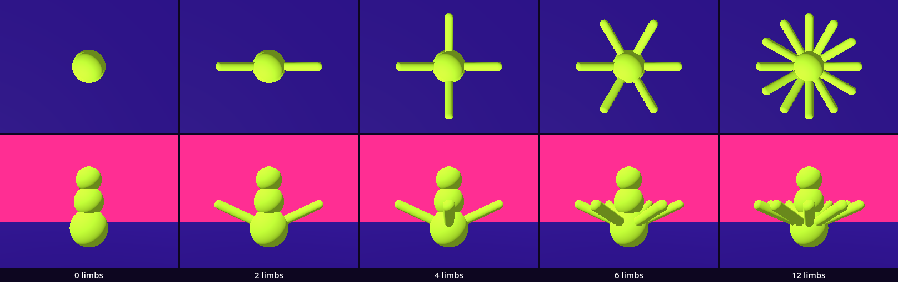
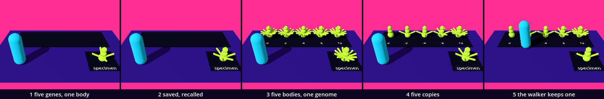

# Genome — genes as files

Families described a body once, as a class, and stood four members on a sheet. When the game stopped, all four were gone, and the next run made them again from numbers written in the script. Here the numbers leave the script. A creature's five genes become a thing of their own, a *resource*, which can be saved as a file and loaded again. A body is built from it, one specimen is chosen and saved, and it is still there after a restart. You have met what this needs: a class with exported fields, `set()` and `get()` by name, a scene instanced in a loop, a signal, a seed. Two ideas are new: a resource, and saving and loading.

This is a new project. In the Project Manager choose **Import** and open this folder's `project.godot`.

The lesson is one session. Every message and number on this page comes from running the study in Godot 4.6. Parts marked *(editor)* describe the editor's own windows and were not watched.

## Find the family in the hall

A lesson starts in its hall, with one question: does the hall show one work at several values of one axis?

The hall is [PG_Genetic_Evolution](../../../../commons/maps/PG_Genetic_Evolution/final.md), *What does the score notice?* It holds two works. The one at the desk declares two axes in the registry, `alphabet` (primitives, csg_tree, parametric, voxel) and `muster` (parade, champion, scatter). The hall's map sets neither, so you stand on the first value of each. The screen below the decks declares `support` and `surface` and also stands at one value. No declared family is shown.

The desk's work is a family all the same. "Six boxes wait beyond the desk", and its script gives each one gene, a box, at one of six sizes: 0.7, 1.0, 1.25, 1.5, 1.75 and 2.0. The reading says what this chapter is about: "Each candidate has a genome: a list of primitive names and parameters. A builder reads that list to make the visible body."

Two more things in the halls are ours. Press HOLD at the desk and the leader is kept as "a copy that will stay while the population changes". In the encounter hall, LSystems_Living, the same copy has a history: "This steadiness had to be written. The export used to point at the same editable DNA resource." That is the fault we plant below. And in Random_Definition a grid of cubes stands twice from one seed, and the two are alike: that is our fifth gene. Nothing in the carrier hall is saved to a file. We read all of this from the halls' map files, their scripts and the artifact registry; we did not walk them.

So stand at the six boxes and write down which two you expect to look most alike. Nobody has rendered that sheet. Keep the guess: this study ends with a sheet of our own.

## Open the study

Open the [Genome study](README.md), then `cabinet.tscn`: double-click it in the FileSystem dock, at the lower left of the editor *(editor)*. The editor's own view shows a white floor and Godot's preview light; the sky, violet above a pink horizon, and the violet floor are made by a script when the scene runs.

Run it: the Play button at the top right, or F5. Five lime creatures stand in a row on a dark sheet, over the plates 0, 2, 4, 6 and 12: a stack of three balls, and that many limbs around the lowest. A sixth stands in front on a dark square marked *specimen*. The cyan capsule is the walker: W, A, S and D walk it, and Space keeps the creature nearest to it. The Output panel, at the bottom of the editor, reads:

```
no file yet: a new genome
limb_count 0: 3 parts
limb_count 2: 5 parts
limb_count 4: 7 parts
limb_count 6: 9 parts
limb_count 12: 15 parts
```

Three scripts are ours. `cabinet.gd` is beside the scene. `genes.gd` and `creature.gd` are in the folder `guests/genome/`, with the creature's scene, `genome.tscn`. They live in that folder because it is the folder that travels to your room at the end, and a saved genome names its script by where the script is. The download holds the finished versions. We will take them apart and build them again.

## Five genes

Replace everything in `guests/genome/genes.gd` with this:

```gdscript
extends Resource

@export var segments: int = 3                 # balls in the trunk, from the ground up
@export var limb_count: int = 4               # limbs around the lowest ball
@export var limb_angle: float = 25.0          # degrees the limbs are raised
@export var colour: Color = Color("c6ff3d")   # BODY, written out
@export var body_seed: int = 1                # which individual: the size of each ball
```

and everything in `cabinet.gd` with this:

```gdscript
extends Node3D

const Genes := preload("res://guests/genome/genes.gd")

func _ready() -> void:
	var genes := Genes.new()
	print(genes.segments, " segments, ", genes.limb_count, " limbs, raised ", genes.limb_angle, " degrees")
```

Run it. The sheet and the square are empty, and the output reads `3 segments, 4 limbs, raised 25.0 degrees`.

`genes.gd` is a class, as `globe.gd` was in Families, with one difference in its first line. A Globe was a `MeshInstance3D`: a node, a thing that stands in the room. This class is a `Resource`: data, and nothing else. It has no place, it is never added to a scene, and the room does not hold it. Meshes and materials are resources too; you have used them since Point One. Now we write one of our own.

The class has no `class_name`. `preload()` hands us the script, and the name we give it, `Genes`, works as a class name did: `Genes.new()` makes a genome. The colour is the look's BODY written out, because this folder will leave the kit and `look.gd` stays behind. And the seed is called `body_seed` for a reason Godot gave us: a variable named `seed` got `The variable "seed" has the same name as a built-in function.`

## A body from the genes

Add a function at the end of `genes.gd`:

```gdscript

func mutate(gene: String, value: Variant) -> void:
	set(gene, value)
	emit_changed()
```

Replace everything in `guests/genome/creature.gd` with this:

```gdscript
extends Node3D

const Genes := preload("res://guests/genome/genes.gd")

var genes := Genes.new()

func _ready() -> void:
	genes.changed.connect(build)
	build()

func build() -> void:
	for part in $Parts.get_children():
		part.free()
	var paint := StandardMaterial3D.new()
	paint.albedo_color = genes.colour
	paint.roughness = 0.8
	var rng := RandomNumberGenerator.new()
	rng.seed = genes.body_seed
	var hub := Vector3.ZERO    # the middle of the lowest ball
	var top := 0.0             # where the next ball begins
	for i in genes.segments:
		var ball := SphereMesh.new()
		ball.radius = 0.22 * pow(0.8, i) * rng.randf_range(0.85, 1.15)
		ball.height = ball.radius * 2.0
		var part := add_part(ball, paint)
		part.position.y = top + ball.radius
		if i == 0:
			hub = part.position
		top += ball.radius * 1.6
	for i in genes.limb_count:
		var limb := CapsuleMesh.new()
		limb.radius = 0.05
		limb.height = 0.5
		var part := add_part(limb, paint)
		part.rotation = Vector3(0.0, TAU * i / genes.limb_count, deg_to_rad(genes.limb_angle) - PI / 2.0)
		part.position = hub + part.basis.y * 0.4

func add_part(mesh: Mesh, paint: Material) -> MeshInstance3D:
	var part := MeshInstance3D.new()
	part.mesh = mesh
	part.material_override = paint
	$Parts.add_child(part)
	return part
```

And everything in `cabinet.gd` with this:

```gdscript
extends Node3D

const Genes := preload("res://guests/genome/genes.gd")
const Creature := preload("res://guests/genome/genome.tscn")

var kept: Node3D

func _ready() -> void:
	var genes := Genes.new()
	kept = Creature.instantiate()
	kept.genes = genes
	kept.position = $Place.position
	add_child(kept)
	print(kept.get_node("Parts").get_child_count(), " parts")
	genes.mutate("limb_count", 6)
	print(kept.get_node("Parts").get_child_count(), " parts")
```

Run it. One creature stands on the square, with six limbs. The output:

```
7 parts
9 parts
```

`creature.gd` is the builder: it reads a genome and makes a body. It runs on the first node of `genome.tscn`, a scene with two more nodes: `Parts`, empty, and `Trunk`, a cylinder that only a body can feel. `build()` clears `Parts` and fills it again. Each ball is 0.8 times the one below, and a generator started from `body_seed` makes each a little larger or smaller, up to 15%. Same seed, same three balls: radii of 0.209, 0.164 and 0.141 m in our run, every time. The limbs are capsules. A capsule stands upright, so each is laid down by a quarter turn, raised by `limb_angle`, turned to its place in the circle, and moved out along its own length: `basis.y` is the way the capsule points.

The second number in the output is the new idea at work. `mutate()` sets one gene by its name, as `set()` did in Families, and then calls `emit_changed()`. Every resource has a signal named `changed`. The creature listens to its genome's: `genes.changed.connect(build)`. So we changed a number in the genome, and the body followed. Nobody called `build()`.

`set()` is as quiet here as it was there. `genes.mutate("limbs", 6)` changes nothing and says nothing: the genome has no gene of that name.

## The genome as a file

Replace everything in `cabinet.gd` with this:

```gdscript
extends Node3D

const Genes := preload("res://guests/genome/genes.gd")
const Creature := preload("res://guests/genome/genome.tscn")
const FILE := "user://specimen.tres"

var kept: Node3D

func _ready() -> void:
	var genes := Genes.new()
	genes.mutate("limb_count", 6)
	kept = Creature.instantiate()
	kept.genes = genes
	kept.position = $Place.position
	add_child(kept)
	keep(genes)

func keep(genes: Genes) -> void:
	var error := ResourceSaver.save(genes, FILE)
	print("kept ", genes.limb_count, " limbs in ", ProjectSettings.globalize_path(FILE), ": ", error_string(error))
```

Run it. The same creature, and one line, with your own name in it:

```
kept 6 limbs in C:/Users/you/AppData/Roaming/Godot/app_userdata/Genome/specimen.tres: OK
```

`ResourceSaver.save()` writes a resource to a file. `user://` is a folder Godot keeps for this project on your machine, outside the project. Godot's documentation gives the reason: an exported game cannot write into `res://`. We did not export this kit. `globalize_path()` says where the folder is. `save()` does not stop the game when it fails. It returns a number, and `error_string()` turns the number into words; here, `OK`. Asked to save under a name ending in `.txt`, it returned 15, `File unrecognized`, wrote nothing and printed nothing. Read what it returns.

Now open the file. **Project > Open User Data Folder** shows the folder *(editor)*; the path in the Output panel leads there too. Any text editor opens it:

```
[gd_resource type="Resource" format=3]

[ext_resource type="Script" path="res://guests/genome/genes.gd" id="1_xxxxx"]

[resource]
script = ExtResource("1_xxxxx")
limb_count = 6
```

The letters after `1_` are Godot's own and differ from file to file. The rest is the whole genome: seven lines of text. Read what is there and what is not. The file names its script by path. And it holds one gene. The other four are missing: a gene that still has the script's default value is not written. A genome with all five at their defaults is saved with no gene in it at all.

## A body recalled

Replace everything in `cabinet.gd` with this:

```gdscript
extends Node3D

const Genes := preload("res://guests/genome/genes.gd")
const Creature := preload("res://guests/genome/genome.tscn")
const FILE := "user://specimen.tres"

var kept: Node3D

func _ready() -> void:
	var parent := recall()
	kept = Creature.instantiate()
	kept.genes = parent
	kept.position = $Place.position
	add_child(kept)

func recall() -> Genes:
	if ResourceLoader.exists(FILE):
		var genes: Genes = load(FILE)
		print("recalled ", genes.limb_count, " limbs")
		return genes
	print("no file yet: a new genome")
	return Genes.new()

func keep(genes: Genes) -> void:
	var error := ResourceSaver.save(genes, FILE)
	print("kept ", genes.limb_count, " limbs in ", ProjectSettings.globalize_path(FILE), ": ", error_string(error))
```

Run it. The creature with six limbs, and `recalled 6 limbs`. The script no longer says six anywhere. The number came from the file, written by a run that has ended. Stop the game, with the square button at the top right or F8, and run it again: the same. That is what a file is for.

`load()` is the call that made scenes of `.tscn` files since the Body of Parts. Handed a `.tres` it returns the resource: the script named in the file, with the file's values set on it. `ResourceLoader.exists()` asks first. Without that line, on a machine with no file, Godot printed

```
ERROR: Cannot open file 'user://specimen.tres'.
ERROR: Failed loading resource: user://specimen.tres.
```

and `load()` returned nothing. Two more red lines followed, the first of them `Invalid access to property or key 'limb_count' on a base object of type 'null instance'.` Reading such lines is ordinary. The top one says which file. The ones below it are what the script went on to do with nothing: here, ask it for its limbs.

## A family from one parent

Now the row: five children of the recalled parent, one for each value of one gene. Replace everything above `func recall()` in `cabinet.gd` with this:

```gdscript
extends Node3D

const Genes := preload("res://guests/genome/genes.gd")
const Creature := preload("res://guests/genome/genome.tscn")
const FILE := "user://specimen.tres"

@export var axis := "limb_count"
@export var values: Array = [0, 2, 4, 6, 12]

var row: Array[Node3D] = []
var kept: Node3D

func _ready() -> void:
	var parent := recall()
	kept = Creature.instantiate()
	kept.genes = parent
	kept.position = $Place.position
	add_child(kept)
	for value in values:
		var genes := parent
		genes.mutate(axis, value)
		var creature: Node3D = Creature.instantiate()
		creature.genes = genes
		$Sheet.hang(creature, str(genes.get(axis)))
		row.append(creature)
	for creature in row:
		print(axis, " ", creature.genes.get(axis), ": ", creature.get_node("Parts").get_child_count(), " parts")
```

The loop is the one from Families: a creature for each value, the gene set by its name, the creature hung on the sheet under what the genome reads back.

Run it. Five plates: 0, 2, 4, 6, 12. Over them, five creatures alike, each with twelve limbs. The specimen on its square has twelve too. The output:

```
recalled 6 limbs
limb_count 12: 15 parts
limb_count 12: 15 parts
limb_count 12: 15 parts
limb_count 12: 15 parts
limb_count 12: 15 parts
```

Godot printed nothing else: no error, no warning. And each plate was true when it was written.

`var genes := parent` does not make a genome. It gives the one genome a second name. All six creatures were handed the same resource and all six listen to it. Each turn of the loop changed its `limb_count`, every body built so far followed, and the last value won. The file still says six.

This is how resources are: shared unless you ask for a copy. `load()` shares too. We loaded the file twice and got one object, not two: whoever loads a path gets what the loader already holds. It is the fault the encounter hall wrote down, and it happens in silence because sharing is often what you want: forty bodies with one material is one material to change.

The repair is to ask. In the loop, replace the line `var genes := parent` with:

```gdscript
		var genes: Genes = parent.duplicate(true)
```

Run it:

```
recalled 6 limbs
limb_count 0: 3 parts
limb_count 2: 5 parts
limb_count 4: 7 parts
limb_count 6: 9 parts
limb_count 12: 15 parts
```

`duplicate()` returns a new resource with the same values. With `true` it also copies what the resource holds inside. For five plain numbers there is nothing inside, and `duplicate()` alone did the same. We tried both on a resource that held a material and a list: `duplicate()` left the two shared, `duplicate(true)` copied them. Write `true` when a copy is meant to stand alone.

## Keep one

Add this at the end of `cabinet.gd`:

```gdscript

func _process(_delta: float) -> void:
	if Input.is_action_just_pressed("pause"):
		var nearest := row[0]
		for creature in row:
			if away(creature) < away(nearest):
				nearest = creature
		keep(nearest.genes)
		kept.genes = nearest.genes.duplicate(true)
		kept.genes.changed.connect(kept.build)
		kept.build()

func away(creature: Node3D) -> float:
	return creature.global_position.distance_to($Walker.global_position)
```

Run it. Walk to the creature with two limbs and press Space. The specimen on the square now has two limbs, and the output says `kept 2 limbs in` your folder, `: OK`. Stop the game. Run it again: `recalled 2 limbs`.

`pause` is the action on Space in the Input Map. The loop finds the creature nearest to the walker. `keep()` saves its genome. The specimen then gets a copy of it, not the genome itself: the specimen is the one you kept, and it should stay as it was if its source changes. That is HOLD in the hall. The line after it makes the specimen listen to its new genome, as `_ready()` did for the first.

We pressed the key from a script, with the walker sent to the creature of six: `kept 6 limbs`, nine parts on the square. We changed the source to three limbs: the specimen kept its six. Then we started Godot a second time on the project: `recalled 6 limbs`.

This is the finished study. `cabinet.gd` is the script under *A family from one parent* with the repaired line, `recall()`, `keep()`, and the two functions above.

## The argument: where does a creature become a flower?

The axis is the gene `limb_count`. The values are 0, 2, 4, 6 and 12.

**Write your prediction before you render.** Five creatures, each seen alone from 2 m, from straight above. Which two will look most alike? Write it down, with a reason.

The course's outline made its own: 6 and 12 will look most alike from above, because "past about six limbs the body reads as radial, a star or a flower, not an animal". Its claim: somewhere between 4 and 6 limbs, a creature becomes a flower.

Then look. For the stills, run `sheet.gd` as the [README](README.md) says; it needs a terminal. You can go on without it: the tables are what our run measured.



Two stills differ at a pixel when its three channels together are more than a tenth of full scale apart. Each number is the share of the still on which a pair differs.

| pair | from above | from the side |
| --- | --- | --- |
| 0 and 2 | 2.74% | 3.12% |
| 0 and 4 | 5.49% | 4.10% |
| 0 and 6 | 8.21% | 5.85% |
| 0 and 12 | 16.44% | 7.36% |
| 2 and 4 | 2.75% | 0.98% |
| 2 and 6 | 5.47% | 3.84% |
| 2 and 12 | 13.70% | 6.44% |
| 4 and 6 | 8.22% | 4.82% |
| 4 and 12 | 10.95% | 5.46% |
| 6 and 12 | 8.23% | 2.61% |

From above, the closest pair is 0 and 2. The outline's prediction was false there: 6 and 12 differ on 8.23%, as much as 4 and 6 or 0 and 6. Read the column again and it is counting. Each limb covers 1.32% of the still, and two bodies differ by the limbs that do not lie on top of each other, about 1.37% for each. 0 and 2: two limbs. 6 and 12: six. 4 and 6 share only two directions, so six there too.

We photographed every count from 0 to 12 to see how far that goes:

| limbs | 0 | 2 | 3 | 4 | 5 | 6 | 11 |
| --- | --- | --- | --- | --- | --- | --- | --- |
| differs from 12, from above | 16.44% | 13.70% | 12.32% | 10.95% | 17.62% | 8.23% | 19.94% |
| its outline differs from 12's, from the side | 5.53% | 2.43% | 2.45% | 2.43% | 1.30% | 0.48% | 0.64% |
| its outline changes when it is turned, from the side | 0.00% | 3.10% | 3.95% | 2.06% | 1.83% | 1.67% | 0.81% |

From above, the creature with eleven limbs is further from the one with twelve than the creature with none is. Eleven and twelve share one direction; all their other limbs lie beside each other and not on each other. Nobody would call those two different kinds. From above this measure sees which limbs coincide, and nothing of what kind of body it is.

From the side it is another matter. There the closest pair is 2 and 4: their outlines are the same to the pixel, because the two new limbs point at the camera and away from it. 6 and 12 come second, 2.61%, with outlines 0.48% apart. And the second row has a step in it: with 2, 3 and 4 limbs the outline is 2.4% from that of twelve; with 5 it is 1.30%; with 6, 0.48%. The third row is each body against itself, turned by half the angle between two limbs: how much it matters where you stand. That falls most between 3 and 4 limbs, then a little at every count, down to 0.57% at 12.

The claim, as measured: the genome draws no border. `limb_count` changes the body one limb at a time, each limb the same 1.32% of the still. Seen from the side, the outline comes to rest between 4 and 6 limbs; seen from above, nothing marks that place. A border between a creature and a flower is drawn by a standpoint, and by whoever is looking. No eye was asked here.

**Decide.** One difference could be followed: from above the measure rewards limbs that coincide. The next intervention would be to turn every creature by its own random angle before the still, with a generator seeded as `body_seed` is, and see which pairs stay close. Or settle: one of these five is the specimen your room needs, and you can say why. Either is right. Write your decision and the reason in your [field note](FIELD_NOTE.md); ours is there as an example of the form, not of the answer.

## What the file owes

A genome decides which creatures are possible. Ours has five genes, so every creature it can describe is a stack of balls with limbs around the lowest. There is no gene for wings. We wrote one into a file by hand, `wings = 2`, and loaded it: the genome came back without it, and Godot said nothing. A creature this script cannot name is not refused. It is never born, and nothing records that it was asked for. The same silence covers a wrong value: `limb_count = "six"` loaded as 0, and 3.5 as 3. A genome asking for −3 limbs got none.

The file is less than the creature. It holds the genes that differ from the script's defaults and the script's path. Change a default in `genes.gd` and every saved specimen that relied on it changes its body: a file with no gene in it loaded with 4 limbs, and with 8 under a script whose default was 8. Move the script and the file is nothing: with the path `res://genes.gd` in it, `load()` returned null and Godot printed `Parse Error: [ext_resource] referenced non-existent resource at: res://genes.gd.` A saved body is a frozen choice, and what froze it is not in the file.

Sharing goes further than our row. `genome.tscn` holds the trunk's collision shape, and all five creatures have that one shape: we set its height to 2 m on the first and read 2 m on the fifth. And the loader's memory outlasts a save. With a loaded genome still in use we saved another to the same path, and `load()` went on handing out the old six limbs; the file said twelve. A restart reads the file.

One thing we did not try. A `.tres` names a script, and Godot runs the scripts it loads. A genome from a classmate is text you can read before you load it. Read it.

## Meet the specimen

The place this chapter asks for is to carry the specimen: pick it up, leave the room, come back, and find it. At a desk, the key is the hand and the restart is the door. No headset was used.

What a body meets is not what the genome describes. We sent the walker at the specimen on its square: it was stopped, 0.50 m from the middle, by the trunk's cylinder. We sent it past the trunk and through a limb: it arrived. A marble dropped over the trunk came to rest at 0.90 m, on the cylinder's flat top; dropped over a limb it fell through to the floor. The limbs are for the eye. And no gene touches the cylinder. A creature of one ball, 0.53 m high, and one of five, 1.20 m, stopped the walker in the same place, and the marble came to rest at 0.90 m over both: over the small one it lies in the air, 0.37 m above the creature's top.

## The process

five genes, one body → saved, recalled → five bodies, one genome → five copies → the walker keeps one



`sheet.gd` makes the strip in its studio, under a plain pink sky, and counts what each step built. The specimen has 7, 9, 15, 9 and 5 parts. The row has none, none, then 15 parts five times, then 3, 5, 7, 9 and 15. The last tile differs most from the one before, 9.07%, and most of that is the walker crossing the floor. Of the steps that changed only bodies, the third did most, 7.27%: five bodies arrived, all alike, and the specimen grew six limbs it was never given. Saving and loading changed 0.66% of the tile: two limbs more, because the file said six.

## In your room

Save your room's family as files, and let a classmate load and breed one specimen.

First the guest has to recall its own file, because in your room nobody hands it genes. In `guests/genome/creature.gd`, replace the line `var genes := Genes.new()` and the function `_ready()` under it with:

```gdscript
const FILE := "res://guests/genome/specimen.tres"

var genes: Genes

func _ready() -> void:
	if genes == null:
		genes = load(FILE) if ResourceLoader.exists(FILE) else Genes.new()
	genes.changed.connect(build)
	build()
```

Run the study: nothing changes, because the cabinet hands every creature its genes. Then copy your kept `specimen.tres` from the user data folder into `guests/genome/`, over the one that is there. Ours has six limbs.

Copy the folder `guests/genome/` from this kit into your room project's `guests/` folder, and add its line to `GUESTS` in `room.gd`:

```gdscript
	"res://guests/genome/genome.tscn",
```

Run the room and walk to it. We did this in a copy of the room: the creature stood at place 2 with its six limbs, and the walker, sent at it, was stopped 0.50 m from the middle of the place.

Now the task. In this kit, save the whole row: at the end of `_ready()` in `cabinet.gd`, a loop over `row` with `ResourceSaver.save(creature.genes, "user://family_%d.tres" % creature.genes.limb_count)`. We ran that line: five files, of six or seven lines each. Give one to a classmate. They put it in their user data folder as `specimen.tres` and run their cabinet: their row is five children of your creature. We tried it with a file written by hand, five segments, limbs raised 60 degrees, `body_seed` 7: `recalled 4 limbs`, and five creatures of five balls.

Then make the genome yours: add a sixth gene to `genes.gd` and use it in `build()`. Before you send a file to the classmate, write down what their cabinet will show. Their script does not have your gene.

Write one line in your README: your genes, and one creature they cannot describe. Hand in your room with its process strip and your field note. If the room is gone, its README says how to get it back.

## What we borrowed

| Part | From | How far we go |
| --- | --- | --- |
| `supplied/base.tscn`, `look.gd` | The base | Use: the floor, the sky, the sun, the fixed camera; `cabinet.tscn` inherits it. |
| `supplied/sweep_sheet.gd` | Families | Use: `hang(member, title)` stands a member next in the row and names it on a plate. |
| `supplied/walker.tscn` | The base | Use: W, A, S, D walk it; a `StaticBody3D` stops it, a mesh does not. |
| `place.gd` | Supplied here | Use: the dark square, 1.6 m, the size of a place in your room. |
| `genome.tscn` | Supplied here | Understand: a `Node3D` with `Parts` and a `Trunk`, a cylinder of 0.2 m radius and 0.8 m height. |
| `Resource`, `changed`, `emit_changed()` | Godot | Understand: a class for data, with one signal. |
| `ResourceSaver.save()`, `load()`, `ResourceLoader.exists()` | Godot | Use: a resource to a file and back. `save()` returns a number; `load()` shares. |
| `duplicate(true)` | Godot | Use: a copy that stands alone. |
| `RandomNumberGenerator`, `seed` | Godot, the chapters on chance | Use: the same seed gives the same numbers. |
| `sheet.gd` | Supplied here | Use: it photographs each creature alone, measures the pairs, and makes the strip. |

What we made is `genes.gd`, a resource with five exported genes and `mutate()`; `creature.gd`, a builder that listens to its genome; and `cabinet.gd`, which recalls a parent from a file, breeds a row from copies of it, and keeps the one the walker chooses.

## What we carry forward

We leave with a resource as a class for data; with a file that holds what differs from the defaults and the path of its script; with `save()` and its returned number, `load()` and its memory; and with one rule: a resource is shared until you ask for a copy.
