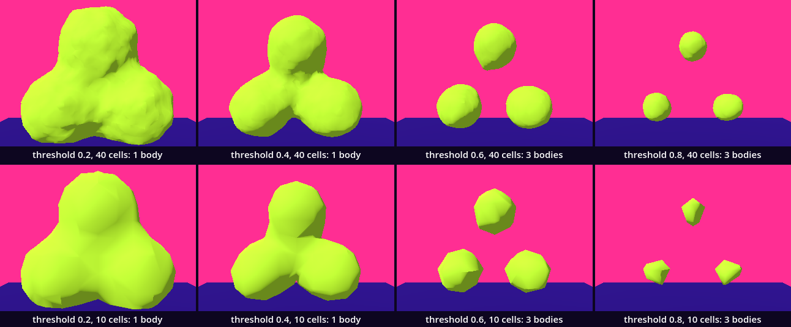
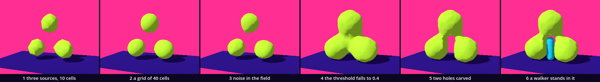

# Implicit bodies — a body with no vertices until you ask

Every body so far began as a list of points that we wrote. This one begins as a rule: a number for every place in the room. Where that number crosses a threshold there is a skin, and there is none until we ask. We ask on a grid, cell by cell, and a borrowed table says which triangles each cell gets. You have the parts already: noise, loops inside loops, packed arrays, `SurfaceTool`, an `@export` for the axis, a clock around a piece of code. One idea is new: a thread. The asking takes a tenth of a second, and we move it off the thread that draws the room.

This is a new project. In the Project Manager choose **Import** and open this folder's `project.godot`.

The halls put it this way. [ISO_Metaballs](../../../../commons/maps/ISO_Metaballs/final.md) shows a neck between two sources: "The surface does not mark ownership: it is the place where a sum crosses a threshold." [ISO_Introduction](../../../../commons/maps/ISO_Introduction/final.md) shows the comparison we write here, [ISO_LookupTable](../../../../commons/maps/ISO_LookupTable/final.md) opens the table, and [ISO_Sculpting](../../../../commons/maps/ISO_Sculpting/final.md) cuts into a field with a hand.

The lesson takes two sessions. The first builds the body and ends at **Stop here**. The second breaks the thread on purpose, measures four thresholds, reads the borrowed table, and walks into the body.

Every message and number on this page comes from running the study in Godot 4.6. Parts marked *(editor)* describe the editor's own windows and were not watched. No headset was used.

## Find the family in the hall

A lesson starts in its hall, with one question: does the hall show one work at several values of one axis?

The two halls this chapter leans on show it in time, not side by side. In ISO_Metaballs the walk-in field stands once. It has two axes, `emplacement` (column, ring, pair, shell, scatter) and `kernel` (inverse square, Wyvill, Gaussian, cone), and the desk's buttons step through them; HOLD keeps the earlier boundary behind the live one, so two values at most are seen together. In ISO_Introduction the noise specimen stands once too, and LEVEL cycles its threshold through 0.50, 0.45 and 0.55. The family is in a third hall. In ISO_LookupTable one work, the Threshold Opinion, shows one field cut at five thresholds at once: 0.30, 0.42, 0.50, 0.60 and 0.72. It declares no axis; the five are built into it. We read this from the halls' map files, the artifact registry, the readings and the work's script. We did not walk them.

So stand at the Opinion. Before you read its plates, write down which two of the five surfaces you expect to look most alike, and between which two the count of bodies changes.

## Open the study

Open `implicit.tscn` from the FileSystem dock, at the lower left of the editor. The editor's own view shows a white floor under Godot's preview light. The look is put on by a script when the scene runs.

Run it (F5). A lime body of three lobes stands on the floor, two below and one above, joined by necks. At the left stands the walker. Over the scene a line reads `threshold 0.4: 1 body, 6282 triangles`. Press Space: `threshold 0.6: 3 bodies, 3588 triangles`. The necks are gone, and the third body hangs in the air. Space again steps to 0.8, to 0.2 and back.

One script is ours: `field_body.gd`. The download holds it finished. We take it apart and build it again. `implicit.gd` is given: it listens for the keys and writes the line, and it runs with every stage below. Two more files are given and read later: `mc_table.gd`, the borrowed table, and `pieces.gd`, which counts bodies.

## A field

Replace everything in `field_body.gd` with this:

```gdscript
extends MeshInstance3D

const Look := preload("res://supplied/look.gd")
const Table := preload("res://mc_table.gd")
const Pieces := preload("res://pieces.gd")

@export_range(0.05, 0.95) var threshold := 0.4   # the value of the field where the skin is
@export var radius := 0.95     # metres: the reach of one source
@export var wobble := 0.08     # how much noise the field carries

var centres := PackedVector3Array([Vector3(-1.15, 0.9, 0.0), Vector3(1.15, 0.9, 0.0), Vector3(0.0, 2.9, 0.0)])
var noise := FastNoiseLite.new()

func _ready() -> void:
	material_override = Look.paint(Look.BODY)
	noise.seed = 36
	noise.frequency = 0.9
	for place: Vector3 in [centres[0], Vector3(0.0, 0.9, 0.0), Vector3(0.0, 0.9, 2.0)]:
		print(place, " -> ", snappedf(value_at(place), 0.001))

# The field: one number for every place. A source adds 1 at its centre and less further out.
func value_at(p: Vector3) -> float:
	var sum := wobble * noise.get_noise_3dv(p)
	for centre in centres:
		sum += exp(-p.distance_squared_to(centre) / (radius * radius))
	return sum
```

Run it. The body is gone; nothing draws one yet. The Output panel, at the bottom of the editor, reads:

```
(-1.15, 0.9, 0.0) -> 1.022
(0.0, 0.9, 0.0) -> 0.475
(0.0, 0.9, 2.0) -> -0.012
```

`value_at()` is the whole body. It answers for any place, and it holds no point and no triangle. Each of the three sources adds a bell: 1 at its centre, 0.37 one `radius` away, almost nothing at three. The noise adds or takes up to 0.08. At the first centre the answer is 1.022. Halfway between the two lower centres it is 0.475: neither source reaches 0.4 there alone, and their sum does. Two metres in front it is about zero.

The skin will be where the field is exactly `threshold`. Inside is where it is more.

## Ask it on a grid

We cannot ask everywhere. We ask at the corners of a grid of small cubes, the cells. Add two exports under `wobble`:

```gdscript
@export var cells := 40        # cells along one side of the grid
@export var size := 5.0        # metres: the side of the box the field is asked in
```

In `_ready()`, replace the two lines of the `for` loop with one:

```gdscript
	build(threshold)
```

and add at the end of the file:

```gdscript

func build(level: float) -> void:
	var began := Time.get_ticks_usec()
	var n := cells + 1          # samples along one side
	var step := size / cells    # metres from one sample to the next
	var origin := Vector3(-size / 2.0, 0.0, -size / 2.0)
	var values := PackedFloat32Array()
	values.resize(n * n * n)
	for z in n:
		for y in n:
			for x in n:
				values[x + n * (y + n * z)] = value_at(origin + Vector3(x, y, z) * step)
	var inside := 0
	for value in values:
		if value > level:
			inside += 1
	print(values.size(), " samples, ", inside, " inside, ", (Time.get_ticks_usec() - began) / 1000.0, " ms")
```

Run it. The Output panel reads `68921 samples, 5873 inside` and a time, which is your machine's.

The box is 5 m on a side and stands on the floor. Forty cells along a side make 41 samples, 12.5 cm apart, and 41 × 41 × 41 is 68,921. They go into one long packed array, and `x + n * (y + n * z)` is where sample (x, y, z) lies in it: the chessboard's two indices, with a third. When our checks asked the same 68,921 questions it took 56.1 ms, more than half of a whole build.

## March

Now each cell looks at its eight corners. Replace the last five lines of `build()`, from `var inside := 0`, with these:

```gdscript
	var offsets := PackedInt32Array()   # from a cell's first sample to each of its eight corners
	for corner in Table.CUBE_VERTICES:
		offsets.append(int(corner.x) + n * (int(corner.y) + n * int(corner.z)))
	var at := PackedFloat32Array()      # the field at the eight corners of one cell
	at.resize(8)
	var points := PackedVector3Array()  # three for every triangle
	for z in cells:
		for y in cells:
			for x in cells:
				var first := x + n * (y + n * z)
				var which := 0          # the case: one bit for each of the eight corners
				for i in 8:
					at[i] = values[first + offsets[i]]
					if at[i] < level:
						which |= 1 << i
				for edge: int in Table.TRIANGLE_TABLE[which]:
					var a: int = Table.EDGE_CONNECTIONS[edge][0]
					var b: int = Table.EDGE_CONNECTIONS[edge][1]
					var along := (level - at[a]) / (at[b] - at[a])
					var crossing: Vector3 = Table.CUBE_VERTICES[a].lerp(Table.CUBE_VERTICES[b], along)
					points.append(origin + (Vector3(x, y, z) + crossing) * step)
	var tool := SurfaceTool.new()
	tool.begin(Mesh.PRIMITIVE_TRIANGLES)
	for point in points:
		tool.add_vertex(point)
	tool.generate_normals()
	mesh = tool.commit()
	print(points.size(), " points, ", (Time.get_ticks_usec() - began) / 1000.0, " ms")
```

Run it. The Output panel reads `18846 points` and a time. A lime body stands on the floor, and it looks wrong. Where its front should be you look into it, as into a bowl: a dark rim, a lit far wall, and at the bottom two holes that show the floor. We mend that in a moment. First, what the loop does.

A corner is on one side of the threshold or on the other. Eight corners, one bit each: `which` is a number from 0 to 255, the cell's case. `|=` sets a bit and `1 << i` is bit number `i`. In case 0 and case 255 all corners are on one side, and the table's rows for them are empty. That is most of the 64,000 cells.

`Table.TRIANGLE_TABLE[which]` is the row for the case: a list of edges of the cell, three for every triangle. A skin can only cross an edge whose two ends are on different sides. Where on the edge? `along` says it: the threshold lies that share of the way from one end's value to the other's, and `lerp()` goes there. Up to four cells share an edge, and each computes this point for itself. They must all get the same one, to the last digit, or the skin has a seam. We checked: at 0.6 the 3,588 triangles meet in 1,800 places, as three closed skins must. `generate_normals()` gives points in one place one shared normal, which is why the body looks smooth and not faceted.

The table is 256 rows that nobody in this room wrote. It came with the method, marching cubes, published by Lorensen and Cline in 1987. Ours is the copy the Ada project marches with.

## Inside out

The comparison above, `at[i] < level`, is the one the hall shows and Ada's own generator uses: a bit for each corner under the threshold. In this run it made 6,282 triangles, and every one of them faces inward. Godot draws a triangle from the side where its corners run clockwise, so we see the far wall from inside and nothing of the near one. Godot printed nothing. Change one character:

```gdscript
					if at[i] > level:
```

Run it. The body is whole: three lobes, lit from the upper left. There are 6,282 triangles again, and now every one faces out.

The table does not say which side a bit stands for. Turn the comparison and every case becomes its opposite, 255 minus itself, which crosses the same edges and is wound the other way. The convention lives in the code that uses the table, and the two have to agree with the engine. We come back to the table in *What the body owes*.

## The hand-back

The mesh is a picture. A walker needs a wall, and the line over the scene needs numbers. The lines above `_ready()` now read:

```gdscript
extends MeshInstance3D

const Look := preload("res://supplied/look.gd")
const Table := preload("res://mc_table.gd")
const Pieces := preload("res://pieces.gd")

signal built   # a new skin is on

@export_range(0.05, 0.95) var threshold := 0.4   # the value of the field where the skin is
@export var radius := 0.95     # metres: the reach of one source
@export var wobble := 0.08     # how much noise the field carries
@export var cells := 40        # cells along one side of the grid
@export var size := 5.0        # metres: the side of the box the field is asked in

var centres := PackedVector3Array([Vector3(-1.15, 0.9, 0.0), Vector3(1.15, 0.9, 0.0), Vector3(0.0, 2.9, 0.0)])
var noise := FastNoiseLite.new()
var wall: StaticBody3D             # what a walker meets
var pieces := 0                    # how many separate bodies the skin has
var cost := 0.0                    # milliseconds the last build took

```

In `_ready()`, the last line becomes:

```gdscript
	rebuild()
```

Add this function under `value_at()`, above `build()`:

```gdscript
func rebuild() -> void:
	build(threshold)

```

Replace the last two lines of `build()` with these three:

```gdscript
	var made := tool.commit()
	var count := Pieces.count(points)
	show_mesh(made, count, (Time.get_ticks_usec() - began) / 1000.0)
```

and add at the end of the file:

```gdscript

# The hand-back. Only here do we touch the scene.
func show_mesh(made: ArrayMesh, count: int, took: float) -> void:
	mesh = made
	pieces = count
	cost = took
	if wall != null:
		wall.queue_free()
	wall = StaticBody3D.new()
	if made.get_surface_count() > 0:
		var shape := CollisionShape3D.new()
		shape.shape = made.create_trimesh_shape()
		wall.add_child(shape)
	add_child(wall)
	built.emit()
```

Run it. The line is back: `threshold 0.4: 1 body, 6282 triangles`, and under it `built in` so many ms `on the main thread`. Press Space. The body changes, and the picture stands still for a moment first.

`build()` now makes things and `show_mesh()` puts them into the scene: the mesh, and a wall made from the same triangles, `create_trimesh_shape()`. The old wall is freed each time. `Pieces.count()` is given; it joins triangles that share a corner and counts the groups. `built` is a signal of our own. The line over the scene listens to it.

After Space the line gives two numbers. In a window on our machine the build took 93 to 97 ms, and the longest frame while it ran was 107 to 108 ms. A usual frame there is 16.68 ms. For a tenth of a second nothing moved: not the body, not the walker, not the eye.

## A worker thread

A program does one thing at a time unless it has more than one thread. Godot draws, steps the physics and runs our scripts on one of them, the main thread. It also keeps a pool of others that wait for work. Add one export under `size`:

```gdscript
@export var threaded := true   # build on a worker thread
```

and two fields under `cost`:

```gdscript
var task := -1                     # the build that is running, or -1
var stale := false                 # asked again while a build was running
```

Replace `rebuild()` with this:

```gdscript
# With `threaded` on, build() runs on a worker thread. It reads the field and touches no node.
func rebuild() -> void:
	if task != -1:
		stale = true   # a build is running: build once more when it has ended
		return
	if threaded:
		task = WorkerThreadPool.add_task(build.bind(threshold))
	else:
		build(threshold)

```

The last line of `build()` becomes:

```gdscript
	show_mesh.call_deferred(made, count, (Time.get_ticks_usec() - began) / 1000.0)
```

In `show_mesh()`, replace the last line, `built.emit()`, with these:

```gdscript
	if task != -1:
		WorkerThreadPool.wait_for_task_completion(task)   # it has ended; this lets the pool forget it
		task = -1
	if stale:
		stale = false
		rebuild()
	built.emit()
```

and add at the end of the file:

```gdscript

func _exit_tree() -> void:
	if task != -1:
		WorkerThreadPool.wait_for_task_completion(task)   # do not leave while a thread still works for us
		task = -1
```

Run it and press Space. The line reads `on a worker thread`, and the picture does not stop. In a window on our machine the longest frame was 26 to 28 ms, where it was 107 to 108.

`WorkerThreadPool.add_task()` takes a function and gives it to a thread of the pool. It returns at once with a number for the task, and our script goes on. `build.bind(threshold)` is `build` with its argument already in it: the threshold as it was when we asked.

`build()` now runs beside the main thread, and it obeys one rule: it touches nothing in the scene. It reads the field, fills its own arrays and makes a mesh, which is a resource and not a node. Then it hands the mesh over. `show_mesh.call_deferred(...)` does not call `show_mesh()`. It leaves a note for the main thread, which makes the call itself when it next has a moment.

`wait_for_task_completion()` waits until a task has ended. In `show_mesh()` ours already has, so it returns at once. We understand that the pool keeps a finished task until somebody has waited for it, and we could not see that: with the line taken out, all our checks still passed. In `_exit_tree()` the same call does wait, and that we can show. Without it, a body freed in the middle of a build left its thread asking a body that was gone, and Godot printed `Invalid call. Nonexistent function 'value_at' in base 'previously freed'.`

`stale` keeps a wish. If Space comes while a build runs, we do not start a second thread on the same body. We note it, and build once more when the first has handed back.

Select `Body` in the Scene dock, at the upper left, and untick **Threaded** in the Inspector, at the right *(editor)*. Run, press Space, and the stall is back.

## Stop here: what we have

This is the end of the first session. Check four things: a lime body of three lobes; the line `threshold 0.4: 1 body, 6282 triangles`; after Space, `3 bodies, 3588 triangles` and `on a worker thread`; and a walker that the body stops when you walk it into a lobe with W and D.

## One word missing

In the last line of `build()`, delete `.call_deferred`, so that it reads `show_mesh(made, count, ...)` as it did before the thread. This is the mistake to expect: the line was right this morning. Run it.

The body appears. The line over the scene does not. The Debugger panel, at the bottom of the editor, turns red *(editor)*. Godot printed four errors and went on running. The first and the third:

```
ERROR: /root/Implicit/Body: The caller thread can't call the function `update_gizmos()` on this node. Use `call_deferred()` or `call_deferred_thread_group()` instead.
ERROR: Adding children to a node inside the SceneTree is only allowed from the main thread. Use call_deferred("add_child",node).
```

Read them as they stand. Each names what was tried, says who may do it, and gives the cure. The first is for `mesh = made`. The third is for `add_child(wall)`: the wall was made and never entered the scene. The other two are for signals, and one of those is ours: `built` was never sent, so the line stayed empty. We sent the walker at the body and it walked through, `arrived`. The picture is right and the body is not there. Reading an error is ordinary; here it is also the fastest way to the fault.

Put `.call_deferred` back.

The course outline planned this bug as a call that "errors or crashes". In Godot 4.6 it errors, four times for every build, and does not crash.

## The argument: which threshold?

The axis is `threshold`. The values are 0.2, 0.4, 0.6 and 0.8. The field is the same for all four.

**Write your prediction before you render.** Four bodies, each alone, seen level from the front. Which two will look most alike? And how many bodies is each? Write both down, with a reason.

The course outline made its own: "0.4 and 0.6 will look most alike: both show separate blobs, one set fatter. At 0.2 the blobs fuse into one body; at 0.8 they shrink into beads."

Then look. Space steps through the four. For stills of all four, run `sheet.gd` as the [README](README.md) says; it needs a terminal. You can go on without it: the tables are what our run measured.



| threshold | bodies | triangles | wide | lowest point | covers |
| --- | --- | --- | --- | --- | --- |
| 0.2 | 1 | 8,296 | 4.73 m | 0 m | 50.57% of the still |
| 0.4 | 1 | 6,282 | 4.16 m | 0 m | 33.99% |
| 0.6 | 3 | 3,588 | 3.69 m | 0.22 m | 16.40% |
| 0.8 | 3 | 1,508 | 3.24 m | 0.46 m | 6.77% |

| pair | differ on |
| --- | --- |
| 0.2 and 0.4 | 27.02% of the still |
| 0.2 and 0.6 | 40.05% |
| 0.2 and 0.8 | 47.16% |
| 0.4 and 0.6 | 22.12% |
| 0.4 and 0.8 | 30.47% |
| 0.6 and 0.8 | 12.14% |

The closest pair is 0.6 and 0.8, not 0.4 and 0.6. And 0.4 and 0.6 are not two sets of blobs: 0.4 is one body and 0.6 is three. The two ends of the prediction held. At 0.2 everything is one fat body, and at 0.8 three beads are left, the third with its top 3.36 m up and nothing under it. The lower row of the sheet, the same field on a grid of 10 cells, gave the same four counts and the same closest pair.

We asked in steps of a hundredth: one body up to 0.48, two at 0.49, three from 0.50. On the sheet that step falls between the second tile and the third, and the stills do not mark it: that pair differs on 22.12%, less than 0.2 and 0.4, which are both one body.

Where the step falls is the sources' doing. We moved the same three sources 1.17 times further from their middle, 2.83 radii apart in place of 2.42. Then the four thresholds gave 1, 3, 3 and 3 bodies, and the outline's sentence about 0.4 and 0.6 is true of that field. The noise decides the order: without it the three necks part together, between 0.47 and 0.48.

The claim, as measured: an implicit body's identity is a threshold. Between 0.48 and 0.50 one number decides whether there is one body or three. A still does not show where: the two most alike pictures lie on the same side of it.

**Decide.** One difference could be followed: the count says the body changes most between 0.4 and 0.6, and the picture says between 0.2 and 0.4. The next intervention would be a sheet of four thresholds round the step, 0.44, 0.48, 0.50 and 0.54: change `VALUES` in `sheet.gd`. Or settle: one of the four bodies is the one your room needs, and three beads may be it. Either is right. Write your decision and its reason in your [field note](FIELD_NOTE.md); ours is there as an example of the form, not of the answer.

## What the body owes

**The sum.** The necks belong to no source. Halfway between the two lower centres each source alone gives 0.231, and the skin is there because two were added. This is the blob: bodies that fuse because their fields do, with no seam to show where one ends.

**The table.** It is inherited code. Open `mc_table.gd` and read its comments; then open `table_station.tscn` and run it with F6 *(editor)*. The station tests the table against itself: for each of the 256 cases, the corner bits alone say which edges are crossed. It prints:

```
triangle table: 256 rows, 820 triangles; rows that disagree with the corner bits: []
edge table: 256 rows; rows that disagree with the corner bits: [48, 49, 50, 51, 52, 53, 54, 55, 56, 57, 58, 59, 60, 61, 62, 63, 192, 193, 194, 195, 196, 197, 198, 199, 200, 201, 202, 203, 204, 205, 206, 207]
edge table: rows that name a thirteenth edge: [62, 63, 192, 193]
```

The triangle table is whole. The edge table beside it, under the comment "All 256 entries for complete marching cubes implementation", is wrong in 32 rows, and four of them name an edge a cube does not have. Our code never reads it. Which of Ada's generators do, we did not test.

Three more assumptions, found by reading. The comments call corners 0 to 3 the "Bottom face" and 4 to 7 the "Top face". In the file's own list those two fours differ in z, not in y: the words come from a world where z is up. Nothing says which side of the threshold sets a bit; we found out by getting it wrong. And Ada's generator, `MarchingCubesGenerator.gd`, mends its winding by turning every triangle whose normal points down. That is a rule for a landscape. We read it and did not run it.

The table also makes triangles with no area. Where a sample is within a rounding of the threshold, the crossings round it fall on the corner itself: 5 of our 6,282 triangles have two corners in one place.

**The grid.** It decides what can be thin. We asked the same field on four grids:

| cells | a cell | triangles at 0.4 | one body up to | a build |
| --- | --- | --- | --- | --- |
| 10 | 50 cm | 364 | 0.46 | 2.7 ms |
| 20 | 25 cm | 1,548 | 0.47 | 14.4 ms |
| 40 | 12.5 cm | 6,282 | 0.48 | 92.9 ms |
| 80 | 6.25 cm | 25,264 | 0.48 | 664.2 ms |

The coarse grid breaks the necks two hundredths early. At 0.43 the grid of 80 finds a crumb of 8 triangles beside the body, which no coarser grid sees. We take it for a bump of the noise; we did not look at it. Each halving of the cell makes eight times as many samples, and cost between 5 and 8 times as much.

**The box.** The body exists where we asked. At 0.2 in a box of 4.4 m the skin reached the wall and was cut open: 92 open edges. Under the floor we never ask, so a body that stands on it is open below: at 0.4, a rim of 29 edges.

**The hand-back.** The thread takes the build off the main thread, not the handing over. With the worker the longest frame was 26 to 28 ms at 40 cells and 62 to 63 ms at 80, against 107 to 108 and 700 to 711 without. The wall is made on the main thread, and it grows with the triangles. Without a window, `show_mesh()` alone took 7.81 ms.

## Place: stand inside it

The body stops the walker. Now the walker cuts. Add one field under `centres`:

```gdscript
var cuts := PackedVector3Array()   # the feet of the standing holes carved so far
```

In `value_at()`, add three lines above `return sum`:

```gdscript
	for foot in cuts:
		var nearest := Geometry3D.get_closest_point_to_segment(p, foot, foot + Vector3(0.0, 1.5, 0.0))
		sum = minf(sum, (p.distance_to(nearest) - 0.45) * 4.0)
```

and add this function above `_exit_tree()`:

```gdscript
# A standing hole, as high as a walker, with its foot on the ground under `at`.
func carve(at: Vector3) -> void:
	while task != -1:
		await built   # a thread is reading the field: do not change it under its hands
	var foot := to_local(at)
	cuts.append(Vector3(foot.x, 0.0, foot.z))
	rebuild()

```

This is the `field_body.gd` in the download. A cut is not made in the mesh. It is a place in a list, and the field is lower near it: within 45 cm of a standing line of 1.5 m the answer falls under zero, under every threshold. `minf()` takes the lower of two answers. The next build finds no skin there, and a new one round it.

`carve()` waits before it writes. A worker thread may be reading `cuts` at that moment, and a list that changes under a reader is the fault threads are known for. `await built` waits for the hand-back.

Run it, and do three things.

**Walk at it.** Walk to the front of the body with D, then at the neck between the two lower lobes with W. The neck stops you. Our walker, on its autopilot, was stopped 0.71 m in front of the body's middle.

**Carve.** Press M. A hole opens 0.6 m ahead of you, and the room does not stall while it does. Walk on, be stopped again, press M again. After two holes our walker arrived on the far side. The body was still one body, of 6,330 triangles. No point of its skin lay within 0.5 m of a hole's middle line, 2,649 lay on the holes' walls, and it was as wide and as high as before.

**Stand inside.** Walk back into the gate and stop. The third source is over your head. Press C to look through the walker's eyes.

A marble dropped from 4.6 m over the top source was on the skin a second later, 3.68 m up; the same drop beside the body was on the floor.

What was not checked: the keys were pressed by a script, not a hand. Nothing was run in a headset. There a hand would carve where it is; here the walker's place stands in for the hand, and every hole is a walker high.

## The process

A body made by more than one operation has a recipe. Ours, one still after each step, from one standpoint:

three sources asked on 10 cells, at 0.6 → asked on 40 cells → noise in the field → the threshold falls to 0.4 → two holes carved → a walker stands in it



`sheet.gd` makes the strip and counts. The bodies are 3, 3, 3, 1, 1, 1. The threshold changed the tile most, 15.86%: it is the one step that changed how many bodies there are. The finer grid changed 3.26%, the two holes 2.88%, the noise 1.72%.

## In your room

Copy the folder `guests/implicit/` from this kit into your room project's `guests/` folder. In the room's `room.gd`, add its line to `GUESTS`, under the last one:

```gdscript
	"res://guests/implicit/implicit.tscn",
```

Run the room. The Output panel says `My room: place 2 is res://guests/implicit/implicit.tscn`, or another number if you have more guests. On its place stand three lime bodies, one of them in the air. Walk to them. Within 2.5 m the threshold starts to fall, a step for every build, and the three become one. Walk away and they part.

We ran the room's own trial with this guest at place 2: the walker reached the aisle and was then stopped, `blocked`, 0.64 m from the middle of the place. In our checks the guest went from 0.6 to 0.3 in six builds, each on a worker thread, and built nothing while nobody was near. A work at rest should not be paid for.

Now your own. **Carve or fuse one body in your room.**

The guest in your room is yours. Open its `implicit.gd`: it is `field_body.gd` at 0.3 of the size, made to stand alone. In `_ready()`, above `rebuild()`, add one line. To fuse:

```gdscript
	centres.append(Vector3(0.0, 0.36, 0.0))
```

A fourth source between the three: we ran it, and the guest was one body even with nobody near. Or to carve:

```gdscript
	cuts.append(Vector3(0.0, 0.0, 0.0))
```

A hole, 0.5 m high, between the two lower sources: we ran that too. At 0.3, the threshold of a visitor near, the one body had a gate under it, 1,614 triangles where there had been 1,420. Then move your line's numbers until the body is one you want. The next chapter, Combine, does the same with ready shapes and three verbs.

Write one line in your room's notes: what you added to the field, and what the body lost or gained.

## What we borrowed

| Part | From | How far we go |
| --- | --- | --- |
| `supplied/base.tscn`, `look.gd` | the kit base | Use: the floor, the sky, the light, `paint()`. |
| `supplied/walker.tscn` | the kit base | Use: it walks, is stopped, and is where we carve from. |
| `mc_table.gd` | the Ada project; the method is Lorensen and Cline's, 1987 | Use and criticise: we read three of its four lists, and tested two against the third. |
| `pieces.gd`, `table_station.gd` | this kit | Read: a count of bodies; a test of the table. |
| `implicit.gd` | this kit | Read: the keys, the line, the longest frame. |
| the sum of sources | the hall ISO_Metaballs | Understand, and change: `centres`, `radius`, `wobble`. |
| the cut | the hall ISO_Sculpting | Understand: a lower answer in the field, not a knife in the mesh. |
| `WorkerThreadPool`, `call_deferred()` | Godot | Use: a task, a hand-back, a wait. |
| `SurfaceTool`, packed arrays, `FastNoiseLite` | Godot | Use. |
| `sheet.gd`, `verify.gd` | this kit | Use: the stills, the measures, the checks. |

What we made is `field_body.gd`: a field, a grid that asks it, a march through the cells, and a thread that does the asking while the room goes on.

## What we carry forward

We leave with a body that is a rule and a skin that is an answer; with a thread, and the one law it lives under, that only the main thread touches the scene; and with a number, the threshold, that turned out to be the body's identity.

The next stop joins and cuts ready bodies with three verbs: union, subtraction, intersection.
