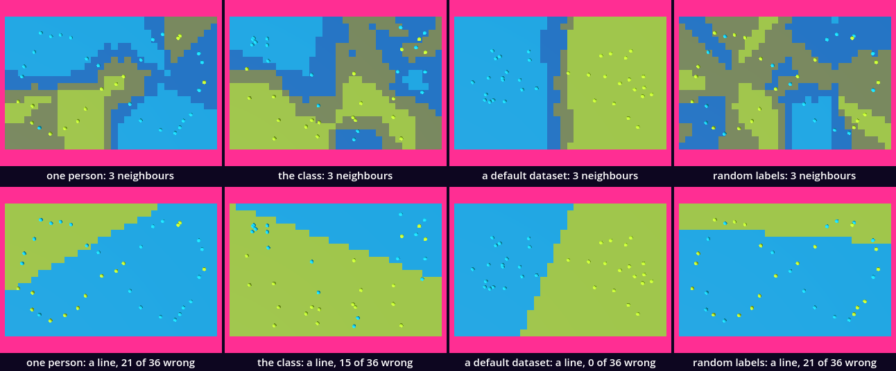
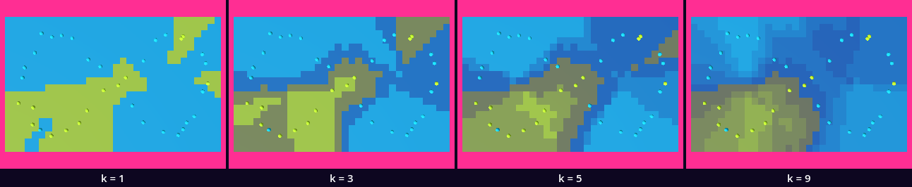
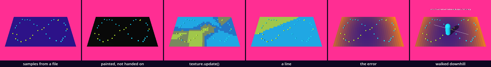

# Bodies that learn — whose data trains the body

So far every body did what its code said. This one does what its data says. We put labelled places on a floor: here somebody would stay, here they would pass. A rule colours every cell by the labels nearest to it. Then a second rule, a line, tries the same, and its error becomes a floor you walk down. You have the parts: arrays, dictionaries, loops, a texture on a plane, a file written and read, a test. One idea is new: JSON, data kept as text that a person can read and a program can take apart.

This is a new project, like every stop of this course: in the Project Manager choose **Import** and open this folder's `project.godot`.

In the halls, [ML_Classification](../../../../commons/maps/ML_Classification/final.md) says of two of its works that they "were told the answers first". Ours is that kind of work, and the question is who told it.

This study takes two sessions; the first ends at **Stop here**. Every message and number on this page comes from running the study in Godot 4.6. Parts marked *(editor)* describe the editor's own windows and were not watched. No headset was used. And nobody in the kit's data is a person: *The samples* says who they are.

## Find the family in the hall

Does the hall show one work at several values of one axis?

In time, yes. Three works of ML_Classification declare the axis `cohort` with five values: blobs, block, rings, braid, skew. The hall's map sets none, so each stands at its script's own choice: the table of moving centres and the work with the gold points at `blobs`, the forest at `block`. The table has a DATASET button that steps through blobs, rings and block: a family shown one member after the other. We read this from the hall's map file, the scripts and the artifact registry; we did not walk it.

So stand at the table and write down which two of its three datasets will leave the most alike boundaries. Then press DATASET. In the hall the data changes and the rule stays. Our sheet does the same, and what changes is who labelled.

## Open the study

Open the [study](README.md), then `learning_body.tscn`. It inherits the supplied base, with the camera moved back and up, and adds two nodes: `Field`, a `MeshInstance3D` that runs `learning_body.gd`, and the supplied `Walker`. The editor's own view shows a white floor, because the look is applied when the scene runs.

Run it. The floor is painted in patches, lime and cyan, bright where the field is sure and dull where it is not. Thirty-six small balls stand on it in a figure-eight. A line of text hangs over the far edge: `you stand on stay, sure to 67%`. Walk with W, A, S and D and it changes.

`learning_body.gd` is ours; it is in the FileSystem dock, at the lower left. The download holds the finished version. We will take it apart and build it again.

## The samples

Double-click `samples.json` in the FileSystem dock *(editor)*; it opens as text. Its second line reads `"about": "Stand-in data, made by make_samples.gd. Nobody in this file is a person."` Then comes a short list named `consent`, and then 144 samples, each like this:

```
		{
			"label": "pass",
			"labelled_by": "the builder",
			"x": 1.11,
			"z": 1.4
		},
```

This is JSON. Curly brackets hold a dictionary, square brackets a list, and every name is in quotes. A sample is a place on the floor, a label, and who gave the label.

The course asks for your own walk from Point Trace and your classmates', labelled with consent. A kit built at a desk has neither, and the file says so. *The builder* is 36 places along a figure-eight, labelled one by one by a session that built this kit: where it would stay. *Classmates 1, 2 and 3* are three rules, each with a line of its own across the floor, each flipping one answer in six. *Nobody* is a default dataset: two round heaps, pass on the left and stay on the right. *A coin* is the builder's 36 places again, each label thrown.

Replace everything in `learning_body.gd` with this:

```gdscript
extends MeshInstance3D

@export var file := "res://samples.json"

var consent := {}                  # labeller -> whether the file records their consent
var samples: Array = []            # every sample of the file

func _ready() -> void:
	var data: Dictionary = JSON.parse_string(FileAccess.get_file_as_string(file))
	consent = data.consent
	samples = data.samples
	print(samples.size(), " samples; the first: ", samples[0])
	print("consent: ", consent)
```

Run it. The floor is bare. The Output panel, at the bottom of the editor, reads:

```
144 samples; the first: { "label": "pass", "labelled_by": "the builder", "x": 1.11, "z": 1.4 }
consent: { "classmate 1": true, "classmate 2": true, "classmate 3": true, "the builder": true }
```

`get_file_as_string()` reads the file as one text. `JSON.parse_string()` takes it apart and hands back what the brackets said: here a dictionary, and `data.consent` is short for `data["consent"]`. Every number comes back with a decimal part. And read the consent line: four names. The file has six labellers.

## Who labelled what

Replace everything with this:

```gdscript
extends MeshInstance3D

const Look := preload("res://supplied/look.gd")
const PAINT := {"stay": Look.BODY, "pass": Look.SECOND}

@export var file := "res://samples.json"
@export_enum("one person", "the class", "a default dataset", "random labels") var labelled_by := 0

var consent := {}                  # labeller -> whether the file records their consent
var samples: Array = []            # every sample of the file
var who := ["the builder", "classmate", "nobody", "a coin"]   # whose samples each value of labelled_by trains on
var chosen: Array = []             # the samples we train on
var balls: Array = []              # one ball for each of them

func _ready() -> void:
	var data: Dictionary = JSON.parse_string(FileAccess.get_file_as_string(file))
	consent = data.consent
	samples = data.samples
	choose()

## Picks the samples to train on by who labelled them, and stands a ball on each.
func choose() -> void:
	for ball: Node in balls:
		ball.free()
	balls = []
	chosen = []
	var labellers := {}
	for sample: Dictionary in samples:
		if not sample.labelled_by.begins_with(who[labelled_by]):
			continue
		chosen.append(sample)
		labellers[sample.labelled_by] = consent.get(sample.labelled_by, "not recorded")
		var ball := MeshInstance3D.new()
		ball.mesh = SphereMesh.new()
		ball.scale = Vector3.ONE * 0.14
		ball.position = Vector3(sample.x, 0.07, sample.z)
		ball.material_override = Look.paint(PAINT[sample.label])
		add_child(ball)
		balls.append(ball)
	print(chosen.size(), " of ", samples.size(), " samples; labelled by, and their consent: ", labellers)
```

Run it. Thirty-six balls stand on the violet floor in a figure-eight: 13 lime, where the builder would stay, and 23 cyan. The output:

```
36 of 144 samples; labelled by, and their consent: { "the builder": true }
```

`choose()` keeps the samples whose labeller begins with the name that `labelled_by` picks from `who`; `"classmate"` takes all three. `PAINT` is a dictionary used as a table: a label goes in, a colour of the look comes out. `consent.get(name, "not recorded")` answers `"not recorded"` for a name the consent list does not hold.

Change the `0` at the end of the `@export_enum` line to `2` and run. Two heaps of balls, cyan on the left and lime on the right, and:

```
36 of 144 samples; labelled by, and their consent: { "nobody": "not recorded" }
```

The tidiest data in the file is the one nobody answers for. Set it back to `0`.

You can also set **Labelled By** in the Inspector, at the right, with `Field` selected in the Scene dock, at the upper left *(editor)*. Keep to one of the two ways: a value set in the Inspector is saved in the scene and wins over the script's line.

## The nearest ones vote

Now a rule that answers for a place nobody labelled. Add the `@export` line under the last `@export` line, the two functions at the end of the file, and the `print` line at the end of `_ready()`:

```gdscript
@export_range(1, 9, 2) var k := 3  # how many neighbours vote

## The k nearest samples vote. Returns the winning label and its share of the votes.
func neighbours_say(x: float, z: float) -> Array:
	var near: Array = []
	for sample: Dictionary in chosen:
		near.append([Vector2(sample.x - x, sample.z - z).length(), sample.label])
	near.sort()
	var voters := mini(k, near.size())
	var votes := {}
	for i in voters:
		votes[near[i][1]] = votes.get(near[i][1], 0) + 1
	var winner := ""
	for label: String in votes:
		if winner == "" or votes[label] > votes[winner]:
			winner = label
	return [winner, votes.get(winner, 0) / float(maxi(1, voters))]

## What the rule in use says of a place: a label, and how sure it is, from 0 to 1.
func says(x: float, z: float) -> Array:
	return neighbours_say(x, z)
```

```gdscript
	print("the neighbours say ", says(-3.2, 2.0), " where the walker starts")
```

Run it. The last line of the output:

```
the neighbours say ["stay", 0.66666666666667] where the walker starts
```

`neighbours_say()` makes a list with one pair for each chosen sample: how far it is from the place, and its label. `sort()` orders pairs by the first of each, so the nearest come first, and the first `k` vote. `votes` is a dictionary that counts. The answer is the label with the most votes and its share: two of three is 0.67. `k` goes in steps of two, so that two labels cannot tie.

This is the whole learner. It has no idea what staying is. It has a list, a distance and a count.

## Paint the floor

A cell of the field is a quarter of a metre, and the field has one pixel for each cell. Add the two `const` lines under the last `const` line and the two `var` lines under the last `var` line, replace `_ready()`, and add the three functions at the end:

```gdscript
const CELL := 0.25                 # metres: the side of one cell of the field
const CELLS := Vector2i(32, 20)    # 32 by 20 cells cover the floor, 8 m by 5 m

var image: Image
var texture: ImageTexture

func _ready() -> void:
	var data: Dictionary = JSON.parse_string(FileAccess.get_file_as_string(file))
	consent = data.consent
	samples = data.samples
	choose()
	make_floor()
	paint_field()

## The floor's own mesh and material: one pixel of the image for each cell.
func make_floor() -> void:
	var plane := PlaneMesh.new()
	plane.size = Vector2(CELLS) * CELL
	mesh = plane
	image = Image.create(CELLS.x, CELLS.y, false, Image.FORMAT_RGB8)
	texture = ImageTexture.create_from_image(image)
	var material := Look.paint(Color.WHITE)
	material.albedo_texture = texture
	material.texture_filter = BaseMaterial3D.TEXTURE_FILTER_NEAREST
	material_override = material

## The colour of a place: the ground, turned toward the label's colour as far as the answer is sure.
func colour_at(x: float, z: float) -> Color:
	var said := says(x, z)
	if said[0] == "":
		return Look.GROUND
	return Look.GROUND.lerp(PAINT[said[0]], said[1] * 0.75)

## One colour for each cell of the floor, written into the image.
func paint_field() -> void:
	for cz in CELLS.y:
		for cx in CELLS.x:
			image.set_pixel(cx, cz, colour_at((cx + 0.5) * CELL - 4.0, (cz + 0.5) * CELL - 2.5))
	print("painted ", CELLS.x * CELLS.y, " cells")
```

`make_floor()` gives this node a plane of 8 m by 5 m and a material that shows a texture. A `PlaneMesh` has its UVs already: the image's top row lies on the far edge of the floor. `TEXTURE_FILTER_NEAREST` keeps every pixel a sharp square. In `paint_field()`, `(cx + 0.5) * CELL - 4.0` is the middle of cell `cx`, in metres from the middle of the floor.

Run it. The floor is black, with the balls on it. The output ends:

```
painted 640 cells
```

Nothing is red. No error, no warning: 640 cells were painted, and the floor shows none. This is the fault of this chapter, and it is a silent one. In a run with a window we asked both sides: the image held 640 painted pixels, and the texture, read back, held 0.

`ImageTexture.create_from_image()` copied the image to the graphics card as it was then: empty, which is black. `set_pixel()` writes into the image, in the script's memory. Nobody told the texture. Add one line to `paint_field()`, above the `print`:

```gdscript
	texture.update(image)
```

Run it. The floor is the field: lime where the neighbours say stay, cyan where they say pass, bright where all three agree and dull where one disagrees. An image and a texture are two things; after every change to the first, the second has to be told.

## Stand on it

Add one `var` line under the last one, three lines at the end of `_ready()`, and one function at the end of the file:

```gdscript
var readout: Label3D
```

```gdscript
	readout = Look.label("")
	readout.position = Vector3(0, 1.3, -2.6)
	add_child(readout)
```

```gdscript
func _process(_delta: float) -> void:
	var walker := get_node_or_null("../Walker")
	if walker == null or readout == null:
		return
	var at: Vector3 = walker.position
	var said := says(at.x, at.z)
	readout.text = "you stand on %s, sure to %d%%" % [said[0], roundi(said[1] * 100)]
```

Run it and walk: D to the right, W away from you. The text says what the field makes of the place you stand on. Press C to look through the walker's eyes. The `if` is a guard: with no walker, or with no text yet because `_ready()` stopped early, there is nothing to say.

We sent the walker's autopilot from its start 4.2 m to the right. The text read `stay, sure to 67%`, then `stay, sure to 100%`, `stay, sure to 67%`, `pass, sure to 67%` and `pass, sure to 100%`: it crossed the boundary the data drew, with its feet at 0.00 m. Nothing on the field stops a body; sent through a ball, the walker arrived as well.

## A test

Can the field be wrong? About the places it was given, we can count. Add the function at the end of the file and the `print` line at the end of `_ready()`:

```gdscript
## The test that catches the field lying about its own data: how many of the
## samples it was trained on does it answer against their own label?
func wrong() -> int:
	var count := 0
	for sample: Dictionary in chosen:
		if says(sample.x, sample.z)[0] != sample.label:
			count += 1
	return count
```

```gdscript
	print("wrong about its own samples: ", wrong(), " of ", chosen.size())
```

Run it:

```
wrong about its own samples: 2 of 36
```

The two are a lime ball alone among cyan ones at the right edge, and a cyan ball alone among lime ones at the front left. Each is outvoted by its two nearest neighbours. Now change the `3` in the `k` line to `1` and run: `wrong about its own samples: 0 of 36`. Every sample is its own nearest neighbour and votes alone. The count is 0 for the coin's labels too, which mean nothing. Set `k` back to `3`.

## Stop here: what we have

This is the end of the first session. `learning_body.gd` should have four `const` lines, three `@export` lines, eight `var` lines and nine functions: `_ready`, `choose`, `neighbours_say`, `says`, `make_floor`, `colour_at`, `paint_field`, `_process`, `wrong`. Run the study and check three things: the floor is painted in four colours with 36 balls on it; the text changes as you walk; the output ends `wrong about its own samples: 2 of 36`.

## The argument: who labelled?

The axis is `labelled_by`. The values are one person, the class, a default dataset and random labels: 36 samples each, the same rule, the same `k` of 3.

**Write your prediction before you render.** Four floors. Which two will look most alike? Which will be the most sure of itself? And one pair shares its 36 places and differs only in the labels on them: how much of the floor will that change?

The course's outline made its own: the class and the default dataset will look most alike, smooth and confident; random labels give a speckled field; your own labels draw the most particular map.

Then look: run each value. For stills, run `sheet.gd` as the [README](README.md) says; it needs a terminal. You can go on without it: the tables are what our run measured.



| pair | differ on, of the still | cells with another label, of 640 |
| --- | --- | --- |
| one person, the class | 48.13% | 233 |
| the class, a default dataset | 54.47% | 269 |
| one person, random labels | 56.93% | 370 |
| the class, random labels | 59.14% | 351 |
| one person, a default dataset | 61.55% | 406 |
| a default dataset, random labels | 72.30% | 420 |

The field covers 76.67% of each still. A cell counts in the first column when its label changed or its sureness did.

| labelled by | cells sure, of 640 | boundary, in cell sides | regions | wrong about its own | wrong when left out |
| --- | --- | --- | --- | --- | --- |
| one person | 354 | 72 | 3 | 2 | 8 |
| the class | 275 | 114 | 7 | 5 | 14 |
| a default dataset | 568 | 27 | 2 | 0 | 0 |
| random labels | 140 | 135 | 7 | 11 | 18 |

The closest pair is one person and the class, by both counts. The outline's pair is second. And the class is not smooth: 275 sure cells and a boundary of 114, nearer the coin's 140 and 135 than the default's 568 and 27. Three labellers who disagree look, to this rule, much like chance. Random labels do give the most broken field. For "most particular" we found no count, and we do not claim it.

The last question has a number. The builder and the coin labelled the same 36 places, and the coin gave 17 of them the other label. Same places, same rule, same `k`: 370 of 640 cells changed their answer.

Remember what the four are: stand-ins made by a script and by a session at a desk. The numbers show what the method does with them, and nothing about a real class.

The claim, as measured: the field is a map of who labelled. Where they agree with their neighbours it is sure, 568 cells for the data that was made to be split; where they do not, it is not, 140 cells for the coin. It has no sureness of its own.

**Decide.** One difference could be followed. The class is the least sure of the three that meant something. Is that because its three labellers disagree with each other, or because each flips one answer in six? The next intervention would be one classmate at a time: write `"classmate 1"` in place of `"classmate"` in `who`. Or settle: one of these floors is the one your room needs. Either is right. Write your decision and the reason in your [field note](FIELD_NOTE.md); ours is there as an example of the form, not of the answer.

## A line

The neighbours keep every sample. A perceptron keeps three numbers, two weights and a bias. They are a line across the floor: on one side it says stay, on the other pass. Add the `@export` line under the last one and the two `var` lines under the last `var` line, replace `says()`, and add the two new functions at the end:

```gdscript
@export_enum("neighbours", "a line") var rule := 0

var weights := Vector2.ZERO        # the line: weights.x * x + weights.y * z + bias = 0
var bias := 0.0

## What the rule in use says of a place: a label, and how sure it is, from 0 to 1.
func says(x: float, z: float) -> Array:
	if rule == 0:
		return neighbours_say(x, z)
	return line_says(x, z)

## The line answers by the side a place is on. It is always sure.
func line_says(x: float, z: float) -> Array:
	return ["stay" if weights.x * x + weights.y * z + bias > 0.0 else "pass", 1.0]

## The perceptron: go through the samples, and each time the line is wrong about one, turn it a little toward that sample.
func train(rounds := 100) -> void:
	weights = Vector2.ZERO
	bias = 0.0
	for count in rounds:
		for sample: Dictionary in chosen:
			if line_says(sample.x, sample.z)[0] != sample.label:
				var target := 1.0 if sample.label == "stay" else -1.0
				weights += 0.1 * target * Vector2(sample.x, sample.z)
				bias += 0.1 * target
```

Then two lines in `_ready()`, above `paint_field()`:

```gdscript
	if rule == 1:
		train()
```

Run it: nothing has changed, because `rule` is 0. Change the `0` at the end of the `rule` line to `1` and run. Two colours, one straight edge, and:

```
wrong about its own samples: 21 of 36
```

`train()` is the learning: a hundred times through the samples, and for every sample on the wrong side the line is pushed a tenth of that sample's position toward the right answer. `says()` is now the one place that knows which rule answers; the floor, the text and the test all ask it.

The lower row of the sheet is the four labellers by a line. The default dataset: 0 of 36 wrong. The class: 15. One person: 21. Random labels: 21. The line is at home on the data that was made for a line. On the others it does not settle: stopped after 99, 100, 101 and 102 rounds, one person's line was wrong about 22, 21, 12 and 22. Set `rule` back to `0`.

## What no line can do

Four samples: stay in two opposite corners, pass in the other two. No straight line has both stays on one side. This is the exclusive-or. We make it a test that runs every time the scene starts. Add the function at the end, and the `assert` line as the first line of `_ready()`:

```gdscript
## Four samples that no line can split: how many does the trained line get wrong?
func xor_wrong() -> int:
	var before := [rule, chosen]
	rule = 1
	chosen = [
		{"x": -1.0, "z": -1.0, "label": "stay"}, {"x": 1.0, "z": 1.0, "label": "stay"},
		{"x": -1.0, "z": 1.0, "label": "pass"}, {"x": 1.0, "z": -1.0, "label": "pass"},
	]
	train(1000)
	var count := wrong()
	rule = before[0]
	chosen = before[1]
	return count
```

```gdscript
	assert(xor_wrong() > 0, "a line split XOR: no line can, so the test is broken")
```

Run it. Nothing new is printed: an `assert` that holds is silent. After a thousand rounds our line was wrong about 2 of the 4. This test asks for a failure we know must be there, and speaks up if the failure goes missing, which could only mean that `train()` or `wrong()` is broken. *Try* shows what it says then.

## The error, as a floor

How wrong is a line? Give every sample a target, 1 for stay and −1 for pass, take what the line's sum gives at the sample, and square the difference. The mean over the samples is the line's error. Now let a place on the floor stand for a line: its x and its z, a quarter each, are the two weights, and the bias is 0. Every place then has an error. That is a landscape, and a body can walk down it.

Replace the `rule` line, add one `var` line under the last one, and add two functions at the end:

```gdscript
@export_enum("neighbours", "a line", "the error") var rule := 0

var line: MeshInstance3D           # the line of the weights, laid on the floor

## The squared error of the line through the middle of the floor whose two
## weights are this place: a quarter of a weight for every metre.
func error_at(x: float, z: float) -> float:
	var sum := 0.0
	for sample: Dictionary in chosen:
		var target := 1.0 if sample.label == "stay" else -1.0
		sum += pow(0.25 * x * sample.x + 0.25 * z * sample.z - target, 2)
	return sum / maxi(1, chosen.size())

## Downhill from a place: step to the lowest of the four cells around, until none is lower.
func walk_down(from: Vector3) -> Array:
	var points: Array = []
	var here := from
	while points.size() < 100:
		var best := here
		for step: Vector3 in [Vector3(CELL, 0, 0), Vector3(-CELL, 0, 0), Vector3(0, 0, CELL), Vector3(0, 0, -CELL)]:
			if error_at(here.x + step.x, here.z + step.z) < error_at(best.x, best.z):
				best = here + step
		if best == here:
			break
		here = best
		points.append(here)
	return points
```

Three small changes use them. Add two lines at the top of `colour_at()`:

```gdscript
	if rule == 2:
		return Look.GROUND.lerp(Look.THIRD, minf(1.0, error_at(x, z) / 8.0))
```

In `_process()`, add these lines above `var said`:

```gdscript
	if rule == 2:
		weights = Vector2(at.x, at.z) * 0.25
		bias = 0.0
		var along := Vector3(-at.z, 0.0, at.x).normalized() * 2.4
		line.show_between(Vector3(0, 0.03, 0) - along, Vector3(0, 0.03, 0) + along)
		readout.text = "error %.2f here; the line of these weights gets %d of %d wrong" % [error_at(at.x, at.z), wrong(), chosen.size()]
		return
```

And replace the last line of `_ready()`, the `print`, with these:

```gdscript
	line = preload("res://supplied/segment.gd").new()
	add_child(line)
	var walker := get_node_or_null("../Walker")
	if rule == 2 and walker != null:
		walker.walk_to(walk_down(walker.position))
	if rule != 2:
		print("wrong about its own samples: ", wrong(), " of ", chosen.size())
```

Set `rule` to `2` and run. The floor is dark in the middle and orange toward its corners: the error, low and high. A white line lies across the balls, and the walker sets off by itself. It takes 17 steps of a quarter metre, each to the lowest cell beside it, and stops. The line turned under the balls as it went. The text reads:

```
error 0.92 here; the line of these weights gets 15 of 36 wrong
```

Then the keys are yours: walk, and watch the line turn and the two numbers change.

The error where the walk started was 4.01, and in the middle of the floor, where both weights are 0 and the line says nothing, it is 1.00. So 0.92 is barely better than saying nothing. And the bottom of the error is not the fewest mistakes: one cell of this floor is wrong about 12, and the walk ends on 15. The landscape is made of what we chose to measure. Set `rule` back to `0`.

## Your own labels

Now the fifth labeller. Replace the `labelled_by` line and the `who` line, and add one `var` line under the last one:

```gdscript
@export_enum("one person", "the class", "a default dataset", "random labels", "you") var labelled_by := 0

var who := ["the builder", "classmate", "nobody", "a coin", "you"]   # whose samples each value of labelled_by trains on
var save_file := "res://my_samples.json"
```

Add the function at the end of the file:

```gdscript
## A new sample where the walker stands, labelled by you, and saved at once.
func add_sample(at: Vector3, label: String) -> void:
	samples.append({"x": snappedf(at.x, 0.01), "z": snappedf(at.z, 0.01), "label": label, "labelled_by": "you"})
	consent["you"] = true
	var saved := FileAccess.open(save_file, FileAccess.WRITE)
	saved.store_string(JSON.stringify({"consent": consent, "samples": samples}, "\t"))
	saved.close()
	choose()
	paint_field()
```

In `_process()`, add four lines under `var at`, and two at the very end:

```gdscript
	if Input.is_action_just_pressed("pause"):
		add_sample(at, "stay")
	if Input.is_action_just_pressed("drop"):
		add_sample(at, "pass")
```

```gdscript
	if said[0] == "":
		readout.text = "no label yet: Space says stay here, M says pass"
```

And in `_ready()`, two lines under the `assert`:

```gdscript
	if FileAccess.file_exists(save_file):
		file = save_file
```

This is the `learning_body.gd` of the download. Set `labelled_by` to `4` and run. The floor is violet and bare: `no label yet: Space says stay here, M says pass`. Press Space. The whole floor turns lime and the text says `you stand on stay, sure to 100%`: one label, and the field is sure of all 640 cells. Walk somewhere you would not stay and press M. Now there are two regions, and the field is sure of neither by more than a half. Go on until the floor is a portrait of where you would stay.

`JSON.stringify()` is `parse_string()` the other way: a dictionary goes in and text comes out; the `"\t"` asks for one field to a line. Every label is saved at once in `my_samples.json`, beside the kit's file, and at the next start the script reads it. Open it from the FileSystem dock *(editor)*: your samples are the last ones, and `consent` has a new line, `"you": true`. You pressed the key, so the script wrote it for you. Delete the file, there or in your file manager, to begin again.

No person sat at this kit. Our check pressed the two actions from a script, once each, and read the file back: 146 samples, 2 of them by "you".

## What the field owes

**The lone sample.** At the right edge one lime ball stands among cyan ones. With `k` at 1 it has a region of its own, 10 cells. With `k` at 3 it has none, and the test counts it as one of the field's two mistakes. With `k` at 9 the field has two regions left and is sure of 33 cells.



`k` decides how many neighbours a place needs before it counts. The one who would stay where nobody else would is, to `wrong()`, an error of the field. Nothing in the code can say whether that label was a slip or the truest one on the floor.

**The default.** The default dataset is the only one both rules get wholly right. One person's labels the line gets wrong 21 times of 36, exactly as often as the coin's, and those two stills differ on 17.61%, the closest pair on the whole sheet. A model made for tidy data makes a person look like a coin. Models are always biased; the question is toward whom.

**The test.** `wrong()` asks the field about samples it has seen. Leave each sample out in turn and let the others vote on it: with `k` at 1 the coin's field is then wrong about 23 of 36, and one person's about 5. The first test said 0 for both. A test proves only what you thought to ask.

**The assistant.** The course's own AI assistant was trained on labels nobody in your room chose, and its consent list is not in a file you can open. Ask it for "a human body" and study what comes back. This is a prompt; it was not run for this page.

## Stand on your own portrait

The place this chapter asks for is to stand on your own portrait and walk across the boundary the data drew. What a body met, by the walker's autopilot: a floor it stands on at 0.00 m, balls it walks through, and a boundary that only the text marks. In a headset the field would be under your own feet. That was not checked: no headset was used and no hand was on the keys.

## Try

Take one comma out of `samples.json`: the one after the bracket that closes the first sample. Run. This time Godot speaks, in red, twice:

```
ERROR: Parse JSON failed. Error at line 15: Expected ','
SCRIPT ERROR: Trying to assign value of type 'Nil' to a variable of type 'Dictionary'.
```

The first says where the reading stopped, and what it wanted there. The second is what that cost: `parse_string()` gave back nothing, and nothing is not a dictionary. The floor is bare, because the rest of `_ready()` did not run. Reading two red lines is ordinary. Put the comma back.

Turn the test round: write `== 0` in place of `> 0` in the `assert` line and run.

```
SCRIPT ERROR: Assertion failed: a line split XOR: no line can, so the test is broken
```

Set it back. We read both from a run started in a terminal. In the editor the run stops at the faulty line, and the Debugger panel, at the bottom, shows the same words *(editor)*; press Stop, F8, and mend the line.

## The process

A body made by more than one operation has a recipe. Ours, one still after each step, from one standpoint:

samples from a file → painted, not handed on → texture.update() → a line → the error → walked downhill



`sheet.gd` makes the strip and measures each tile against the one before. Three steps change the same 37.15% of the tile, which is the whole floor: the fault, its repair, and the error. In the picture the mistake is as large as the making. A line changes 28.11%. The walk changed the least, 2.64%, and it is the only step in which a body did anything.

## In your room

Train something on data about your visitors or yourself, with consent, and write the test that would catch it lying.

The body this kit hands to your room is in `guests/learning-body/`: the scene `learning-body.tscn`, the script `portrait.gd` and a `samples.json` of its own. It is this page's floor at about a fifth of its size, 1.52 m by 0.95 m, on a slab 0.10 m high that you can step onto. It names nothing outside its folder.

Copy the folder `guests/learning-body/` from this kit into the `guests/` folder of your room project. Open the room's `room.gd` and add one line to `GUESTS`, under the last one:

```gdscript
	"res://guests/learning-body/learning-body.tscn",
```

Run the room. We did, in a copy with the example guest still in the list. The output read `My room: place 2 is res://guests/learning-body/learning-body.tscn`. Over the slab hang four lines: `36 labels by the builder`, `consent recorded`, `wrong about 2 of its own`, `and 8 when each is left out`. The room's walker, sent to place 2, stepped onto the slab and arrived 0.08 m from its middle with its feet at 0.10 m. On its left half it was told `you stand on stay, sure to 100%`.

Now make it yours. Label a floor in this kit, as under *Your own labels*. Copy your `my_samples.json` over the room's `guests/learning-body/samples.json`, keeping the name `samples.json`. In the room's `guests/learning-body/portrait.gd`, change one line:

```gdscript
@export var trained_on := "you"   # whose labels of the file it learns from
```

Run the room. The slab is your portrait, and its second line says whether the file records your consent. We tried this with the two labels our check had pressed: the slab read `2 labels by you`, `consent recorded`, `wrong about 0 of its own`, `and 2 when each is left out`.

Then the test. `portrait.gd` has two: `wrong()` and `left_out_wrong()`. Write a third that would catch your portrait lying in a way these two cannot. One we did not write: label ten new places tomorrow, and count how many of them today's portrait gets wrong.

If the data is about your visitors and not about you, the consent is theirs to give. Ask before the key is pressed, and let the file say who said yes.

Write one line in your README: whose labels trained it, and what your test asks. Hand in your room with its process strip and your field note.

## What we borrowed

| Part | From | How far we go |
| --- | --- | --- |
| `supplied/base.tscn`, `look.gd`, `walker.tscn`, `segment.gd` | The kit base | Use: the floor and the look; the walker's keys and `walk_to(points)`; `show_between(a, b)`. |
| `samples.json`, `make_samples.gd` | Supplied here | Use the file. The script that made it is there to read. |
| `JSON.parse_string()`, `JSON.stringify()` | Godot | Understand: text to dictionaries and lists, and back. |
| `Image`, `ImageTexture`, `texture.update()` | Godot | Understand: the image is in the script's memory, the texture on the graphics card. |
| `assert()` | Godot, the testing chapter | Use. Godot's manual says a release build skips it; we did not export this kit. |
| the perceptron | Rosenblatt, 1957, by the hall's footnote | Understand: one line, turned toward each sample it gets wrong. |
| `sheet.gd`, `verify.gd` | Supplied here | Use: the stills and their counts; the checks. |

What we made is `learning_body.gd`: samples read from a file with their labeller, a vote of the nearest, an image painted and handed to its texture, a test, a line and its error, and a key that adds your own label and saves it.

## What we carry forward

We leave with JSON, both ways; with a dictionary as one record and as a counter; with the image and the texture as two things; with a test that expects a failure; and with one question to ask of any body that learned: who labelled it, and did they say yes.

The next stop, *The crisis of foundations*, builds a figure that is possible from one standpoint only. It starts where the XOR test stopped: with what a system cannot do.
