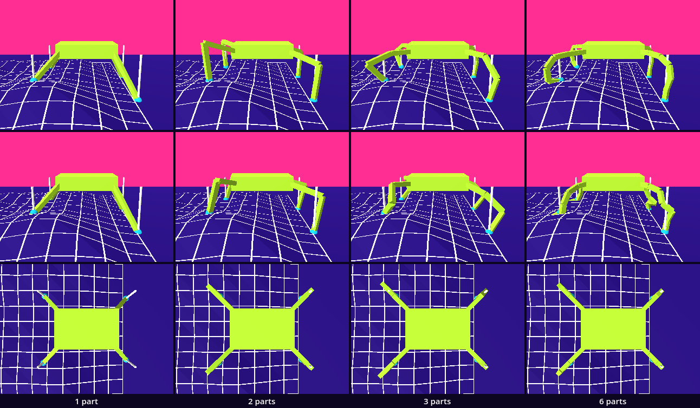
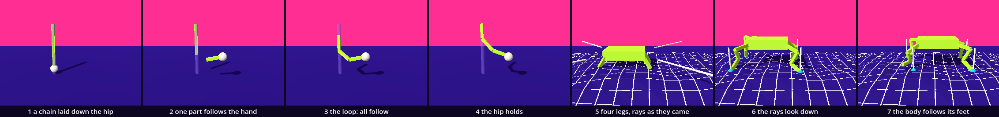

# Legs — the passive part drives

The body of parts was commanded from the top: the parent moved and its children were carried. The walker was pushed from its middle. Here we turn the order round. A leg is a chain of parts that follows its foot. The foot goes where a ray finds the ground. The body stands over the middle of its four feet. One idea is new: a ray that asks the physics where the ground is, and with it the layers a ray looks at. The rest returns: a loop, `look_at()`, a basis, a collider, a scene instanced four times under one body.

This is a new project: import this folder's `project.godot` in the Project Manager.

In the hall, [VFM_09_Legs](../../../../commons/maps/VFM_09_Legs/final.md) asks what lets a body stand, and answers with a row of seven walkers. Its reading is exact about who commands whom there: "The body itself is a mesh whose position is advanced by the patrol code." The feet follow. We build the opposite.

The lesson takes two sessions. The first builds one leg and ends at **Stop here**. The second gives it a ray, puts four legs under a body and compares four kinds of leg. Every message and number on this page comes from running the kit in Godot 4.6. Parts marked *(editor)* describe the editor's own windows and were not watched.

## Find the family in the hall

Does the hall show one work at several values of one axis? Nearly. Beyond its first work, along one line, stand seven walkers, four metres apart: `one_leg`, `two_leg_critter`, `three_leg_critter`, `four_leg_critter`, `five_leg_critter`, `six_leg_critter` and `octapod_ik`. That reads as one axis, the number of legs, at 1, 2, 3, 4, 5, 6 and 8. But they are seven works with seven scenes, and none declares an axis in the registry. The reading says so: "These are related constructions with different rigs and stepping rules, not a proof that a count dictates a way of living." What they share is the leg: every leg in every scene has six bones. The hall sweeps the legs and holds the parts. We will hold four legs and sweep the parts. We read this from the hall's map file, its scenes and the registry; we did not walk it.

Write one prediction down: of the seven walkers, which two will look most alike as they walk? Nobody has rendered that sheet.

## Open the study

Open `legs.tscn` from the FileSystem dock, at the lower left, and press F5, **Run Project** *(editor)*. A lime creature on four legs walks to the right over a bumpy ground with a white net on it. Under each foot lies a cyan ball, and a white line comes down on it: the ray. The creature walks through a pale plank, turns where the floor ends and walks back. The walker stands at the front left, just outside the picture; the long shadow across that corner of the floor is its shadow. Hold D and it walks into view, a cyan capsule. W A S D walk it, and C looks through its eyes.

In the editor's own view you see a white floor and the walker's capsule only *(editor)*. The look is put on when the scene runs, and the ground, the plank and the creature are built by scripts.

Two scripts are ours: `leg.gd` and `creature.gd`. The download holds the finished ones. We take them apart and build them again.

## One part follows

Open `carry.tscn`. It holds a post, a leg hanging from the top of it, a white ball called `Hand`, and a small supplied script that tells the leg every frame where the hand is: `$Leg.follow(hand)`. Replace everything in `leg.gd` with this:

```gdscript
extends Node3D
## A leg is a chain that follows its foot. This node is the hip.

const Look := preload("res://supplied/look.gd")

@export var segments := 3    # parts in the chain: the axis of this chapter
@export var total := 0.8     # metres from hip to foot, whatever the number of parts
@export var reach := 0.35    # metres from the hip, along the leg at rest, to where its ray starts
@export_flags_3d_physics var ground := 1   # the layers that are ground for this foot

var chain: Array[Node3D] = []   # the parts, the hip's end first
var length := 0.0               # metres, of one part
var target := Vector3.ZERO      # where the foot is going
var foot := Vector3.ZERO        # where the foot is now
var led := Vector3.ZERO         # where the loop led the hip's end of the chain
var lead := Vector3.ZERO        # how far from its rest place the ray starts, in the room's axes

func _ready() -> void:
	length = total / segments
	for i in segments:
		var part := Node3D.new()
		add_child(part)
		part.position = Vector3(0, -length * i, 0)   # laid out along the hip's own down
		part.rotation.x = -PI / 2.0                  # its -z, the way it looks, along that down
		var bone := MeshInstance3D.new()
		var box := BoxMesh.new()
		box.size = Vector3(0.05, 0.05, length)
		bone.mesh = box
		bone.material_override = Look.paint(Look.BODY)
		bone.position.z = -length / 2.0              # from the part's own place to its far end
		part.add_child(bone)
		chain.append(part)
	$Mark.material_override = Look.paint(Look.SECOND)
	target = to_global(Vector3(0, -total, 0))
	foot = target

## One part follows: it looks at a place and keeps its length.
func follow(to: Vector3) -> void:
	var part := chain[-1]
	part.look_at(to, global_basis.z)
	part.global_position = to + part.global_basis.z * length
	led = part.global_position

## Where the chain ends now: the far end of its last part.
func tip() -> Vector3:
	return chain[-1].global_position - chain[-1].global_basis.z * length
```

Run this scene and not the project: press F6, or the button with a clapperboard at the top right of the editor, **Run Current Scene** *(editor)*. F5 would run `legs.tscn`. Hold D. The hand moves to the right, and the lowest part of the leg goes with it: its end sits on the hand. The two parts above it hang where they were. The readout says `foot to hand 0.00 m`.

`_ready()` builds the chain. `total / segments` is the length of one part, so three parts or six make the same leg of 0.8 m. Each part is an empty `Node3D` with a box as its child, and the box runs from the part's own place to its far end. The parts are laid out one under the other. Some of the variables wait for the second session.

`follow()` is two lines of work. `look_at(to, ...)` turns the part so that its −z points at the place. Then the part is moved: `global_basis.z` points backwards from where it looks, so `to + global_basis.z * length` is one length behind the place. The far end now touches it. The part has turned and moved, and it has not stretched.

The second argument of `look_at()` says which way is up for the part. Left out, it is the room's up, and a leg that hangs straight down looks along it. Godot then says, and goes on:

```
WARNING: Target and up vectors are colinear. This is not advised as it may cause unwanted rotation around local Z axis.
```

Reading such a line is ordinary. We hand `look_at()` the hip's own z, which lies across the leg.

## The loop: every part follows the next

Replace `follow()` with this:

```gdscript
## The follow loop: the foot leads, each part follows the next, the hip comes last.
func follow(to: Vector3) -> void:
	var aim := to
	for i in range(chain.size() - 1, -1, -1):
		var part := chain[i]
		part.look_at(aim, global_basis.z)                           # it looks at the next
		part.global_position = aim + part.global_basis.z * length   # and keeps its length
		aim = part.global_position
	led = aim
```

Run it (F6) and carry the hand away. All three parts follow, and the whole leg leaves its post, like a rope pulled by one end. `hip led … m away` grows as you go.

`range(chain.size() - 1, -1, -1)` counts down: 2, 1, 0. The loop starts at the foot. The last part follows the hand; then `aim` becomes that part's own place, and the part above follows that. Nothing in the loop knows the hip. The hip's end of the chain comes last and goes where it is led.

We measured what that does. With the foot carried 2 m in a straight line, the hip's end travelled 1.64 m after it and ended 0.02 m above the foot's height, where it had begun 0.80 m above. A chain that only follows lies down behind its foot. It is a tail.

## The hip holds

A leg is a chain that follows at one end and is held at the other. Add two lines at the end of `follow()`:

```gdscript
	for part in chain:                                              # the hip holds: the chain is carried back to it
		part.global_position += global_position - led
```

Run it (F6). The leg stays on its post and reaches for the hand. Near the post the readout says `foot to hand 0.00 m`. Carry the hand far away: the leg stretches out straight towards it, and the number grows.

`global_position - led` is the way back from where the loop led the hip's end to where the hip is. Every part is moved by it, so the chain keeps its shape. The foot is now off its place by the same amount. In the next frame the loop starts from this pose and pulls the foot back, and the chain bends a little more. In our check a leg of three parts had its end within a millimetre of a place 0.54 m from the hip after 2 calls of `follow()`; a leg of six needed 4. A place 1.08 m from the hip is out of reach: the leg ended 0.28 m short of it.

## Stop here: what we have

This is the end of the first session. `leg.gd` should be the script under *One part follows*, with the loop in `follow()` and the two lines of *The hip holds* at its end. Run `carry.tscn` and check three things: the leg stays on its post; its end is on the hand while the hand is near; far from the post it points at the hand and stops short.

## The ray

A foot should not need a hand. Add two functions at the end of `leg.gd`:

```gdscript
## The ray starts at the leg's rest place. True if it found ground.
func find_ground() -> bool:
	var ray: RayCast3D = $Ray
	ray.collision_mask = ground
	ray.global_position = to_global(Vector3(0, -reach, 0)) + lead
	ray.force_raycast_update()
	target = ray.get_collision_point()
	$Beam.show_between(ray.global_position, ray.to_global(ray.target_position))
	return ray.is_colliding()

## One frame of the foot: it glides to its target, lifted while on its way, and the chain follows.
func step(delta: float) -> void:
	foot = foot.move_toward(target, 1.5 * delta)
	$Mark.global_position = target
	follow(foot + Vector3.UP * minf(0.1, foot.distance_to(target)))
```

`Ray` is a node of the leg's scene, a `RayCast3D`: a straight line that asks the physics what it crosses first. We have not set it up. As it comes, its `target_position` is (0, −1, 0): it looks one metre down from where it is. `find_ground()` puts its start `reach` metres along the leg's own down, and `lead` further. `force_raycast_update()` asks now, without waiting for the next physics step. `get_collision_point()` is where the line met something, as a place in the room. The white `Beam` shows where the ray looks, and `Mark` is the cyan ball at `target`.

A ray meets colliders and never meshes, like the marble. And it meets only those on the layers in its `collision_mask`. `@export_flags_3d_physics` shows `ground` in the Inspector, the panel at the right of the editor, as a row of numbered layers to tick *(editor)*. As a number, layer 1 is 1, layer 2 is 2, and both together are 3.

`step()` moves the foot towards its target at 1.5 m a second and hands `follow()` the foot's place, lifted by up to 10 cm while it is still on its way.

On a hip that is not turned, like the one in `carry.tscn`, this ray finds the floor straight under it. We checked that.

## Four legs under one body

Replace everything in `creature.gd` with this:

```gdscript
extends Node3D
## A creature: four legs under one body, and the body follows its feet.

const Look := preload("res://supplied/look.gd")
const LEG := preload("res://leg.tscn")
const ORDER := [0, 2, 1, 3]              # whose turn it is: a foot, then the foot across from it

@export var segments := 3                # parts in each leg
@export var heading := Vector3.RIGHT     # the way the feet reach; Vector3.ZERO and it stands
@export var lead := 0.2                  # metres a foot reaches ahead of its rest place
@export var ride := 0.4                  # metres the body rides above the middle of its feet
@export var beat := 0.2                  # seconds from one foot's turn to the next foot's
@export var leash := 0.0                 # metres from its start before it turns; 0: until the ground ends
@export_flags_3d_physics var ground := 1 # the layers that are ground for its feet
@export var hand: Node3D                 # if set, the first foot goes where this node is

var legs: Array[Node3D] = []
var turn := 0        # a place in ORDER
var clock := 0.0     # seconds since the last turn
var home := Vector3.ZERO

func _ready() -> void:
	var trunk := MeshInstance3D.new()
	var box := BoxMesh.new()
	box.size = Vector3(0.7, 0.16, 0.44)
	trunk.mesh = box
	trunk.material_override = Look.paint(Look.BODY)
	add_child(trunk)
	trunk.create_convex_collision()          # a StaticBody3D: what a walker and a marble meet
	for i in 4:
		var out := Vector3.RIGHT.rotated(Vector3.UP, deg_to_rad(45 + 90 * i))   # the way this leg leaves the body
		var leg := LEG.instantiate()
		leg.segments = segments
		leg.ground = ground
		leg.position = Vector3(signf(out.x) * 0.3, 0, signf(out.z) * 0.18)
		leg.rotation_degrees = Vector3(0, 45 + 90 * i, 90)   # a quarter turn about z lays the leg on its side
		add_child(leg)
		leg.target = leg.to_global(Vector3(0, -leg.reach, 0)) + Vector3.DOWN * ride
		leg.foot = leg.target
		legs.append(leg)
	home = global_position

func _physics_process(delta: float) -> void:
	clock += delta
	if clock >= beat:                        # one foot's turn to find the ground
		clock = 0.0
		var leg := legs[ORDER[turn]]
		turn = (turn + 1) % 4
		if leash > 0.0 and (global_position - home).dot(heading) > leash:
			heading = -heading               # far enough: turn round
		leg.lead = heading * lead
		if not leg.find_ground():
			heading = -heading               # no ground there: turn round
	if hand != null:
		legs[0].target = hand.global_position
	var middle := Vector3.ZERO
	for leg in legs:
		middle += leg.foot / 4.0
	global_position = middle + Vector3.UP * ride   # the body follows its feet
	for leg in legs:
		leg.step(delta)                            # and each leg follows its foot
```

`_ready()` is the body of parts again: one scene, `leg.tscn`, instanced four times under one body, each with its fields set before `add_child()`. The trunk gets a collider in one call, as the plane did: `create_convex_collision()` is the same move for a closed body like a box. A leg as it comes hangs straight down, and four of those make a table. So each hip is turned: a quarter about z lays the leg on its side, and the turn about y, 45°, 135°, 225° and 315°, fans the four out of the body's corners. `out` is that same direction as a vector, and its signs choose the corner.

`_physics_process()` is the chapter. Every `beat`, a fifth of a second, it is one foot's turn: its ray starts `lead` metres ahead, the way of `heading`, and its target becomes the ground there. Every frame the body is put `ride` metres above the middle of the four feet, and then each leg takes its step. Nothing here gives the body a speed. The feet reach ahead and the body follows them.

Run the project (F5).

## The planted bug: a ray that looks sideways

The creature does not walk. It glides to the middle of the room, sinks its four feet into one point, 0.18 m under the ground there, and stays. Four white lines stick out of it sideways, level, a metre long. The Output panel, at the bottom of the editor, has no message about it: in our run Godot logged no error and no warning.

Ask the ray. Add one line to `find_ground()`, under `ray.force_raycast_update()`:

```gdscript
	print(ray.is_colliding(), " ", ray.get_collision_point())
```

Run it. The output fills with one line, four or five times a second:

```
false (0.0, 0.0, 0.0)
```

The ray found nothing, and the point it gave is (0, 0, 0), the middle of the room. All four feet were sent there. Take the `print` line out.

The white lines say why. `target_position` is counted in the ray's own axes, and the ray is a child of the hip. We turned the hip a quarter, so the ray's down now points out of the body, level: (0.71, 0, −0.71) in the room for the first leg. The same ray that found the floor under an unturned hip finds nothing here, and `get_collision_point()` then returns a point that was never a hit. The course's outline expected the foot to step into the air. In Godot 4.6 it steps to the room's origin, and in silence.

The repair has two parts. Replace `find_ground()` with this:

```gdscript
## The ray looks straight down from the leg's rest place. True if it found ground.
func find_ground() -> bool:
	var ray: RayCast3D = $Ray
	ray.collision_mask = ground
	ray.global_position = to_global(Vector3(0, -reach, 0)) + lead
	ray.target_position = ray.to_local(ray.global_position + Vector3.DOWN * 2.0)
	ray.force_raycast_update()
	if ray.is_colliding():
		target = ray.get_collision_point()
		$Beam.show_between(ray.global_position, target)
	else:
		$Beam.show_between(ray.global_position, ray.to_global(ray.target_position))
	return ray.is_colliding()
```

`ray.global_position + Vector3.DOWN * 2.0` is a place in the room, two metres under the ray. `to_local()` says the same place in the ray's own axes, whatever the hip's turn. And the foot takes the point only `if ray.is_colliding()`; otherwise it keeps the place it had. A ray that finds nothing still hands out a point: (0, 0, 0) if it never had a hit, and its last hit if it had one. We measured both. Neither is an answer.

Run it (F5). The creature stands up, walks over the ground, and turns where the floor ends. In our check it walked 2.78 m in 8 seconds, and one started near the end got to x = 3.45 on a floor that ends at 4 and walked back. This is the `leg.gd` and the `creature.gd` in the download.

## The plank: ground is a layer

The pale plank lies in the creature's way, its top 0.25 m up. It has a collider, on layer 2 and no other. Our feet look at layer 1: their highest place at the plank was 0.00 m, the floor under it. Select `Creature` in the Scene dock, at the upper left, and tick layer 2 of **Ground** in the Inspector, at the right *(editor)*, or write `3` for the `1` in the `ground` line of `creature.gd`. Run: the feet step onto the plank, 0.25 m up, and the body rises over it. Nothing about the plank changed. Set `ground` back to 1.

## The argument: how many parts?

The axis is `segments`, the parts in each leg: 1, 2, 3 and 6. The leg is 0.8 m long every time. The creature stands still on the most uneven place of the ground, where two feet stand on the floor and two stand 0.15 and 0.22 m up.

**Write your prediction before you render.** Which two of the four will look most alike? What does a leg of one part do? Write it down, with a reason.

The course's outline made its own: 3 and 6 will look most alike on uneven ground, because both bend smoothly around a step; 1 cannot bend at all, so its foot hangs above the ground or sinks below it.

Then look. Set **Segments** on `Creature` in the Inspector *(editor)*, or change the `3` in `creature.gd`, and run. `sheet.gd` photographs all four; it needs a terminal, as the [README](README.md) says. You can go on without it: this is what our run measured.



The first row is the creature put down and left to stand for three seconds. The second is the same place reached by walking 1.2 m. The third is the first from straight above.

| pair | from rest | on the flat floor | after a walk | from above |
| --- | --- | --- | --- | --- |
| 1 and 2 | 6.55% of the still | 6.55% | 5.72% | 2.80% |
| 1 and 3 | 6.66% | 6.80% | 5.56% | 2.84% |
| 1 and 6 | 6.59% | 6.84% | 5.09% | 2.47% |
| 2 and 3 | 5.44% | 4.74% | 4.67% | 1.53% |
| 2 and 6 | 4.76% | 4.42% | 4.64% | 1.40% |
| 3 and 6 | 3.03% | 1.94% | 4.61% | 0.50% |

The closest pair is 3 and 6 in every column, as the outline said. But read the third column. After a walk, three pairs lie within 0.06 of a percent of each other: 3 and 6 are the closest by a hair. The feet stand on the same places in both rows. Only the legs' history differs, and the loop keeps it: each frame starts from the pose the last one left.

The outline's reason did not hold. We measured the sharpest bend between two parts that follow each other. From rest it is 112.4° with 2 parts, 113.2° with 3 and 74.9° with 6: a leg of 3 bends as sharply as a leg of 2. After the walk the leg of 6 has the sharpest bend of all, 165.0°: one part folded back along the one before it.

The leg of one part did what the outline said, in one direction only. It points at its foot's place and ends 0.20 to 0.36 m past it, under the ground. It never hung above, because the leg is longer than every distance from hip to foot here. With 2, 3 and 6 parts every leg's end was on its place to the millimetre. Walking over the uneven ground, the ends were 0.339 m from their places on average with 1 part, and 0.006, 0.008 and 0.005 m with 2, 3 and 6. The creature walked equally far every time: 2.05 m in 6 seconds. The feet's places do not depend on the legs.

The claim, as measured: one joint decides which grounds a limb can meet. With two parts or more, every standing foot was on its place, 0.45 to 0.61 m from its hip; with one part, none was. Beyond two, the number of parts changes how the leg looks, and how it looks depends on how it got there. The foot's target drives, and the body follows.

**Decide.** One difference could be followed. While the creature walked, we looked at 10 places along every part and counted those under the ground. In two walks it was 0.0% and 0.6% with 2 parts, 0.0% and 0.7% with 3, and 3.5% and 4.9% with 6. A leg of six seems to trail more of itself through the ground behind the foot. The next intervention would be `ride`, from 0.4 to 0.5, counted again. Or settle: one of these four is the leg your body needs, and the table is enough to choose it. Either is right. Write your decision and the reason in your [field note](FIELD_NOTE.md); ours is there as an example of the form.

## What the leg owes

Klee draws movement as a chain of command: an active part, a middle part, a passive part, brain, tendon, bone, and he gives the active and the passive a sex. The scene tree is that chain. The body is the parent of the hip, the hip of the parts, and when the body moves they are carried. We did not take the tree apart. We changed who decides: the foot's target is found first, the chain follows it, and the body is put where its feet are. The passive end drives. That inversion is an order of lines in `_physics_process()`. It is not a costume on the creature. One command is left, and it is in `follow()`: the hip holds, and the chain is carried back to it.

The ground is a setting. The ray sees colliders on the layers of its mask and nothing else: the plank was ground or was not, by one number. The walker is on layer 1, so for a foot it could be ground too: a ray that starts above the walker's head finds it, 1.80 m up. Our rays start at hip height, inside the walker, and a ray does not see a shape it starts inside. A walker standing where a foot comes down changed nothing. That is luck, not design.

And the ray asks about one point. The foot finds the ground; the knee never asks. With one part a quarter of the leg, 24.9% of the places we looked at, was under the ground.

And the loop cannot bend a chain that is straight. A leg of three parts hanging exactly over a place 0.6 m under its hip ended 0.20 m past it, as a leg of one part would. Our hips are turned, so no leg hangs over its foot, and we left it.

## Place: walk to it, carry its foot

The walker is the body here. On its autopilot it walked onto the uneven ground and stood on it, its feet at 0.17 m where the ground is 0.17 m. It walked through the plank, and a marble dropped over the plank fell to the floor, 0.10 m. It walked at the standing creature and was stopped by the trunk's collider, 0.54 m from the creature's middle. A marble dropped on the creature's back stayed there, at 0.58 m. The legs have no colliders; only the trunk stops a body.

Now carry a foot. Add two lines at the end of `_ready()` in `creature.gd`:

```gdscript
	hand = $"../Walker"
	heading = Vector3.ZERO
```

Run (F5), hold D to walk into the picture, and walk on with W A S D. The creature's first foot goes where you are. The leg follows the foot, and the body follows its legs: the other three feet step after it, one at a time. In our check the body had moved 0.51 m towards the walker after the first second. Then the walker walked 2.8 m; the body moved 2.59 m in all and stood 0.88 m from the walker. Take the two lines out.

In the field-trip hall, [Trans_Pit](../../../../commons/maps/Trans_Pit/final.md), walls arrive where you stand, moved by scripts as our trunk is: "The collision follows the visible angle." There the moving body commands the space. Here you command one foot.

No headset was used. A hand would take the foot's cyan ball and pull; the walker stands in for it.

## The process

a chain laid down the hip → one part follows the hand → the loop: all follow → the hip holds → four legs, rays as they came → the rays look down → the body follows its feet



Putting four legs under a body on the borrowed ground changed the picture most, 14.22% of the tile, and that tile is the bug: the body sits at (0, 0.4, 0) on four feet in one point.

## In your room

Copy the folder `guests/legs/` from this kit into your room project's `guests/` folder, and add its line to `GUESTS` in `room.gd`:

```
	"res://guests/legs/legs.tscn",
```

Run the room and walk to it. The creature paces on its place, 6 cm each way, on legs that find your room's floor. We ran the room's own trial in a copy of the room: the walker walked at it and was stopped by its trunk.

Then give one body in your room legs that find the ground. The guest's `creature.gd` has one export more, `rider`: a scene the legs carry on the trunk's back. In your room's copy of `guests/legs/creature.gd`, add a line at the top of `_ready()`:

```
	rider = load("res://guests/example/example.tscn")
```

with the path of a guest of your own in place of the example. In our check the legs carried a box of 0.5 m, its underside at 0.48 m, and a marble dropped on it rested at 1.08 m. Or have the creature follow the visitor: the two lines of *Place*, with `$"../../Walker"` for the path. Write one line in your field note: what your body can do on legs that it could not do before, and what the legs do not know about it.

## What we borrowed

| Part | From | How far we go |
| --- | --- | --- |
| `supplied/base.tscn`, `look.gd` | The base | Use: the floor, the camera, the sky, the palette. |
| `supplied/walker.tscn` | The base | Use: W A S D walk it; `walk_to(points)` is its autopilot. |
| `supplied/mover.gd`, `segment.gd` | The base | Use: the hand of `carry.tscn`; `show_between(a, b)` draws the ray. |
| `borrowed/terrain.gd` | ch12, Noise, as a small version | Use: `height_at(x, z)` is the ground's height at a place of the room; it builds the mesh and the collider from it. |
| `ghost_plank.gd`, `carry.gd`, `carry.tscn` | Supplied here | Use: a board on layer 2; the scene that hands the hand's place to one leg. |
| `RayCast3D` | Godot | Understand: `target_position` in its own axes, `collision_mask`, `force_raycast_update()`, `is_colliding()`, `get_collision_point()`. |
| `look_at()`, `to_local()`, `to_global()`, `global_basis` | Godot | Understand: a node turned at a place; a place said in a node's own axes. |
| `create_convex_collision()`, `move_toward()`, `rotated()`, `signf()`, `minf()`, `deg_to_rad()` | Godot | Use. |
| `sheet.gd`, `verify.gd` | Supplied here | Use: the stills and the checks. |

What we made is `leg.gd`, a chain that follows its foot and is held at its hip, with a ray that finds the foot's next place; and `creature.gd`, four of those legs under a body that stands over its feet.

## What we carry forward

We leave with a loop that runs from the far end back; with `look_at()` and a part that keeps its length; with a ray, its mask and its own axes; with the habit of asking `is_colliding()` before believing a point; and with a body that is put where its passive parts are.

Our creature cannot fall: nothing asks whether its feet hold it up. The hall's other work, a plate on four posts, asks exactly that, and the next stop, *The tightrope walker*, takes it up.
