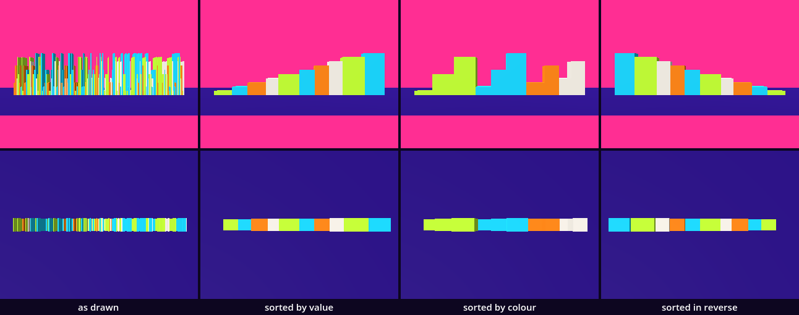
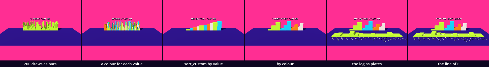

# The QFEP laboratory — order toward entropy

This chapter makes two bodies. The first is a row of 200 symbols, drawn by a seeded generator, which a tween sorts four ways while we count its Shannon entropy. The second is a prediction log: every prediction and observation since the first sheet, read from a file and stood on the floor as a line of plates, one for each chapter, as high as the prediction was wrong. You have the generator and its seed from Disturbed order, `MultiMesh` from the pendulum, dictionaries and JSON. One idea is new: sorting.

This is a new project. In the Project Manager choose **Import** and open this folder's `project.godot`.

The study is one class day with a stop in the middle, at **Stop here**. Every message and number on this page comes from running the study in Godot 4.6. Parts marked *(editor)* describe the editor's own windows and were not watched.

## Find the family in the hall

A lesson starts in its hall, with one question: does the hall show one work at several values of one axis?

Neither of this chapter's two halls does. In [QFEP_F_Term](../../../../commons/maps/QFEP_F_Term/final.md) the rail with the lambda scale declares `calibration`, five values, and the hall sets one, `none`; the workbench beside it declares `evidence`, four values, and stands at one. In [QFEP_Lambda_Spectrum](../../../../commons/maps/QFEP_Lambda_Spectrum/final.md) three works declare axes and each stands once. But the workbench has a rail you move yourself, and its reading says what this lesson measures: "Reversing which bit is common can preserve the amount of uncertainty even though the grid’s dominant colour changes."

The row we build stands in a third hall, [Random_Entropy](../../../../commons/maps/Random_Entropy/final.md): a gauge over two hundred coloured tiles, ten symbols, one seed, and a button that says SORT. We read all of this from the halls' map files, the artifact registry and the readings; we did not walk them.

So stand at the workbench with p near 0.1, then near 0.9, and write down two things before you read H: will the two grids look alike, and will the number be the same?

## Open the study

Open `lab.tscn`: double-click it in the FileSystem dock, at the lower left of the editor. It inherits `supplied/base.tscn`: the floor, the sky and the sun. The editor's own view shows a white floor and Godot's preview light; the look is put on when the scene runs. The scene adds three nodes: `Row`, which runs `row.gd`; `Curve`, which runs `f_curve.gd`; and `Walker`, the supplied walker.

Run it: the Play button at the top right of the editor, or F5. At the back stands a row of 200 thin bars in four colours and ten heights, in no order, and over it `as drawn: H = 3.296 bits`. In front lies a line of sixteen lime plates of different heights, a white line over them and a chapter's name before each. The Output panel, at the bottom of the editor, reads:

```
as drawn: H = 3.296 bits; the row begins [2, 6, 6, 3, 8, 4, 2, 6, 1, 8, 0, 6]
16 chapters; most wrong: extrude, F = 8.97
```

Press Space. The bars glide into a staircase and the number stays. W, A, S and D walk the walker, and C changes between the camera and the walker's eyes.

`row.gd` and `f_curve.gd` are ours. The download holds the finished versions, and the folder `steps/` holds each script as it is after each step below: if you lose your place, copy a step's contents into the script. Now we take them apart and build them again.

## Two hundred draws

Replace everything in `row.gd` with this:

```gdscript
extends Node3D

const ALPHABET := 10   # the symbols are the whole numbers 0 to 9

@export var seed_value := 40   # the row's name: the same number returns the same draws
@export var count := 200       # how many symbols are drawn

var values := PackedInt32Array()      # the symbols, in the order they were drawn

func _ready() -> void:
	var rng := RandomNumberGenerator.new()
	rng.seed = seed_value
	for i in count:
		values.append(rng.randi_range(0, ALPHABET - 1))
	print(count, " symbols; the row begins ", values.slice(0, 12))
```

Run it. The row is gone from the floor, and the output reads `200 symbols; the row begins [2, 6, 6, 3, 8, 4, 2, 6, 1, 8, 0, 6]`. (The line about 16 chapters is the log's; we come to it.) If a red line comes instead, read it: it names the file and the line. That is ordinary.

This is Disturbed order's generator: a seed, then draws. A symbol here is a whole number from 0 to 9. `PackedInt32Array` is the pendulum's kind of list: whole numbers and nothing else. `slice(0, 12)` is the list from place 0 up to, not including, place 12.

## Count them: a dictionary

Add one line at the end of `_ready()`:

```gdscript
	print(tally(values))
```

and one function under `_ready()`:

```gdscript
## How many times each symbol occurs.
func tally(symbols: PackedInt32Array) -> Dictionary:
	var counts := {}
	for s in symbols:
		counts[s] = counts.get(s, 0) + 1
	return counts
```

Run it. The new line: `{ 2: 22, 6: 17, 3: 14, 8: 26, 4: 25, 1: 18, 0: 21, 5: 18, 7: 16, 9: 23 }`.

The keys are the symbols and the values are counts. `counts.get(s, 0)` is the count so far, or 0 for a symbol not met before. Read the order of the keys: 2, 6, 3, 8. It is the order in which the row met them; a dictionary keeps its keys as they came. And the counts are not 20 each. The odds were even, and 3 came 14 times and 8 came 26.

## The entropy: one number from ten counts

Replace the line `print(tally(values))` with this one:

```gdscript
	print("H = %.3f bits; at most %.3f" % [entropy(values), log(ALPHABET) / log(2.0)])
```

and add a second function under `tally()`:

```gdscript
## The Shannon entropy of the symbols' shares, in bits for each symbol.
func entropy(symbols: PackedInt32Array) -> float:
	var counts := tally(symbols)
	var h := 0.0
	for s in ALPHABET:
		var c: int = counts.get(s, 0)
		var p := float(c) / symbols.size()
		h -= p * log(p) / log(2.0)
	return h
```

Run it: `H = 3.296 bits; at most 3.322`.

A symbol's share is its count divided by 200: `p`. Each symbol adds its share times the logarithm of one over its share, and the sum is H. `log()` is the natural logarithm; dividing by `log(2.0)` makes it a logarithm to base 2, and the unit is then the bit. With all ten shares at 0.1, H would be log₂ 10 = 3.322, the most ten symbols can give. A row of one symbol only has H = 0. So H says how evenly the row uses its alphabet. It is the gauge's sum in the hall.

Say what was counted, every time: the distribution is the shares of ten symbols in this one row, and the estimator is the plain one, the shares put into the formula.

## The row as a body

Replace everything above `tally()`, down to the end of `_ready()`, with this:

```gdscript
extends Node3D

const Look := preload("res://supplied/look.gd")

const ALPHABET := 10   # the symbols are the whole numbers 0 to 9
const PITCH := 0.02    # metres from one bar's middle to the next

@export var seed_value := 40   # the row's name: the same number returns the same draws
@export var count := 200       # how many symbols are drawn

var values := PackedInt32Array()      # the symbols, in the order they were drawn
var bars := MultiMesh.new()
var readout: Label3D

func _ready() -> void:
	var rng := RandomNumberGenerator.new()
	rng.seed = seed_value
	for i in count:
		values.append(rng.randi_range(0, ALPHABET - 1))
	build()
	for i in count:
		stand(i, i)
	readout.text = "H = %.3f bits" % entropy(values)
```

And add two functions at the end of the script, under `entropy()`:

```gdscript
## Stands bar i at a place of the row; a place may lie between two whole numbers.
func stand(i: int, place: float) -> void:
	var height := 0.1 * (values[i] + 1)
	var x := (place - (count - 1) / 2.0) * PITCH
	bars.set_instance_transform(i, Transform3D(Basis.from_scale(Vector3(1.0, height, 1.0)), Vector3(x, height / 2.0, 0.0)))

func build() -> void:
	var bar := BoxMesh.new()
	bar.size = Vector3(PITCH, 1.0, 0.3)
	var paint := Look.paint(Color.WHITE)
	paint.vertex_color_use_as_albedo = true   # each bar takes the colour of its instance
	paint.vertex_color_is_srgb = true
	bar.material = paint
	bars.transform_format = MultiMesh.TRANSFORM_3D
	bars.use_colors = true
	bars.mesh = bar
	bars.instance_count = count
	for i in count:
		bars.set_instance_color(i, Look.BODIES[values[i] % 4])
	var holder := MultiMeshInstance3D.new()
	holder.multimesh = bars
	add_child(holder)
	var wall := CollisionShape3D.new()   # for a body the row is one box, as long, high and deep as the row can be
	wall.shape = BoxShape3D.new()
	wall.shape.size = Vector3(count * PITCH, 1.0, 0.3)
	wall.position.y = 0.5
	var body := StaticBody3D.new()
	body.add_child(wall)
	add_child(body)
	readout = Look.label("")
	readout.position.y = 1.3
	add_child(readout)
```

Run it. The row is back, 4 m long, and over it `H = 3.296 bits`.

`build()` is the pendulum's `MultiMesh`: one box, drawn 200 times. Each instance has a transform and, new here, a colour of its own: `use_colors` switches that on, and the material is told to take it. `stand()` writes one bar's transform. A symbol's value is its height, 0.1 m for a 0 and 1.0 m for a 9. Its colour is one of the look's four, chosen by `values[i] % 4`: 0, 4 and 8 are lime, 1, 5 and 9 cyan, 2 and 6 orange, 3 and 7 bone. So a symbol shows twice, as a height and as a colour.

A `MultiMesh` has no collider. For a body the whole row is one box, 4 m long and 1 m high. That is a simplification, and we measure what it costs below.

## sort(): the list in order

Add three lines at the end of `_ready()`:

```gdscript
	var sorted := values.duplicate()
	sorted.sort()
	print("sorted: ", sorted.slice(0, 12), " ... ", sorted.slice(194), "; H = %.3f bits" % entropy(sorted))
```

Run it: `sorted: [0, 0, 0, 0, 0, 0, 0, 0, 0, 0, 0, 0] ... [9, 9, 9, 9, 9, 9]; H = 3.296 bits`. The bars did not move.

`sort()` puts a list in rising order, in the list itself. We sorted a copy, made with `duplicate()`, so `values` still holds the draws. The entropy of the sorted copy is the same 3.296: `tally()` asks how often, never where.

But a sorted list of values cannot move a bar. It says a 0 stands first, and not which of the 21 zeros, or where it came from. To glide every bar to its new place we have to sort the bars' numbers, 0 to 199, by what each one holds. Take the three lines out again.

## Which draw goes where: sort_custom() and a tween

Replace everything above `func _ready()` with this:

```gdscript
extends Node3D

const Look := preload("res://supplied/look.gd")

const NAMES := ["as drawn", "sorted by value", "sorted by colour", "sorted in reverse"]
const ALPHABET := 10   # the symbols are the whole numbers 0 to 9
const PITCH := 0.02    # metres from one bar's middle to the next

@export_enum("as drawn", "sorted by value", "sorted by colour", "sorted in reverse") var arrangement := 0
@export var seed_value := 40   # the row's name: the same number returns the same draws
@export var count := 200       # how many symbols are drawn
@export var glide := 1.5       # seconds a new arrangement takes

var values := PackedInt32Array()      # the symbols, in the order they were drawn
var order: Array = []                 # order[k] is the draw that stands at place k
var came_from := PackedInt32Array()   # for each draw, the place it leaves
var goes_to := PackedInt32Array()     # and the place it glides to
var bars := MultiMesh.new()
var readout: Label3D
var gliding: Tween
```

In `_ready()`, replace the three lines under `build()` with two:

```gdscript
	goes_to.resize(count)
	arrange(arrangement, 0.0)
```

And add five functions at the end of the script:

```gdscript
## The row as it stands now, read from left to right.
func row() -> PackedInt32Array:
	var out := PackedInt32Array()
	for k in order:
		out.append(values[k])
	return out

## Does draw a stand before draw b? The answer depends on `arrangement`.
func before(a: int, b: int) -> bool:
	var va := values[a]
	var vb := values[b]
	if arrangement == 2 and va % 4 != vb % 4:
		return va % 4 < vb % 4
	if va != vb:
		return va > vb if arrangement == 3 else va < vb
	return a < b   # two equal symbols keep the order they were drawn in

func arrange(how: int, seconds: float) -> void:
	arrangement = how
	came_from = goes_to.duplicate()
	order = range(count)
	if how > 0:
		order.sort_custom(before)
	for place in count:
		goes_to[order[place]] = place
	if gliding:
		gliding.kill()   # a glide still under way stops where it is
	if seconds <= 0.0:
		slide(1.0)
	else:
		gliding = create_tween()
		gliding.tween_method(slide, 0.0, 1.0, seconds)
	readout.text = "%s: H = %.3f bits" % [NAMES[how], entropy(row())]
	print(readout.text, "; the row begins ", row().slice(0, 12))

## Every bar at `t` of its way from the place it leaves to the place it goes to.
func slide(t: float) -> void:
	for i in count:
		stand(i, lerpf(came_from[i], goes_to[i], t))

func _process(_delta: float) -> void:
	if Input.is_action_just_pressed("pause"):
		arrange((arrangement + 1) % NAMES.size(), glide)
```

Run it and press Space four times, waiting each time. The bars glide into a staircase that rises, then into four blocks of one colour each, then into a staircase that falls, then back. The output, without the log's line:

```
as drawn: H = 3.296 bits; the row begins [2, 6, 6, 3, 8, 4, 2, 6, 1, 8, 0, 6]
sorted by value: H = 3.296 bits; the row begins [0, 0, 0, 0, 0, 0, 0, 0, 0, 0, 0, 0]
sorted by colour: H = 3.296 bits; the row begins [0, 0, 0, 0, 0, 0, 0, 0, 0, 0, 0, 0]
sorted in reverse: H = 3.296 bits; the row begins [9, 9, 9, 9, 9, 9, 9, 9, 9, 9, 9, 9]
as drawn: H = 3.296 bits; the row begins [2, 6, 6, 3, 8, 4, 2, 6, 1, 8, 0, 6]
```

`order` begins as `range(count)`: the numbers 0 to 199, each the name of one draw. `sort_custom(before)` sorts those names, and asks our function each time it has to decide between two: does draw `a` stand before draw `b`? `before()` answers from what the two hold. By value: the smaller first. In reverse: the larger. By colour: the smaller `% 4` first, and inside one colour the smaller value.

Its last line matters. Godot's sort does not promise to keep two equal things in the order they had, so when two draws hold the same symbol we say it ourselves: the earlier draw first. We tried `return false` in its place: the row read the same, and 197 of the 200 draws stood at another place.

`goes_to` is `order` read the other way: for every draw, its place. A `Tween` changes a value over time: `tween_method(slide, 0.0, 1.0, seconds)` calls `slide()` every frame with a number that runs from 0 to 1, and `slide()` stands each bar that share of the way between its two places, with `lerpf()`. `pause` is the action on Space. The count is made when `arrange()` runs, before a bar has moved. The glide is for our eyes.

## Stop here: what we have

`row.gd` is the script above. Run it and check four things: 200 bars in no order under `as drawn: H = 3.296 bits`; Space glides them into a rising staircase in a second and a half; the fourth Space brings the first row back; all five lines of output say 3.296.

## Your log as a body

Since the first sheet, every lesson has asked for a prediction before the render. To make a body of that log, each chapter needs one number. Our rule: in a chapter's table of pairs, `predicted` is the difference measured for the pair you named as the closest, and `observed` is the difference of the pair that was the closest. If you named it, the two are the same number. Their distance is F:

F = |predicted − observed|

QFEP, this project's own framework, has a term F for the gap between what a model expects and what arrives. Ours is a heuristic reading of it: a prediction error somebody wrote down, in percent of a still. It is not a measured free energy.

Open `sketchbook.json`. Its first entries:

```
{"chapter": "organism", "named": "the end and one third", "predicted": 1.94, "closest": "one third and the centre", "observed": 1.27},
{"chapter": "chessboard", "named": "chessboard and stripes", "predicted": 14.26, "closest": "every cell alike and stripes", "observed": 11.12},
{"chapter": "family", "named": "16 and 64", "predicted": 0.85, "closest": "16 and 64", "observed": 0.85},
```

This file is not a student's sketchbook. It is the course's own: for sixteen chapters whose kits were finished when this one was built, the pair the course's outline named and what the kit's sheet measured. You replace it with yours at the end of this page.

Replace everything in `f_curve.gd` with this:

```gdscript
extends Node3D

@export var log_file := "res://sketchbook.json"

var entries: Array = []   # the log: one dictionary for each chapter, with "f" added
var ranked: Array = []    # the same entries, the most wrong first

func _ready() -> void:
	entries = read_log(log_file)
	ranked = entries.duplicate()
	ranked.sort_custom(func(a: Dictionary, b: Dictionary) -> bool: return a["f"] > b["f"])
	if not ranked.is_empty():
		print("%d chapters; most wrong: %s, F = %.2f" % [entries.size(), ranked[0]["chapter"], ranked[0]["f"]])

## The entries of the log, each with its F: how far the prediction was from the observation.
func read_log(path: String) -> Array:
	var data = JSON.parse_string(FileAccess.get_file_as_string(path))
	if not data is Dictionary or not data.get("entries") is Array:
		print("no log to read at ", path)
		return []
	var out: Array = []
	for entry: Dictionary in data["entries"]:
		entry["f"] = absf(entry["predicted"] - entry["observed"])
		out.append(entry)
	return out
```

Run it. The plates are gone, and the output reads `16 chapters; most wrong: extrude, F = 8.97`.

`JSON.parse_string()` turns the file's text into dictionaries and lists, as it did when you loaded a saved file. Each entry gets one key more, `"f"`. Then `sort_custom()` again, on a list of dictionaries this time. The function it asks is written in place, with `func` and no name: entry `a` stands before entry `b` when its F is larger. `ranked[0]` is the chapter where the prediction was most wrong.

Now the body. Replace everything above `func _ready()`:

```gdscript
extends Node3D

const Look := preload("res://supplied/look.gd")
const Segment := preload("res://supplied/segment.gd")

const STEP := 0.4    # metres from one chapter's plate to the next
const BASE := 0.05   # metres: the height of a plate whose F is 0

@export var log_file := "res://sketchbook.json"
@export var rise := 0.03   # metres of height for one point of F

var entries: Array = []   # the log: one dictionary for each chapter, with "f" added
var ranked: Array = []    # the same entries, the most wrong first
```

In `_ready()`, add six lines under `entries = read_log(log_file)`:

```gdscript
	for i in entries.size():
		add_plate(i)
		if i > 0:
			var line: MeshInstance3D = Segment.new()
			add_child(line)
			line.show_between(top_of(i - 1), top_of(i))
```

And add two functions at the end:

```gdscript
## The middle of the top of plate i: where the line passes and a body stands.
func top_of(i: int) -> Vector3:
	return Vector3((i - (entries.size() - 1) / 2.0) * STEP, BASE + rise * entries[i]["f"], 0.0)

func add_plate(i: int) -> void:
	var top := top_of(i)
	var box := BoxMesh.new()
	box.size = Vector3(STEP, top.y, 0.8)
	var plate := MeshInstance3D.new()
	plate.mesh = box
	plate.material_override = Look.paint(Look.BODY)
	plate.position = Vector3(top.x, top.y / 2.0, 0.0)
	add_child(plate)
	plate.create_convex_collision()   # a body of its own: the walker stands on it
	var label := Look.label("%s  %.2f" % [entries[i]["chapter"], entries[i]["f"]])
	label.font_size = 28
	label.horizontal_alignment = HORIZONTAL_ALIGNMENT_LEFT
	label.rotation = Vector3(-PI / 2.0, -PI / 3.0, 0.0)   # flat on the floor, slanted like the names under a chart
	label.position = Vector3(top.x - 0.1, 0.01, 0.5)
	add_child(label)
```

This is the `f_curve.gd` in the download. Run it. Sixteen plates lie side by side in the order of the course, each 0.4 m wide. A plate with F = 0 is 5 cm high, and every point of F adds 3 cm: extrude, the highest, stands at 0.32 m. The white line is the supplied segment, laid from each plate's top to the next. `create_convex_collision()` gives a plate its body in one call. Nine of the sixteen plates are flat. The other seven are where the outline named a pair that was not the closest.

## A planted bug: twelve symbols

Two hundred bars are too many to read one by one. In `row.gd`, set `count` to 12: in the script, or in the Inspector, at the right of the editor, with `Row` selected in the Scene dock at the upper left *(editor)*.

```gdscript
@export var count := 12        # how many symbols are drawn
```

Run it. Twelve bars, and over them `as drawn: H = -nan bits`. The output: `as drawn: H = -nan bits; the row begins [2, 6, 6, 3, 8, 4, 2, 6, 1, 8, 0, 6]`. Godot printed no error and no warning.

`nan` means *not a number*. Three symbols never occur in these twelve draws: 5, 7 and 9. Our loop asks about all ten. For a symbol with count 0 the share is 0, `log(0.0)` is minus infinity, and 0 times minus infinity is `nan`. Whatever is added to a `nan` is a `nan`, so one missing symbol spoils the whole sum. With 200 draws every symbol occurred and the same script printed 3.296: the fault was there and did not show. (`print()` writes this value as `nan`; the `%.3f` in our line writes `-nan`.)

A symbol that never occurs adds nothing to the entropy. Say so, with two lines in `entropy()` under `var c: int = counts.get(s, 0)`:

```gdscript
		if c == 0:
			continue   # a symbol that never occurs adds nothing
```

Run it: `as drawn: H = 2.585 bits`. Set `count` back to 200:

```gdscript
@export var count := 200       # how many symbols are drawn
```

This is the `row.gd` in the download. The hall's gauge has the same guard: "A symbol that never occurred is skipped rather than given a zero times an infinity."

Three more faults, each run by us, each with a red line to read:

- In `sketchbook.json`, take out the comma at the end of the first entry: `ERROR: Parse JSON failed. Error at line 5: Expected ','`, then our own `no log to read at`, and no plates. Godot counts a file's lines from 0 and names the line where it noticed: the sixth, the one after the missing comma.
- Leave `"observed"` out of an entry: `Invalid access to property or key 'observed' on a base object of type 'Dictionary'.`
- Name the fourth arrangement `"sorted by value, reversed"`: `Parse Error: Argument 4 of annotation "@export_enum" contains a comma. Use separate arguments instead.`

## The argument: how are they arranged?

The axis is `arrangement`: how the same 200 symbols stand in the row. The values are as drawn, sorted by value, sorted by colour, and sorted in reverse.

**Write your prediction before you render.** Which two rows will look most alike? And what will H be for each of the four?

The course's outline made its own: sorted by value and sorted in reverse will look most alike, because they are mirror images; and all four carry exactly the same counted entropy.

Then look: press Space in the running scene. For stills of all four, run `sheet.gd` as the [README](README.md) says; it needs a terminal. You can go on without it: the numbers below are what our run measured.



Each row was photographed alone, from the side and from straight above, 4.95 m away, its shadow off. The table gives the share of the still on which two rows differ.

| pair | from the side | from above |
| --- | --- | --- |
| sorted by colour, sorted in reverse | 15.55% | 5.72% |
| sorted by value, sorted by colour | 16.05% | 6.19% |
| as drawn, sorted by value | 17.20% | 6.31% |
| as drawn, sorted by colour | 18.97% | 6.90% |
| as drawn, sorted in reverse | 19.47% | 6.84% |
| sorted by value, sorted in reverse | 19.92% | 7.59% |

The first half of the outline's prediction was false. Sorted by value and sorted in reverse are the farthest pair, from both standpoints. The measure compares two stills place by place, and where one row has a 0 the other has a 9.

They are mirror images all the same. We flipped the still of the reversed row left to right and measured again: the two then differ on 0.12% of the still from the side and 0.17% from above. We put what is left down to the light: the sun stands to the left, and a flipped still is lit from the right. We did not test that. The outline saw something true that our ruler cannot see. A count of pixels has no notion of a mirror.

The closest pair is sorted by colour and sorted in reverse, and we do not trust it. With seed 41 the closest pair from the side is sorted by value and sorted by colour, 13.30%, and the farthest is again value and reverse, 18.30%. Which two are closest belongs to the seed; which two are farthest did not change.

The second half held. H is 3.29584088399618570 bits for all four rows, the same to the last digit. It holds that exactly because of how we add: `entropy()` takes the symbols in the alphabet's order, 0 to 9, whatever the row. We also summed in the order the dictionary met the symbols. Then the reversed row read 3.29584088399618610: the same ten numbers, added in another order, differ in the sixteenth digit.

The claim, as measured: entropy counts what there is, not how it is arranged. Four rows that differ on 15.55% to 19.92% of a still have one H.

**Decide.** One difference here could be followed. H cannot tell these rows apart; is there a count that can? The next intervention would be to count *runs*: the places where a symbol differs from its left neighbour, plus one. We counted them: 175 as drawn, and 10 for each of the three sorted rows. Runs see order and still cannot tell a staircase from its mirror. Or settle: the sheet shows what the number hides, and that is the argument. Either is right. Write your decision and its reason in your [field note](FIELD_NOTE.md); ours is there as an example of the form, not of the answer.

## What the number owes

Shannon entropy measures a distribution and is blind to arrangement. The metric hides exactly what the sheet shows.

The number also depends on what we call a symbol. Count the same row by colour, four symbols in place of ten, and it has 1.921 bits of at most 2. Nothing in the row changed; the description did.

And it depends on the estimator. Our source is even, so its entropy is 3.322 bits, and our row reads 3.296. That is no accident of seed 40. The rows of seeds 1 to 100 read from 3.245 to 3.319, 3.292 on average, and not one reaches 3.322. Shares counted in a sample are never quite even, so the plain estimator reads low.

What we counted is the entropy of the symbol shares in one row. It is not the entropy of the room, of your search, or of you, and this chapter makes no claim about those.

F owes more. The hall says it: "Predictability under an assumed distribution, a realised prediction error and variational free energy are not interchangeable quantities." Ours is the second of the three. QFEP is this project's own framework, and an F measured on a learner must not become a score. We did not add the sixteen numbers up, and you should not. The log is for the student, not for the grade. An F of 0 hides things too: in the legs chapter the outline named the right pair for a reason that did not hold, and its plate is as flat as any.

## Walk your curve

Run the scene, press C for the walker's eyes, and walk along the log with W, over the plates. The chapters where the prediction was most wrong are the highest points. Stand on them.

We sent the walker along the log on its autopilot, from plate to plate. It arrived on all sixteen. On extrude its feet stood at 0.32 m, on the plate's top. On six plates they did not touch the plate at all. The walker is 0.6 m wide and a plate 0.4 m, so on collage, 5 cm high, its feet were at 0.30 m: held up by extrude beside it. A body can stand on a peak of this curve and cannot stand in the valley next to one.

The height of a point is a choice too. With `rise` at 0.1 the plate of extrude is 0.95 m high, a wall: the walker was stopped on collage, 0.10 m short of its middle.

Sent at the row, the walker was stopped 0.32 m from its face: for a body the row is its one box. A marble dropped over the zeros, bars 0.1 m high, came to rest at 1.10 m, on the box's top, 0.9 m above the bars it was over. That is what the simplification costs.

No headset was used and nobody walked with their hands on the keys: the walker was driven by its autopilot.

## The process

200 draws as bars → a colour for each value → sort_custom by value → by colour → the log as plates → the line of F



`sheet.gd` makes the strip. The step that changed the tile most was *the log as plates*, 6.56%: a second body. Among the steps of the row it was *sort_custom by value*, 5.37%. And *the line of F* changed 0.27%: the smallest step in the picture is the one the log is read by.

## In your room

The kit hands your room one body: the log as a small relief, in `guests/qfep-lab/`.

Copy the folder `guests/qfep-lab/` from this kit into the `guests/` folder of your room project. Then open `room.gd` in the room and add its line to the list, under the last one:

```gdscript
	"res://guests/qfep-lab/qfep-lab.tscn",
```

Run the room and walk to it. In our copy of the room it stood at place 2 and the Output panel read `QFEP lab: 16 chapters; most wrong: extrude, F = 8.97`. Sixteen narrow plates stand side by side, 1.5 m in all, the highest 0.3 m and cyan, with its chapter's name over it. The walker, sent at it from the aisle, was stopped by it, 0.50 m from the middle of the place, its feet on the floor: sixteen narrow tops gave it no level place to step onto.

Now the room's task: plan your final project. The guest reads the file `sketchbook.json` in its own folder. In your room, open `guests/qfep-lab/sketchbook.json` and replace the entries with your own, one for each chapter where you wrote a prediction: the pair you named and its number from that lesson's table, the closest pair and its number. Keep the commas. Run the room. The cyan plate is the chapter where you were most wrong.

We did the same with a file of three chapters: the room printed `QFEP lab: 3 chapters; most wrong: two, F = 6.50` and stood three plates, each 0.5 m wide. This time the walker stepped onto the highest and stood on it, its feet at 0.30 m.

Build your hall's argument on your cyan chapter: write in your field note what you named there, what was measured, and the one axis you will sweep in your hall to find out why.

## What we borrowed

| Part | From | How far we go |
| --- | --- | --- |
| `supplied/base.tscn`, `look.gd`, `walker.tscn`, `segment.gd` | the kit base | Use: the floor, sky and sun; `Look.paint()`, `Look.BODIES`, `Look.label()`; the walker; `show_between(a, b)` lays a line. No colour here is ours. |
| `RandomNumberGenerator`, `MultiMesh`, `JSON` | Godot, earlier chapters | Use: as before. New: a colour for each instance. |
| `sort()`, `sort_custom()` | Godot | Use: we decide what stands before what. How it sorts we did not open. |
| `Tween`, `tween_method()`, `kill()` | Godot | Use: a number from 0 to 1 over a time, handed to our function every frame. |
| `log()` | Godot | Use: the natural logarithm. `log(0.0)` is `-inf`. |
| `sketchbook.json` | sixteen kits of this course | Understand: read from their sheets on 1 October 2026; not run again here. |
| `verify.gd`, `sheet.gd` | Supplied here | Use: the checks, and the stills and measures of this page. |

What we made is `row.gd`: seeded draws, a count in a dictionary, an entropy, a row of bars, three orders from one function, and a glide. And `f_curve.gd`: a log read from a file, ranked, and stood on the floor.

## What we carry forward

We leave with `sort()` and `sort_custom()`, and a function that answers which of two comes first; with a tween; with an entropy, and the habit of saying which distribution was counted and how; and with a number that did not move while the picture did.

The next stop is the last: *Your hall*. It begins with the chapter your log names.
