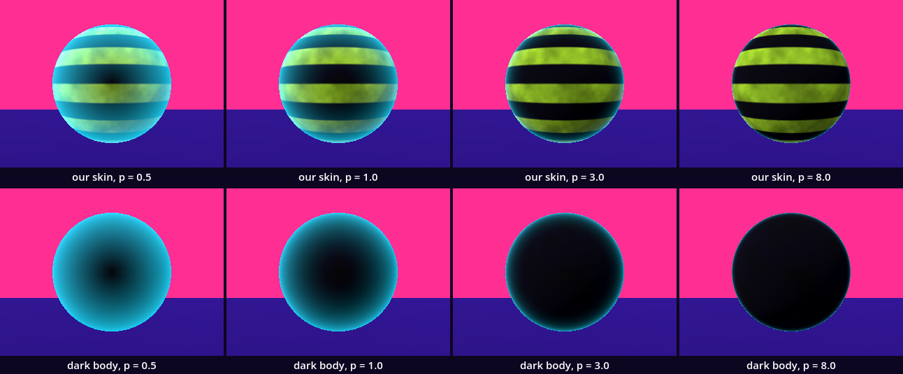
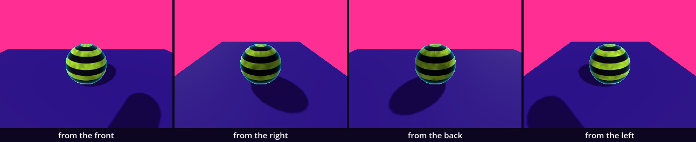
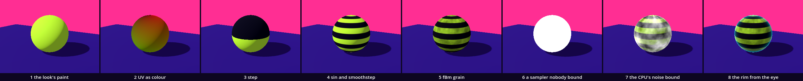

# The Shader Skin — the pixel's colour circle

So far a body got its colour from `paint()`: one colour for the whole body, and the light did the rest. Here one member of your family gets a skin that is computed. A small program, a shader, is asked for the colour of every pixel the body covers, in every frame. It draws stripes from the body's UV with `step`, `sin` and `smoothstep`, clouds them with the octaves of the Noise chapter, and lights the body's edge from the angle between its surface and your eye. You have met all the parts: UV, `mix` as interpolation, the sine, normals, octaves of noise, `@export`. Two ideas are new: the shader, and the uniform, the wire by which a script hands a shader its numbers.

This is a new project, like every stop of this course: in the Project Manager choose **Import** and open this folder's `project.godot`.

In the halls, [Shader_01_Shaping](../../../../commons/maps/Shader_01_Shaping/final.md) hangs five squares on a wall, one for each shaping function, and says what a shader is: "The square is not a thing that gets changed. It is a rule, and the rule is asked, for every pixel of the square, on every frame the museum draws". [Shader_11_QueerRubber](../../../../commons/maps/Shader_11_QueerRubber/final.md) puts such rules on five bodies and asks what a surface answers to: the lamps, the clock, "the angle at which it turns from your eye".

This study takes two sessions. The first builds the skin and ends at **Stop here**. The second compares four exponents on a sheet, walks around the body and takes it to your room.

Every message and number on this page comes from running the study in Godot 4.6. Parts marked *(editor)* describe the editor's own windows and were not watched.

## Find the family in the hall

A lesson starts in its hall, with one question: does the hall show one work at several values of one axis? If it does, predict which two look most alike before you read anything beside them.

Neither hall shows a family as a family. The dark sphere that stands in both declares two axes in the registry, `presence` with five values and `body` with four, and stands at one value of each. The screen in the first hall declares `support` and `surface` and stands at one value of each too. The five squares and the five bodies declare no axis at all.

But this chapter's axis is in the second hall, three times, and nobody named it. Three of the five bodies light their edge with the same rule and raise it to another power. The pink sphere: `rim = pow(rim, 3.0);`. The black ring: `pow(rim, 2.0)`. The capsule: `pow(noisy_rim, 1.0 - sheen_sharpness)`, and nothing sets `sheen_sharpness`, so it keeps its default of 0.5 and the exponent is 0.5. One rule at 0.5, 2 and 3, on a capsule, a ring and a sphere, in three colours, under three coloured lamps. Nobody can compare them there. We read this from the hall's map file, its script, its five shader files and the artifact registry; we did not walk it.

So stand in front of the three and write down which one glows furthest in from its edge, and which has the thinnest edge. This study puts four exponents on one body in one colour and measures.

## Open the study

Open the [Shader skin study](README.md), then `shader_skin.tscn`. The scene inherits the supplied base: the floor, the fixed camera and the look. In the editor the floor is white under Godot's preview light; the look is made by a script when the scene runs. Three nodes are added: `Skin`, an empty `Node3D` which runs `shader_skin.gd`; `Walker`, the supplied walker; and `Readout`, the words in the air.

Run it. A sphere of one metre stands on the floor in lime and near-black stripes with clouds in the lime, and its edge glows cyan. The stripes crawl slowly upward. The Output panel, at the bottom of the editor, reads:

```
the member wears ShaderMaterial with 8 uniforms; rim_power 3.0
```

Press Space: the glow changes, and the Output says `rim_power 8.0`, then 0.5, 1.0 and 3.0 again. Press C to look through the walker's eyes, walk with W A S D, and hold V and move the mouse to look.

Two files are ours: `shader_skin.gd` and `skin.gdshader`. The download holds the finished versions. We will take them apart and build them again. To open the shader, double-click `skin.gdshader` in the FileSystem dock, at the lower left; it opens in the Shader Editor, a panel at the bottom of the editor *(editor)*. If you get lost, the folder `steps/` holds the shader as it is after each step.

## The member, in the look's paint

Replace everything in `shader_skin.gd` with this:

```gdscript
extends Node3D

const Look := preload("res://supplied/look.gd")
const Member := preload("res://parts/member.gd")

func _ready() -> void:
	var member: MeshInstance3D = Member.make(64)
	add_child(member)
	member.material_override = Look.paint(Look.BODY)
	print("the member wears ", member.material_override.get_class())
```

Run it. A lime sphere stands on the floor, lighter where the sun reaches it. The Output: `the member wears StandardMaterial3D`.

`Member.make(64)` is borrowed from Families: the member of 64 segments, with a collider. `paint()` gives it the material every body has had so far: one colour, and Godot's own rule for how light falls on it. That rule is a shader too, one Godot wrote. Now we write our own.

## A skin that is asked

Replace everything in `skin.gdshader` with this:

```glsl
shader_type spatial;

void fragment() {
	ALBEDO = vec3(UV.x, UV.y, 0.0);
}
```

And everything in `shader_skin.gd` with this:

```gdscript
extends Node3D

const Look := preload("res://supplied/look.gd")
const Member := preload("res://parts/member.gd")

var material := ShaderMaterial.new()

func _ready() -> void:
	var member: MeshInstance3D = Member.make(64)
	add_child(member)
	material.shader = load("res://skin.gdshader")
	member.material_override = material
	print("the member wears ", material.get_class(), " with ", material.shader.get_shader_uniform_list().size(), " uniforms")
```

Run it. The sphere is red at the top and turns green towards the ground, with more red on one side than on the other. The Output: `the member wears ShaderMaterial with 0 uniforms`.

A `ShaderMaterial` is a material whose rule we write. `shader_type spatial` says the rule is for a body in space. `fragment()` is the function Godot calls for every pixel the body covers, in every frame. It has no loop and no list: each call knows one pixel. `UV` is that pixel's place on the body's own map, two numbers from 0 to 1. `ALBEDO` is the colour we answer with, a `vec3`: red, green, blue. So this sphere shows its own map: `UV.x` as red, once round; `UV.y` as green, 0 at the top and 1 at the bottom. These are not colours of the palette. They are coordinates, drawn. The sun still shades them: we set the colour, and Godot's light is applied after.

## A uniform: two colours handed over

Replace everything in `skin.gdshader` with this:

```glsl
shader_type spatial;

uniform vec3 body_colour : source_color;
uniform vec3 band_colour : source_color;

void fragment() {
	float band = step(0.5, UV.y);
	ALBEDO = mix(band_colour, body_colour, band);
}
```

Run it. The sphere is black, but for a faint shine where the sun hits it. The Output: `the member wears ShaderMaterial with 2 uniforms`.

A `uniform` is a variable of the shader that is set from outside. It has the same value for every pixel, which is its name. Nobody has set these two, and a `vec3` nobody set is three zeros. Add two lines to `_ready()`, above the `print` line:

```gdscript
	material.set_shader_parameter("body_colour", Look.BODY)
	material.set_shader_parameter("band_colour", Look.SHADE)
```

Run it. The upper half is near-black and the lower half lime.

`set_shader_parameter()` takes the uniform's name as a text and a value. A name the shader does not have is taken too: write `"body_color"` and the material keeps it, the shader never hears of it, and nothing is printed. `: source_color` tells Godot that the three numbers are a colour as the palette writes it. `step(0.5, UV.y)` is the hall's first desk: 0 below the edge, 1 from the edge on, nothing in between. `mix(a, b, t)` is interpolation: `a` where `t` is 0, `b` where it is 1. The shader holds no colour of its own; the script hands it the palette's.

## Stripes: a sine, and an error worth reading

Replace the line that begins `float band` with two:

```glsl
	float wave = 0.5 + 0.5 * sin(UV.y * 6 * TAU);
	float band = step(0.5, wave);
```

Run it. The sphere is grey, and the Output has red lines in it:

```
--res://skin.gdshader--
    5 | 
    6 | void fragment() {
E   7->  float wave = 0.5 + 0.5 * sin(UV.y * 6 * TAU);
    8 |  float band = step(0.5, wave);
    9 |  ALBEDO = mix(band_colour, body_colour, band);
SHADER ERROR: Invalid arguments to operator '*': 'float, int'.
   at: (null) (res://skin.gdshader:7)
```

Reading an error is ordinary work. This one says where: line 7 of `skin.gdshader`, with an arrow. And what: the `*` was given a `float` and an `int`. `UV.y` is a number with decimals; `6` is a whole number; the shader language does not multiply the two. GDScript would have. The body is grey because Godot draws a body whose shader it refused with a plain material, and our own line now ends `with 0 uniforms`: a refused shader has none. The repair is two characters:

```glsl
	float wave = 0.5 + 0.5 * sin(UV.y * 6.0 * TAU);
```

Run it. Stripes with hard edges. The sine swings six times between the poles, so the body is cut into six lime stripes and six dark ones; from the side, 2 m away, a still crosses five of the lime ones, because the cap at the top is over the horizon. `0.5 + 0.5 * sin(...)` moves the sine from between −1 and 1 to between 0 and 1.

Now the edges, the count and the clock become numbers a script can set. Replace everything in `skin.gdshader` with this:

```glsl
shader_type spatial;

uniform vec3 body_colour : source_color;
uniform vec3 band_colour : source_color;
uniform float bands : hint_range(1.0, 16.0) = 6.0;
uniform float softness : hint_range(0.01, 0.5) = 0.1;
uniform float drift : hint_range(0.0, 1.0) = 0.0;

void fragment() {
	float wave = 0.5 + 0.5 * sin((UV.y * bands + TIME * drift) * TAU);
	float band = smoothstep(0.5 - softness, 0.5 + softness, wave);
	ALBEDO = mix(band_colour, body_colour, band);
}
```

And add one line to `_ready()`, above the `print` line:

```gdscript
	material.set_shader_parameter("drift", 0.1)
```

Run it. The edges are soft, and the stripes crawl upward. The Output says `5 uniforms`.

`smoothstep(a, b, x)` is the hall's second desk: 0 below `a`, 1 above `b`, and an S between them. A uniform can have a default, after `=`, and a `hint_range`, which gives it a slider in the Inspector *(editor)*. We set `drift` and left `bands` and `softness` at their defaults. `TIME` is a clock: the seconds since the program started. Our script has no `_process()`: no line of it runs after `_ready()`. The stripes move because the rule is asked again for every frame, with another `TIME`. With `drift` at 0.1, two stills taken 1.08 seconds apart differed on 8.48% of the still, and the stripes had moved up by 18 pixels; with `drift` at 0, on 0.00%. The hall says it of its wave: "It can only be asked again."

## Grain: noise for every pixel

Add one uniform under the line of `drift`:

```glsl
uniform float grain : hint_range(0.0, 1.0) = 0.6;
```

Add three functions above `void fragment()`:

```glsl
float hash(vec2 p) {
	return fract(sin(dot(p, vec2(127.1, 311.7))) * 43758.5453);
}

float noise(vec2 p) {
	vec2 i = floor(p);
	vec2 f = fract(p);
	vec2 u = f * f * (3.0 - 2.0 * f);
	float low = mix(hash(i), hash(i + vec2(1.0, 0.0)), u.x);
	float high = mix(hash(i + vec2(0.0, 1.0)), hash(i + vec2(1.0, 1.0)), u.x);
	return mix(low, high, u.y);
}

float fbm(vec2 p) {
	float value = 0.0;
	float amplitude = 0.5;
	for (int i = 0; i < 5; i++) {
		value += amplitude * noise(p);
		p *= 2.0;
		amplitude *= 0.5;
	}
	return value;
}

```

And replace the line that begins `ALBEDO` with two:

```glsl
	float cloud = fbm(UV * vec2(24.0, 12.0));
	ALBEDO = mix(band_colour, body_colour, band) * mix(1.0, cloud, grain);
```

Run it. The lime stripes are clouded, darker in patches; the dark stripes look as before. The Output says `6 uniforms`.

This is the Noise chapter again, written out. `hash()` makes a number that looks like chance from a place: the same place always gives the same number, so nothing has to be remembered. `noise()` takes the four corners of the cell a place lies in and interpolates between their numbers; `f * f * (3.0 - 2.0 * f)` is `smoothstep` by hand. `fbm()` is the octaves: five layers, each twice as fine and half as strong. There the loop ran on the CPU, once for each corner of a terrain. Here it runs for every pixel of the body in every frame. `UV * vec2(24.0, 12.0)` makes 24 cells round and 12 from pole to pole. The hall [Shader_09_FBM](../../../../commons/maps/Shader_09_FBM/final.md) hangs the same loop on its wall, with a desk of sliders for its numbers.

## Glow from a picture, and nobody brought the picture

`ALBEDO` is what the body reflects. `EMISSION` is light it claims to make. First we take the glow from a picture. Add one uniform under the line of `grain`:

```glsl
uniform sampler2D glow_map;
```

And one line at the end of `fragment()`:

```glsl
	EMISSION = texture(glow_map, UV).rgb;
```

Run it. The body is white. Not light: white. In our still all of it, 100.00% of its pixels, is exactly `#ffffff`: no stripes, no clouds, no shading. The Output says `7 uniforms` and nothing else. No error, no warning.

A `sampler2D` is a picture the shader may read, and `texture(glow_map, UV)` reads its colour at this pixel's place. We declared the picture and never handed one over. Godot gives a sampler nobody bound a white picture, in silence, and white in `EMISSION` is full glow on every pixel. The hall has this fault twice, more quietly: the cube's tears and the ring's oil are each read from a picture the hall "never hands it". The hall [Shader_10_ReactionDiffusion](../../../../commons/maps/Shader_10_ReactionDiffusion/final.md) has it at full size: one square is green from edge to edge, because its rule asks for a picture of its own last frame and nobody hands it one. "A texture nobody assigns reads as white".

The repair is to bring the picture. Add three lines to `_ready()`, above the `print` line:

```gdscript
	var noise := FastNoiseLite.new()
	noise.frequency = 0.02
	material.set_shader_parameter("glow_map", ImageTexture.create_from_image(noise.get_image(256, 128)))
```

Run it. The stripes are back, under white clouds that glow. `FastNoiseLite` is Godot's noise on the CPU: the script made 256 by 128 values once, in `_ready()` (3.8 ms on our machine), and the shader only looks them up.

## Glow from the eye: the rim

A picture is one way to say where a body glows. The other is to compute it, from something a picture cannot hold: where you stand. In `skin.gdshader`, replace the line `uniform sampler2D glow_map;` with two:

```glsl
uniform vec3 rim_colour : source_color;
uniform float rim_power : hint_range(0.25, 8.0) = 3.0;
```

And the line that begins `EMISSION` with two:

```glsl
	float facing = clamp(dot(NORMAL, VIEW), 0.0, 1.0);
	EMISSION = rim_colour * pow(1.0 - facing, rim_power);
```

In `shader_skin.gd`, replace the three lines of the noise with one:

```gdscript
	material.set_shader_parameter("rim_colour", Look.SECOND)
```

Run it. The clouds of light are gone, and the body has a thin cyan edge. The Output says `8 uniforms`.

`NORMAL` is the way the surface faces at this pixel. `VIEW` is the way from this pixel to the eye. Their `dot` is 1 where the surface faces you and 0 where it turns away edge-on; `clamp` keeps it between the two. `1.0 - facing` turns that round: nothing in the middle of the body, 1 at its outline. `pow(..., rim_power)` bends it: halfway, 0.5 to the power of 3 is 0.125, so most of the glow is squeezed to the outline. The hall writes the same line on its pink sphere. We made the rim SECOND, the walker's colour: it is the part of the skin that belongs to whoever looks.

## Stop here: what we have

This is the end of the first session. `skin.gdshader` should be the file `steps/4_grain.gdshader` with the two rim uniforms and the two rim lines added; `shader_skin.gd` ends with three colours and `drift` handed over. Run the study and check four things: lime and dark stripes with soft edges, crawling upward; clouds in the lime; a thin cyan edge all round; the Output says `8 uniforms` and has no red line.

## The argument: which exponent?

The exponent becomes an axis. Replace everything in `shader_skin.gd` with this:

```gdscript
extends Node3D

const Look := preload("res://supplied/look.gd")
const Member := preload("res://parts/member.gd")
const POWERS := [0.5, 1.0, 3.0, 8.0]   # the axis: four exponents for the rim

@export_range(0.25, 8.0) var rim_power := 3.0   # the rim's exponent
@export_range(0.0, 1.0) var drift := 0.1        # how many bands a second the stripes crawl

var material := ShaderMaterial.new()

func _ready() -> void:
	var member: MeshInstance3D = Member.make(64)
	add_child(member)
	material.shader = load("res://skin.gdshader")
	member.material_override = material
	material.set_shader_parameter("body_colour", Look.BODY)
	material.set_shader_parameter("band_colour", Look.SHADE)
	material.set_shader_parameter("rim_colour", Look.SECOND)
	material.set_shader_parameter("drift", drift)
	material.set_shader_parameter("rim_power", rim_power)
	print("the member wears ", material.get_class(), " with ", material.shader.get_shader_uniform_list().size(), " uniforms; rim_power ", material.get_shader_parameter("rim_power"))

func _process(_delta: float) -> void:
	if Input.is_action_just_pressed("pause"):
		rim_power = POWERS[(POWERS.find(rim_power) + 1) % POWERS.size()]
		material.set_shader_parameter("rim_power", rim_power)
		print("rim_power ", rim_power)
```

This is the `shader_skin.gd` of the download. Two exported fields hold the two numbers; `_ready()` hands them to the shader and reads one back, as Families taught: read back what was built. `_process()` is new here and does one thing: on Space it takes the next exponent of the list and hands it over. A uniform can be set while the scene runs.

**Write your prediction before you render.** One body, four exponents: 0.5, 1, 3 and 8, seen from the side, 2 m away. Which two will look most alike? What does 0.5 do to the stripes? Write it down, with a reason.

Then look: run the study and press Space. For stills of all four, run `sheet.gd` as the [README](README.md) says; the table below is what it measured, so you can go on without it.



The stills are made in the sheet's plain studio, under a flat sky; the scene you run has the look's sky, violet down to pink. The body covers 29.58% of the still. Two stills differ at a pixel when its three channels together are more than a tenth of full scale apart.

| pair | differ on, of the still | on the dark body |
| --- | --- | --- |
| 0.5 and 1 | 28.48% | 29.00% |
| 0.5 and 3 | 29.07% | 29.38% |
| 0.5 and 8 | 29.12% | 29.40% |
| 1 and 3 | 24.19% | 25.76% |
| 1 and 8 | 24.25% | 25.79% |
| 3 and 8 | 9.06% | 10.52% |

| exponent | the rim changes, of the body | it begins, of the radius | left half's brightness, of the right's |
| --- | --- | --- | --- |
| 0.5 | 98.47% | 0.25 | 1.11 |
| 1 | 82.03% | 0.46 | 1.15 |
| 3 | 30.73% | 0.82 | 1.23 |
| 8 | 6.77% | 0.96 | 1.26 |

The closest pair is 3 and 8, on our skin and on the dark body, and from 5 m as well (1.31% of a still in which the body is small). The course's outline predicted that: "both give a thin bright edge on a dark body". They are still not alike: they differ on 9.06% of the still, nearly a third of the body. At 3 the glow begins 0.82 of the radius from the middle; at 8 it is the last twenty-fifth.

The outline's second sentence was: "0.5 floods the whole body with the rim colour, so it reads as unlit." The flood is real: at 0.5 the rim changes 98.47% of the body, and only a dark pupil is left in the middle, facing you. For "unlit" we measured the sun: it stands to the left, so the body's left half is brighter than its right. With the rim black the left half is 1.27 times as bright as the right. The same skin with no light at all, the shader with `render_mode unshaded;` added, measures 1.02: the clouds are not the same left and right, and that is the floor of this measure. At 8 the ratio is 1.26, at 0.5 still 1.11. So the glow at 0.5 takes away 0.16 of the 0.25 between lit and unlit, nearly two thirds, and not all of it. On the dark body the sun alone gives 1.95 and no light 1.07, and the rim at 0.5 gives 1.04: by this measure that body cannot be told from an unlit one. So the sentence held on a dark body and in part on ours: how much depends on what is under the rim.

The claim: a skin can be computed from the angle between the body and your eye, and one exponent takes the same body from a lamp with a pupil to a hairline. The outline says "rubber or glass". That is an eye's word, and no eye was asked: every "alike" here is a count of pixels.

## Decide

One difference you could follow. The closest pair still differs on a third of the body, so between 3 and 8 something is still changing; the next intervention would be values between them, 4, 5 and 6, to find where the edge stops moving for your still. Another: "unlit" depended on the body under the rim, so the next intervention would be `body_colour` and not the exponent. Or settle: you have four skins measured, and one of them may already be the one your body wants. Settling is equally right. Write your decision and its reason in your field note.

## What the skin owes

The GPU computes every pixel at once and remembers nothing between them (after Jacob Gaboury's *Image Objects*). From 2 m our body covers 204,480 pixels of the still; each asks five octaves of noise, in every frame, and nothing is kept. No line of GDScript can ask the skin what colour it is at a place. The picture we bound was the other kind of noise: 32,768 values made once, which the script still holds and could read.

The shader's noise is not the Noise chapter's. The loop is shared, and the look. The body is not. A marble dropped on the top came to rest at 1.09 m with `grain` at 0 and at 1, the same to the millimetre (a centimetre lower than the two radii say; we did not look for the cause), and the walker was stopped 0.80 m from the middle from four sides: the collider is a smooth sphere, whatever the skin shows. You could stand on the terrain. You cannot stand on a shader. The hall says it of its water: "a picture that happens to lie under a floor."

The skin has a seam. `UV.x` runs once round and jumps from 1 back to 0 on a line from pole to pole, and `hash()` knows nothing of that: the clouds break there. The borrowed member is turned so that the line is at the back. Measured across the body's middle line, the colour steps by 15.4 of 765 from behind and by 1.2 from in front. At the poles the cells are squeezed into rays; you can see them on the cap. The hall [Shader_05_Patterns](../../../../commons/maps/Shader_05_Patterns/final.md) is named for this: "Where are the seams?"

And a skin computed from the viewer changes with who looks. That is the next section.

## Walk around it

Run the study, press C, and walk round the body. The rim comes with you.

`sheet.gd` stood the walker 2 m from the body on four sides and photographed through its eyes, at 1.60 m, once with the rim and once with `rim_colour` set to black.



From every side the rim changes 29.92% to 30.53% of the body and begins 0.82 or 0.83 of the radius from the middle. Laid over each other, 97.06% to 97.53% of the rim's pixels are the same pixels of the still. Under the rim, the skin from the front and the skin from another side differ on 51.99% to 71.26% of the body: the clouds are other clouds, the seam shows from behind, and the bright half changes sides, 1.18 and 1.25 times the right half from the front and the right, 0.87 and 0.81 from the back and the left. The clouds and the seam stay on the body. The sun stays in the room. The rim stays with the eye.

So there is no place on the body where the rim is. Each camera gets its own: the fixed camera has the rim on its outline, the walker's eyes on theirs, and C changes between the two. Two visitors see two skins. The hall: "The rainbow comes with you."

For a body, the skin is not there. The walker's autopilot walked round the body by four points, 1.5 m out, and arrived; sent at the body from four sides it was `blocked` each time, 0.80 m from the middle, which is the sphere's radius and its own.

No headset was used, and the walker was walked by its autopilot, not by a hand on the keys. In a headset each eye is a camera, so each eye would get a rim of its own; that was not checked.

## The process

the look's paint → UV as colour → step → sin and smoothstep → fBm grain → a sampler nobody bound → the CPU's noise bound → the rim from the eye



From the strip's standpoint the body covers 15.24% of the still. Three steps changed 15.24% of the tile, every pixel of the body: the first shader, the first `step`, and the picture nobody brought. The step that made stripes changed least, 6.95%.

## In your room

Copy the folder `guests/shader-skin/` from your copy of this kit into the `guests/` folder of your room project. Open `room.gd` in the room and add its line to `GUESTS`, under the last one:

```gdscript
	"res://guests/shader-skin/shader-skin.tscn",
```

Run the room and walk to it. We did this in a copy of the room: it stood at place 2, the room ran 180 frames with no error, and the walker's autopilot, sent at it by the aisles, was `blocked` 0.80 m from the middle of the place.

The guest is this chapter's body with everything in its own folder: `shader-skin.gd` and a copy of `skin.gdshader`. A guest may name nothing outside its folder, so it writes the palette's three colours out.

Then give your family a computed skin, and let it argue with your room's colour. Open `guests/shader-skin/shader-skin.gd` in the room. Four lines near the top are yours: `segments`, the member of your family; `rim_power`, the exponent you decided on; `drift`; and `rim_colour`. Try the room's own sky for the rim:

```gdscript
var rim_colour := Color("ff2e93")
```

In the sheet's plain studio the body's upper half stands against a flat pink sky. There its outer tenth was 238.8 away from the sky's colour, of 441, with the rim in SECOND, and 73.2 with the rim in the sky's colour: the edge melts into the sky. In our copy of the room it did not melt. This is the room as it runs, under its own sky and filter, seen through the walker's eyes 2 m in front of the body. There you look down on it from 1.60 m, and what stands behind it is the floor and the dark square of its place. Against that the edge was 140.9 away with the rim in SECOND and 138.6 with the rim in the sky's colour: the pink rim cut as clearly as the cyan one. A rim hands the body's edge to whatever is behind it in that colour, and what is behind it depends on where you stand. Which colour your room wants is yours to say.

For a body of your own from an earlier chapter, copy `skin.gdshader` into that guest's folder and give its mesh a `ShaderMaterial` as we did here, with the path of its own copy. We did that to the room's example guest, a box, in our copy of the room. It ran with no error, and the walker was `blocked` 0.55 m from the middle of its place. Its front face had three lime stripes, because a box has another UV map than a sphere. Its top is one flat face, and a flat face turns from your eye all at once. Through the walker's eyes from 6 m the top glowed: 13.81% of the box's pixels in the still were cyan (blue above 150 of 255, and above red). From 4 m and from 2 m, looking down on it, none were, and the top was only tinted. The hall [Shader_12_PinkExtravaganza](../../../../commons/maps/Shader_12_PinkExtravaganza/final.md) says it of its black cube: "on a cube the rim is not a band but a face".

Write one line in your README: what your skin answers to, and what it cannot know. Hand in your room with its process strip and your field note.

## What we borrowed

| Part | From | How far we go |
| --- | --- | --- |
| `supplied/base.tscn`, `look.gd` | Supplied | Use: the floor, the fixed camera, the palette. `BODY`, `SHADE` and `SECOND` are handed to the shader. |
| `supplied/walker.tscn` | Supplied | Use: W A S D, V, C; `walk_to(points)` in the checks. |
| `parts/member.gd` | Families | Use: `make(segments)` gives one sphere of the family, 1 m across, standing on the ground, with a collider and no material, its seam at the back. |
| `parts/readout.gd` | Supplied here | Use: the words in the air; it reads `rim_power` from `Skin`. |
| `ShaderMaterial`, `set_shader_parameter()`, `get_shader_parameter()` | Godot | Use: a material whose rule we write; a uniform set and read back by its name as a text. |
| `step`, `smoothstep`, `sin`, `mix`, `pow`, `dot`, `clamp`, `fract`, `floor`, `texture` | The shader language | Understand: each is one line of the skin. |
| `UV`, `NORMAL`, `VIEW`, `TIME`, `ALBEDO`, `EMISSION` | Godot's spatial shader | Use: what `fragment()` is given and what it answers. |
| `hash`, `noise`, `fbm` | The Book of Shaders, by way of the hall Shader_09_FBM | Change: three functions we typed; the octaves and the cell counts are ours to move. |
| `FastNoiseLite`, `ImageTexture` | Godot | Use: the CPU's noise as a picture, bound and taken out again. |
| `sheet.gd` | Supplied here | Use: it photographs the four exponents, the four sides and the strip, and measures them. |

What we made is `skin.gdshader`: eight uniforms, three functions for noise, and a `fragment()` of six lines that answers a colour and a glow for one pixel. And `shader_skin.gd`: a script that builds the member, hands the shader three colours and two numbers, reads one back, and steps the exponent on Space.

## What we carry forward

We leave with a shader and its `fragment()`, asked for every pixel in every frame; with uniforms, set by name from a script, and silent when nobody sets them; with `step`, `smoothstep` and `sin` as tools for a surface; with a glow computed from the eye; and with one more rule for every sheet: a skin can look like a body and be none, so ask a marble.
