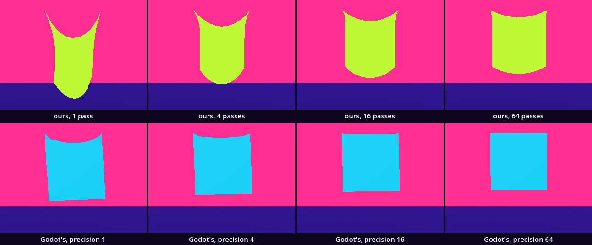
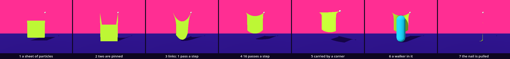

# Soft bodies — the organism returns

Every body so far kept its shape. We built a mesh once and moved it whole. Here we make a cloth: 121 points that fall, 220 links that ask them to keep their distance, and two corners that are held. Its mesh is built again sixty times a second from where the points are. You have the parts already: a class with fields, a movement added in small steps, `SurfaceTool` and packed arrays for the mesh, `@export` for the axis. One idea is new: inheritance. A class is made from another class and changes one thing. A held point is a point that does one thing differently.

This is a new project. In the Project Manager choose **Import** and open this folder's `project.godot`.

The halls put it this way. In [SoftBodies_Soft_Body_Deformation](../../../../commons/maps/SoftBodies_Soft_Body_Deformation/final.md) a cube gives way under a hand: "The engine has a limited number of attempts to keep those distances at each step." And: "What looks like a quality of the material also depends on how much work the simulation is allowed to do." That sentence is this lesson's question. [FormFinding_Relaxation](../../../../commons/maps/FormFinding_Relaxation/final.md) shows the code we write here: "keep two positions, and their difference carries the motion."

The lesson takes two sessions. The first builds the cloth and ends at **Stop here**. The second breaks it on purpose, measures it, and lets a body walk into it.

Every message and number on this page comes from running the study in Godot 4.6. Parts marked *(editor)* describe the editor's own windows and were not watched. No headset was used.

## Find the family in the hall

A lesson starts in its hall, with one question: does the hall show one work at several values of one axis?

The chapter leans on three halls, and none of them shows that side by side. Two show it in time. In FormFinding_Relaxation one bench stands, a magenta cloth of ten by eight points. Its axis is `relaxation`, with four values: nudged, worked, pressed and held, which are 1, 4, 8 and 12 passes. The hall places it once, at worked, and gives it a button, PASSES, that goes through the four. The reading gives two numbers for it: at one pass the worst spring is about 34% off its length, at four passes 8.9%. In Topology_Entropy_Morphogenesis one surface stands, with one seed, and its desk steps through four cuts. In SoftBodies_Soft_Body_Deformation the jelly cube stands at one value of its axis `assay`, and beside it five jellies that differ in stiffness, damping, pressure and mass all at once. We read this from the halls' map files, the artifact registry and the readings. We did not walk them.

So stand at the bench in Form Finding and press PASSES four times. Before you do, write down which two of the four outlines you expect to be hardest to tell apart. The project's own notes predicted 8 and 12.

## Open the study

Open `soft_body.tscn` from the FileSystem dock, at the lower left of the editor. The editor's own view shows a white floor under Godot's preview light. The look is put on by a script when the scene runs.

Run it (F5). On the left a lime cloth hangs by its two top corners and sags between them. The small white ball on its right corner is the Hand. On the right hangs a cyan square: the soft body Godot has built in. At the far left stands the walker. Over them a line reads `4 passes: lowest point 0.43 m, longest link 144% of its length`, and then a time, which is your machine's. The numbers move while the cloth swings; read them when it hangs still.

The arrows or WASD move the Hand. Space sends the walker to its next stop. M lets go. Try them now, or wait for *Place*.

Two scripts are ours: `cloth.gd` and `soft_cloth.gd`. The download holds them finished. We take them apart and build them again. A third, `soft_body.gd`, is given: it joins the parts, and it runs with every stage below.

## A point that falls

Replace everything in `cloth.gd` with this:

```gdscript
extends MeshInstance3D

const Look := preload("res://supplied/look.gd")
const GRAVITY := Vector3(0.0, -9.8, 0.0)

# A point of the cloth: where it is, and where it was one step ago.
class Particle extends RefCounted:
	var position := Vector3.ZERO
	var previous := Vector3.ZERO

	func _init(at: Vector3) -> void:
		position = at
		previous = at

	func step(delta: float) -> void:
		var here := position
		position += (position - previous) * 0.99 + GRAVITY * delta * delta
		previous = here

func _ready() -> void:
	var drop := Particle.new(Vector3.ZERO)
	for i in 60:
		drop.step(1.0 / 60.0)
		if i % 20 == 19:
			print("step ", i + 1, ": ", snappedf(drop.position.y, 0.001), " m")
```

Run it. The lime cloth is gone; nothing draws one yet. The Output panel, at the bottom of the editor, reads:

```
step 20: -0.537 m
step 40: -1.968 m
step 60: -4.129 m
```

`class Particle` is a class written inside a script. In Families the class was the whole file and had a name the project knew. This one is known only in `cloth.gd`, and that is enough. `extends RefCounted` makes it a light object: no node, no place in the scene, only its fields. `_init()` runs when `new()` makes one. Under the three lines the Output panel shows two more, from `soft_cloth.gd`; we come to them.

Look at `step()`. The steps you know keep a speed and add it to a place. A particle keeps no speed. It keeps where it was. `position - previous` is how far it came in the last step, and it goes that far again, less one hundredth, plus what gravity adds in one step: 2.7 mm at first. After 60 steps it has fallen 4.13 m. A body with nothing in its way falls 4.9 m in a second; the hundredth took the rest.

## A sheet of particles

Leave the class as it is. Replace `_ready()` with this, down to the end of the file:

```gdscript
@export var across := 11       # particles in a row
@export var down := 11         # rows
@export var spacing := 0.12    # metres from one particle to the next

var particles: Array[Particle] = []
var corners := PackedInt32Array()   # three particles for every triangle

func _ready() -> void:
	var paint := Look.paint(Look.BODY)
	paint.cull_mode = BaseMaterial3D.CULL_DISABLED   # a cloth is seen from both sides
	material_override = paint
	build()

func build() -> void:
	particles.clear()
	corners.clear()
	for row in down:
		for column in across:
			var at := Vector3((column - (across - 1) / 2.0) * spacing, -row * spacing, 0.0)
			var i := particles.size()
			particles.append(Particle.new(at))
			if column > 0 and row > 0:
				corners.append_array([i - across - 1, i - across, i - 1, i - across, i, i - 1])
	draw()

func _physics_process(delta: float) -> void:
	step(delta)
	draw()

func step(delta: float) -> void:
	for particle in particles:
		particle.step(delta)

func draw() -> void:
	var tool := SurfaceTool.new()
	tool.begin(Mesh.PRIMITIVE_TRIANGLES)
	for particle in particles:
		tool.add_vertex(particle.position)
	for corner in corners:
		tool.add_index(corner)
	tool.generate_normals()
	mesh = tool.commit()
```

Run it. A lime square, 1.2 m wide, starts at 2 m and falls through the floor, whole. After one second it is 4 m down.

`build()` is the chessboard's loop inside a loop: 11 rows of 11. Each particle gets a place counted from the node `Cloth`, which sits at 2 m. Each square of four neighbours becomes two triangles, and `corners` keeps their six numbers: which particles, not where. `draw()` hands the particles' places to a `SurfaceTool` and makes the mesh again, at every step. The mesh is new sixty times a second, and the list of triangles never changes.

Nothing joins the particles yet. They fall alike, so the square keeps its shape by accident.

## Two that stay: a class made from a class

Add this class under `Particle`, above the line `@export var across`:

```gdscript
# A particle that is held: by a nail, or by a node that carries it.
class PinnedParticle extends Particle:
	var holder: Node3D   # null: a nail

	func _init(at: Vector3, by: Node3D = null) -> void:
		super(at)
		holder = by

	func step(_delta: float) -> void:
		if holder != null:
			position = holder.position

```

In `build()`, replace the line `particles.append(Particle.new(at))` with these six:

```gdscript
			if row == 0 and column == 0:
				particles.append(PinnedParticle.new(at))
			elif row == 0 and column == across - 1:
				particles.append(PinnedParticle.new(at, get_node_or_null("Hand")))
			else:
				particles.append(Particle.new(at))
```

Run it. Two corners stay at 2 m. The other 119 fall as before, and the mesh is drawn out between them: two spikes that grow, 4 m long after a second. Hold D: the right spike follows the white ball.

`class PinnedParticle extends Particle` is inheritance. A `PinnedParticle` has everything a `Particle` has: `position`, `previous`, `step()`. It adds one field, `holder`, and it writes `step()` again. That is an override: where the parent falls, the child stays, or goes where its holder is. The list `particles` holds both kinds, and the line `particle.step(delta)` in the cloth did not change. Each particle answers with its own `step()`.

`super(at)` runs the parent's `_init()`, which is where `position` gets its value. We come back to that line.

You have used inheritance since Point Zero. `extends MeshInstance3D` at the top of this file makes the whole script a child of a class Godot wrote, and `_ready()` is an override of its own.

The Hand is a child of `Cloth`. So its `position` is counted from the cloth, like the particles' places, and `holder.position` needs no arithmetic.

## Links

Now the particles are joined. Add a second function to `Particle`, under its `step()`:

```gdscript
	func nudge(by: Vector3) -> void:
		position += by

```

and override it in `PinnedParticle`, under its `step()`:

```gdscript
	func nudge(_by: Vector3) -> void:
		pass

```

The exports and the lists above `_ready()` now read:

```gdscript
@export_range(1, 64) var iterations := 4   # passes over the links in one step
@export var across := 11       # particles in a row
@export var down := 11         # rows
@export var spacing := 0.12    # metres from one particle to the next

var particles: Array[Particle] = []
var links := PackedInt32Array()     # two particles for every link
var corners := PackedInt32Array()   # three particles for every triangle
var cost := 0.0                     # milliseconds the last step took

```

Replace `build()` with this:

```gdscript
func build() -> void:
	particles.clear()
	links.clear()
	corners.clear()
	for row in down:
		for column in across:
			var at := Vector3((column - (across - 1) / 2.0) * spacing, -row * spacing, 0.0)
			var i := particles.size()
			if row == 0 and column == 0:
				particles.append(PinnedParticle.new(at))
			elif row == 0 and column == across - 1:
				particles.append(PinnedParticle.new(at, get_node_or_null("Hand")))
			else:
				particles.append(Particle.new(at))
			if column > 0:
				links.append_array([i - 1, i])
			if row > 0:
				links.append_array([i - across, i])
			if column > 0 and row > 0:
				corners.append_array([i - across - 1, i - across, i - 1, i - across, i, i - 1])
	draw()

```

and `step()` with these two functions:

```gdscript
func step(delta: float) -> void:
	for particle in particles:
		particle.step(delta)
	for pass_number in iterations:
		relax()

# One pass: every link pulls its two particles half of the way back to its length.
func relax() -> void:
	for k in range(0, links.size(), 2):
		var a := particles[links[k]]
		var b := particles[links[k + 1]]
		var between := b.position - a.position
		var half := between.normalized() * (between.length() - spacing) * 0.5
		a.nudge(half)
		b.nudge(-half)

```

Run it. The cloth hangs. It swings for a few seconds and comes to rest with its lowest point 0.43 m above the floor.

A link is two numbers in `links`: this particle and that one. Each particle is linked to the one on its left and the one above it, 220 links in all. A link asks for one thing, that its two ends be `spacing` apart. `relax()` goes through all of them once. Where a link is too long it moves each end half of the error toward the other. That mends this link and spoils its neighbours a little, so one pass is never enough. `iterations` says how many passes a step may spend. Nothing here solves the cloth. It is asked again and again.

`nudge()` is why two classes were worth having. A link does not know what it holds. It nudges both ends, and a pinned end answers `pass`. We ran the cloth once without that override. `step()` held the pins and the links dragged them: after 11 seconds the nailed corner was at (0.60, -1.62, 0.00) of the cloth, 1.6 m below its nail. An override covers one function. Whatever else the parent can do, the child still does.

## What a step costs

Replace `_physics_process()` with this:

```gdscript
func _physics_process(delta: float) -> void:
	var began := Time.get_ticks_usec()
	step(delta)
	cost = (Time.get_ticks_usec() - began) / 1000.0
	draw()
```

and add at the end of the file:

```gdscript

func report() -> String:
	var lowest := INF
	for particle in particles:
		lowest = minf(lowest, to_global(particle.position).y)
	var longest := 0.0
	for k in range(0, links.size(), 2):
		longest = maxf(longest, particles[links[k]].position.distance_to(particles[links[k + 1]].position))
	return "%d passes: lowest point %.2f m, longest link %.0f%% of its length, %.2f ms a step" % [iterations, lowest, 100.0 * longest / spacing, cost]
```

Run it. The line over the scene is back: `4 passes: lowest point 0.43 m, longest link 144% of its length` and the time of a step, 0.61 ms in one run on our machine.

`Time.get_ticks_usec()` reads a clock in millionths of a second. Read it before and after, and the difference is what `step()` cost. That is profiling by hand. The editor has a profiler too, in the Debugger panel at the bottom, under **Profiler** *(editor)*.

The longest link is 144% of the length it asks for. It is one of the two links on a pinned corner. All the cloth's weight goes through those four.

## Godot's own

Open `soft_cloth.gd` and type it again:

```gdscript
extends SoftBody3D

const Look := preload("res://supplied/look.gd")

# Godot's own soft body. Its mesh is in the scene. Here we say which points are held.
func _ready() -> void:
	var paint := Look.paint(Look.SECOND)
	paint.cull_mode = BaseMaterial3D.CULL_DISABLED
	material_override = paint
	var points: PackedVector3Array = mesh.surface_get_arrays(0)[Mesh.ARRAY_VERTEX]
	for i in points.size():
		if is_equal_approx(points[i].y, 0.6) and is_equal_approx(absf(points[i].x), 0.6):
			set_point_pinned(i, true)
			print("pinned point ", i, " at ", points[i])
```

Run it. The output:

```
pinned point 110 at (0.6, 0.6, 0.0)
pinned point 120 at (-0.6, 0.6, 0.0)
```

`SoftBody3D` is a node that does what `cloth.gd` does, inside the engine. It takes a mesh, here a plane of 11 by 11 points, and makes every point of it a particle. We do not write its step. We say which points stay: `set_point_pinned()`. To find the two top corners we ask the mesh for its points and take the two that lie highest and furthest out.

Select `SoftCloth` in the Scene dock, at the upper left of the editor, and look in the Inspector, at the right *(editor)*: **Simulation Precision** is 5 and **Linear Stiffness** is 0.5. The first is the engine's name for our `iterations`. The second sets how hard a link pulls. We did not open the engine to see how.

## Stop here: what we have

This is the end of the first session. Check four things: a lime cloth that hangs by two corners; the line `4 passes: lowest point 0.43 m, longest link 144% of its length`; the two `pinned point` lines in the Output panel; and the Hand, which carries its corner when you hold a move key.

## One line missing

In `PinnedParticle`, delete the line `super(at)`. Run it.

The left corner has moved. It hangs from the middle of the top edge, and the cloth is half as wide at the top. The line reads `4 passes: lowest point 0.22 m, longest link 141% of its length`. Godot printed nothing: no error, no warning.

A child's `_init()` replaces the parent's. Without `super(at)` the parent's two lines never run, and `position` keeps the value it was declared with: (0, 0, 0), the origin of the cloth. The nail holds that place. The other corner mended itself, because its `step()` copies the Hand's place at the first step. So one corner is right, one is wrong, and nothing was said. Reading a run that is wrong and silent is ordinary. Print `particles[0].position` when a body starts somewhere you did not put it.

Godot is loud about the half mistake. Write `super()` with nothing in the brackets, and the scene does not start:

```
Parse Error: Too few arguments for "_init()" call. Expected at least 1 but received 0.
```

Read it as it stands: it names the function and counts what it was handed. Godot checks what you hand to the parent. It does not check that you called. Put `super(at)` back.

The course outline planned this bug as "pinned particles have no position and the cloth hangs from the origin". That is what happens, for the nailed corner. The corner with a holder recovers.

## The argument: how many passes?

The axis is `iterations`. The values are 1, 4, 16 and 64.

**Write your prediction before you render.** Four cloths at rest, each seen alone from the front. Which two will look most alike? How far, in centimetres, will the lowest point rise from 16 passes to 64? Write both down, with a reason.

The course outline made its own: "16 and 64 will look most alike: the cloth hangs taut, and the extra passes remove less than a centimetre of stretch. 1 sags like rubber."

Then look. Select `Cloth` and set **Iterations** in the Inspector *(editor)*, or change the `4` in the `@export_range` line, and run. For stills of all four, run `sheet.gd` as the [README](README.md) says; it needs a terminal. You can go on without it: the tables are what our run measured.



If no link gave, the lowest point would be at 0.80 m. We call that taut.

| passes | lowest point | below taut | longest link | a step costs |
| --- | --- | --- | --- | --- |
| 1 | 0.12 m | 68.4 cm | 285% | 0.18 ms |
| 4 | 0.43 m | 37.4 cm | 144% | 0.61 ms |
| 16 | 0.56 m | 24.0 cm | 118% | 2.23 ms |
| 64 | 0.65 m | 15.4 cm | 108% | 8.89 ms |

| pair | ours differ on | Godot's differ on |
| --- | --- | --- |
| 1 and 4 | 7.10% of the still | 3.91% |
| 1 and 16 | 10.93% | 6.03% |
| 1 and 64 | 13.79% | 6.86% |
| 4 and 16 | 4.07% | 2.19% |
| 4 and 64 | 7.08% | 3.04% |
| 16 and 64 | 3.02% | 0.86% |

The closest pair is 16 and 64. That part of the prediction held, and so did the rubber: at one pass the corner links are nearly three times their length. The rest was false. The cloth does not hang taut at 64 passes: it is 15.4 cm below taut. And from 16 to 64 the lowest point rises 8.62 cm, not less than one. In the still that is a band 16 pixels wide.

Each row costs between three and four times the row before and takes a third to a half off the sag. Sixty steps a second leave 16.7 ms for a step. At 64 passes this one cloth of 121 points took 8.89 of them when the sheet ran and 8.29 when the checks ran.

The second row of the sheet is Godot's soft body at the same four counts. It is tighter than ours at every count: 22.7, 9.9, 2.9 and 0.5 cm below taut. From 16 to 64 it rises 2.4 cm. It leans, too. We think that is its triangles, whose diagonals all run one way; we did not test it. And it was not the same in every run. In `verify.gd`, without a window, the same body came to rest at 15.7, 5.0, 1.3 and 0.3 cm below taut. We did not find out why. Ours is stepped by our own loop and came out the same to the last digit every time.

The claim, as measured: stiffness here is a budget, and a poor one. The same net is rubber at one pass and a slack cloth at 64, each fourfold of passes costs nearly four times as much, and the net is not a chain at any count we tried.

**Decide.** One difference could be followed. We spent the 16 passes another way: four steps of 1/240 s with four passes each, in place of one step of 1/60 s with sixteen. The lowest point came to 0.6452 m, against 0.5603 m, and against 0.6465 m for 64 passes. It cost 2.19 ms where 16 passes cost 2.08 and 64 cost 8.29, in that run. The next intervention would be two lines in `_physics_process()`: a loop of four around `step(delta / 4.0)`. Or settle: one of the four cloths is the one your room needs, and rubber may be it. Either is right. Write your decision and its reason in your [field note](FIELD_NOTE.md); ours is there as an example of the form, not of the answer.

## What the cloth owes

A soft body needs points to bend at, and every point costs at every step. We built the same 1.2 m cloth as a net of 6 by 6, 11 by 11 and 21 by 21 points, each at 16 passes. Its lowest point hung at 0.67, 0.56 and 0.40 m, and a step cost 0.54, 2.08 and 8.07 ms. The finer net bends in more places and is softer, for more time. Smooth and stiff are bought from the same budget. In a headset the picture is drawn twice, once for each eye, and the step is paid once; we did not run one.

Inheritance is a taxonomy. `PinnedParticle extends Particle` says that being held is a kind of particle. It is not. It is something between a particle and a nail, or a hand. The class shows the strain twice. It had to grow a field, `holder`, that points at the other end of that relation. And a particle cannot stop being pinned: an object keeps its class for as long as it lives. To let go, the next section has to throw the particle away and put a new one in its place.

Where it is held decides more than how often it is asked. With the whole top row pinned, the same cloth rose 0.69 cm from 16 to 64 passes and hung 0.12 cm below taut. The outline's sentence is true of that cloth. Hung by two corners, all the weight goes through four links, and a top edge that stretches a little sags a lot.

And `relax()` has a rule of its own. A link with a pinned end gets half its error mended, since the pinned end does not answer. We tried the other rule, where the free end takes the whole error: 0.66 m at 64 passes against 0.65. It explains a centimetre.

## Place: a body in the cloth

The cloth meets nothing yet. A walker would go through it and it would not move. A cloth of our own knows only the bodies we tell it about. Add a third function to `Particle`, under its `nudge()`:

```gdscript
	# Out of a ball or a capsule: all that is nearer than `radius` to the line from a to b.
	func push_out(a: Vector3, b: Vector3, radius: float) -> void:
		var away := position - Geometry3D.get_closest_point_to_segment(position, a, b)
		if away.length() < radius:
			nudge(away.normalized() * (radius - away.length()))
			previous = position   # it stops where it touches

```

Add one line under `var corners`:

```gdscript
var bodies: Array = []              # what the cloth keeps out of, told anew every step
```

Replace `step()` with this:

```gdscript
func step(delta: float) -> void:
	for particle in particles:
		particle.step(delta)
	for pass_number in iterations:
		relax()
	for body: Array in bodies:
		for particle in particles:
			particle.push_out(body[0], body[1], body[2])
	bodies.clear()

```

and add at the end of the file:

```gdscript

# A body to keep out of in the next step: a ball (a and b the same place) or a capsule.
func meet(a: Vector3, b: Vector3, radius: float) -> void:
	bodies.append([to_local(a), to_local(b), radius])

# A PinnedParticle cannot become a Particle. So a new Particle takes the place of the first one found.
func let_go() -> void:
	for i in particles.size():
		if particles[i] is PinnedParticle:
			particles[i] = Particle.new(particles[i].position)
			return
```

This is the `cloth.gd` in the download. `PinnedParticle` did not change. It inherits `push_out()`, which calls `nudge()`, and its own `nudge()` answers. `is` asks an object for its class. `soft_body.gd` does the telling: at every step it calls `meet()` for the walker, as a capsule, and for the floor, as a ball two kilometres across.

Run it, and do four things.

**Carry.** Hold S for a second. The Hand comes 1.2 m toward us and its corner comes with it. The cloth is drawn out between the nail and the Hand: the longest link reads 181%. Bring it back with W.

**Walk in.** Press Space. The walker walks into the cloth and stands in it. Its walk ended `arrived`: the cloth stopped nobody. The cloth is pushed 0.29 m out of its plane and lies round the walker. Press Space again and the walker walks on. Ten seconds later the cloth was 2 cm out of its plane and still swinging back.

Godot's soft body did less. A walker sent into it arrived too, and the soft body did not move at all: 0.0000 m. With its two points let go it fell through the supplied floor, 25 m in three seconds. What it does meet, we did not find out.

**Let go.** Press M. The nail is gone, and the cloth hangs from the Hand alone. It does not hang as a cloth. It hangs as a rope, down to the floor: 100 of its particles are in the air, none more than 1.3 cm from the line under the Hand. Nothing keeps one particle out of another, so a sheet held by one corner folds into a line.

**Lay it over a body.** Press Space until the walker stands where the cloth hung. Hold A: the Hand carries the cloth over the walker. Press M again. We measured this in `verify.gd`, with a capsule of the walker's size standing there from the start: while the Hand held the cloth, 76 particles lay above 0.5 m; let go, none did. At 16 passes, 85 and none. A rope does not stay on a post. The place asked for a cloth draped over a body, and this cloth cannot do it.

What was not checked: the keys were pressed by a script, not a hand. Nothing was run in a headset. There a hand would hold the corner, where the Hand moves at one height on four keys.

## The process

A body made by more than one operation has a recipe. Ours, one still after each step, from one standpoint:

a sheet of particles → two are pinned → links, one pass a step → 16 passes a step → carried by a corner → a walker in it → the nail is pulled



`sheet.gd` makes the strip and counts. The pinned are 0, 2, 2, 2, 2, 2, 1. The passes are 0, 0, 1, 16, 16, 16, 16. The walker changed the tile most, 11.41%, and most of that is the walker. Of the steps that changed only the cloth, pulling the nail did most: 9.99%. The seventh tile looks empty. The cloth is there, as a line under the white ball.

## In your room

Copy the folder `guests/soft-body/` from this kit into your room project's `guests/` folder. In the room's `room.gd`, add its line to `GUESTS`, under the last one:

```gdscript
	"res://guests/soft-body/soft-body.tscn",
```

Run the room. The Output panel says `My room: place 2 is res://guests/soft-body/soft-body.tscn`, or another number if you have more guests. Walk to it: a lime cloth between two white posts, 1.4 m apart. Walk between the posts. The posts stop you; the cloth gives way.

We ran the room's own trial with this guest at place 2: the walker `arrived`, 0.07 m from the middle of the place, standing in the cloth. In a second run the cloth was pushed 0.29 m out of its plane. When nobody is near and nothing has moved for two seconds, the cloth stops stepping, and a body that comes near wakes it. A work at rest should not be paid for.

Now your own. **Give one body in your room a soft part that a visitor can deform.**

The guest's folder holds a second `cloth.gd`. It is ours made to stand alone: it writes its colour out, and it asks the room itself which bodies are near. Copy that one file into the folder of one of your own guests. Open that guest's scene. In the Scene dock, right-click the top node, choose **Add Child Node** and add a `MeshInstance3D`. Drag the copied `cloth.gd` from the FileSystem dock onto it *(editor)*. Its place is where the top edge hangs; set it in the Inspector, with **Across**, **Down** and **Spacing**.

We did this with a copy of the example guest, the lime box, by writing its scene file: a cloth of 6 by 5 points, 0.1 m apart, at (0, 1.3, 0.35), which is in front of the box. The walker walked at the box and was blocked 0.56 m from the middle of the place. The flag was pushed 0.13 m.

Write one line in your room's notes: what your soft part is held by, and what it is allowed to meet.

## What we borrowed

| Part | From | How far we go |
| --- | --- | --- |
| `supplied/base.tscn`, `look.gd` | the kit base | Use: the floor, the sky, the light, `paint()`. |
| `supplied/mover.gd` | the kit base | Use: it moves the Hand on the four move keys. |
| `supplied/walker.tscn` | the kit base | Use: `walk_to()` and how the walk ended. |
| `soft_body.gd` | this kit | Read: it tells the cloth about the floor and the walker and listens for Space and M. |
| the step without a speed | Loup Verlet, 1967 | Understand: two places, and their difference carries the motion. |
| links relaxed in passes | Thomas Jakobsen, 2001 | Understand, and change: `iterations`, and the rule in `relax()`. |
| `SoftBody3D` | Godot | Use: `set_point_pinned()`, Simulation Precision, Linear Stiffness. |
| `SurfaceTool`, `PackedInt32Array` | Godot | Use: a mesh made again at every step from one list of corners. |
| `Geometry3D.get_closest_point_to_segment()` | Godot | Use: the nearest point on a line between two places. |
| `sheet.gd`, `verify.gd` | this kit | Use: the stills, the measures, the checks. |

What we made is `cloth.gd`: two classes, one made from the other; a list that holds both; links that are asked a counted number of times; and a mesh that follows.

## What we carry forward

We leave with `extends` between two classes of our own, with an override, and with `super()`; with `is`; with a body whose shape is the outcome of a step and not a thing we wrote; and with a number, passes a step, that looked like a material.

The next stop asks for a body with no points at all until you ask where its surface is.
