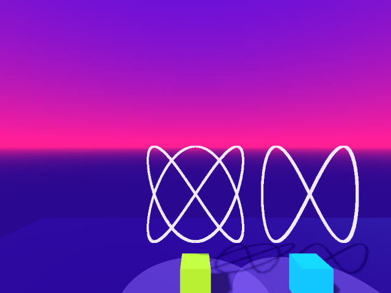
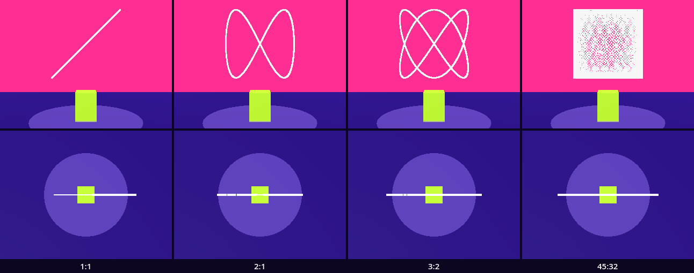
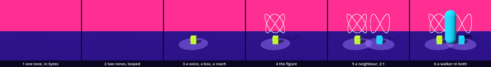

# Sound — the swing heard

The pendulum left us with `sin()`, a number that swings between −1 and 1 as time passes, and with `TAU`, one whole turn. There the swing was laid into space. Here it is made fast enough to hear: 256 swings in one second, written as 44,100 numbers into a list of bytes and handed to Godot as a sound. Then two tones at once, a chord, played from a place in the room: you walk into its reach and it sounds. The same two sines, one across and one up, draw the chord's figure in beads, so the chord is also a body. Two ideas are new: a packed array, and a sound made from one. The loop, the area and its signals, the export and the `MultiMesh` you have used before.

This is a new project, like every stop of this course: in the Project Manager choose **Import** and open this folder's `project.godot`.

In the halls, [Effect Sound](../../../../commons/maps/WaveFunctions_Effect_Sound/final.md) keeps a note and changes the rule that made it: "The modulator is inside the sine's argument." [AirMusic](../../../../commons/maps/WaveFunctions_AirMusic/final.md) says what its ringing bars are: "a sine at the bar's frequency under an exponential decay", and then: "So this is a synthesised resonance, not the vibration of a metal bar solved from its material." Both halls make their sound the way we will, one number at a time into a buffer.

This study takes two sessions. The first makes the sound and gives it a place; it ends at **Stop here**. The second draws the figure, compares four chords on a sheet and walks into them.

Every message and number on this page comes from running the study in Godot 4.6. One thing no run gave us: this page was made without ears. Where it says what you hear, we measured what reached Godot's mixer, and we say so. Parts marked *(editor)* describe the editor's own windows and were not watched.

## Find the family in the hall

A lesson starts in its hall, with one question: does the hall show one work at several values of one axis? If it does, predict which two look most alike before you read anything beside them.

Effect Sound places many works that declare an axis and sets a value on two of them. The two balls on their desks have `evidence` (result, trace, sources, longhand), set to `longhand`. The timbre sculptor has `waveform` (sine, square, sawtooth, triangle, formant), set to `square`. One value each: neither is shown as a family. What does stand there three times is a sound controller, three in a column, each with another `mode`: techno_kick, laser_zap, sine_bell. `mode` is not a declared axis, but it is one work at three values, and the difference is for the ear. AirMusic's metallophone has `tuning` (pentatonic, equal, just, harmonic) and stands on the first; its reading says what that is: "a decision about which pairs are available to you, not a law about which pairs are good."

The work nearest to ours is on the field trip. In the Synthesis Lab a Lissajous curve stands with the axis `ratio` and six values: 3_2_1, 1_1_0, 2_1_0, 3_2_0, 5_4_0, 1_phi_0. The hall shows the first. We read all of this from the halls' map files and the artifact registry; we did not walk them.

So find the curve in the Synthesis Lab, read its six ratios, and write down which two you expect to look most alike. Keep the guess: this study ends with a sheet of our own.

## Open the study

Open `chord.tscn`. The editor's view shows a white floor and Godot's own preview light: the look is put on by a script when the scene runs. Press Play (F5).



You look through the eyes of the walker, 2.2 m in front of the left chord. Two chords stand there, 1.2 m apart. Each is a box on the floor, a ring around it, and a white figure above it. The left one, `Chord`, runs `chord.gd`: that script is ours. The right one, `Neighbour`, is the finished chord as it will stand in your room; it stays while we work. Walk forward with W. Inside the ring the chord sounds, and the Output panel, at the bottom of the editor, says so: `Chord sounds`. Then walk to the right with D: between the two boxes both sound, and further right the neighbour alone.

The download holds the finished `chord.gd`. We take it apart and build it again.

## One second of numbers

Replace everything in `chord.gd` with this:

```gdscript
extends Node3D

const RATE := 44100    # samples in one second of sound

func _ready() -> void:
	var data := PackedByteArray()
	data.resize(RATE * 2)
	for i in range(RATE):
		var t := float(i) / RATE
		var wave := sin(TAU * 256.0 * t)
		if i < 4:
			print(i, ": ", wave)
	print(data.size(), " bytes; the first is ", data[0])
```

Run it. The left chord is gone, and nothing sounds. The output:

```
0: 0.0
1: 0.03646573291433
2: 0.07288295940137
3: 0.10920323755673
88200 bytes; the first is 0
```

A loudspeaker is a skin that moves in and out. A sound in a computer is a list of positions for that skin, one after another, 44,100 for each second. One position is a *sample*. The loop walks through one second of them: `i` is which sample, `t` is its time in seconds, and `wave` is the pendulum's swing at that time, 256 whole turns a second. Turns a second are called hertz, Hz. The first four values climb: the swing has just left the middle.

`PackedByteArray` is the new kind of list. An `Array` can hold anything. A packed array holds one kind of thing, packed tightly: here bytes, whole numbers from 0 to 255. `resize()` makes room. We ask for two bytes for each sample, 88,200 in all, and they start as 0. So far the loop computes the wave and throws it away.

## Into the buffer, and out

Replace everything with this:

```gdscript
extends Node3D

const RATE := 44100    # samples in one second of sound

func _ready() -> void:
	var data := PackedByteArray()
	data.resize(RATE * 2)
	for i in range(RATE):
		var t := float(i) / RATE
		var wave := sin(TAU * 256.0 * t)
		data.encode_s16(i * 2, wave)
	var stream := AudioStreamWAV.new()
	stream.format = AudioStreamWAV.FORMAT_16_BITS
	stream.mix_rate = RATE
	stream.data = data
	var voice := AudioStreamPlayer.new()
	voice.stream = stream
	add_child(voice)
	voice.play()
	print("playing: ", voice.playing, "; sample 43 is ", data.decode_s16(43 * 2))
```

`encode_s16(where, number)` writes one number into two bytes, starting at byte `where`: sample `i` lives in bytes `i * 2` and `i * 2 + 1`. `AudioStreamWAV` is a sound made of such bytes: we tell it that a sample is 16 bits and that 44,100 of them make a second, and hand it the list. `AudioStreamPlayer` is the node that plays a stream.

Run it. Silence. The output: `playing: true; sample 43 is 0`.

Nothing crashed, the player says it is playing, and the mixer stayed at −200 dB, the bottom of Godot's scale. Sample 43 is where the wave stands at its top, 0.999997, and the buffer holds 0 there. Every one of the 44,100 samples is 0.

Godot did say something, before the scene started. Run with the debugger attached, as the editor's Play button does, the output begins:

```
WARNING: Narrowing conversion (float is converted to int and loses precision).
   at: GDScript::reload (res://chord.gd:11)
```

In the editor the same warning is in the Debugger panel at the bottom, under Errors, and marks line 11 *(editor)*; we read it from a run started with `-d`. Reading a warning is ordinary work: it names the line, and the line is the one we just wrote.

Sixteen bits hold a whole number from −32,768 to 32,767. Our wave is a number with decimals between −1 and 1. Handed to `encode_s16()`, it is cut to a whole number, and everything between −1 and 1 is cut to 0. The swing has to be stretched to the range of the buffer first. Replace line 11:

```gdscript
		data.encode_s16(i * 2, int(wave * 32767.0))
```

Run it. A steady tone for one second, then silence: `playing: true; sample 43 is 32766`. In the mixer the tone reached the top of the scale, 0 dB, and held 256 Hz and none of the other tones of this study. `int()` cuts the decimals, now on purpose: 0.999997 times 32,767 is 32,766.9, and 32,766 is written.

The course's outline planned this fault as plain silence. It is silence for the ear, and it is a warning for anyone who opens the Debugger. The repaired line ran with the debugger attached and gave no warning: Godot takes `int()` as your decision. So `int(wave)`, without the stretch, is a decision too, and it is the same silence: every sample 0, and no error. That line we ran without the debugger only.

## Two tones

Replace everything with this:

```gdscript
extends Node3D
## A chord: two tones computed sample by sample into one second of sound.

const RATE := 44100    # samples in one second of sound

@export var ratio := "3:2"    # the faster tone to the slower one
@export var low_hz := 256.0   # the slower tone: turns in one second

var high_hz := 384.0          # the faster tone; _ready() works it out from the ratio

func _ready() -> void:
	var parts := ratio.split(":")
	high_hz = low_hz * float(parts[0]) / float(parts[1])
	var stream := AudioStreamWAV.new()
	stream.format = AudioStreamWAV.FORMAT_16_BITS
	stream.mix_rate = RATE
	stream.data = render()
	stream.loop_mode = AudioStreamWAV.LOOP_FORWARD
	stream.loop_end = RATE
	var voice := AudioStreamPlayer.new()
	voice.stream = stream
	add_child(voice)
	voice.play()
	print(name, ": ", ratio, ", ", low_hz, " and ", high_hz, " Hz")

## One second of the two tones as 16-bit samples: two bytes for each sample.
func render() -> PackedByteArray:
	var data := PackedByteArray()
	data.resize(RATE * 2)
	for i in range(RATE):
		var t := float(i) / RATE
		var wave := 0.5 * sin(TAU * low_hz * t) + 0.5 * sin(TAU * high_hz * t)
		data.encode_s16(i * 2, int(wave * 32767.0))
	return data
```

Run it. `Chord: 3:2, 256.0 and 384.0 Hz`, and the sound does not stop. The mixer held 256 Hz and 384 Hz, each at 0.50 of the full range.

Three things changed. The loop moved into a function, `render()`, which returns the bytes. A second sine is added to the first: two skins cannot move one loudspeaker, so two tones are one list of numbers, the sum. Each tone gets half the height, because two tops together would be 2, and the buffer ends at 1. And the stream loops: `loop_end = RATE` sends it back to the start after sample 44,100.

`ratio` is a text, `"3:2"`: the faster tone makes three turns while the slower makes two. `split(":")` cuts it at the colon, and the faster tone is 256 × 3 / 2 = 384 Hz. Musicians call this pair a fifth.

Why 256? The loop plays the last sample and then the first. That seam is silent only if both tones have come back to where they started, and they have when each makes a whole number of turns in the second. With 256 Hz the four ratios of this study give 256, 512, 384 and 360 Hz: all whole. We measured the step across the seam: 1,493, the same as the largest step inside the buffer. With `low_hz` at 261.63, the piano's middle C, the step at the seam is 5,114 and the largest inside 1,527: a click, once a second.

## A voice in the room

So far the chord is everywhere. Now it gets a place. The top of the script, down to the end of `_ready()`, becomes this:

```gdscript
extends Node3D
## A chord you can walk into. Two tones are computed sample by sample into one
## second of 16-bit sound. A voice in the room plays it in a loop while a body
## stands inside the reach. The same two sines, one across and one up, draw
## the chord's figure in beads.

const Look := preload("res://supplied/look.gd")
const RATE := 44100    # samples in one second of sound

@export var ratio := "3:2"    # the faster tone to the slower one
@export var low_hz := 256.0   # the slower tone: turns in one second
@export var member := 0       # which of a family: Look.BODIES[member] is its colour

var high_hz := 384.0          # the faster tone; _ready() works it out from the ratio
var voice: AudioStreamPlayer3D

func _ready() -> void:
	var parts := ratio.split(":")
	high_hz = low_hz * float(parts[0]) / float(parts[1])
	var stream := AudioStreamWAV.new()
	stream.format = AudioStreamWAV.FORMAT_16_BITS
	stream.mix_rate = RATE
	stream.data = render()
	stream.loop_mode = AudioStreamWAV.LOOP_FORWARD
	stream.loop_end = RATE
	voice = AudioStreamPlayer3D.new()
	voice.stream = stream
	voice.unit_size = 1.0
	voice.position = Vector3(0, 0.4, 0)
	add_child(voice)
	add_speaker()
	add_reach()
	print(name, ": ", ratio, ", ", low_hz, " and ", high_hz, " Hz")
```

`render()` stays as it is. Add these four functions under it:

```gdscript
## The box the sound comes from: a mesh for the eye and a shape for a body.
func add_speaker() -> void:
	var speaker := MeshInstance3D.new()
	var box := BoxMesh.new()
	box.size = Vector3(0.3, 0.4, 0.3)
	speaker.mesh = box
	speaker.material_override = Look.paint(Look.BODIES[member])
	speaker.position.y = 0.2
	add_child(speaker)
	var body := StaticBody3D.new()
	var shape := CollisionShape3D.new()
	var solid := BoxShape3D.new()
	solid.size = box.size
	shape.shape = solid
	body.add_child(shape)
	speaker.add_child(body)

## Where the chord is heard: a round area, and a ring on the floor that shows it.
func add_reach() -> void:
	var reach := Area3D.new()
	var shape := CollisionShape3D.new()
	var cylinder := CylinderShape3D.new()
	cylinder.radius = 0.8
	cylinder.height = 2.0
	shape.shape = cylinder
	shape.position.y = 1.0
	reach.add_child(shape)
	add_child(reach)
	reach.body_entered.connect(_on_body_entered)
	reach.body_exited.connect(_on_body_exited)
	var ring := MeshInstance3D.new()
	var disc := CylinderMesh.new()
	disc.top_radius = 0.8
	disc.bottom_radius = 0.8
	disc.height = 0.01
	ring.mesh = disc
	ring.material_override = Look.ghost()
	ring.position.y = 0.01
	add_child(ring)

func _on_body_entered(body: Node3D) -> void:
	if body is CharacterBody3D:
		voice.play()
		print(name, " sounds")

func _on_body_exited(body: Node3D) -> void:
	if body is CharacterBody3D:
		voice.stop()
		print(name, " is silent")
```

Run it. The left chord is back, without its figure: a lime box and a lavender ring, and it is silent. Walk forward with W. As you cross the ring: `Chord sounds`. Walk back with S: `Chord is silent`.

`AudioStreamPlayer3D` is a voice with a position. Godot hears it from where the camera is, and you look through the walker's eyes, so the walker's head is where the ears are. `unit_size = 1.0` says how fast the voice fades with distance; Godot's own value is 10, and with it the voice was as loud from 4 m as from 1 m. With 1 we measured −3.4 dB from 1 m, −9.4 from 2 m and −15.3 from 4 m: each doubling of the distance takes 6 dB.

The reach is an `Area3D`, as in the regions chapter: a shape that stops nothing and notices who is inside. Its two signals call our two functions. The `if` matters. In its first moments the reach is entered by two bodies, the floor's and the chord's own box. Without the `if` the chord would sound for the floor. The walker is a `CharacterBody3D`; the floor and the box are not.

`add_speaker()` is the box you have built before: a mesh for the eye, a `StaticBody3D` with a shape for a body. `member` picks its colour from the look's family colours; the neighbour is member 1. The ring is a flat cylinder in the look's ghost colour: it shows where the reach is and has no collider.

## Stop here: what we have

This is the end of the first session. Check four things. The output begins `Chord: 3:2, 256.0 and 384.0 Hz`. The scene is silent until you walk. Walk in with W: two tones, and the Output says `Chord sounds`. Walk right with D: between the two boxes both chords sound at once.

## The figure

The sound is two sines added. Draw the same two sines against each other instead: the slower one moves a point left and right, the faster one moves it up and down. Add one line under `const RATE`:

```gdscript
const BEADS := 5512    # the samples of an eighth of a second: one bead for each
```

one line in `_ready()`, under `add_reach()`:

```gdscript
	add_figure()
```

and this function at the end:

```gdscript
## The same two sines as a figure: the slower tone across, the faster one up.
func add_figure() -> void:
	var beads := MultiMesh.new()
	beads.transform_format = MultiMesh.TRANSFORM_3D
	var bead := BoxMesh.new()
	bead.size = Vector3(0.02, 0.02, 0.02)
	beads.mesh = bead
	beads.instance_count = BEADS
	for i in range(BEADS):
		var t := float(i) / RATE
		var at := Vector3(0.5 * sin(TAU * low_hz * t), 1.1 + 0.5 * sin(TAU * high_hz * t), 0)
		beads.set_instance_transform(i, Transform3D(Basis(), at))
	var figure := MultiMeshInstance3D.new()
	figure.multimesh = beads
	figure.material_override = Look.paint(Look.LINE)
	add_child(figure)
```

Run it. Above the box hangs a white knot, 1 m wide and 1 m high: the figure you saw when you opened the study. This is the `chord.gd` of the download.

The loop is the loop of `render()`, with the same `t` and the same two sines. There we added the two numbers and wrote them into bytes. Here one becomes x and the other y, and a bead is put at that point. The beads are one `MultiMesh`, as in the pendulum chapter: one box of 2 cm, drawn 5,512 times. 5,512 is the number of samples in an eighth of a second, so the figure is the first eighth of a second of the sound, looked at instead of listened to. In that time the slower tone makes 32 turns, and each of our four ratios comes back to its start at least once.

The figure has no collider. It is a trace, in the look's line colour, like every trace of this course.

## The argument: which chords look alike?

The axis is `ratio`. The values are 1:1, 2:1, 3:2 and 45:32: two equal tones, the octave, the fifth, and an interval musicians call the tritone. With 256 Hz below, the faster tone is 256, 512, 384 and 360 Hz.

**Write your prediction before you render.** Four figures, each alone, seen from 2.6 m. Which two will look most alike? Which one stands apart, and how much of its square does it cover? Write it down, with a reason.

The course's outline made its own: 2:1 and 3:2 will look most alike, because "both close into small knots of a few lobes", and 45:32 "closes only after 32 turns of the slower tone, so in the still it fills its square".

Then look. Select `Chord`, change **Ratio** in the Inspector, on the right *(editor)*, or change `"3:2"` in the script, and run. Leave the colon out, `"3"`, and Godot stops at line 20 of `chord.gd`: `Out of bounds get index '1' (on base: 'PackedStringArray')`. Nothing of that chord is built; the neighbour stands as before. Reading it is ordinary: the text was cut into one piece, and line 20 asks for the second. In our run, without the editor, it was one logged line; in the editor the run pauses on that line, and the message is in the Debugger panel at the bottom *(editor)*.

For stills of all four, run `sheet.gd` as the [README](README.md) says; it needs a terminal. You can go on without it: the table is what our run measured.



| pair | differ on, from the side | from above |
| --- | --- | --- |
| 1:1 and 2:1 | 3.43% of the still | 0.24% |
| 1:1 and 3:2 | 4.97% | 0.27% |
| 2:1 and 3:2 | 5.97% | 0.18% |
| 3:2 and 45:32 | 16.69% | 0.17% |
| 2:1 and 45:32 | 18.13% | 0.28% |
| 1:1 and 45:32 | 19.65% | 0.37% |

The closest pair from the side is 1:1 and 2:1, not 2:1 and 3:2. The first half of the outline's prediction did not hold by this measure. The measure counts pixels, and these figures are thin lines that hardly ever lie on each other, so two figures differ by about the ink of both. The unison is a diagonal line: two equal tones that start together never part. It covers 4.07% of its square, the octave 12.41%, the fifth 20.08%. The two with the least ink are the closest.

The second half held. The tritone covers 92.43% of its square and stands 16.69 to 19.65% from the other three. By the rule its beads fall in 2,166 of the 2,500 cells of a 50 by 50 grid over the square; the fifth's fall in 464, the octave's in 273, the unison's in 50.

From above the axis is gone. Every figure is a flat sheet of beads seen on edge, and no pair differs on more than 0.37% of the still. A figure has a front.

The claim, as measured: a ratio has a shape. A ratio of small numbers closes into a figure of little ink, 1:1 into a line, 2:1 into two lobes, 3:2 into a knot; 45:32 has covered 92.43% of its square before it closes. Whether the small figures are the ones that sound restful, no measurement here says.

**Decide.** One difference could be followed. Our two tones start together. Start the faster one part of a turn ahead, `sin(TAU * (high_hz * t + 0.25))` in `render()` and in `add_figure()`, and the unison opens from a line into a circle: it differs from the plain one on 2.73% of the still, and its loudest sample falls from 1.00 to 0.71 of the range. The fifth, a quarter turn ahead, is the knot it was (0.15%). An eighth of a turn ahead it folds onto itself: it covers 10.37% of its square in place of 20.08%, and its loudest sample rises from 0.95 to 1.00. So one ratio has more than one picture. Which of them an ear can tell apart, the sheet cannot say. The next intervention would be a second axis, the start of the faster tone, and a listener. Or settle: four ratios, four shapes, and the one your room needs is among them. Either is right. Write your decision and the reason in your [field note](FIELD_NOTE.md); ours is there as an example of the form, not of the answer.

## What the chord owes

Sampling again. 44,100 numbers a second stand in for a wave, and the numbers cannot hold every wave. We wrote a tone of 43,844 Hz into the buffer, 256 short of the rate: sample for sample it is the 256 Hz tone upside down, with a largest difference of 0. The buffer cannot tell the two apart. A tone of 22,050 Hz, half the rate, is sampled each time it crosses the middle: every sample is 0. Anything above half the rate folds back and is heard as another, lower tone. This is called aliasing, and it is why `RATE` is a little more than twice the highest tone people are said to hear.

The figure is sampled too. With one bead in eight, 689 beads, the tritone covers 28.12% of its square in place of 92.43%, and it is no longer a curve: a cloud of dots, and nothing in the still says which dot follows which. "Fills its square" is a statement about our bead, 2 cm, and our count, as much as about 45:32.

The height is cut as well. `int()` leaves 65,536 steps, and a sum that climbs past the top is not refused. Without the two halves the sum asks for numbers up to 62,452; `encode_s16()` wraps them round, and 17,600 of the 44,100 samples came back as another number. The first is sample 12: 33,888 was asked, −31,648 is in the buffer. Godot printed nothing.

And the names. Octave, fifth and tritone, and the idea that the first two are at rest and the third is not, belong to one tradition of tuning. The hall carries that as an axis: its chord spring declares `consonance_theory` with the values western, blues, ratio and flat, and stands on western. Our sheet shows that small ratios make small figures. It does not show that small figures are good.

One more thing we did not do. Our second is computed once, before it plays. Godot's `AudioStreamGenerator` is the live alternative: a buffer you keep filling while it sounds. The Bernini columns, in the hall after Effect Sound, use it. We read that in their script and did not run it here.

## Walk into the chord

The place this chapter asks for: stand in each reach and hear it; stand where two overlap.

W, A, S and D walk; hold the right mouse button, or V, and move the mouse to look. C changes between the walker's eyes and the camera above the floor, and the ears go with the eyes.

We pressed the keys from a script: W for 45 steps of the physics, and the Chord sounded alone; D for 18 steps, and both sounded; D for 22 more, and the neighbour alone. Then we sent the walker on its autopilot and read the mixer at each stop. Outside both rings: nothing plays, −200 dB. In the left ring: `Chord sounds`, and the mix holds 256 and 384 Hz, at −7.1 dB. Then C: the same chord from the fixed camera, 5 m away, is −16.9 dB. Where the two rings overlap, between the boxes: both sound, and the mix holds 256, 384 and 512 Hz, at −2.4 dB. Three tones in the ratio 2:3:4. Getting there the walker went through both figures and they stopped nothing. Walked at the neighbour's box it was stopped, 0.46 m from the middle: the box has a collider. There only the neighbour sounds, 256 and 512 Hz. Walked away: both silent.

A marble dropped over the middle of a chord fell through the figure and came to rest on the box, at 0.50 m. Dropped 0.35 m to the side it went through the beads to the floor, 0.10 m. And it did not start the sound: a marble is not a `CharacterBody3D`.

What was not checked: no ear heard any of this. The levels are the mixer's, read in a run that had no loudspeaker. Whether two chords at once read as one chord of three tones or as two things, a listener has to say. No headset was used: there the ears would turn with the head, and the left and right sides would differ as you turn. We measured that much: with the voice 2 m to the listener's left, the left side was −7.3 dB and the right −13.4 dB.

## The process

one tone, in bytes → two tones, looped → a voice, a box, a reach → the figure → a neighbour → a walker in both



The first two operations made all of the sound and changed 0.00% of the picture. The walker changed the tile most, 8.32%. Of the steps that made the body, the neighbour changed most, 7.21%; the figure, which carries the whole argument, changed 2.07%.

## In your room

Copy the folder `guests/sound/` from this project into the `guests/` folder of your room project. In the room's `room.gd`, add its line to `GUESTS`:

```gdscript
	"res://guests/sound/sound.tscn",
```

Run the room and walk to its place. In our trial the walker was stopped by the box, 0.45 m from the middle of the place, inside the reach, and the room printed `Sound sounds`.

`guests/sound/sound.gd` is `chord.gd` with the look's colours written out, because a guest may name nothing outside its own folder. The task is in that copy, in your room: give your room a sound that is computed, not recorded. Choose your own `ratio` and your own `low_hz`, a whole number so that the loop closes. Then change the rule in `render()`. Ours: `"5:4"` on 192 Hz, and one line under the `var wave` line that makes the chord swell twice a second:

```gdscript
		wave *= 0.5 - 0.5 * cos(TAU * 2.0 * t)
```

The room printed `Sound: 5:4, 192.0 and 240.0 Hz`. Its loudest sample is 32,271, the second begins and ends on 0, and in the mixer the level rose and fell: over six short listenings, between −15.6 and −5.9 dB. A listening catches the swell where it happens to be, so the lower number differs from run to run.

Write one line in your field note: what your rule computes, and what a recording of a real instrument would have that it leaves out.

## What we borrowed

| Part | From | How far we go |
| --- | --- | --- |
| `supplied/base.tscn`, `look.gd` | Supplied | Use: the floor, the sky, the light; `Look.paint()`, `Look.ghost()`, `Look.BODIES`, `Look.LINE`. |
| `supplied/walker.tscn` | Supplied | Use: the keys, `through_eyes`. Its eyes are the ears. |
| `guests/sound/` | This kit | Ours: `chord.gd` with the colours written out. It goes to the room. |
| `PackedByteArray`, `resize()`, `encode_s16()`, `decode_s16()` | Godot | Understand: a list of bytes; one whole number from −32,768 to 32,767 in two of them. |
| `AudioStreamWAV`: `format`, `mix_rate`, `data`, `loop_mode`, `loop_end` | Godot | Use: a sound made of bytes we wrote. |
| `AudioStreamPlayer`, `AudioStreamPlayer3D`: `play()`, `stop()`, `unit_size` | Godot | Use: a voice everywhere, and a voice with a place. |
| `Area3D`, `body_entered`, `body_exited` | Godot, the regions chapter | Use: who is inside. |
| `MultiMesh` | Godot, the pendulum chapter | Use: one box, 5,512 times. |
| `sheet.gd`, `verify.gd` | Supplied here | Use: the stills and the measurements; the checks. |

What we made is `chord.gd`: one second of two tones written into bytes, a stream that loops it, a voice with a place, a reach that starts and stops it, and the same two sines as a figure of beads.

## What we carry forward

We leave with a packed array and what a sample is; with a sound that is a rule and not a recording; with `int()` as a decision; with the seam of a loop; with a voice that has a place and ears that have one too; and with a figure that is the sound's own numbers, seen from the side.

The next stop, *The arrow and the field of arrows*, keeps the two numbers at every point and stops adding them: a direction at each place, and a field of them.
