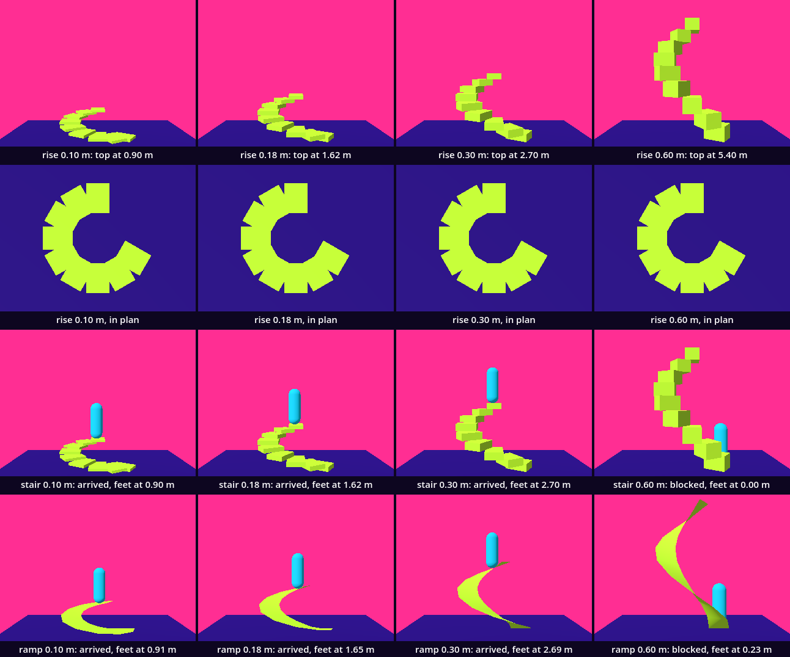
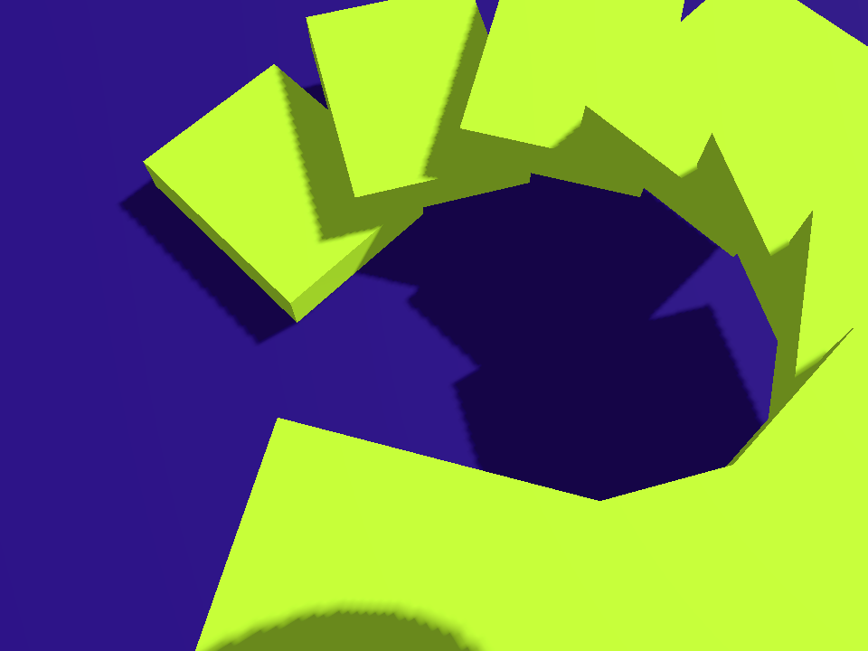
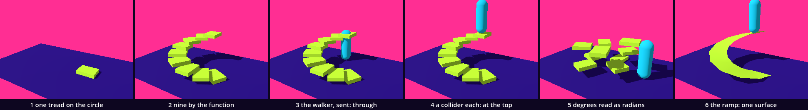

# The spiral stair — a spiral you can walk

*Eye level* opened the walker: a capsule 1.8 m high that walks where it is sent and steps up 0.35 m. Here we build something for it to climb. A spiral stair is one function called nine times: tread `i` stands at (r cos(i a), i rise, r sin(i a)). You have the loop, the function that returns a value, the box with a collider and the test that runs without a window. One idea is new: `sin()` and `cos()`, and the unit they count in.

This is a new project, like every stop of this course: in the Project Manager choose **Import** and open this folder's `project.godot`.

This study takes two sessions. The first builds the stair, sends the walker up and writes the walk as a test; it ends at **Stop here**. The second plants a bug, compares four rises, asks whom a stair shuts out, and builds the ramp.

Every message and number on this page comes from running the study in Godot 4.6. Parts marked *(editor)* describe the editor's own windows and were not watched.

## Find the family in the hall

A lesson starts in its hall, with one question: does the hall show one work at several values of one axis?

The hall is [Wavefunctions_Sky_Stairs](../../../../commons/maps/Wavefunctions_Sky_Stairs/final.md). One staircase stands in it, wound round an empty middle. Its [making passage](../../../../commons/maps/Wavefunctions_Sky_Stairs/tutorial.md) gives the numbers: eighty treads, two turns, each tread 0.11 above the last, and a radius of `2.5 + 0.45 * sin(2 * angle)`, so the stair swings in and out as it climbs. The reading asks this chapter's question: "When does a sampled curve become a route a body can use?"

The answer to our question is no. The staircase has a declared axis, `provision`: what is added round the formula so that a body can use it. Its values are membrane, none, rail and posts, and the hall shows one, `membrane`, sheets laid between the treads. A cube, a dark sphere and a shelf of mathematical objects stand beside it; each has an axis of its own and stands once. We read this from the hall's map file, the staircase's script and the artifact registry; we did not walk it.

So stand at the foot of the hall's stair and write down one prediction: which two of the four provisions would look most alike from the floor? Nobody has rendered that sheet. Then read the sentence the hall ends its walk on: "From the surrounding floor you can follow the spiral with your eyes. That journey does not tell you whether your body could complete it." This study sends a body.

Two more halls belong to the chapter. In WaveFunctions_Unit_Circle a point goes round a circle and two rods show how high it is and how far to the side. In WaveFunctions_TrigWalkingPath two rows of steps, red and blue, give sine and cosine what the reading calls "another body".

## Open the study

Open `spiral_stair.tscn` *(editor: double-click it in the FileSystem dock, at the lower left)*. It inherits the supplied base, and adds two nodes: `Stair`, an empty `Node3D` that runs `stair.gd`, and `Walker`, the supplied walker, on the floor at (2.7, 0, 0). The root runs `climb.gd`. The editor's view shows a white floor, Godot's own light and no stair: the look and the stair are both made by scripts when the scene runs.

Run it (F5). Nine lime blocks climb round three quarters of a circle. The cyan walker comes in from the right, turns at the foot and climbs to the top. The Output panel, at the bottom of the editor, reads:

```
the walker arrived with its feet at 1.62 m; the top is at 1.62 m
```

Three scripts are ours: `stair.gd`, `climb.gd` and `walk_test.gd`. The download holds the finished versions. We take them apart and build them again.

## One tread on a circle

First the walker waits. Replace everything in `climb.gd` with this:

```gdscript
extends Node3D

func _ready() -> void:
	print("the walker waits")
```

Then replace everything in `stair.gd` with this:

```gdscript
extends Node3D

const Look := preload("res://supplied/look.gd")

@export var radius := 1.2       # metres from the middle of the well to the middle of a tread

func _ready() -> void:
	var angle := 0.0
	var box := BoxMesh.new()
	box.size = Vector3(0.9, 0.18, 0.7)
	var block := MeshInstance3D.new()
	block.mesh = box
	block.material_override = Look.paint(Look.BODY)
	block.position = Vector3(radius * cos(angle), 0.09, radius * sin(angle))
	add_child(block)
	print(block.position)
```

Run it. One lime block lies on the floor, to the right of the middle. The output:

```
(1.2, 0.09, 0.0)
the walker waits
```

`cos()` and `sin()` are the two new functions. Think of a point on a circle of radius 1 round the middle of the floor. `angle` says how far round it has gone. `cos(angle)` is then how far the point is along x, and `sin(angle)` how far along z: the two rods of the Unit_Circle hall. At angle 0 they are 1 and 0. Multiplied by `radius` the circle is the size we want.

Now turn it. Change `var angle := 0.0` to `var angle := 1.0` and run: `(0.648363, 0.09, 1.009765)`. The block has gone a good way round, towards us. One what? Not one degree. `sin()` and `cos()` count angles in radians, and that hall's reading says what a radian is: "On a circle of radius one, the angle is the distance the point has travelled along the rim, measured in radii: a little over six for a whole turn." Exactly, a whole turn is 6.283185 radians. Godot calls that number `TAU`. One radian is 57.3 degrees.

We think in degrees, so we convert. Change the line to

```gdscript
	var angle := deg_to_rad(30.0)
```

and run: `(1.03923, 0.09, 0.6)`. `deg_to_rad()` makes radians of degrees: 30 degrees is 0.5236 radians. The z of the block is 0.6, half the radius, because the sine of 30 degrees is one half.

## The function, nine times

Replace everything in `stair.gd` with this:

```gdscript
extends Node3D

const Look := preload("res://supplied/look.gd")

@export var treads := 9         # how many
@export var radius := 1.2       # metres from the middle of the well to the middle of a tread
@export var turn_deg := 30.0    # degrees of turn from one tread to the next
@export var rise := 0.18        # metres up from one tread to the next

func _ready() -> void:
	for i in range(1, treads + 1):
		add_child(tread(i))

## The function. Where the stair is after i treads, r metres from the middle:
## x and z go round a circle, y goes up. i may be a number between two treads.
func place(i: float, r: float) -> Vector3:
	var angle := deg_to_rad(turn_deg) * i
	return Vector3(r * cos(angle), rise * i, r * sin(angle))

## Tread i: a block one rise high with the middle of its top at place(i).
func tread(i: int) -> MeshInstance3D:
	var box := BoxMesh.new()
	box.size = Vector3(0.9, rise, 0.7)
	var block := MeshInstance3D.new()
	block.mesh = box
	block.material_override = Look.paint(Look.BODY)
	block.position = place(i, radius) - Vector3(0, rise / 2.0, 0)
	block.rotation.y = -deg_to_rad(turn_deg) * i
	return block
```

Run it. Nine blocks stand round three quarters of a circle, each 30 degrees on from the last and 0.18 m higher. The first lies on the floor; the ninth has its top at 1.62 m. The middle is empty: that is the well.

`place()` is the whole chapter in two lines. The angle grows with `i`, so x and z go round the circle. `rise * i` grows with `i` too, so y goes up. Together they make a spiral. `r` is a parameter because we will ask for the stair's inner and outer edge later. And `i` is a `float`: `place(0.5, radius)` is half way between the floor and the first tread.

`tread()` makes one block. Its top is at `place(i, radius)`, so its own middle is half a rise lower. The last line turns the block so that its long side points away from the middle. The minus is there because a turn about y in Godot goes from x towards −z, and our angle goes from x towards z. The loop runs from 1 to 9: the floor is step 0.

## Send the walker

A stair needs a way to tell a body where it goes. Add these two functions at the end of `stair.gd`:

```gdscript
## The walker's way: the foot of the stair on the floor, then the middle of each tread.
func route() -> Array:
	var points := []
	for i in treads + 1:
		points.append(to_global(place(i, radius)))
	return points

## How high the top is, in metres above the stair's own floor.
func top() -> float:
	return rise * treads
```

Then replace everything in `climb.gd` with this:

```gdscript
extends Node3D

func _ready() -> void:
	$Walker.walk_ended.connect(_on_walk_ended)
	$Walker.walk_to($Stair.route())

func _on_walk_ended(how: String) -> void:
	print("the walker ", how, " with its feet at ", snappedf($Walker.global_position.y, 0.01), " m; the top is at ", $Stair.top(), " m")
```

`route()` is `place()` again, from 0 to 9, as a list. `to_global()` makes each point a place in the room, because the stair might be moved. `walk_to()` and the signal `walk_ended` are the walker's own, from *Eye level*.

Run it. The walker comes in from the right and walks round the circle, through every block, and stops under the top tread, which cuts through it at the height of its eyes. The output:

```
the walker arrived with its feet at 0.0 m; the top is at 1.62 m
```

`arrived` is true. The walker stands over the last point of its route, and only x and z of a point count. It did not climb anything: the treads are meshes, there for the eye. That is why the line prints the feet beside the top.

## A collider for each tread

Replace the function `tread()` in `stair.gd` with this:

```gdscript
## Tread i: a block one rise high with the middle of its top at place(i).
func tread(i: int) -> StaticBody3D:
	var size := Vector3(0.9, rise, 0.7)
	var box := BoxMesh.new()
	box.size = size
	var block := MeshInstance3D.new()
	block.mesh = box
	block.material_override = Look.paint(Look.BODY)
	var shape := BoxShape3D.new()
	shape.size = size
	var collider := CollisionShape3D.new()
	collider.shape = shape
	var body := StaticBody3D.new()
	body.add_child(block)
	body.add_child(collider)
	body.position = place(i, radius) - Vector3(0, rise / 2.0, 0)
	body.rotation.y = -deg_to_rad(turn_deg) * i
	return body
```

Run it. The walker climbs:

```
the walker arrived with its feet at 1.62 m; the top is at 1.62 m
```

A tread is now a `StaticBody3D` with two children: the mesh for the eye and a box of the same size for a body. We place and turn the body, and its children go with it. The walker does the rest: when something in its way is no higher than 0.35 m, it lifts itself onto it.

## The walk as a test

*The budget* had a test that ran without a window and said pass or fail. A walk can be a test too. Make a new script, `walk_test.gd` *(editor: right-click in the FileSystem dock, **New Script**)*, with this in it:

```gdscript
extends "res://supplied/verify_tools.gd"

func run() -> void:
	result_file = "res://walk_test.json"
	var scene: Node3D = load("res://spiral_stair.tscn").instantiate()
	root.add_child(scene)
	var how := await walk(scene.get_node("Walker"), scene.get_node("Stair").route())
	var feet: float = scene.get_node("Walker").global_position.y
	var top: float = scene.get_node("Stair").top()
	check(how == "arrived", "the walk ended \"%s\"" % how)
	check(absf(feet - top) < 0.05, "the walker's feet are at %.2f m and the top is at %.2f m" % [feet, top])
```

The first line borrows a supplied harness. It gives us `check(ok, text)`, which prints PASS or FAIL, and `walk(walker, points)`, which sends the walker and waits for the end. There are two checks because of what we just saw: `arrived`, and the height.

Run it in a terminal, from this folder; `godot` stands for the Godot 4.6 program:

```
godot --headless --path . --xr-mode off --script res://walk_test.gd
```

A few seconds later:

```
the walker arrived with its feet at 1.62 m; the top is at 1.62 m
PASS the walk ended "arrived"
PASS the walker's feet are at 1.62 m and the top is at 1.62 m
Spiral stair: 2 checks, 0 failed; passed=true
```

With no terminal at hand you can go on: the line the scene prints is the same check, read by eye. The test reads it when nobody is looking.

## Stop here: what we have

This is the end of the first session. `stair.gd` should be the script under *The function, nine times*, with `route()` and `top()` at its end and the `tread()` that returns a `StaticBody3D`. `climb.gd` should be the script under *Send the walker*. Run the study and check three things: nine blocks in a rising curve; the walker ends on the top one; the output says its feet are at 1.62 m.

## One planted bug: degrees handed over as they are

Now break it on purpose. In `place()`, change `deg_to_rad(turn_deg) * i` to `turn_deg * i`. In `tread()`, change `-deg_to_rad(turn_deg) * i` to `-turn_deg * i`. It is the mistake everybody makes once: 30, meant as degrees, handed to `cos()` as it is.

Run it. There are still nine lime blocks at nine heights round the same middle, and they are not a stair. They lie scattered, each far from the one below it. The walker comes in and stops on the floor, 0.80 m short of the foot. The output:

```
the walker blocked with its feet at 0.0 m; the top is at 1.62 m
```

Godot printed nothing else: no error and no warning. `cos(30)` is a correct call. It means 30 radians, which is 4.77 turns: four whole turns and 278.9 degrees more. So each tread lies 81.1 degrees back from the last, and two neighbours are 1.56 m apart where they were 0.62 m. The course outline expected the stair to wrap several times round its column. It goes 2.03 times round, backwards. The ninth tread ends up 10 degrees from the foot with its underside at 1.44 m, and that stops the walker: its head meets the top of the stair before its feet meet the first step.

Ask Godot directly. Add this as the first line of `_ready()`:

```gdscript
	print(sin(30), " ", sin(deg_to_rad(30)))
```

Run it: `-0.98803162409286 0.5`. The sine of 30 degrees is one half. The sine of 30 is not.

The test, run now, says what the picture only shows:

```
the walker blocked with its feet at 0.0 m; the top is at 1.62 m
FAIL the walk ended "blocked"
FAIL the walker's feet are at 0.00 m and the top is at 1.62 m
Spiral stair: 2 checks, 2 failed; passed=false
```

Put `deg_to_rad()` back in both lines and take the `print` line out. A fault with no message is as ordinary as an error with one. Two habits find it: keep the unit in the name, as `turn_deg` does, and keep a test.

## Four lines you have already called

Earlier chapters handed you four functions closed. They are in `borrowed/trig_lines.gd`, and now you can read them:

```gdscript
static func wave_height(x: float, z: float) -> float:
	return sin(x) * sin(z)

static func gap_to_circle(n: int) -> float:
	return 1.0 - cos(PI / n)

static func catenoid(u: float, v: float) -> Vector3:
	return Vector3(cosh(v) * cos(u), v, cosh(v) * sin(u))

static func base_ring(sides: int, radius: float) -> Array:
	var ring := []
	for i in sides:
		var angle := deg_to_rad(225.0) + TAU * float(i) / float(sides)
		ring.append(Vector3(cos(angle) * radius, 0.0, sin(angle) * radius))
	return ring
```

`wave_height()`, from *Noise*, has no circle in it. It uses `sin()` as a height that comes back: x and z are metres read as radians, so the floor repeats every `TAU` metres.

`gap_to_circle()`, from *The budget*, is how far a circle cut into n straight sides falls short of the round one. `PI` is half a turn, so `PI / n` is half the angle of one side. The family lesson gave you 1 − cos(11.25°) for 16 sides and promised this chapter: `gap_to_circle(16)` is 0.0192. It matters here too. Our walker goes straight from one tread's middle to the next, twelve such sides to a turn, and `gap_to_circle(12)` is 0.0341: its way comes 4.1 cm nearer the well than the circle does.

`catenoid()` is a circle whose radius, `cosh(v)`, changes with the height: 1 at the waist and 1.543 one metre up. And `base_ring()`, from the pyramid in the hall of the cube lesson, is our own function: with a turn of 90 degrees and no rise, `place(i + 2.5, 1.2)` gives the four corners of `base_ring(4, 1.2)`. We checked that they agree.

## The argument: which rises make a stair?

The axis is `rise`. The values are 0.10, 0.18, 0.30 and 0.60 m. To try one, change the number in the line `@export var rise := 0.18` and run; set it back to 0.18 afterwards. Or select `Stair` in the Scene dock, at the upper left; the Inspector, at the right, shows **Rise** *(editor)*.

**Write your prediction before you render.** Four stairs of nine treads, each seen alone from the side. Which two will look most alike? What will the four look like from straight above? And which of them will the walker climb? Write it down, with a reason for each.

The course's outline made its own: "0.10 and 0.18 will look most alike: both read as a stair. 0.60 reads as a column of blocks, and the walker cannot climb it, because its step limit is lower."

Then look. For stills, run `sheet.gd` as the [README](README.md) says; it needs a terminal. You can go on without it: the tables below are what our run measured.



The first row shows each stair alone from the side, from 9 m. The second shows it in plan: from straight above, with no perspective.

| pair | differ on, from the side | in plan |
| --- | --- | --- |
| 0.10 and 0.18 | 5.21% of the still | 0.00% |
| 0.10 and 0.30 | 7.65% | 0.00% |
| 0.10 and 0.60 | 13.05% | 0.00% |
| 0.18 and 0.30 | 7.13% | 0.00% |
| 0.18 and 0.60 | 13.57% | 0.00% |
| 0.30 and 0.60 | 12.59% | 0.00% |

From the side the closest pair is 0.10 and 0.18, as the outline said. In plan there is no closest pair: by this measure the four stills are one picture. Counted again with no threshold they are nearly one: at most 1,832 of a still's 691,200 pixels differ between two rises, each by one step of 255 in one channel. `rise` is in the y of `place()` and nowhere else, and a plan shows x and z. Whether 0.60 "reads as a column of blocks" we cannot say: no eye was asked.

One other cause had to be looked at: 0.10 and 0.18 are also the two nearest numbers. So we photographed three pairs that are each 0.08 m apart. 0.10 and 0.18 differ on 5.21% of the still, 0.22 and 0.30 on 6.20%, 0.52 and 0.60 on 7.51%. The same step separates two tall stairs more than two low ones, so the low pair is closest on both counts.

The third row is the walk:

| rise | the walk ended | the feet | the top |
| --- | --- | --- | --- |
| 0.10 m | arrived | 0.90 m | 0.90 m |
| 0.18 m | arrived | 1.62 m | 1.62 m |
| 0.30 m | arrived | 2.70 m | 2.70 m |
| 0.60 m | blocked | 0.00 m | 5.40 m |

The second half of the prediction held as well, and we looked for the line. At a rise of 0.35 m the walker reaches the top, 3.15 m. At 0.36 m it is stopped on the floor. The line is the walker's `step_height`.

The claim, as measured: the picture and the body sort these stairs differently. The picture puts 0.10 and 0.18 together and 0.60 far off. The walker puts 0.10, 0.18 and 0.30 together and draws its line between 0.35 and 0.36, where no still shows anything. A stair is a relation between a function and a leg: the same nine blocks are a path below that line and a wall above it.

**Decide.** One difference here could be followed. The top of the stair of 0.60 m is at 5.40 m and the walker cannot get there, but `rise` is not the only number that makes a height. The next intervention would be to ask for the same top with `treads` at 18 and `rise` at 0.30, and to watch what the stair does when it comes round over itself. Or settle: one of these four is the way up your room needs, and the tables are enough to choose it. Either is right. Write your decision and the reason in your [field note](FIELD_NOTE.md); ours is there as an example of the form, not of the answer.

## What the stair owes

Paul Klee's stair climber has legs, and our stair assumes them too. We gave the walker a `step_height` of 0, a body that rolls or glides and does not step, and sent it at the stair. It was stopped on the floor by every rise we have. The standard of who goes up is one number in `walker.gd`, and nobody sees it in the picture of a stair.

There is a second standard: the walker's height. Nine treads make three quarters of a turn. With sixteen the stair goes once round and a third, and its twelfth tread hangs over the foot, eleven rises up. At a rise of 0.18 m that is 1.98 m, and the walker, 1.80 m high, is stopped on the floor: it has to lift itself to step and there is no room. With 2.20 m overhead it takes one tread and stops. With 2.31 m, a rise of 0.21 m, it climbs to the top. The gentle rise that suits the leg shuts out the head.

And the stair is an approximation. The treads are flat boxes set along a curve, and the walker's way between them is a straight line that cuts the circle by 4.1 cm. A wider body, a wheel or a hand on a rail would each meet another stair than the one `place()` describes.

## Climb it, look down, build the ramp

Run the study and let the walker climb. Then press C: you look through its eyes. Hold V, or the right mouse button, and move the mouse to look down. We did not do this with a hand: `sheet.gd` put a camera where the walker's eyes are at the top, 3.22 m up, and aimed it at the floor of the well.



Now the ramp: the same spiral with no steps in it. Add one line under the line that begins `@export var rise`:

```gdscript
@export var ramp := false       # ticked: one sloping surface in place of the treads
```

Replace `_ready()` with these two functions:

```gdscript
func _ready() -> void:
	build()

func build() -> void:
	for child in get_children():
		child.free()
	if ramp:
		add_child(slope())
	else:
		for i in range(1, treads + 1):
			add_child(tread(i))
```

And add this function under `tread()`:

```gdscript
## The ramp: the same function with no steps in it, as one surface.
func slope() -> StaticBody3D:
	var tool := SurfaceTool.new()
	tool.begin(Mesh.PRIMITIVE_TRIANGLES)
	for i in treads + 1:    # one piece more than the stair has treads: the last point of the route is not an edge
		var a := place(i, radius - 0.45)
		var b := place(i, radius + 0.45)
		var c := place(i + 1, radius + 0.45)
		var d := place(i + 1, radius - 0.45)
		for corner: Vector3 in [a, b, c, a, c, d]:
			tool.add_vertex(corner)
	tool.generate_normals()
	var paint := Look.paint(Look.BODY)
	paint.cull_mode = BaseMaterial3D.CULL_DISABLED    # a surface has no thickness: draw it from below too
	var surface := MeshInstance3D.new()
	surface.mesh = tool.commit()
	surface.material_override = paint
	var collider := CollisionShape3D.new()
	collider.shape = surface.mesh.create_trimesh_shape()
	var body := StaticBody3D.new()
	body.add_child(surface)
	body.add_child(collider)
	return body
```

This is the `SurfaceTool` of the plane lesson, fed by `place()`. Each piece has four corners: the inner and the outer edge at `i`, and the same at `i + 1`. That is what the parameter `r` was for. The four corners make two triangles, and `create_trimesh_shape()` turns all the triangles into one collider, a `ConcavePolygonShape3D`, where the stair had nine boxes.

Run it: nothing has changed, the stair is still there. Change `false` to `true` in the new line, or tick **Ramp** in the Inspector *(editor)*, and run. A lime band winds up where the treads were, and the walker walks up it:

```
the walker arrived with its feet at 1.65 m; the top is at 1.62 m
```

It stops within 0.1 m of its last point, on a slope, and there its feet are 3 cm above the point. Set `ramp` back to `false` when you have looked.

We walked both, at all four rises, with the walker and with the body that does not step. The fourth row of the sheet shows the ramp.

| rise | stair, walker | ramp, walker | stair, no step | ramp, no step |
| --- | --- | --- | --- | --- |
| 0.10 m | arrived, 0.90 m | arrived, 0.91 m | blocked, 0.00 m | arrived, 0.89 m |
| 0.18 m | arrived, 1.62 m | arrived, 1.65 m | blocked, 0.00 m | arrived, 1.61 m |
| 0.30 m | arrived, 2.70 m | arrived, 2.69 m | blocked, 0.00 m | arrived, 2.69 m |
| 0.60 m | blocked, 0.00 m | blocked, 0.23 m | blocked, 0.00 m | blocked, 0.23 m |

The ramp lets in the body the stair shut out. It does not open 0.60 m: there both bodies get 0.23 m up and stop, and the cause is not a step. The walker is a `CharacterBody3D`, and its `floor_max_angle` says how steep a thing may be and still count as a floor: 45 degrees. Each piece of our ramp is two flat triangles, and they are not equally steep. At a rise of 0.18 m one is 12.3 and the other 25.6 degrees, where the curve under the walker's feet rises at 16.0. At 0.60 m they are 36.0 and 58.0. A walker told that 70 degrees is still a floor climbed that ramp to 5.41 m. So the ramp has a limit of its own, between a rise of 0.38 and of 0.40 m for this walker, and part of it is how we cut the curve into triangles. That is the ramp's own debt.

A second property shows on the way down. `floor_snap_length`, 0.1 m, keeps the walker's feet on a floor that falls away in front of it. Sent back down the ramp, it was off the floor in 0 of 221 steps of the physics; with the snap at 0, in 158 of 226. Down the stair it falls from tread to tread: 77 of 216.

Here is what was not checked. No headset was used, and no hand walked the stair with the keys: the walker went by its autopilot. Whether a person on this stair in a headset feels the well, we cannot say.

## The process

a tread on the circle → nine by the function → the walker sent: through the treads → a collider each: the walker at the top → degrees read as radians → the ramp



`sheet.gd` makes the strip from one standpoint. The planted bug changed the picture most: 26.72% of the tile, against 13.93% for the step that made nine treads of one. The step that changed what a body can do, a collider for each tread, changed 4.47%.

## In your room

Give your room a way up that a body can take, and write whom it excludes.

The kit hands your room one body: the folder `guests/spiral-stair/`. Copy that folder from your copy of this kit into your room project's `guests/` folder, and add its line to `GUESTS` in `room.gd`:

```
	"res://guests/spiral-stair/spiral-stair.tscn",
```

Run the room and walk to it. It is this chapter's stair made narrow enough for a place 1.6 m wide: six treads of 0.30 m, 1.80 m high, with a white plate on the floor at its foot. Walk onto the plate. The stair hands the walker its route, and the walker climbs by itself; the keys are yours again at the top. In our test the room's walker ended `arrived` with its feet at 1.80 m.

The guest is yours now. Open your copy of `spiral-stair.gd`: it is `stair.gd` with its colours written out, and `treads`, `turn_deg`, `rise` and `ramp` are at its top. Here is whom it shuts out as it stands. A body that does not step is stopped on the floor. As a ramp, at its own rise, it stops the walker too, 0.09 m up: on a place 1.6 m wide a ramp that high is too steep. A ramp the walker can take there rises 0.10 m a piece and ends at 0.61 m. And at this kit's own rise, 0.18 m, the narrow stair stops the walker on the floor. We repeated the walker's own test where it stood: lifted 0.35 m and moved ahead, its round foot would come down on the edge of the second tread, whose top is at 0.36 m, and not on the top of the first. The walker steps only onto a level top. These treads are 0.35 m deep and the walker is 0.6 m wide: its foot is over two treads at once. Here the gentler rise is the one that shuts it out.

So choose. Change one number of your stair, run the room, and step on the plate. Then write one line in your room's README: what your way up is, and one body it excludes. Hand in your room with your field note.

## What we borrowed

| Part | From | How far we go |
| --- | --- | --- |
| `supplied/base.tscn`, `look.gd` | the kit base | Use: the floor, the sky, the light; `Look.paint()` and the palette's roles. |
| `supplied/walker.tscn` | *Eye level* | Use: `walk_to(points)`, `walk_ended(how)`, `step_height`. Understand: it is a `CharacterBody3D`, with `floor_max_angle` and `floor_snap_length`. |
| `supplied/verify_tools.gd` | the kit base | Use: `check(ok, text)` and `await walk(walker, points)` in a script run without a window. |
| `borrowed/trig_lines.gd` | *Noise*, *The budget*, the cube lesson's hall | Understand: four lines of `sin()` and `cos()` you had called closed. Small versions made for this kit. |
| `sin()`, `cos()`, `deg_to_rad()`, `TAU`, `PI` | Godot | Change: they are ours now. Angles in radians; convert in one place. |
| `SurfaceTool`, `create_trimesh_shape()` | Godot, the plane lesson | Use: a surface from corners, and one collider from its triangles. |
| `sheet.gd` | supplied here | Use: it photographs the four rises, measures the pairs and makes the strip. |

What we made is `stair.gd`: a function that says where a spiral is after `i` treads, a stair and a ramp built from it, and the route a body takes. And `walk_test.gd`: a test that fails when the body does not reach the top.

## What we carry forward

We leave with `sin()` and `cos()` as two readings of a point on a circle; with radians, `TAU` and `deg_to_rad()`; with one function that places, builds and routes; with a walk as a test, and its two checks; and with one question for every way up: whose leg, whose head, and whose wheel was it measured for?
