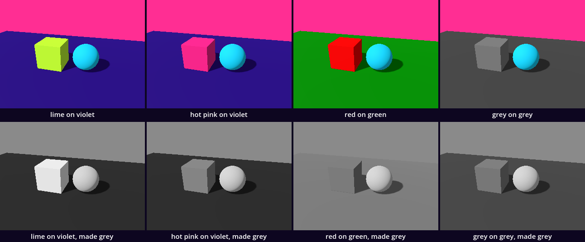
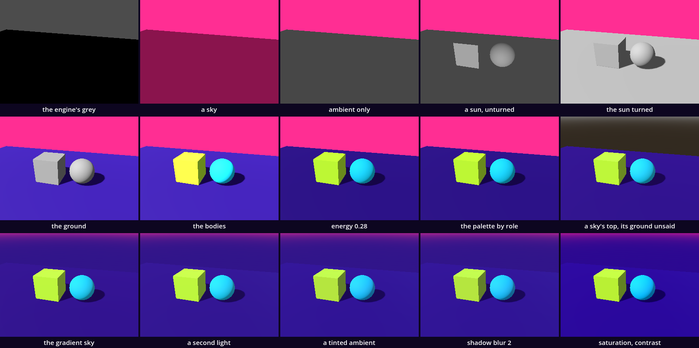

# The look — a sky, a light, a palette

Point One gave a position a surface and then a boundary, and its hall had a switch on the wall that took the sun away. Here we take everything else away as well and put it back one decision at a time: a sky, light with no sun, a sun, a colour for the ground, a colour for each body, and a short list of names. Then we lay a filter over that plain look. We use what Point Zero and Point One gave us: `_ready()`, `.new()`, `add_child()`, a property set with `=`, and `$Name` for a child that is already in the scene. Three words are new: a colour written as `Color("…")`, a material, and `const`.

This is a new project. In the Project Manager choose **Import** and open this folder's `project.godot`.

Every colour and number on this page was read from a still or a run of this study in Godot 4.6, with the Compatibility renderer. A colour is written as the still had it, like `#474747`. Parts marked *(editor)* describe the editor's own windows and were not watched.

## Find the family in the hall

A lesson starts in its hall, with one question: does the hall show one work at several values of one axis?

The hall is [Point_One](../../../../commons/maps/Point_One/final.md). It does, twice, and names neither. Along its corridor stand four works under one label, "Point one": nothing, a white sphere, a white sphere that stops you, and a sphere of 1.3 m on a pedestal. All four are one script, `point_condition.gd`, at four values of its one setting, `condition`. The registry lists them under four names and declares no axis for them.

The fifth work is the switch on the wall. It carries the hall's own sun: one light with a direction, turned 36 degrees down and 32 to the side, and beside it a second, dimmer lamp that has a place and casts no shadow. The switch's whole decision is one line, `sun.visible = false`. So the hall shows a second axis, in time and not side by side: the same spheres with their sun and without it. The reading says what stays: "The spheres remain, faintly lit." We read all of this from the hall's map file, the registry and two scripts; we did not walk it.

So stand at the switch, and before you turn it write down one prediction: with the sun gone, will the white sphere still look round, or flat like a disc of paper? This study turns the same switch on two bodies of our own.

## Open the study

Open `the_look.tscn`: double-click it in the FileSystem dock, at the lower left of the editor *(editor)*. The Scene dock, at the upper left, shows the root `TheLook` and four children: `Floor`, `Box`, `Sphere` and `Camera3D`. The floor is 8 m by 5 m. The box is 0.6 m on every edge and the sphere 0.6 m across. Each has a collider, built as Point One built its solid sphere. The scene file holds no light, no sky and no colour. All of that is in the script on the root, `look.gd`.

The editor's own 3D view shows the bodies white on a white floor, under a pale sky *(editor)*. That light is the editor's preview and is not in the scene. What is in the scene shows when it runs.

Run it (F5). A violet floor that runs back to a pink rim at the top of the window, a lime box and a cyan sphere, each with a shadow. The download holds the finished `look.gd`. We will take it apart and build it again.

## Nothing: the engine's grey

Replace everything in `look.gd` with this:

```gdscript
extends Node3D

func _ready() -> void:
	print("ready, with ", get_child_count(), " children")
```

<!-- state: 0_engine_grey -->

Run it. The Output panel, at the bottom of the editor, reads:

```
ready, with 4 children
```

The window shows two flat areas: grey above, `#4c4c4c`, and black below. The black is the floor. The box and the sphere are in it, black on black.

All four children are there, and nothing lights them. The grey is not a sky. It is the colour Godot clears the window with before it draws, and a project that says nothing gets this one: (0.3, 0.3, 0.3), under **Project > Project Settings > Rendering > Environment** *(editor)*. This project says nothing. So this is where every project starts: a grey that somebody chose for all of us, and black.

## A sky

Replace everything in `look.gd` with this:

```gdscript
extends Node3D

func _ready() -> void:
	var sky := Environment.new()
	sky.background_mode = Environment.BG_COLOR
	sky.background_color = Color("ff2e93")

	var world := WorldEnvironment.new()
	world.environment = sky
	add_child(world)
```

<!-- state: 1_sky -->

Run it. The upper area is hot pink, `#ff2e93`. The lower area changed too, from black to a dark pink, `#8a144d`: the floor and both bodies alike, so the bodies still cannot be seen.

An `Environment` is a list of decisions about everything that is not a body: what is behind the bodies, and what light is everywhere. It is not a node. A `WorldEnvironment` is the node that holds one and puts it to work, as a `MeshInstance3D` held a sphere in Point One.

`Color("ff2e93")` is new. It is a colour written as six digits: two for red, two for green, two for blue. Each pair counts from `00` to `ff`, which is 0 to 255 written with sixteen digits, 0 to 9 and then a to f. `ff2e93` is all the red there is, a little green and a good half of the blue.

`background_mode` says which kind of background we want, and `Environment.BG_COLOR` is the kind that is one plain colour. We ran the script without that line: the sky stayed grey, and Godot said nothing. A colour for a background that is not switched on is kept and not used.

Why did the floor turn pink? We asked for no light. An `Environment` that is told nothing about light takes it from its background: the sky lights the bodies, in the sky's colour. A mesh with no material answers like a mid grey, so floor, box and sphere all give the same dark pink back.

## Light with no sun

Add these three lines under the line `sky.background_color = Color("ff2e93")`:

```gdscript
	sky.ambient_light_source = Environment.AMBIENT_SOURCE_COLOR
	sky.ambient_light_color = Color.WHITE
	sky.ambient_light_energy = 0.25
```

<!-- state: 2_ambient_only -->

Run it. Below the pink there is one grey, `#474747`: floor, box and sphere. There is still nothing to see.

Ambient light is light that comes from everywhere at once. The three lines say where it comes from (a colour we name, and no longer the background), which colour (`Color.WHITE` is a colour Godot has a name for) and how strong. It reaches every face by the same amount, so the top of the box, its front and the floor behind it come out alike. Light with no direction cannot show a shape.

## A sun that lights no floor

Add these lines at the end of `_ready()`, after an empty line:

```gdscript
	var sun := DirectionalLight3D.new()
	add_child(sun)
```

<!-- state: 3_sun_unturned -->

Run it. Something appeared: a pale patch with four corners, and beside it a ball lit from the front. The patch is the front of the box, `#a4a4a4`. But the top of the box is still `#474747`, and so is the floor, the same grey as before there was a sun. The box has a front and nothing else. Nothing casts a shadow. And the Output panel is empty: no error, no warning.

This is the fault this lesson was built around, and it is a silent one. A `DirectionalLight3D` is a sun: light that arrives from one direction, the same everywhere, as if from very far away. Where the node stands does not matter. Which way it is turned is all that matters, and we have not turned it. A new one shines level, straight into the picture, along (0, 0, −1). That light runs along the floor and never lands on it. It slides over the top of the box. It meets only what faces us.

The course's outline expected the scene to stay flat. It does not quite: the faces turned to the camera light up, and everything that faces upward stays exactly as it was.

Reading a silence like this is ordinary work. Ask what was added, what it changed (the faces towards us) and what it did not (every face that looks up).

Add these two lines under the line `var sun := DirectionalLight3D.new()`:

```gdscript
	sun.rotation = Vector3(-0.75, -0.75, 0.0)
	sun.shadow_enabled = true
```

<!-- state: 4_sun_turned -->

Run it. Now there is a room. The floor is `#c3c3c3` and the top of the box the same. Its front is a little darker, `#b6b6b6`. Its right side, turned away from the sun, is still `#474747`. The sphere is round. Each body has a shadow on the floor, to its right and behind it, and the floor inside a shadow is `#474747` too.

`rotation` holds three turns, around x, y and z, counted in radians. One radian is about 57 degrees, so 0.75 is 43 degrees. The first number tips the sun 43 degrees downward. The second swings it to the side, so that its light comes from the upper left, from behind the camera. `shadow_enabled` lets a body stand in its way.

The darkest grey in the picture is the ambient light. A face the sun does not reach, and the floor in a shadow, still get the quarter that everything gets.

One thing here we did not ask for. With the rotation and without the shadow line, the floor in the sun was `#8c8c8c`. With the shadow line it is `#c3c3c3`. In this renderer a sun that casts shadows lights more strongly than the same sun without them. We measured it and do not know why. Two steps on it has a consequence.

## The ground

Add these lines at the end of `_ready()`, after an empty line:

```gdscript
	var ground := StandardMaterial3D.new()
	ground.albedo_color = Color("32188a")
	ground.roughness = 0.8
	$Floor.material_override = ground
```

<!-- state: 5_ground -->

Run it. The floor is violet: `#4727bf` in the sun and `#150547` in the shadows. The bodies are still grey.

A material is new. It says what a surface does with the light that reaches it, and `StandardMaterial3D` is Godot's usual one. `albedo_color` is the colour the surface gives back under plain white light. `roughness` runs from 0, polished, to 1, matt. `$Floor` is the child named `Floor`, as `$Greeting` was in Point Zero, and `material_override` puts the material on it.

Neither colour on the screen is `32188a`. In the sun the floor is lighter than what we wrote, in a shadow darker. A material is not a colour on the screen. It is half of one, and the light is the other half.

## The bodies, and a sun that is too strong

Add these lines at the end of `_ready()`, after an empty line:

```gdscript
	var lime := StandardMaterial3D.new()
	lime.albedo_color = Color("c6ff3d")
	lime.roughness = 0.8
	$Box.material_override = lime

	var cyan := StandardMaterial3D.new()
	cyan.albedo_color = Color("22d9ff")
	cyan.roughness = 0.8
	$Sphere.material_override = cyan
```

<!-- state: 6_bodies -->

Run it. The sphere is cyan. The box is yellow: its top is `#ffff58`. We wrote `c6ff3d`, an acid lime.

The sun is too strong. The lime gives back all the green it gets, and no screen shows more than `ff`. More light can only raise the red, from `c6` to `ff`, and full red with full green is yellow. Light did not only make the colour brighter. Past the top of a channel it changed which colour it is.

Add this line under the line `sun.shadow_enabled = true`:

```gdscript
	sun.light_energy = 0.28
```

<!-- state: 7_energy -->

Run it. The top of the box is `#cbff39`. That is 6.1 away from `c6ff3d`, taken as one distance through red, green and blue, each out of 255. The floor in the sun is `#2d1388`, 7.3 from `32188a`.

0.28 is not a guess, and it is not ours. Whoever built the base of these kits measured it: with a quarter of the light coming from everywhere, a face turned up to this sun shows the colour that was written. The other faces do not. The front of the box is `#bdf734`. The side the sun does not reach is `#69891c`, 153.8 away from the lime we wrote.

## The palette: names for roles

The script works, and it has a problem waiting in it. One variable is named `lime`. If we decide tomorrow that the made body is orange, `lime` will hold an orange. So we move every colour to the top and name each for what it does, not for how it looks.

Replace everything in `look.gd` with this:

```gdscript
extends Node3D

# The palette: one name for each role. A body asks for a role, not for a colour.
const SKY := Color("ff2e93")      # hot pink: the background
const GROUND := Color("32188a")   # violet: the floor
const BODY := Color("c6ff3d")     # acid lime: the made body
const SECOND := Color("22d9ff")   # cyan: a second body
const THIRD := Color("ff8b1f")    # orange: a third
const BONE := Color("f4efe6")     # off-white: a fourth; the marble
const LINE := Color("ffffff")     # white: traces and segments
const GHOST := Color("9b7bff")    # lavender: what has no collider
const INK := Color("ffffff")      # white: text
const SHADE := Color("0d0620")    # near black: what text stands on

func _ready() -> void:
	var sky := Environment.new()
	sky.background_mode = Environment.BG_COLOR
	sky.background_color = SKY
	sky.ambient_light_source = Environment.AMBIENT_SOURCE_COLOR
	sky.ambient_light_color = Color.WHITE
	sky.ambient_light_energy = 0.25

	var world := WorldEnvironment.new()
	world.environment = sky
	add_child(world)

	var sun := DirectionalLight3D.new()
	sun.rotation = Vector3(-0.75, -0.75, 0.0)
	sun.shadow_enabled = true
	sun.light_energy = 0.28
	add_child(sun)

	var ground_paint := StandardMaterial3D.new()
	ground_paint.albedo_color = GROUND
	ground_paint.roughness = 0.8
	$Floor.material_override = ground_paint

	var body_paint := StandardMaterial3D.new()
	body_paint.albedo_color = BODY
	body_paint.roughness = 0.8
	$Box.material_override = body_paint

	var second_paint := StandardMaterial3D.new()
	second_paint.albedo_color = SECOND
	second_paint.roughness = 0.8
	$Sphere.material_override = second_paint
```

<!-- state: 8_palette -->

Run it. Nothing changed: the still is the same as the one before, to the pixel. What changed is who the script asks.

`const` is new. It gives a name to a value that does not change while the scene runs. It is written above the functions, and by habit in capitals. `SKY` is a role, and `ff2e93` is the colour that has the role today. The box no longer asks for lime. It asks for `BODY`, and its material is `body_paint`, which will stay a true name whatever `BODY` becomes.

Six of the ten names are not used in this scene. They are the rest of the course's palette, and every later kit uses them: a third body is `THIRD`, a line is `LINE`, a thing with no collider is `GHOST`, a letter is `INK` on `SHADE`. This is the plain look.

## The hall's switch

Add this line under the line `add_child(sun)`:

```gdscript
	sun.visible = false
```

Run it. The shadows are gone and the floor is `#150547` everywhere. The box is one flat shape: its top, its front and its side are all `#69891c`. The sphere is a disc, `#0c7489` from edge to edge. This is the line in the hall's switch, on our bodies. Compare it with what you predicted at the wall. As far as its files say, the hall's spheres keep a lit side, because their second lamp has a place. Ours have only the light from everywhere, and they lost their roundness with their shadows.

Take out the line `sun.visible = false`.

## A sky with a top and a horizon

Now a filter goes over the plain look, starting with the sky.

Add these lines under the line that begins `const SHADE`, after an empty line:

```gdscript
# The filter: colours for the sky and the light, not for bodies.
const SKY_TOP := Color("5a1fd6")        # violet: the top of the sky; SKY is its horizon
const AMBIENT_TINT := Color("e2d9ff")   # faintly lavender: the light from everywhere
const FILL := Color("5fe0ff")           # pale cyan: the second light
```

Then replace the line `sky.background_mode = Environment.BG_COLOR` with these:

```gdscript
	var gradient := ProceduralSkyMaterial.new()
	gradient.sky_top_color = SKY_TOP
	gradient.sky_horizon_color = SKY
	sky.sky = Sky.new()
	sky.sky.sky_material = gradient
	sky.background_mode = Environment.BG_SKY
```

<!-- state: 9_sky_ground_unsaid -->

Run it. The pink is gone, and no violet came. Above the floor the picture is a dark brown, `#332920`, under a grey rim. We wrote neither colour.

A `ProceduralSkyMaterial` paints a ball around the whole scene: the half above the horizon from a top colour and a horizon colour, the half below from two more. A `Sky` holds the material, the `Environment` keeps the `Sky` in a property also called `sky`, and `BG_SKY` switches it on. We named the upper half. But our camera looks down, and the top of its picture is one degree under the horizon: all it shows above the floor is the ground beyond the floor. Nobody said what colour that is, so Godot's own came, a brown `332b22` under a grey. It is the first run again: a default is somebody's decision, and it arrives in silence.

Add these lines under the line `gradient.sky_horizon_color = SKY`:

```gdscript
	gradient.sky_curve = 0.25
	gradient.ground_horizon_color = SKY
	gradient.ground_bottom_color = GROUND
	gradient.sun_angle_max = 0.0
	gradient.sun_curve = 0.0
```

<!-- state: 10_gradient_sky -->

Run it. Above the floor the picture is violet, `#32148b`, and the floor in the sun is `#331490`: the floor's far edge has all but gone, and the ground runs on to a pink rim at the top of the window. The sky itself is above this camera; you look up at it in *Walk it*.

The ground now asks the palette for two roles, `SKY` at its horizon and `GROUND` below. `sky_curve` says how soon the horizon's colour gives way to the top's: a level camera of ours read the sky 20 degrees up as `#9723bd`, and as `#7920c9` at 0.15, the value a new sky has. The last two lines take away what this sky draws unasked: a disc for every light that has a direction. Our sun's was a grey smudge in the violet, `#474747`.

Two lines change no pixel, `gradient.sun_curve = 0.0` and the old `sky.background_color = SKY`: we ran the script without each. They are in the base's look, so they are in ours. And the top of the box went from `#cbff39` to `#ccff4e`, bluer: even a matt surface mirrors a little of the sky.

## A second light

Add these lines under the line `add_child(sun)`, after an empty line:

```gdscript
	var fill := DirectionalLight3D.new()
	fill.rotation = Vector3(-0.5, 2.4, 0.0)
	fill.light_color = FILL
	fill.light_energy = 0.05
	add_child(fill)
```

<!-- state: 11_second_light -->

Run it. You will not find the difference by eye: no pixel moved by more than 25 of 765, the threshold of every sheet. The side of the box that the sun does not reach went from `#6b8927` to `#6c8f2a`.

It is a second sun, turned so that its light comes from behind the bodies, on the right: pale cyan, weak, 0.05 against the sun's 0.28, its shadows off.

Its work shows when the sun is gone. With the switch's line back in for one run, the top and the side of the box rose from `#6a8930` and `#6b8927` to `#6b8e32` and `#6c8f2a`, and the front stayed `#6a8925`: this light does not reach it. It is the hall's second lamp, and it gives the box its edges back by five or six levels of 255.

Now the light from everywhere. Replace the two lines that begin `sky.ambient_light_color` and `sky.ambient_light_energy` with these:

```gdscript
	sky.ambient_light_color = AMBIENT_TINT
	sky.ambient_light_energy = 0.27
```

<!-- state: 12_tinted_ambient -->

Run it. The front of the box went from `#bef73e` to `#b5e63f`, the shaded side of the sphere from `#13748b` to `#126590`. The tint has all of its blue, 89% of its red and 85% of its green, so it is not even-handed: every shaded face lost some green and gained a little blue.

## A softer shadow, which this renderer does not draw

Add this line under the line `sun.light_energy = 0.28`:

```gdscript
	sun.shadow_blur = 2.0
```

<!-- state: 13_shadow_blur -->

Run it. Nothing changed: the still is the one before it, to the pixel.

`shadow_blur` is meant to soften a shadow's edge, and the base's look sets it to 2. We ran 0, 1, 2, 6 and 20: five stills with not one byte between them, the edge of the sphere's shadow 8 pixels wide in each. Under Forward+, another of Godot's renderers, the same five gave an edge of 4 pixels at 0, 20 at 2 and 134 at 20. So the property is real, and the Compatibility renderer does not draw it: one more silence. The line stays, so that our look says what the base's says.

## Saturation and contrast

Add these lines under the line `sky.ambient_light_energy = 0.27`:

```gdscript
	sky.adjustment_enabled = true
	sky.adjustment_saturation = 1.08
	sky.adjustment_contrast = 1.04
```

<!-- state: 14_saturation_contrast -->

Run it. Every colour is a little stronger: the floor in the sun went from `#311496` to `#2b089d`, the top of the box from `#c4fd50` to `#c8ff46`.

An adjustment is made after the picture is drawn, on every pixel alike. Saturation moves a pixel away from the grey of its own lightness, contrast away from middle grey; at 1 each does nothing.

This is the `look.gd` in the download, 71 lines. Its filter is most of what this renderer has for one. The rest was tried here and left out:

- **Fog**, as it comes, laid Godot's own grey blue, `848d9b`, over what is far: the ground beyond the floor went `#838e9d`, and the top of the box went from 9.6 to 16.3 away from `BODY`.
- **Glow**, as it comes, moved no channel by more than 2 of 255. With `glow_bloom = 0.5` it lifted every colour, shadows too: the top was 20.7 away.
- **The other tonemaps.** A tonemap turns the light the renderer counted into the numbers of a screen; ours, the linear one, leaves them as they are. Reinhard gave the same still, to the byte. Filmic made the top of the box `#e6ff63`, ACES `#f4ff9a`, AgX `#bacd6d`: two pale yellows and a dull olive.

Try one. Add this line under the line `sky.adjustment_contrast = 1.04`:

```gdscript
	sky.tonemap_mode = Environment.TONE_MAPPER_FILMIC
```

Run it and look at the box. Take out the line `sky.tonemap_mode = Environment.TONE_MAPPER_FILMIC`.

## What every later kit does

Open `supplied/look.gd` and read it. Do not change it. Its first ten `const` lines are yours, and under `# The filter` are your three names and six values you wrote where they are used. Further down is this. It is a reading, not a block to type:

```gdscript
static func paint(color: Color) -> StandardMaterial3D:
	var material := StandardMaterial3D.new()
	material.albedo_color = color
	material.roughness = 0.8
	material.metallic = 0.0
	return material
```

`paint` is a function somebody wrote, as we wrote `_ready`. It holds the three lines we typed three times, and `return` hands the finished material to whoever asked. `environment()`, `sun()` and `fill()` hold our lines for the sky and the two lights, and one more, `ground_curve`, at the value a new sky has; the blur is set in `supplied/base_look.gd`. From the next kit on, a script begins with `const Look := preload("res://supplied/look.gd")` and paints a body in one line: `body.material_override = Look.paint(Look.BODY)`.

We ran this scene dressed by that file in place of ours. The still is ours, pixel for pixel.

So the look every later kit opens in is these 71 lines. They are decisions. The engine's nature was the first run, a grey and black, and it spoke twice more unasked: a brown ground, a grey-blue fog.

## The plain studio

`studio_environment()`, in the same file, is our sky as it stood at the palette step. Every sheet of the course is photographed there, with no second light. We ran the palette step against it: the same still, pixel for pixel.

The reason is the filter. With not one body moved it changed 91.68% of the picture, and a measurement should be of the body. So a running scene wears the filter and a sheet does not. Under the filter the grey box was seen whole, where the plain look loses its shaded side (81.18% seen): the number would have been about the filter.

## The argument: which pair?

The axis of this lesson is the pair: a body's colour on the ground's colour. With the palette, one value of the axis is two lines.

| pair | `BODY` | `GROUND` |
| --- | --- | --- |
| lime on violet, the course's pair | `c6ff3d` | `32188a` |
| hot pink on violet | `ff2e93` | `32188a` |
| red on green | `ff0000` | `009400` |
| grey on grey | `808080` | `4d4d4d` |

The green was chosen to be as light as the red: their luminance is 0.2118 and 0.2126, where white is 1. Luminance is the measure of lightness used here: a sum of the red, green and blue light in which green counts most (0.7152), red less (0.2126) and blue least (0.0722). The last pair is a mid grey on Godot's own background grey.

To see a pair, replace the two lines that begin `const GROUND` and `const BODY` with these:

```gdscript
const GROUND := Color("009400")   # a green as light as the red
const BODY := Color("ff0000")     # a red
```

Run it. A red box on a green floor. The sphere stayed cyan: it asks for `SECOND`. The ground beyond the floor went green: the sky asks for `GROUND`. Try the other pairs the same way. Then replace the two lines that begin `const GROUND` and `const BODY` with the course's pair again:

```gdscript
const GROUND := Color("32188a")   # violet: the floor
const BODY := Color("c6ff3d")     # acid lime: the made body
```

**Write your prediction before you render.** Suppose each still is turned to grey: every pixel keeps its lightness and loses its colour. Which of the four boxes will be hardest to find? And which pair is farthest apart in colour? Write both down, with a reason.

The course's outline made its own: red on green differs most in hue and least in grey; grey on grey is the lowest in both.



`sheet.gd` makes each pair the way you just did, by writing the two lines again, but in the plain look, and photographs it. It needs a terminal; the [README](README.md) has the command, and you can go on without it. For each pair it finds the box's pixels, takes a second still with the box away, and counts how far each of the box's pixels is from the bare ground: the three channels added, out of 765. Then it turns both stills to grey and counts again. The box covers 6.33% of the still.

| pair | hues apart | box from ground, as rendered | made grey | of the box, still seen in grey |
| --- | --- | --- | --- | --- |
| lime on violet | 176.1° | 428.1 | 490.2 | 100% |
| hot pink on violet | 77.3° | 212.8 | 222.8 | 100% |
| red on green | 120.0° | 362.6 | 41.4 | 19.06% |
| grey on grey | none | 121.0 | 121.0 | 81.18% |

A pixel counts as seen when it is more than 25 of 765 from the ground, the threshold of every kit's sheet.

The red box is the one that goes. In grey its top is level 128 and the floor beside it 125; its front is 123. What is left of it, 19.06%, is the side the sun does not reach, at 65. Its shadow on the floor is left too. The grey box loses a face too, and loses it in colour already: its unlit side is `#424242` against a floor of `#484848`.

So the outline's prediction held in part. Red on green is the least in grey: true, 41.4 against 121.0 for the next. It differs most in hue: false. The course's own pair is 176.1 degrees apart, nearly opposite on the colour circle, and red and green are 120. Grey on grey is the lowest as rendered, 121.0, but not in grey, where it is third of four.

The claim, as measured: a pair that differs in lightness is still there when the colour is taken away, and a pair that differs only in hue is not. On the screen the hue-only pair is far apart, 362.6, farther than hot pink on violet. In grey it is the nearest to nothing. The course's pair is first both ways: `BODY` has 26.5 times the luminance of `GROUND`.

No eye was asked. The grey still is arithmetic.

**Decide.** One difference here could be followed. A fifth of the red box survived the grey, and it is the part in the box's own shade: the light gave the pair a difference in lightness that the palette did not have. The next intervention would be to take the sun away on that pair, with the switch's line, and make the still grey again. Or settle: you know which pair reads and why, and that is enough to dress a room. Either is right. Write your decision and its reason in your [field note](FIELD_NOTE.md); ours is there as an example of the form, not of the answer.

## What the look owes

The grey of the first run is a decision somebody made. It reads as neutral only because it is everywhere, in every new project and every first screenshot. The course's outline calls what arrives when nobody decides *the default body*. Our pink is no more natural. It is only said out loud, in line 4 of a script you can read.

A palette chosen for contrast also decides who can read it. The outline gives the figure: about one man in twelve does not tell red from green by hue. Our grey still is not that eye. It removes every hue at once, which no eye does, and we tested no eye. But it shows which way the risk runs: red on green, 362.6 apart on our screen, kept 41.4. Lime on violet kept everything.

And the light changes the colour. `BODY` is `c6ff3d` in the script. In the plain look it is `#cbff39` on the face turned to the sun, 6.1 away; `#bdf734` on the front, 15.0 away; and `#69891c` on the side in shade, 153.8 away. With the sun switched off every face is 153.8 away. With the sun at energy 1 the box was yellow. Under the filter, which is what a running scene shows, the top is 9.6 away and the side 162.2. The palette names what a body is given, never what an eye gets. And the number that holds it together, 0.28, compensates for a behaviour of this renderer that we measured and could not explain.

## Walk it

Open `place.tscn` and run it with F6, **Run Current Scene**, the button beside Play at the top right of the editor *(editor)*. It is supplied: your scene, dressed by your `look.gd`, with a walker and a marble in it. Its script, `place.gd`, has one `if` in it, a word the course brings soon.

A cyan capsule stands to the left of the box. That is the walker, a second body, so it is `SECOND`. Press M. The marble falls from above the walker's head, one metre in front of it, lands on the box and stays: it rests at 0.70 m. Press C and you look through the walker's eyes, 1.6 m up. W, A, S and D walk. Hold V, or the right mouse button, and move the mouse to look. Look up: the sky the scene's camera never showed is `#f81e94` at the horizon, `#9a15c5` 20 degrees up and `#570fe2` overhead.

Walk once round the two bodies. Walk at the box: it stops you, your middle 0.30 m from its face. Then go behind the bodies, to the side the shadows point to, and look back at them. The two walls of the box that face you are `#628320` and `#628221`, one level of 255 apart, and the edge between them is all but gone. Only its top is sunlit, `#c8ff55`. The sphere's near side is flat, `#0b6ea0`. From the shadow side a body shows you what the light from everywhere gives it, and the little the second light adds. It is nearly the switch's picture, and you did not touch the switch.

Now stand where the box's shadow falls, close behind its right corner. The box is between your feet and the sun. It is not between your knees and the sun: where a walker can stand, the shadow of a box 0.6 m high does not reach its knees. A marble dropped there lies wholly in it. Seen from above it is `#7a7489`. The same marble in the sun is `#ddd6e4`. `BONE` is `f4efe6`; the filter made it a little lavender.

How this was run: the walker's autopilot walked, and a script pressed the keys. The walk round ended "arrived", the walk at the box "blocked". No hand was on a keyboard and no headset was used.

## The process

A body made by more than one operation has a recipe. Ours, one still after each step, from one camera:

the engine's grey → a sky → ambient only → a sun, unturned → the sun turned → the ground → the bodies → energy 0.28 → the palette by role → a sky's top, its ground unsaid → the gradient sky → a second light → a tinted ambient → shadow blur 2 → saturation, contrast



These tiles are stills of the scene as it runs, not of the plain studio, because the steps change the scene's own sky and light.

The first sky changed the picture most: every pixel of the tile, 100%, because it coloured the background and, unasked, lit the bodies. The unturned sun changed 7.04% and the turned one 63.64%. The palette changed 0.00%: the script changed and the picture did not. Of the filter, saturation and contrast changed most, 40.69%; each sky step 33.21%, all of it above the floor; the second light and the shadow blur 0.00%.

## In your room

The room is a project of its own, `my-room`, and it is yours. Import its `project.godot` once.

First the guest. This kit hands the room the pair of bodies in the course's look. Copy the folder `guests/the-look/` from this project into the room's `guests/` folder: the whole folder, not renamed. In the room's `room.gd`, the list near the top becomes:

```gdscript
const GUESTS: Array[String] = [
	"res://guests/example/example.tscn",
	"res://guests/the-look/the-look.tscn",
]
```

Run the room. The Output panel reads:

```
My room: place 1 is res://guests/example/example.tscn
My room: place 2 is res://guests/the-look/the-look.tscn
```

Walk to place 2. We ran the room's own trial on it in a copy of the room: the walker reached the aisle, walked at the guest and was stopped by it, 0.54 m from the middle of the place.

Then the room's own look. The room has a file `room_look.gd`. It begins as a copy of the supplied look, filter and all. Change two roles, and say why. Ours: in `room_look.gd`, replace the two lines that begin `const SKY` and `const SHADE` with these:

```gdscript
const SKY := Color("0d0620")      # near black: a night sky
const SHADE := Color("ff2e93")    # hot pink: the squares of the places
```

Our reason: the dark squares that mark the places were hard to find. `SHADE` on `GROUND` is 1.54 to 1, counted from the two luminances as (L1 + 0.05) / (L2 + 0.05). The pink on `GROUND` is 3.71 to 1. And a pink horizon over pink squares would have used one colour for two roles, so the horizon took the old `SHADE`.

We ran it in a copy of the room. The sky read back `#0d0620` at the horizon under `#5a1fd6` overhead: a night. The squares read back `#ff2e93`. Two things followed that we had not planned. The numbers on the floor have an edge in `SHADE`, so their edges turned pink: a role is used in more places than the one you were thinking of. And a guest now stands on pink: `BODY` on the old `SHADE` was 16.7 to 1, and on the pink it is 2.93 to 1. The squares read better and the guests read worse. A contrast is paid for somewhere.

Write in your field note which two roles you changed, and why.

## What we borrowed

| Part | From | How far we go |
| --- | --- | --- |
| `the_look.tscn`: a floor, a box, a sphere, a camera | Supplied here | Use: the bodies and their colliders are in the scene; `look.gd` dresses them. |
| `Environment`, `WorldEnvironment`, `Sky`, `ProceduralSkyMaterial` | Godot | Use: a background, flat or a sky with a ground under it; the `ambient_light_` and `adjustment_` properties. |
| `DirectionalLight3D` | Godot | Use: `rotation`, `shadow_enabled`, `light_energy`, `light_color`, `visible`; `shadow_blur`, which this renderer does not draw. |
| `StandardMaterial3D` | Godot | Use: `albedo_color` and `roughness`; `material_override` puts it on a mesh. |
| `Color("…")`, `Color.WHITE` | Godot | Use: a colour from six digits; a colour with a name. |
| `supplied/look.gd` | The kit base | Understand: read beside our own; from the next kit on, use. |
| `place.tscn`, `place.gd`, the walker and the marble | Supplied here; the kit base | Use: our scene with a body that has eyes and a ball that rests on colliders; M drops the ball. |
| `sheet.gd` | Supplied here | Use: it makes the four pairs, the grey stills and the process strip. |

What we made is `look.gd`: thirteen names, a sky with its light and its adjustment, a sun, a second light, and three materials that ask for a role.

## What we carry forward

We leave with a background that has to be switched on; with ambient light, which shows no shape; with a sun, which has a direction and no place; with a material as half of a colour; with `Color("…")` and `const`; with a palette of roles, so that a body asks for `BODY`; and with a filter, which changes every pixel and is kept out of a measurement. And with one measure for any pair of colours: turn it grey and see what is left.

From here on every kit opens in this look, with its filter over it, and you know what both are made of.
