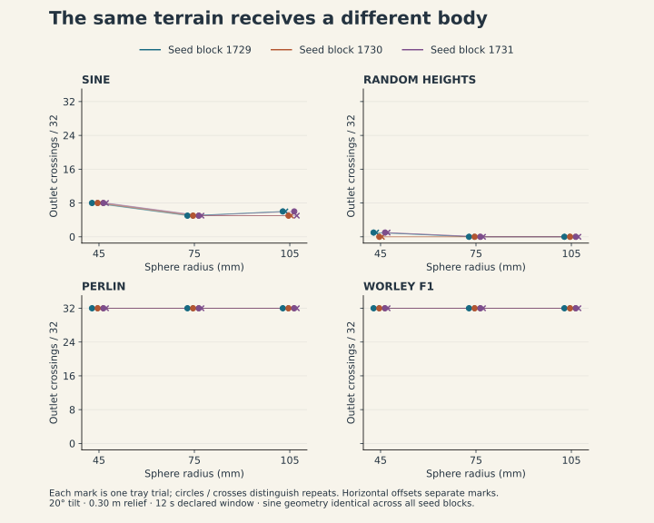
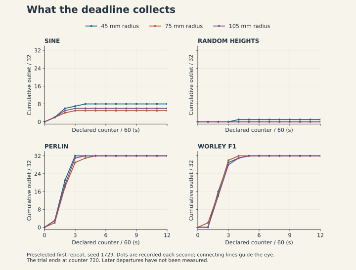

# What leaves? What remains?

*Procedural landscapes and possible bodies — a working article from Ada Research, 12 September 2026.*

Before pressing RELEASE, choose a sphere to follow. Thirty-two arrive on each of four inclined surfaces. Some move towards the open end. Some find a hollow. Others meet another body before they reach the place you expected them to go. A counter records departures. At twelve seconds, the apparatus freezes.

Look back at the bodies still on the surface. We have called them **STILL IN**. The display leaves their future open. They might depart under a longer observation window, a different tilt, another contact. We stopped the experiment in order to read it.

This is where Ada Research's question, *what bodies are possible?*, becomes a practical investigation. A body has a radius, mass, contact surface and starting position. A landscape has sampled heights, edges and an orientation under gravity. Their encounter produces movement that neither a picture of the surface nor the name of its generator tells us completely in advance.

<figure><figcaption>Figure 1. The recorded 75 mm radius trial, seed 1729, first repeat. Back left: sine; back right: independent random heights. Front left: Perlin; front right: Worley F1. The neat rows below the trays are collection displays: exited spheres are repositioned there and removed from further collisions.</figcaption></figure>

The experiment returns to an earlier piece of work. Palle Torsson's [2021 project report](https://docs.google.com/document/d/1zMi54Mc2R5KfXsQ6iwol781FJSXEPtwST1ZyJNGTtEE/edit) describes four Blender landscapes imported into Unity, inclined twenty degrees and given 3,600 spheres each. The reported overflow counts were Voronoi 0, Perlin 45, Random 635 and Sine 3,284. The report does not supply an observation duration or a complete record of mesh, release and physics settings. Those numbers preserve an encounter whose conditions we cannot fully reconstruct from the text.

The accompanying [presentation draft](https://docs.google.com/document/d/1-ezkt4cZ9ZAKsr7Ufwxu8_sML9lSkGE1ba4ow-BmQFA/edit) approaches noise through compression, recognition and the possibility of disappearing. The new apparatus carries those questions into a smaller, explicitly recorded experiment. Its four trays are new constructions. Historical counts and current counts belong to different setups; their disagreement prompts us to inspect how each world was made.

Start with the surface called RANDOM HEIGHTS. At every vertex, the program samples an independent value. It then joins neighbouring vertices with triangles. Between those samples there is already an interpretation: a flat triangle tells the physics engine where contact can happen. The jagged surface is finite, continuous across joined edges, and built at a particular resolution. There is no untouched randomness underneath that a sufficiently faithful image could finally reveal.

For the sine tray, the rule is compact. This excerpt is the expression used before height normalisation:

```gdscript
v = sin(TAU * 0.9 * x) * sin(TAU * 0.9 * z)
```

One rhythm crosses another. The program samples their product on the same grid as the random values. PERLIN selects the Perlin noise basis; WORLEY F1 selects Euclidean distance to the nearest cellular feature. Each sampled field is independently rescaled to a height range of 0.30 metres. Equal relief gives us one shared condition. Slopes, wavelengths and hollows remain different.

The size series asks a narrow question: **what changes when the same surface receives a larger body?** We used radii of 45, 75 and 105 millimetres, three selected seeds, and two runs of each combination. Every trial released 32 spheres per tray at matching local coordinates. Tilt stayed at twenty degrees. The observation counter ran to 720 at sixty physics ticks per second. Mass stayed at 0.1 kilograms, so this comparison changes size while keeping mass fixed; it does not represent enlarging a substance at constant density.

Eighteen trials produced 72 tray observations. The spheres could collide with one another, so the 2,304 releases do not constitute 2,304 independent experiments. Seeds 1729, 1730 and 1731 are three chosen settings, not a representative sample of every possible landscape. The sine expression ignores seed: all its runs use one underlying surface.

<figure><figcaption>Figure 2. Every tray observation is shown. Lines connect size comparisons within the same seed block and repeat; horizontal offsets separate coincident marks. The y-axis is shared across all four plots. Sine uses identical geometry across the three seed blocks.</figcaption></figure>

<!-- SIZE_RESULTS_TABLE -->

*Table 1. Observed outlet counts out of 32 at the declared twelve-second deadline. Ranges cover six observations at each radius. No other exits were recorded. Full counts and paired comparisons are available below.*

Eight small spheres left the sine tray in every run. At the middle radius, five left. At the largest radius, five or six left. On the random surface, at most one small sphere departed; no middle or large sphere did. Perlin and Worley each released all 32 at every tested size. That ceiling leaves this final count unable to distinguish their movements. Earlier counts, paths and contact histories can still differ.

The results resist turning the generator names into fixed characters. Perlin is not granted an enduring property called passage by these eighteen trials. In this apparatus, at this relief, tilt and deadline, all its spheres crossed the outlet. Increasing relief or changing the release would ask another question. A surface that looks like an obstacle may offer a route to this body; a regular rhythm may retain it.

One small discrepancy remains particularly useful. In the seed-1731 block, the largest spheres produced six sine departures in the first repeat and five in the second. The stored height arrays and initial centres match exactly. Thirty-five of the 36 paired tray repetitions gave the same final counts; this one did not. We have not isolated the cause of the difference. It prevents us from substituting reproducible geometry for a guarantee about the entire simulated event.

<figure><figcaption>Figure 3. The counter thickens the observation. These are the three runs selected for figures before collecting results: first repeat, seed 1729, all sizes. Each dot is a recorded second. Connecting lines guide reading between observations; they do not supply unrecorded trajectories.</figcaption></figure>

The outlet itself deserves a look. A sphere counts as out after its centre passes the downstream edge by more than its radius. Once classified, it stops participating and moves to the collection display. At the deadline, every remaining body freezes. These choices make the result readable and also participate in producing it. The clock is part of the experiment's definition of an outcome. It gives us time to compare while leaving later movement unobserved.

Now change the purpose of the tray without changing its mesh. Suppose the task was to retain material rather than convey it. The same count acquires another value. A further task might concern concealment, but remaining in a hollow does not yet mean being hidden. We would need an observer, a target, their heights and a test of sightlines. Shelter would require further conditions still. The apparatus helps us notice how quickly an outcome becomes a judgement, and how much work a different judgement asks us to do.

The queer argument begins here, in making the criterion available for revision. A route, a bodily dimension or a desired speed can become the unmarked expectation against which everything else appears deficient. Giving those expectations controls makes alternatives examinable. No sphere has to impersonate a marginalised person for this method to matter. The experiment concerns how we build conditions of access and how we learn to recognise possibilities our first task did not ask for.

The word *topology* needs the same care. These four heightfields share the connectivity of a rectangular triangulated sheet. Changing their elevations does not, by itself, cut holes or join disconnected components. What we have observed is a change in passage through differently shaped terrain under particular body and physics settings. A body's accessible configurations may have a different connectivity, but we have not mapped that space. The trays give the larger question somewhere precise to begin.

Deleuze and Guattari's smooth and striated spaces offer a related way to think about how movement and measurement organise a space. Their distinction involves local directions, trajectories, coordinates and ways of occupying a milieu; it is not a classification of surfaces by visible roughness. They also insist that smooth spaces are not inherently liberating. That keeps the political question attached to a use and a situation. [*A Thousand Plateaus*, “1440: The Smooth and the Striated,” especially pp. 478–479 and 500](https://files.libcom.org/files/A%20Thousand%20Plateaus.pdf).

For Ada Research, entropy and the fold remain questions to develop alongside these encounters. This series measures departures and presence at a deadline. It has no defined entropy estimator, no measurement of free energy, and no numerical threshold for freedom. Calling the retained bodies a remainder directs attention back to them; it does not explain their condition in advance. The next task is to find what that attention lets us notice and test.

The same question can return later in the machine-learning rooms: **where does downhill take us?** In the existing loss-function exhibit, horizontal coordinates are a line model's slope and intercept; height represents an assigned error. Change the loss and an unusual data point weighs differently in the fit. A parameter update follows the local gradient of that objective. The spheres here have inertia and contacts, so their descent and the parameter update obey different rules. The shared question concerns how a definition of better organises a possible movement. Lower training error also does not by itself settle performance on unseen data. [Goodfellow, Bengio and Courville, *Deep Learning*, chapter 8](https://www.deeplearningbook.org/contents/optimization.html).

This gives the museum a recurring encounter. First make a surface. Then give it a body. Change a condition and follow what happens. In the next hall, bring back the question with a new capability: a periodic field, a sampled random field, coherent noise, a walking body, an observer, a loss function. Each return should carry something learned and introduce something the earlier apparatus could not answer.

The contribution of artistic research lies here in composing a situation whose behaviour can alter the argument. Arrangement, colour, scale, collision and timing become ways of thinking that another person can inspect and disturb. The book can follow the same movement: offer a prediction, let an event interrupt it, read the code, and return to the bodies the prediction overlooked. Its claims must remain answerable to the apparatus, including the small mismatch in the repeat.

At twelve seconds, a sphere remains on the sine surface. The counter has finished its work. Our explanation has not.

<details class="evidence"><summary>Read the method, individual trials and source record</summary>

<!-- SIZE_METHOD -->

</details>

[Return to the workshop and seven-hall research thread](landscape-thread.html) · [Read the article as Markdown](landscape-article.md)
